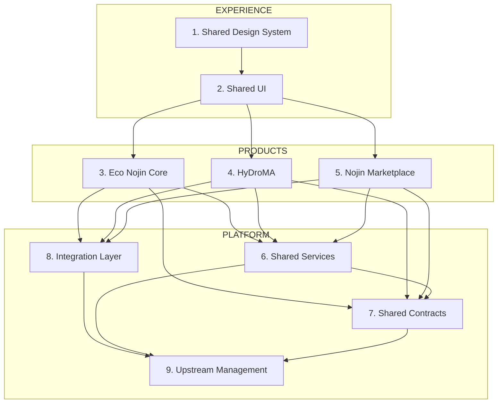

# ECO NOJIN — ECOSYSTEM ARCHITECTURE (ROOT-LEVEL BOUNDARY DEFINITION)

**Document ID:** ECO-NOJIN-ECOSYSTEM-ARCHITECTURE
**Version:** 1.0 (DESIGN — NOT APPROVED)
**Date:** 2026-11-18
**Status:** Root-level boundary definition. No code, no build, no deploy, no repository, no DB.
**Language:** English (technical). Companion documents are Persian where noted.
**Authority:** This document does **not** overwrite or replace any existing architecture file. It sits *above* them and defines the seams between the nine subsystems the owner asked to separate. Where it conflicts with a source document, the source document governs and the conflict is recorded (see §9).

**Status vocabulary used throughout (normative):**

| Label | Meaning |
|---|---|
| `DESIGNED` | Specified on paper; no code exists |
| `IMPLEMENTED` | Code exists and runs |
| `UNIT_TESTED` | Automated unit tests exist and pass |
| `INTEGRATION_TESTED` | Two or more components exercised together |
| `VALIDATED` | Independently checked against a reference / domain authority |
| `OWNER_APPROVED` | Owner has signed off |

A capability is never reported at a higher label than the evidence supports.

---

## 1. Purpose and Scope

This document answers one question the existing documents answer only in fragments:

> When Eco Nojin is built, **what are the top-level parts, and where exactly are the lines between them?**

The existing corpus decomposes the system by *layer* (14 layers, `ECO-NOJIN-MASTER-ARCHITECTURE-V2.md`) and by *bounded context* (19 executable + 5 scientific sub-domains, `architecture/executable-v1/ECO-NOJIN-EXECUTABLE-ARCHITECTURE.md`). Neither view names the **nine ownership boundaries** that decide which team owns a change, which deployable it ships in, and which upstream project may be touched. That is the gap this document fills.

### 1.1 Sources of truth (read, not modified)

| Source | Role here |
|---|---|
| `architecture/ECO-NOJIN-MASTER-ARCHITECTURE-V2.md` | 14-layer macro architecture, principles, phases |
| `architecture/executable-v1/ECO-NOJIN-EXECUTABLE-ARCHITECTURE.md` | 19 bounded contexts, module execution map |
| `architecture/executable-v1/MODULE-EXECUTION-MAP.csv` | Per-module dependency and deploy metadata |
| `architecture/HYDROMA-SCIENTIFIC-ENGINE-ARCHITECTURE.md` | Scientific engine internals |
| `architecture/ECO-NOJIN-SECURITY-AND-INFRASTRUCTURE.md` | Security and deployment scenarios |
| `architecture/ECO-NOJIN-DATA-DOMAIN-MODEL.md` | Data ownership |
| `upstream-registry/FINAL-UPSTREAM-REGISTRY.md` | 54 extracted upstream projects |
| `upstream-registry/FINAL-UPSTREAM-CAPABILITY-MATRIX.csv` | Upstream capability/license scoring |
| `brand/eco-nojin-visual-identity-v3/` (37 standards docs) | Frontend/design standards and decision register |
| `experiments/geospatial-poc/geo-measure/` | Only implemented + unit-tested asset today |

### 1.2 Non-negotiable constraints inherited from the owner

1. Do not modify `D:\HyDroMA` or `D:\eco_nojin`.
2. Preserve all extracted upstream archives and the 54-project registry.
3. Do not overwrite existing architecture documents.
4. No Git initialization or Git operations without explicit owner authorization.
5. No remote repository connection, no deployment.
6. No owner-level financial, legal, scientific, security or product decision is taken here.

---

## 2. The Nine Boundaries

Arrows mean "is allowed to depend on". Reverse arrows are forbidden except through the Integration Layer or a versioned Shared Contract.

### 2.0 Summary table

| # | Boundary | One-line responsibility | Deploy unit | Primary upstream touchpoints | Maturity |
|---|---|---|---|---|---|
| 1 | Shared Design System | Tokens, type, colour, iconography — the *decisions*, not the code | Static assets + token package | none directly | `DESIGNED` (v2 browser-verified, unapproved) |
| 2 | Shared UI | Framework components built *from* the Design System | Frontend bundle | maplibre-gl-js, giro3d, cesium, deck-gl (client) | `DESIGNED` |
| 3 | Eco Nojin Core | Identity, tenancy, territory, content, workflow, admin, finance, inventory | Modular monolith `DU-CORE` | keycloak, temporal/kestra, erpnext/dolibarr (standalone), farmos (standalone) | `DESIGNED` |
| 4 | HyDroMA | Scientific engine: model registry → run → provenance → result | `DU-ENGINE` (independent) | wflow-jl, modflow6, flopy, swatplus, xclim, landlab, aquacrop, invest, rhem-* | `DESIGNED` (geo-measure slice `IMPLEMENTED`+`UNIT_TESTED`) |
| 5 | Nojin Marketplace | Multi-vendor catalog, orders, settlement | `DU-CORE` module + `DU-GEO` media | spree / medusa (candidate), stripe optional | `DESIGNED` |
| 6 | Shared Services | Cross-cutting platform: object storage, search, notify, observability, secrets | Sidecar services | seaweedfs, opensearch, superset, prometheus, otel-collector, grafana (standalone), novu | `DESIGNED` |
| 7 | Shared Contracts | OpenAPI 3.1 schemas, event schemas, shared DTO/type generation | Published spec artifacts | pystac, OGC/GeoJSON schemas | `DESIGNED` |
| 8 | Integration Layer | Adapters that wrap every external/upstream system | Adapter services | titiler, pgstac, odc-stac, mapserver, opentripplanner, external registries | `DESIGNED` |
| 9 | Upstream Management | Intake, license/security triage, version pinning, archive custody of the 54 projects | Process + registry, not a runtime | all 54 | `DESIGNED` (registry frozen) |

---

## 3. Boundary 1 — Shared Design System

**Owns:** the *authoritative visual decisions* — colour routes (4 candidate systems), Persian/Latin typography, spacing scale, grid, breakpoints, border radius, three-theme architecture, iconography, motion rules. Realised today as `brand/eco-nojin-design-system-v2/` (CSS + JSON tokens + local fonts + 9 logo SVGs) and formalised across the 37 standards documents in `brand/eco-nojin-visual-identity-v3/`.

**Consumes:** nothing technical. It is the root of the dependency graph.

**Publishes:** `tokens/eco-nojin-tokens-v1.json`, `BRAND-TOKENS.json`, the standards documents.

**Forbidden:** importing application code, embedding framework assumptions, hard-coding a framework-specific styling solution before decision `AUDIT-MISS-01` / `B1`.

**Boundary rule:** components (Boundary 2) may *read* tokens; tokens never import components. A change to a colour or font is a Design System change, not a component change — this is what keeps the colour route (A01) and typography (A07) owner decisions from forcing UI rework.

**Known debt (F6, from `NEXT-DEVELOPMENT-ROADMAP.md` §3):** `tokens.css` and `themes.css` currently duplicate token values. A single source of truth (work package B2) is required before any UI consumes them, or the two will drift.

**Maturity:** `DESIGNED`. The v2 system is browser-verified (10/10 render checks, 0 console errors) but **not** contrast/WCAG/keyboard/AT tested and **not** owner-approved. Colour route, typography and logo are all still open owner decisions (register: `COLOR-01`, `TYPO-01..06`, `ID-07`).

---

## 4. Boundary 2 — Shared UI

**Owns:** the component library and application shell that turn Design System tokens into rendered, accessible, RTL/LTR-correct, responsive UI. Includes the shell (entry, layout regions, header, navigation skeleton), the 227-page sitemap surfaces, and the shared client-side geospatial widgets.

**Consumes:** Shared Design System tokens (read-only). Client map engines via the Integration Layer (never imported directly by business pages).

**Publishes:** UI components consumed by Core, HyDroMA and Marketplace front-ends.

**Allowed client libs (evaluated, not selected):** `maplibre-gl-js` (2D, BSD-3), `giro3d` (3D, MIT, RUN_TESTED), `cesium` (3D globe, Apache-2.0), `deck-gl` (WebGL layers, MIT). Selection is owner-gated and per-use-case; see `experiments/geospatial-poc/EVALUATION_REPORT.md`.

**Forbidden:** any business rule, any financial or scientific computation as source of truth, direct DB access, direct upstream import. The client renders; it does not decide.

**Boundary rule:** Shared UI must be *token-driven with zero hard-coded colour, font or layout value* (acceptance criterion in `NEXT-DEVELOPMENT-ROADMAP.md` §3). This is the mechanism that lets the identity decision change without re-skinning.

**Maturity:** `DESIGNED`. Zero application source files exist. The geo-measure module (Boundary 4) is the only implemented code and is not UI.

---

## 5. Boundary 3 — Eco Nojin Core

**Owns:** identity and access, tenancy and organization hierarchy, territory registry (village, nomadic, rangeland, farm, watershed, landscape, parcel, restoration project), content/knowledge, workflow orchestration, notification, administration, audit, and the financial/accounting/inventory bounded contexts. Corresponds to bounded contexts `BC-IAM`, `BC-CORE`, `BC-ORG`, `BC-CONTENT`, `BC-NOTIF`, `BC-WF`, `BC-ADMIN`, `BC-FIN`, `BC-INV`.

**Consumes:** Shared Services (storage, search, observability), Shared Contracts, Integration Layer for external registries/payments.

**Publishes:** domain events (transactional outbox), synchronous APIs under `/v1`, and the *documents* (not direct GL writes) to Finance.

**Deploy unit:** `DU-CORE` modular monolith (master architecture §3.1). Rationale: the business domains are tightly coupled; a monolith with hard module boundaries (dependency-lint enforced) is the lowest-risk start, with only Engine, Geo and Web split out.

**Hard internal rules inherited:**
- Finance is append-only, double-entry, `NUMERIC` only — never float; balanced entries enforced at DB/API; corrections via reversal.
- No module writes another module's schema; cross-schema joins forbidden; domains communicate via API or domain event.
- Multi-tenant isolation via `tenant_id` + RLS, with an inter-tenant leak test in CI.

**Maturity:** `DESIGNED`. All security controls `DESIGN` only (`ECO-NOJIN-EXECUTABLE-ARCHITECTURE.md` §7/§9: 194 DESIGN, 0 IMPLEMENTED).

---

## 6. Boundary 4 — HyDroMA (Scientific Engine)

**Owns:** the contract `ScenarioRequest → Job → ModelRun → ResultSet + Provenance`; model registry, adapters, input/units/spatial processing, execution, queue, scenarios, calibration, validation, uncertainty, provenance, result store, visualization API (14 modules `SCI-*`).

**Consumes:** Integration Layer (geospatial data via STAC/COG/GeoJSON), Shared Services (object storage for artifacts), Shared Contracts (job/event schemas).

**Publishes:** scientific results with provenance and an explicit maturity state, via Asynchronous Job + Domain Event. **Never** synchronous with Core (master architecture §4.3 rule; executable architecture §4.3).

**Scientific state model (normative, four states):** `UNCALIBRATED` / `CALIBRATED` / `VALIDATED` / `NOT_VALIDATED`. Only `VALIDATED` results may be consumed by MRV. `EXPERIMENTAL` / `PROVISIONAL` / `REJECTED` are release states, not scientific states.

**Deploy unit:** `DU-ENGINE`, independently deployable, its own result store and registry; no import from business domains.

**Model candidates (per `HYDROMA-SCIENTIFIC-ENGINE-ARCHITECTURE.md` and upstream matrix):** hydrology `wflow-jl` (MIT) / `swatplus` (LGPL-2.1, separate execution); groundwater `modflow6` (CC0) + `flopy` (public domain); erosion `rhem-engine-singlestorm` / `rhem-engine-cligen` (MIT); crop `aquacrop-ospy` (Apache-2.0) / `pcse` (EUPL-1.1, legal review); climate `xclim` (Apache-2.0) / `climate-indices` (BSD-3); ecosystem `invest` (Apache-2.0); geomorph `landlab` (MIT); geoprocessing `pygeoprocessing` (BSD-3). All upstream coupling is behind an adapter so no single library is load-bearing.

**Maturity:** `DESIGNED` except the geodesic kernel:
- `experiments/geospatial-poc/geo-measure/` — `IMPLEMENTED` + `UNIT_TESTED` (23/23, re-run 2026-11-18). Structurally reports `validated: false`; **not** `VALIDATED` (no reference dataset, no owner approval, projected-CRS deliberately unimplemented).

---

## 7. Boundary 5 — Nojin Marketplace

**Owns:** multi-vendor catalog, product variants, pricing, promotions, orders, returns, commission, settlement, shipping/logistics, customers, reviews, market analytics. Bounded context `BC-MKT`.

**Consumes:** Core (identity, territory), Finance (settlement documents), Inventory (stock), Shared Services (media/object storage), Integration Layer (payment adapter).

**Publishes:** orders → financial obligation + inventory reservation, via API/events. **Never** writes the GL directly.

**Deploy unit:** module inside `DU-CORE` at start; extractable only under the master architecture §3.1 criteria (measured scale pressure, independent release cadence, distinct fault domain, named team).

**Upstream candidates:** `spree` (BSD-3-Clause, multi-vendor out-of-box; EE only for SaaS multi-tenant) and `medusa` (MIT + EE). Selection is `OWNER_DECISION_REQUIRED` (D-06).

**Forbidden:** card data entering the domain (tokenized payment only), direct GL writes, autonomous settlement.

**Maturity:** `DESIGNED`.

---

## 8. Boundary 6 — Shared Services

**Owns:** cross-cutting platform capabilities that no single product should own:
- Object storage (COG, documents, evidence, model artifacts, backups) — `seaweedfs` (Apache-2.0) / S3-compatible.
- Search — OpenSearch (Apache-2.0) or Postgres FTS at start (D-11).
- Notification delivery — `novu` (MIT + EE; EE excluded) candidate.
- Observability — OpenTelemetry Collector (Apache-2.0) + Prometheus (Apache-2.0); `grafana` (AGPL-3.0, **standalone and unmodified only**).
- Secrets management, backup/DR, CI/CD (see `ECO-NOJIN-SECURITY-AND-INFRASTRUCTURE.md`).

**Consumes:** infrastructure. **Publishes:** capability APIs consumed by Core/Engine/Marketplace.

**Boundary rule:** Shared Services hold no business logic. A service that starts making a domain decision has crossed back into Core and must be moved.

**Maturity:** `DESIGNED`.

---

## 9. Boundary 7 — Shared Contracts

**Owns:** the versioned interface definitions that make the other boundaries replaceable:
- OpenAPI 3.1 for every synchronous endpoint, versioned `/v1`.
- Domain-event and job schemas (with a named schema owner, `INT-EVENT-SCHEMA`).
- Shared DTOs / generated types.
- Spatial contracts: STAC 1.0, OGC API (Features/Tiles/Maps/Coverages), GeoJSON RFC 7946, UCUM units.
- Decimal/currency contract for finance (D-034-17 / FR-D10): money is never float.

**Consumes:** nothing (it is the shared vocabulary). **Publishes:** spec artifacts consumed by all products and by Integration Layer adapters.

**Boundary rule:** a breaking contract change is a first-class, reviewed event (N-1 compatibility window, ≥2 minor deprecation). Products depend on the *contract*, never on another product's internals.

**Maturity:** `DESIGNED`. No OpenAPI document exists yet; `pystac` (Apache-2.0) is the reference library for the STAC portion.

---

## 10. Boundary 8 — Integration Layer

**Owns:** every adapter that wraps an external or upstream system so that products depend on *our* contract, not on the upstream's:
- Geospatial tiles/raster: `titiler` (MIT), `pgstac` (MIT), `odc-stac` (Apache-2.0), `mapserver` (MIT, OGC only), `pygeoprocessing` (BSD-3).
- Routing: `opentripplanner` (LGPL-3.0, separate service).
- Identity upstream (if Keycloak adopted): OIDC adapter.
- External registries, satellite sources, payment gateways, FX feeds.

**Consumes:** Shared Contracts, upstream systems. **Publishes:** stable internal APIs to Core/Engine/Marketplace.

**Boundary rule (anti-corruption):** upstream APIs, data shapes and licenses never leak past this layer. If an upstream is replaced, only its adapter changes. This is what keeps GPL/AGPL/EUPL upstreams at arm's length (see Upstream Management).

**Maturity:** `DESIGNED`. GeoLibre/Giro3D POC (`experiments/geospatial-poc/`) proved the *client* rendering path only; no server-side adapter exists yet.

---

## 11. Boundary 9 — Upstream Management

**Owns:** the lifecycle of the 54 extracted upstream projects and 58 preserved archives:
- Intake, extraction, integrity verification.
- License and security triage (license risk: 40 LOW, 5 MED, 8 HIGH, 1 REVIEW per `FINAL-UPSTREAM-REGISTRY.md`).
- Version/commit pinning (reproducibility; current weakness: several branch-based archives are unpinned — risk R-11 / A-12).
- Decision classification: `UPSTREAM_ADOPT` / `UPSTREAM_CUSTOMIZE` / `INTEGRATE` / `BUILD` / `DEFER` / `REJECT`.
- Archive custody: `D:\Nojin\upstream-archives` (58 files) and `D:\Nojin\upstream-registry` (54 dirs) are **read-only** and must be preserved.

**Consumes:** nothing runtime. **Publishes:** the integration decisions consumed by Boundaries 3–8. Per-project detail is in `UPSTREAM-INTEGRATION-STATUS.csv` (companion deliverable).

**Hard rules:** HIGH-risk (copyleft/source-available) upstreams are `standalone and legally reviewed`, never code-merged into a proprietary product. `wps` is blocked (license NOT FOUND in archive). `wrf` is excluded (empty archive, INTEGRITY_FAILED).

**Maturity:** `DESIGNED` — registry frozen and reconciled (54 dirs = 54 EXTRACTED; 55th manifest row = WRF INTEGRITY_FAILED).

---

## 12. Dependency Rules (normative)

1. Dependency direction is **Design System → Shared UI → Products → Shared Services → Shared Contracts**, with Integration Layer and Upstream Management as the only paths to anything external.
2. Business products (Core/Engine/Marketplace) **never** import each other's internals; they use Shared Contracts or the Integration Layer.
3. The Scientific Engine (4) is never imported by Financial or Marketplace logic; conversely the Engine imports no business logic. Coupling is one-way through the job contract.
4. Finance is append-only and owns its own schema; every other boundary records *documents*, never journal lines.
5. Client code (2) holds no source-of-truth business/scientific/financial rule.
6. Upstream code never crosses the Integration Layer boundary un-wrapped.
7. Any change that would invert an arrow is a design change requiring an ADR, not a pull request.

---

## 13. Mapping to Existing Decompositions (traceability)

| This document | Master architecture v2 | Executable architecture (BC) | Deploy unit |
|---|---|---|---|
| 1. Shared Design System | L1 Presentation (design subset) | BC-PRES (UI-DESIGN) | static + token pkg |
| 2. Shared UI | L1 Presentation | BC-PRES (UI-SHELL, UI-OFFLINE) | DU-WEB |
| 3. Eco Nojin Core | L2, L3, L4, L8, L9, L11, L13 | BC-IAM, CORE, ORG, CONTENT, NOTIF, WF, ADMIN, FIN, INV | DU-CORE |
| 4. HyDroMA | L5 Scientific Engine | BC-SCI | DU-ENGINE |
| 5. Nojin Marketplace | L8 Business & Marketplace | BC-MKT | DU-CORE module |
| 6. Shared Services | L14 Infra & Observability | BC-ANALYTICS, BC-SEC | sidecar |
| 7. Shared Contracts | P2 API-first, P6 unit-safe | cross-cutting | spec artifacts |
| 8. Integration Layer | L6 Geospatial, L7 Data | BC-GEO (adapter parts) | DU-GEO + adapters |
| 9. Upstream Management | §16 Upstream governance | (process) | registry |

Every one of the 178 catalogued modules maps into exactly one of Boundaries 1–8; Boundary 9 governs the 54 upstreams that feed them.

---

## 14. Count Reconciliation (honesty note)

The corpus states module counts differently in different places, and this document does not silently pick one:

| Source | Figure |
|---|---|
| `ECO-NOJIN-EXECUTABLE-ARCHITECTURE.md` §2.1 | 194 catalog records = 178 MODULE + 4 INTERNAL_CONTROL + 12 AGENT_MANIFEST |
| `NEXT-DEVELOPMENT-ROADMAP.md` §1 | "Modules planned 188" |
| `architecture/consolidated-v1` catalog | (larger superset, 92 KB CSV) |

These are **not** reconciled here and must not be treated as contradictory evidence of work. They are counting the catalog at different times/granularities. Reconciliation is an owner-designated-document action (see `FRONTEND-STANDARDS-CONFLICT-REGISTER.md` CONF pattern). **DESIGNED** count is authoritative-per-source; no implementation count changes regardless (0 implemented modules either way).

---

## 15. What This Document Does NOT Decide

Owner-decision / owner-gated, unchanged and still open (register `ECO-NOJIN-ARCHITECTURE-OPEN-DECISIONS.md` D-01..D-22; frontend register 480 entries / 113 blocking, 0 approved):

- Deployment topology (D-01), database (D-02), tenancy model (D-03), IdP (D-04), accounting core (D-05), marketplace core (D-06), workflow engine (D-07), AI framework (D-08), AI provider (D-09), object storage (D-10), search (D-11), BI (D-12), deployment scenario (D-13), jurisdiction (D-14), EcoCoin/HIC (D-15), payments (D-16), first scientific models (D-17), soil-carbon model (D-18), high-risk license acceptance (D-19), retention (D-20), ASVS level (D-21), client-side processing (D-22).
- **Framework and rendering selection (`AUDIT-MISS-01` / `B1`)** — the single missing architecture decision; blocking, owner-owned. See `DEVELOPMENT-FOUNDATION-REPORT.md`.
- Repository creation and Git authorization (owner act `A1`; rules 4/7 above).

---

## 16. Control Statement

- This is a **DESIGN** document. No code, build, server, DB, API, token, contract or financial operation was created.
- No existing architecture document was overwritten. `D:\HyDroMA`, `D:\eco_nojin`, `upstream-archives/` and `upstream-registry/` were not modified.
- No Git operation was performed (no repository exists).
- All owner decisions remain open. **No subsystem is OWNER_APPROVED. No subsystem is VALIDATED. No subsystem is INTEGRATION_TESTED.** The only `IMPLEMENTED`+`UNIT_TESTED` asset in the entire project is the geo-measure kernel (Boundary 4).

**END OF ECOSYSTEM ARCHITECTURE.**