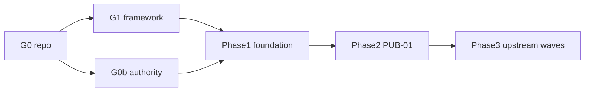

# NEXT IMPLEMENTATION PLAN

**Document ID:** NEXT-IMPLEMENTATION-PLAN
**Version:** 1.0 (PLAN — NOT APPROVED)
**Date:** 2026-11-18
**Status:** Ordered, gate-driven plan. No work in this plan has been executed beyond what is already evidenced. Nothing here is reported as done.
**Companion:** `UPSTREAM-INTEGRATION-STATUS.csv` (classification rubric in §5), `DEVELOPMENT-FOUNDATION-REPORT.md` (framework basis), `FIRST-PRODUCT-SLICE-REPORT.md` (evidence).

---

## 1. Current position (evidence-based, not aspirational)

| Measure | Value | Evidence |
|---|---|---|
| Pages planned / implemented | 227 / **0** | sitemap; no app source |
| Modules planned / implemented | 188–194 (source-dependent) / **0** | module catalog; executable architecture §9 |
| Application source files | **0** | repository inventory |
| Git repositories | **0** | `git rev-parse` → fatal |
| Runnable automated gate | **1** (`geo-measure`, 23/23) | re-run 2026-11-18 |
| Approved owner decisions | **0** | frontend register (480 entries, 0 approved); architecture D-01..D-22 all open |
| Upstream projects preserved | **54** (+58 archives) | registry + archives |
| Implemented + unit-tested assets | **1** (`geo-measure`) | this plan's evidence base |

**The critical path is not "decide more things". It is "authorize the repository, then ratify a framework".** Everything else is downstream.

---

## 2. Gate model

No engineering phase below is enterable until its gate is `PASS`. Gates are owner acts unless marked engineering.

| Gate | Name | Owner | Pass condition | Current |
|---|---|---|---|---|
| **G0** | Repository + Git authorization | Owner (`A1`) | Repo exists at an owner-named path; first commit contains the design-system baseline; `git rev-parse --show-toplevel` returns inside it | **OPEN** |
| **G0b** | Authority matrix + agent authority policy | Owner (`GOV-03`, `GOV-08`) | Recorded with owner id + date | **OPEN** |
| **G1** | Framework + rendering decision | Owner (`AUDIT-MISS-01` / `B1`) | A recorded decision (ADR) naming framework, rendering strategy, and monorepo layout | **OPEN** (basis in foundation report) |
| **G2** | Token single source of truth | Engineering (`B2`) | One token source; `tokens.css`/`themes.css` duplication removed; token change re-skins shell | **OPEN** |
| **G3** | Project-wide automated gate | Engineering (`B5`) | One command runs typecheck + lint + unit + build; passes on clean install | **OPEN** (only geo-measure `node --test` today) |
| **G4** | First page ready | Engineering (`C1..C6`) | `PUB-01` renders 4 states; no overflow at 375/768/1440; RTL fa + LTR en; keyboard pass; gate green | **BLOCKED by G0+G1** |

---

## 3. Ordered plan

### Phase 0 — Unblock (owner acts only)

| # | Action | Gate | Exit condition |
|---|---|---|---|
| 0.1 | Create repository; authorize Git; first commit = current design-system baseline | G0 | Commit exists; `git status` clean |
| 0.2 | Record authority matrix (`GOV-03`) and agent authority policy (`GOV-08`) | G0b | Both recorded with owner + date |
| 0.3 | Ratify framework/rendering + monorepo layout as an ADR | G1 | ADR merged; status `ACCEPTED` by owner |

**Nothing else can start until 0.1 and 0.3 are done.** This plan does not perform them.

### Phase 1 — Foundation (engineering)

| # | Package | Depends | Acceptance |
|---|---|---|---|
| 1.1 | Token SSOT (`B2`) | 0.1 | One token source; zero duplicate colour/font values; token edit re-skins a test view |
| 1.2 | Monorepo scaffold: `design-system`, `shared-ui`, `shared-contracts` packages | 0.1, 0.3 | Packages build independently; shared-ui imports tokens, never duplicates them |
| 1.3 | App shell (`B3`): entry, layout regions, header, navigation skeleton | 0.3, 1.1 | Shell renders with no hard-coded colour/font/layout; reads tokens only |
| 1.4 | Automated gate (`B5`): typecheck + lint + unit + build | 0.1, 0.3 | One command; green on clean install; includes `geo-measure` tests |
| 1.5 | Port geo-measure into `shared-*` or engine package; keep tests | 1.2 | Same 23/23 pass inside the monorepo gate |

### Phase 2 — First product surface (`PUB-01`)

| # | Package | Depends | Acceptance |
|---|---|---|---|
| 2.1 | Home composition from shared components (`C1`) | 1.3, 1.4 | `/` renders |
| 2.2 | Four states (`C2`): loading, empty, error, success | 2.1 | Each state reachable and correct |
| 2.3 | Responsive verification (`C3`) at 375/768/1440 | 2.1 | No horizontal overflow |
| 2.4 | RTL/LTR verification (`C4`) with Persian + English | 2.1 | fa renders RTL, en LTR, no mirrored-layout bugs |
| 2.5 | Accessibility pass (`C5`) incl. keyboard | 2.1 | Every interactive element reachable; visible focus; WCAG 2.2 AA checks |
| 2.6 | Stub links `PUB-03`, `PUB-09` with correct 404 (`C6`) | 2.1 | Correct not-found behaviour |

**Exit:** one production-shaped, tested page with evidence.

### Phase 3 — Upstream integration, wave by wave (engineering, each item owner-gated by license)

Integrate strictly in wave order (§5). Each integration is a normal ADR + PR behind the Integration Layer (Boundary 8); no upstream code is merged into a product.

---

## 4. Dependency chain

---

## 5. Upstream integration classification rubric

This section defines the vocabulary used in `UPSTREAM-INTEGRATION-STATUS.csv`.

### 5.1 `integration_class`

| Class | Meaning | Rule |
|---|---|---|
| `ADOPT` | Use the upstream (library or service) behind our contract | Permissive license; low/medium ops |
| `CUSTOMIZE` | Use with our own code changes | Only with a clean contribution/patch path |
| `INTEGRATE` | Wrap as a service/adapter in the Integration Layer | May be copyleft **only** as a separate process/service, never linked |
| `BUILD` | Do not use; build internally | Chosen when no upstream fits or license blocks |
| `DEFER` | Keep available; decide in a later phase | Default for phase-gated or owner-gated items |
| `REJECT` | Do not use | License or security disqualifies |

### 5.2 `integration_wave`

| Wave | Meaning | Count |
|---|---|---:|
| **1** | Low-risk, high-value — start here | 5 |
| **2** | Next — foundational services and core engines | 15 |
| **3** | Later — phase-gated (marketplace, AI, tourism, search, BI, workflow, RS) | 22 |
| **D** | Deferred / owner-legal-gated / rejected | 12 |

### 5.3 Wave contents (from the CSV)

- **Wave 1 (5):** `maplibre-gl-js`, `giro3d`, `pystac`, `keycloak`, `titiler`.
- **Wave 2 (15):** `swatplus`, `modflow6`, `wflow-jl`, `flopy`, `xclim`, `landlab`, `aquacrop-ospy`, `invest`, `pygeoprocessing`, `pgstac`, `cesium`, `seaweedfs`, `prometheus`, `opentelemetry-collector`, `grafana` *(standalone, unmodified only — AGPL)*.
- **Wave 3 (22):** `climate-indices`, `rhem-engine-singlestorm`, `rhem-engine-cligen`, `deck-gl`, `odc-stac`, `mapserver`, `opensearch`, `superset`, `temporal`, `kestra`, `langgraph`, `agno`, `novu`, `spree`, `medusa`, `opentripplanner`, `openforis-arena`, `collect`, `collect-mobile`, `collect-earth`, `collect-earth-online`, `geolibre`.
- **Wave D (12):** `pcse`(EUPL), `node-red`(REJECT), `openzeppelin-contracts`(token-gated), `erpnext`(GPL), `dolibarr`(GPL), `farmos`(GPL), `directus`(REJECT), `qloapps`(REJECT), `wps`(REJECT — license absent), `hydromt-wflow`(GPL), `flowise`(EE), `sepal`(very heavy).

### 5.4 License gate (non-negotiable)

- **HIGH risk (8):** `hydromt-wflow`, `erpnext`, `dolibarr`, `directus`, `farmos`, `qloapps`, `pcse`, `grafana` — **standalone and legally reviewed**; never code-merged into a proprietary product.
- **MED risk / EE boundary (5):** `swatplus`, `opentripplanner`, `medusa`, `flowise`, `novu` — separate execution; EE features excluded.
- **REVIEW:** `wps` — license NOT FOUND; blocked (U-02 / L-12).
- **Excluded:** `wrf` — empty archive, `INTEGRITY_FAILED`, not in registry.

### 5.5 Start-low-risk-high-value (Phase 3 first moves)

`RECOMMENDATION` begin integrations with the five **Wave 1** items, in this order:
1. `maplibre-gl-js` (2D base map) — BSD-3, client.
2. `giro3d` (3D terrain) — MIT, already `RUN_TESTED` in-repo.
3. `pystac` (STAC contract library) — Apache-2.0, enables Boundary 7.
4. `titiler` (dynamic raster tiles) — MIT, server adapter.
5. `keycloak` (OIDC identity) — Apache-2.0; owner IdP decision `D-04` still required before production use.

Each is behind the Integration Layer and each requires its own ADR + owner acceptance. **None is integrated today.**

---

## 6. Status vocabulary (reminder)

`DESIGNED` → `IMPLEMENTED` → `UNIT_TESTED` → `INTEGRATION_TESTED` → `VALIDATED` → `OWNER_APPROVED`.

Current truth: **1** asset at `IMPLEMENTED`+`UNIT_TESTED` (geo-measure); **everything else** at `DESIGNED`; **0** at `INTEGRATION_TESTED`, `VALIDATED`, or `OWNER_APPROVED`.

---

## 7. What must not be done early

| Decision | Why it waits |
|---|---|
| Colour route (`A01`/`COLOR-01`), typography (`TYPO-*`), logo (`ID-07`) | Phase 2 must be token-driven; identity swaps at the token layer without touching components |
| Authentication (`SEC-D01/02`, `A20`) | No Phase-2 page needs it; `PUB-01` is public |
| API envelope/idempotency (`API-D05/06/10`) | No Phase-2 page needs a backend |
| CRS (`B14`) / projected measurement | No map in Phase 2; geo-measure deliberately fails closed |
| Financial activation / tokens / chain | Owner-gated (`D-15`, `37` §12.4); no chain connection authorized |
| Marketplace / ERP / copyleft adoption | Owner legal + phase-6 gate |

---

## 8. Immediate next action (single)

The one action that unblocks the entire plan is **G0**: the owner creates the repository and authorizes Git, with the design-system baseline as the first commit. Until then, further documentation produces documents, not progress.

**END OF NEXT IMPLEMENTATION PLAN.**