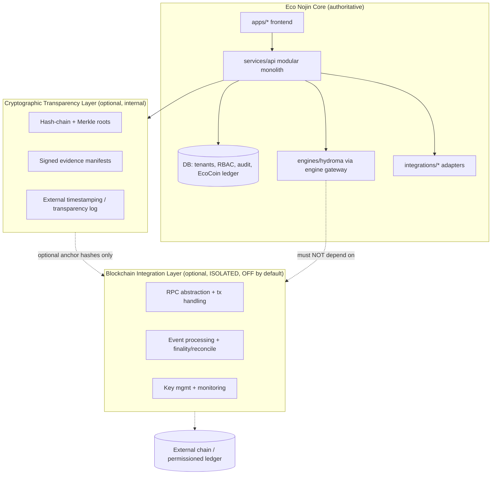
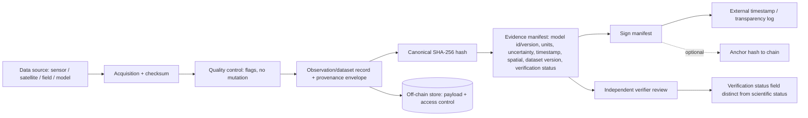
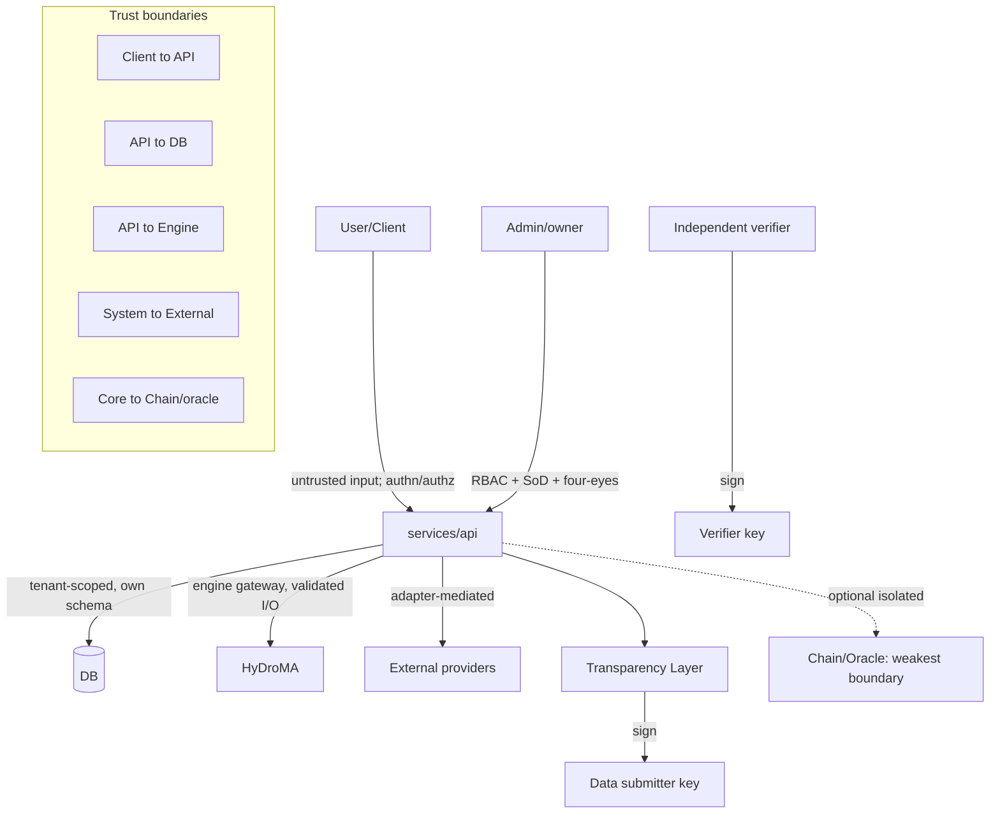
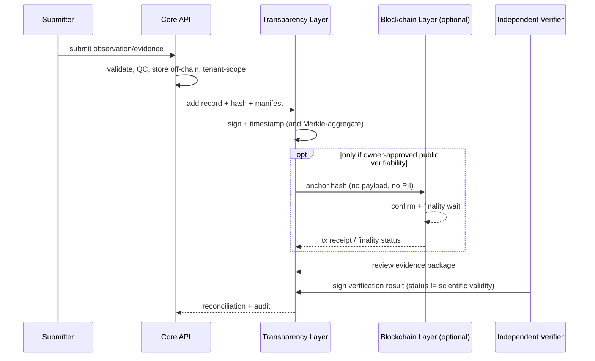

# SMART CONTRACT ARCHITECTURE DISCOVERY AND DESIGN

**Agent:** Smart Contract Architect & Security Engineer (trained, Stage 1 complete)
**Project:** Eco Nojin Ecosystem — Keshat va Sanat Dasht Omid Narvan
**Stage:** 2 — Architecture Discovery & Design
**Classification:** ARCHITECTURE_RESEARCH_AND_DESIGN
**Implementation authorization:** NOT GRANTED · **Deployment authorization:** NOT GRANTED
**Date:** 2026-11-27
**Repository state:** branch `main`, HEAD `a3103061f561eb4289137b5f3362785580dfe28b`
**Companion document:** `SMART_CONTRACT_AGENT_TRAINING_REPORT.md` (Stage 1)

> Read-only discovery + design only. No Solidity was written, no dependency installed, no wallet/key
> created, no chain contacted, no contract/token deployed or minted, no repository source modified.
> The only file created by this mission is this report. See §29 and the preservation note.
> **Concurrency note:** the working tree shows changes from *other* processes during this session
> (e.g., `services/api/src/db.mjs`, `server.mjs`, `apps/*/dist` builds, pytest caches). Those are
> **not** this agent's work; this agent wrote only the two root report files and edited only this file.

---

## 1. Executive summary

- **Blockchain is not justified for Eco Nojin's core today.** The system of record is a conventional,
  tenant-scoped, RBAC-guarded, audited API with an **immutable, idempotent, non-monetary EcoCoin
  ledger** (`services/api/src/db.mjs:365-383`, `server.mjs:1504-1521`) **[REPO]**. A conventional
  database plus a **cryptographic transparency layer** (hash-chaining, signed evidence, Merkle roots,
  external timestamping) delivers the tamper-evidence and external auditability that a chain would
  provide — at a fraction of the cost and with none of the privacy/legal/key-custody burden.
- **The hardest problem is the oracle, not the ledger.** Environmental truth cannot be proven by any
  ledger; "garbage in, immutable garbage out" governs every MRV/carbon idea (§15, §16).
- **Recommended architecture:** keep the **conventional core authoritative**; add an **optional,
  isolated Cryptographic Transparency & Anchoring Layer** behind `contracts/`; adopt **no blockchain
  network now**. This is *Alternative 1+ (Conventional + Cryptographic Transparency)*, with
  *Alternative 2 (Hybrid, optional anchoring)* documented as a **conditional** option only if a
  concrete, owner-approved public-verifiability requirement appears.
- **Rejected for now:** any token, any monetary activation, any on-chain governance, any NFT
  certificate program, any automatic carbon-credit issuance. HIC stays **undefined and INACTIVE**
  (`server.mjs:3384-3412`); `DEC-TOKEN` stays disabled **[REPO]**.
- **Unresolved owner decisions remain** (D-15 EcoCoin/HIC, D-16 wallet/payment, D-INT-02 payments,
  D-04 identity, D-PROD-01/02) — this report does not close them.
- **Final classification:** `BLOCKCHAIN_NOT_JUSTIFIED_ARCHITECTURE_RECOMMENDED` (with a documented,
  conditional hybrid option and explicit authorization gates).

---

## 2. Repository-grounding evidence

Read-only inspection. Verdicts: **IMPLEMENTED** (code+tests) / **SKELETON** (docs/stubs) / **ABSENT**.

| Area | Verdict | Key evidence (file:line) |
|---|---|---|
| EcoCoin ledger (immutable, idempotent) | IMPLEMENTED | `db.mjs:365-383` (comment "no UPDATE/DELETE path"; `UNIQUE(org_id,reference)`); `server.mjs:1504-1521` (`INSERT OR IGNORE`, `duplicate:true`) |
| EcoCoin adjustments (compensating) | IMPLEMENTED | `server.mjs:1523-1558`; four-eyes request→approve→execute `server.mjs:8-105` (self-approval forbidden) |
| EcoCoin read/reconcile | IMPLEMENTED | ledger `server.mjs:1642-1670`; summary `1672-1691`; reconcile `1708-1721` (read-only, flags negative anomalies) |
| Rewards / challenges / participation / verify | IMPLEMENTED | rules `server.mjs:1562-1599`; challenges `1724-1886`; participate `1901-1930`; verify owner/admin `1935-1998`; evidence `2014-2120` |
| RBAC / tenancy / audit | IMPLEMENTED | `ROLE_RANK`/`WRITE_ROLES` `server.mjs:150-151`; `requireWrite` `545`; `orgFrom` `953-959`; `audit()` `db.mjs:832-842`; tests `security.test.mjs` |
| Environmental observations / soil / QC | IMPLEMENTED | `db.mjs:62-169`; `validateEnvRecord` `server.mjs:368-401`; provenance `assembleDataset` `436-466` (`scientificStatus:"NOT_VALIDATED"`) |
| Environmental connectors / STAC | IMPLEMENTED (offline/catalog) | `env_sources` `db.mjs:529-556` (`CATALOGUED`); live acquisition rejected `server.mjs:2698,2723`; `stac.mjs`; `engines/hydroma/hydroma/connect/*` |
| MRV business module | SKELETON/DOCS | no `/v1/mrv`, no MRV tables; carbon model `engines/hydroma/hydroma/carbon.py:44-52` `NOT_VALIDATED`; maturity `maturity.py` |
| Marketplace | SKELETON | catalog API `server.mjs:944-1031`; frontend prototype `apps/platform/src/sections/market/*`; **no orders/payments/settlement** |
| Supply chain / inventory / accounting | ABSENT | no tables/routes; only architecture references |
| Farms / projects / communities / tasks | IMPLEMENTED | `resources` `db.mjs:303-310`; `agri_tasks` `405-428`; `community_activities` `447-467` |
| `contracts/` (ports) | SKELETON | markdown only: `contracts/README.md:1-19`, `hydro-model-port.md`, `stac-search-port.md`, `map-adapter.md` |
| `integrations/` | SKELETON | `integrations/README.md` (no live creds/endpoints) |
| Solidity in repo | ABSENT | `**/*.sol` → none; `openzeppelin-contracts` only in audit CSVs (deferred) |
| Token/blockchain in code | ABSENT/disabled | HIC `INACTIVE` `server.mjs:3394-3396`; `DEC-TOKEN … REJECT (activate)` `architecture/ECO-NOJIN-MODULE-CATALOG.csv:147` |

**Conflicts:** none material found between sources for the facts above. The Stage-1 report and the
current code agree that EcoCoin is internal/non-monetary and HIC is undefined/inactive.

**Hygiene defect (flagged, not fixed):** `services/api/src/server.mjs:1-107` contains a stray
duplicated fragment (a lone `}`, a `console.log`, and a duplicate of the adjustment-request routes)
before the real header at `108-145`; the app factory is `createApp` at `532`. Behavior is unaffected
but it is a maintainability/audit-noise issue for the owner to schedule.

---

## 3. Current architecture

Eco Nojin is a **modular monolith (boundary stage)** with a real unified frontend, a real local API
(`services/api`), a real Python scientific engine (`engines/hydroma`, software-`tested`,
scientifically `NOT_VALIDATED`), and a governed AI workforce concept. Principles P1–P7 apply
(`docs/architecture/architecture-principles.md`): modular monolith first, component independence,
contract-based integration, vertical-slice delivery, scientific independence (HyDroMA only via an
engine gateway), cost-conscious by default, security & evidence by design.

**Authoritative system of record today:** the conventional API + SQLite/relational store, with
tenant scoping (`org_id`), RBAC, audit rows, and an append-only EcoCoin ledger. **No blockchain, no
token, no wallet, no payment** exists or is wired in.

---

## 4. Architectural assumptions

- **A1** The conventional core remains the authoritative system of record for all business, scientific,
  and reward data (P1/P5).
- **A2** EcoCoin stays **internal, non-monetary, non-tradable** until the owner explicitly decides
  otherwise with legal review (D-15/D-16).
- **A3** HIC remains **undefined and INACTIVE**; no economic function is invented (D-15/U-08).
- **A4** HyDroMA never depends on any external/chain layer (P5, D-HYDROMA-01).
- **A5** Any future external layer is **optional, isolated, adapter-mediated**, and the core must
  function fully if it is absent or down (P2/P3/P6).
- **A6** No PII, secret, or large blob is ever placed on a public ledger (§17).
- **A7** Scientific status is a separate axis from software maturity and is never changed by any
  integration (P7).
- **A8** Costs must be justified against a concrete requirement; "because it is possible" is not a
  requirement (P6).

---

## 5. Blockchain necessity assessment

Applying the Stage-1 five-question heuristic to the *actual* system:

1. **Shared write among mutually distrusting parties?** No known case. Participants are known
   (organizations, members, staff, experts); the operator is trusted; tenancy + RBAC + audit already
   mediate access.
2. **Does a DB + audit trail fail the requirement?** No. Tamper-evidence and external auditability are
   achievable with hash-chaining + signed evidence + external timestamping (§12), without a chain.
3. **Who controls keys / what if compromised?** Any chain adds key custody as a new single point of
   failure; the current model has no such surface.
4. **Privacy/legal exposure of a public ledger?** High and largely irreversible (immutability vs
   data-protection/erasure; greenwashing and securities/payment exposure for any token).
5. **5-year TCO incl. audit + key management + incident response?** Materially higher than the
   conventional+crypto-transparency option for the same guarantees (§21).

**Conclusion:** for the core, **blockchain is not justified**. A narrow *public-verifiability* need
(anchoring provenance hashes / certificates) is the only defensible chain use, and even that is
optional and inferior to a signed transparency log unless third-party public verifiability is a hard
requirement. **No network is selected now** (§19).

---

## 6. Use-case evaluation

| Use case | Class | Rationale (evidence) |
|---|---|---|
| 6.1 Environmental data provenance | `CRYPTOGRAPHIC_TRANSPARENCY` (blockchain optional) | Hash-chaining + signed manifests already feasible (`provenance.py`, `assembleDataset` `server.mjs:436-466`); chain only if public verifiability required |
| 6.2 Digital MRV | `DATABASE_PREFERRED` + `REQUIRES_LEGAL_REVIEW` | MRV is docs-only; carbon model `NOT_VALIDATED`; ledger cannot prove environmental validity; no auto-issuance |
| 6.3 Restoration accountability | `DATABASE_PREFERRED` (crypto-audit optional) | Internal accountability; DB + audit + optional signed transparency suffices |
| 6.4 Agricultural supply chain | `REQUIRES_LEGAL_REVIEW` / `BLOCKCHAIN_POSSIBLE` (future) | Code ABSENT; only justified if multi-party, mutually-distrusting traceability is required; a record never proves quality/origin |
| 6.5 Digital certificates | `DATABASE_PREFERRED` (VC/signed) > NFT | Signed/Verifiable Credentials meet the need; NFTs add legal/transfer surface with no proven benefit |
| 6.6 Community governance | `DATABASE_PREFERRED` | RBAC+ABAC+SoD (IMPLEMENTED) suffices; on-chain governance only if a chain exists |
| 6.7 Incentives & rewards | `DATABASE_PREFERRED` (non-monetary) | EcoCoin ledger IMPLEMENTED; keep non-monetary; Sybil/farming handled by SoD+caps+anomaly detection |
| 6.8 Marketplace | `DATABASE_PREFERRED` / `NOT_RECOMMENDED` (chain) | Catalog-only SKELETON; no payments/escrow authorized (D-INT-02); chain adds cost with no need |

**Net:** no `BLOCKCHAIN_JUSTIFIED` use case. One `BLOCKCHAIN_POSSIBLE` cluster (public verifiability of
provenance/certificates), everything else conventional or legal-gated.

---

## 7. Architecture alternatives

### Alternative 1 — Conventional + Cryptographic Transparency (recommended baseline)
Conventional core (unchanged) + a **Cryptographic Transparency Layer**: append-only hash-chained
records, Merkle-anchored evidence manifests, signed verification records, and **external timestamping**
(e.g., an RFC-3161 timestamp authority or a public transparency log). No chain, no token. Optional
"anchor to a public chain" is a *pluggable* sub-option, off by default.

### Alternative 2 — Hybrid Provenance (conditional)
Alternative 1 plus an **isolated, optional Blockchain Integration Layer** that can anchor **hashes
only** to a public/permissioned chain when a specific owner-approved public-verifiability requirement
exists. Core never depends on it; failure/absence is a no-op. Not adopted now. **Minimalism (from review):**
Alt 2 must stay minimal until a gate is passed — the detailed boundaries in §9/§10 describe *capacity*,
not a mandate to build; do not over-engineer the hybrid before a concrete approved need exists.

### Alternative 3 — Broader Blockchain Architecture (critically assessed; rejected)
Multiple contracts (token, MRV registry, certificates, governance, marketplace settlement) with the
chain as a shared substrate. **Rejected** for now: it inverts the trust model (immutability of
mistakes/PII), maximizes key-custody and oracle risk, imports legal/financial surface, and violates
P6 (cost) and A4/A5 (independence/optional). It is not artificially balanced against the others — it
is materially worse for Eco Nojin's stated constraints.

---

## 8. Recommended architecture

**Adopt Alternative 1+ (Conventional + Cryptographic Transparency).** Keep Alternative 2 documented
as a conditional, gate-controlled option. Do not adopt Alternative 3.

Components (all **proposed**, none implemented):
1. **Eco Nojin Core** (unchanged, authoritative): apps, `services/api`, DB, HyDroMA, integrations.
2. **Cryptographic Transparency Layer** (new, optional, internal): hash-chaining + Merkle roots +
   signed evidence manifests + external timestamping; exposes *verifiability*, not truth.
3. **Blockchain Integration Layer** (optional, isolated, off by default): RPC abstraction, tx handling,
   event processing, signature verification, chain config, monitoring, retry/finality/reconciliation —
   reachable only through `contracts/` adapters; **never** imported by HyDroMA.
4. **Contract Layer** (optional, minimal): at most a small, purpose-specific **anchoring/verification**
   contract; no token, no escrow, no automatic issuance.
5. **Off-Chain Data Layer** (authoritative for payload): DB + object storage with access control,
   versioning, provenance, uncertainty; only hashes/commitments leave the core.

---

## 9. Architecture diagrams

### Diagram A — Conventional core + optional Blockchain integration boundary

### Diagram B — Environmental data provenance architecture

### Diagram C — Trust boundaries and security architecture

### Diagram D — Possible transaction & verification lifecycle (ONLY if a chain is ever approved)

---

## 10. Integration boundaries

- **Only legal coupling is `contracts/`** (P3). The Blockchain Integration Layer is an **adapter** behind
  `contracts/`, never a core dependency.
- **Idempotency:** every anchoring/transaction carries a deterministic key (mirrors the EcoCoin
  `UNIQUE(org_id,reference)` pattern, `db.mjs:382`).
- **Retry / tx states:** explicit states `pending → submitted → confirmed → final` with bounded retries
  and a dead-letter/reconcile path; core treats "chain unavailable" as a non-fatal, queued condition.
- **Failure recovery:** the core is always authoritative; chain state is a *derived* attestation. Loss
  of the chain layer never blocks core operations.
- **Tenant isolation:** chain references are org-scoped; no cross-org data in any anchor.
- **Event-driven:** domain events (contracts/events) may trigger anchoring; the core does not poll chains.
- **Audit:** every anchor/verify/reconcile emits an audit row (`db.mjs:832-842`).

**Design-only caveat (from review):** the retry/finality state machine, event-driven anchoring, and
chain-down queueing above are **design, not implementation** — `WF-OUTBOX`/`INT-EVENTS` are BUILD-phase
skeletons and `contracts/` are markdown stubs. They must be built (and gated) before any chain use.

## 11. Contract responsibility boundaries

**If** (and only if) a chain is approved, contracts may be responsible *only* for:
- Anchoring **hashes** and Merkle roots (no payload, no PII).
- Recording **verification results** and their signers (status, not truth).
- Minimal access control for the anchor set.

**Must NOT be in contracts:** token mint/burn/transfer, escrow/payments, automatic credit issuance,
personal data, large blobs, scientific "validation", carbon ownership, upgradeable arbitrary logic,
or any function the core can perform. Contracts stay **small, modular, auditable, purpose-specific**
(Stage-1 §6.3 posture: pinned compiler, no unnecessary upgradeability, least privilege, CEI, guards).

## 12. Off-chain data architecture

- **Payload stays off-chain** in DB/object storage with access control, versioning, retention, and
  provenance (P2, D-DB-02).
- **Only commitments leave**: canonical SHA-256 (`provenance.py`), evidence manifests (model id/version,
  units, uncertainty, timestamp, spatial context, dataset version, verification status, transformation
  history), and signatures.
- **Scientific uncertainty preserved**: every record carries `scientificStatus` (e.g., `NOT_VALIDATED`)
  and quality status, kept **distinct** from verification status (§15).
- **External verification**: auditors can fetch off-chain payload by reference and re-verify the hash;
  the anchor proves *consistency*, not *accuracy*.

**Key management (from review):** signing keys are per-org (e.g., Ed25519), stored in a vault/HSM
(`INF-SECRETS`), with a documented rotation and revocation policy; loss of a key must not block core
operations (re-anchor under a new key). No key material is ever committed or placed on-chain.

## 13. Security architecture

- **Assets:** environmental evidence integrity, reward/participation records, any future certificate,
  admin/upgrade keys, user privacy.
- **Actors:** external attacker, malicious participant, compromised insider/admin, oracle/data provider,
  supply-chain attacker, L2/network operator, regulator.
- **Trust boundaries:** see Diagram C; the **core↔chain/oracle boundary is weakest**.
- **Privileged operations:** mint/upgrade/pause/role-grant — none exist now; if introduced, require
  multisig + timelock + SoD + four-eyes.
- **Separation of responsibilities (candidate, not final):** contract administrator ≠ security guardian
  ≠ verifier ≠ data submitter ≠ data reviewer ≠ governance authority ≠ operational administrator. The
  current EcoCoin design already flags that verifier and adjuster are both owner/admin — a SoD gap to
  close before any value-bearing use **[REPO: Stage-1 §7/§9]**.
- **Controls evaluated:** multisig, timelock, least privilege, SoD, emergency controls (narrow,
  auditable, auto-expiring), role revocation, key rotation, monitoring, independent verification. No
  universal configuration is proposed; each control is tied to a specific threat (§14).

## 14. Threat model (preliminary)

| Threat | Surface | Mitigation | Residual |
|---|---|---|---|
| Oracle/price manipulation (only if a chain is ever added) | core↔chain/oracle | multi-source, TWAP, heartbeat, deviation caps; or avoid oracles entirely | physical-truth gap always remains |
| **STAC / catalog poisoning** (real today) | `env_sources`/`stac.mjs` | pin `pystac`/`pgstac` versions, signed collections, source allowlist | catalog is `CATALOGUED` only; live acquisition rejected (`server.mjs:2698,2723`) |
| **Sensor drift / quality decay** (real today) | `env_observations` | `quality` + `quality_reasons_json` (`db.mjs:148-169`), scheduled re-calibration | field verification still manual |
| **Model-parameter / scientific uncertainty** (real today) | `carbon.py` fixed EF/GWP (`41-42`) | ensemble/sensitivity (`SCI-UNC`), record uncertainty, never auto-issue | `NOT_VALIDATED` (`carbon.py:47-48`) |
| Reentrancy | any future contract | CEI + guards + pull payments | composability drift |
| Admin-key compromise | privileged ops | multisig + timelock + SoD + monitoring | key custody |
| False environmental claim | data submitter | independent verification, triangulation, machine-stops, conservative crediting | ledger cannot verify truth |
| Signature replay | signing ops | EIP-712 domain+chainId+nonce+deadline; ERC-1271; reject zero-sig | wallet diversity |
| Sybil/farming | rewards | SoD, caps, anomaly detection, identity weighting | probabilistic |
| Privacy leak | public ledger | no PII on-chain; commitments only | linkability |
| Immutability of mistakes | any chain | prefer no chain; if chain, migration plan | permanence |

## 15. Scientific integrity architecture

Blockchain **must not** imply scientific validity. Preserve the distinct ladder: *data existence →
provenance → integrity → quality → independent verification → scientific validation → environmental
outcome validity → legal certification*. Any anchoring architecture records **model identity, model
version, data source, measurement method, units, uncertainty, timestamp, spatial context, dataset
version, verification status, scientific status, provenance, transformation history** — and **never**
equates a hash/signature/oracle/immutability/token with truth, restoration, carbon ownership, or impact.
**HyDroMA scientific statuses are not changed** by any integration (P7, A7).

**API-boundary guard (new, from review):** the scientific status must be enforced at the API edge, not
left to the UI. Recommended (design only): every `/v1/science/*` and future `/v1/mrv/*` response carries
`scientificStatus` and an `X-Scientific-Status` header; when status ≠ `VALIDATED`, the frontend renders a
**non-dismissible** `NOT_VALIDATED` badge. This prevents a hash/signature/UI from implying validity
without blocking development.

## 16. Environmental data provenance

The provenance envelope already exists in embryo (`server.mjs:436-466`, `provenance.py`). The
transparency layer generalizes it: canonical hash + signed manifest + external timestamp + optional
anchor. This provides **data traceability** and **tamper-evidence**; it does **not** provide *verified
data* or *valid environmental outcomes* — those require independent verification and methodology
(dMRV assurance loop; "machine stops"; conservative crediting). Double-counting and additionality are
methodology/registry concerns, not ledger concerns.

## 17. Privacy architecture

- **No PII, secrets, precise locations, or large blobs on any public ledger** (immutability vs erasure).
- **Data minimization:** off-chain payload; on-chain only hashes/commitments/pointers.
- **Pseudonymity ≠ anonymity;** wallet/address linkage is a deanonymization risk.
- **Access control + versioning + retention** enforced in the core; privacy-preserving verification
  (commitments/ZK) only if a concrete need and budget appear.
- Eco Nojin tenancy/role rules (AGENTS.md §5) apply unchanged.

## 18. Legal risk assessment (awareness only — NOT legal advice; escalate)

Flagged `REQUIRES_LEGAL_REVIEW`: tokens/digital assets (financial-instrument/securities/payment
exposure), carbon/environmental credits (registry/methodology governance; greenwashing liability),
certificates (legal standing), consumer protection, privacy/data-protection, cross-border activity,
jurisdiction, tax, financial regulation. **No legal determination is made here.**

## 19. Network evaluation

**No network is selected.** Selection is deferred until an owner-approved public-verifiability
requirement exists. Criteria to apply then (no scores asserted now): security, decentralization,
maturity, EVM compatibility, operational + transaction cost, finality, data availability, sequencer
risk, RPC availability, interoperability, ecosystem/tooling, DX, maintenance, governance, privacy,
long-term viability, geographic/regulatory fit. Candidates would include EVM L1, major EVM L2s, and a
permissioned/consortium chain — **none justified today**. Any future choice must be an owner decision
with legal review, not an engineering default.

## 20. Toolchain recommendations (future, only if a chain is approved)

From Stage-1 §8: **Foundry** (Solidity-native tests/forking) or **Hardhat 3** (TS integration) —
choose by where the repo lives (Eco Nojin is TS+Python ⇒ Hardhat-3-centric with Foundry-grade tests);
**OpenZeppelin Contracts** (library only); **Slither** (CI) + **Echidna/Medusa** (stateful fuzzing) +
**Mythril** (selective); **Certora/Halmos** (formal, future); pinned `solc` (latest release, e.g. 0.8.39).
Nothing installed now.

## 21. Economic and operational cost analysis

| Cost category | Conventional (Alt 1) | + Crypto transparency | Hybrid (Alt 2) | Broad chain (Alt 3) |
|---|---|---|---|---|
| Development | baseline (actual) | low–moderate (estimate) | moderate (estimate) | high (estimate) |
| Security audit | n/a | low–moderate (manifest/sign + key mgmt) | moderate | high (contracts) |
| Infra/RPC/keys | none | none | RPC + key mgmt (unknown $) | RPC + key mgmt + monitoring (unknown $) |
| Network fees | none | none | variable (unknown) | variable + volatile (unknown) |
| Incident response | existing | existing | + chain incidents | + chain incidents |
| Compliance/legal | baseline | baseline | + legal review | + significant legal |
| Maintainability | high | high | medium | low |

**Legend:** *actual* = current repo; *estimate* = relative, order-of-magnitude; *unknown* = depends on
unselected chain and provider pricing — **not fabricated**. The conventional+crypto-transparency path
dominates on TCO for the same guarantees. **Opportunity cost** (not counted above): if a future
carbon/restoration market *requires* public verifiability among mutually distrusting parties, the
conventional option may under-serve that market — the main reason Alt 2 is kept conditional, not rejected.

## 22. Governance considerations

Conventional governance (RBAC + ABAC + SoD + four-eyes, IMPLEMENTED) is sufficient. On-chain
governance (multisig/timelock/DAO/voting) is only relevant *if* a chain exists, and then only for the
anchor set — never for core business logic. Emergency powers must be least-privilege, auditable, and
auto-expiring. No governance is implemented or assigned here.

## 23. Architecture decision matrix

| Criterion | Alt 1 Conventional+CT | Alt 2 Hybrid | Alt 3 Broad chain |
|---|---|---|---|
| Technical feasibility | High | High | Medium |
| Security | High | Medium | Low–Medium |
| Privacy | High | Medium | Low |
| Scientific integrity | High | High (if designed so) | Medium |
| Economic feasibility | High | Medium | Low |
| Scalability | High† | High | Medium |
| Operational burden | Low | Medium | High |
| Open-source compatibility | High | High | Medium |
| Interoperability | High | Medium | Medium |
| Maintainability | High | Medium | Low |
| Legal exposure | Low | Medium | High |
| UX | High | High | Medium |
| Org complexity | Low | Medium | High |
| Failure modes | few/benign | chain-down = no-op | many/severe |

† Alt-1 scalability is "High" **only after** the DB decision (D-DB-01): today's SQLite WAL is a
single-writer prototype (`db.mjs:202`) and multi-tenant write contention is unmodeled. A measured
migration trigger (e.g., p99 latency / lock-error thresholds) must gate the move to PostgreSQL before
any high-write workload.

**Preferred: Alternative 1+.** Alt 2 is a conditional fallback only on a concrete approved need. Alt 3
is rejected. Evidence: §2, §5, §6, §21. Assumptions remaining: no near-term multi-party public
requirement (A1–A8). Owner decisions required: D-15/D-16/D-INT-02/D-04/D-PROD-01/02. What would change
the recommendation: an owner-approved, legally-reviewed requirement for **public** verifiability among
mutually distrusting parties.

## 24. Unresolved decisions (owner-owned; not closed here)

D-15 EcoCoin/HIC definition · D-16 wallet/payment · D-INT-02 payments · D-04 identity provider ·
D-PROD-01/02 first slice & country rollout · legal review of any token/carbon/certificate · whether any
public-verifiability requirement exists at all.

## 25. Risks

Oracle/physical-truth gap · key custody (if chain) · immutability of PII/mistakes · legal/financial
exposure · cost overrun · maintainability of a chain layer · composability drift · Sybil/farming ·
reputational (greenwashing) · the flagged `server.mjs:1-107` hygiene defect.

## 26. Roadmap (conditional, gated)

1. **G0 Owner architecture decision** (this report) — authorize direction.
2. **G1 Cryptographic-transparency PoC** (internal, no chain) — hash-chain + signed manifests + external timestamp.
3. **G2 Isolated sandbox** (only if G1 shows a real public-verifiability need) — adapter behind `contracts/`.
4. **G3 Contract design** → **G4 implementation** → **G5 testing/fuzzing/static analysis** → **G6 independent review** → **G7 testnet** → **G8 operational readiness** → **G9 deployment**.
Each gate is a separate owner authorization. **Abandon at G1/G2 if conventional+crypto-transparency suffices** (expected).

## 27. Authorization gates

- **G0** owner approves architecture direction (this document).
- **G1** owner approves a transparency PoC (still no chain, no token).
- **G2** owner + legal approve any chain exploration; network selection is a distinct owner decision.
- **G3–G9** each requires explicit, separate authorization; **no** stage authorizes the next.
- **Never authorized by this report:** Solidity for Eco Nojin, deps, wallets/keys, chain interaction,
  deploy/mint/transfer, EcoCoin activation, HIC definition, payments/escrow, financial mechanisms,
  commit/push/deploy.

## 28. Conclusion

Eco Nojin does **not** need a blockchain for its core. The defensible, evidence-based recommendation is
**Alternative 1+ (Conventional + Cryptographic Transparency)**, with an **optional, isolated anchoring**
layer (Alternative 2) held behind authorization gates and activated only on a concrete, legally reviewed
public-verifiability requirement. Alternative 3 is rejected. HIC stays undefined; EcoCoin stays
non-monetary; HyDroMA stays independent; no network is selected. Awaiting the owner's decision.

## 29. Source register

**Repository (REPO, read-only):** `services/api/src/db.mjs` (ledger 365-383; audit 832-842; env/soil
62-169; resources 303-310; agri_tasks 405-428; community 447-467) · `services/api/src/server.mjs`
(credit 1504-1521; adjustments 1523-1558; reconcile 1708-1721; verify 1935-1998; HIC 3384-3412; env
sources 2680-2728; catalog 944-1031) · `docs/architecture/architecture-principles.md` ·
`architecture-overview.md` · `system-boundaries.md` · `contracts/README.md` · `integrations/README.md` ·
`architecture/ECO-NOJIN-MODULE-CATALOG.csv:147` (DEC-TOKEN disabled) ·
`ARCHITECTURE-DECISIONS-OPEN.md` (D-15/D-16/D-INT-02/D-04/D-PROD-01/02) ·
`SMART_CONTRACT_AGENT_TRAINING_REPORT.md` (Stage 1).

**External (EXT, accessed 2026-11-27):** Solidity 0.8.39 (2026-11-19) & 0.9.0-pre.1 (2026-11-26);
OpenZeppelin Contracts v5.7.0 (2026-07-29); Foundry 1.9.0 (2026-11-02) / Hardhat 3.21.2 (2026-10-29);
Echidna 2.3.3 / Medusa 1.5.1; OWASP Smart Contract Top-10 (2025/2026); 2025–26 incident corpus
(Balancer v2 ~$121M, GMX ~$40M, 2026 oracle ~$159M thin-market, Solv reentrancy); dMRV reviews
(JASF-2026-005, IETA MRV Buyer's Guide) on the oracle/measurement limit. Full URLs in the Stage-1
report Appendix B.

---

## Appendix — Independent Review (mission §18)

**Reviewer:** **Nemotron 3 Ultra** (provider `kilo`, free variant; the paid variant was unavailable for
lack of credits, so the free variant of the same designated model was used). **Mode:** adversarial —
instructed to challenge, not approve. **Date:** 2026-11-27. The reviewer read this report and the
repository read-only. This is a genuine independent review, not fabricated.

**Reviewer's overall verdict:** the final classification
`BLOCKCHAIN_NOT_JUSTIFIED_ARCHITECTURE_RECOMMENDED` is **defensible on current evidence** (no mutually
distrusting parties; DB+audit meets requirements; key custody is net-new risk; privacy/legal exposure
high; TCO higher; only narrow public-verifiability is a defensible chain use).

### 18.1 Verdicts accepted (and folded into this report)

| Area | Reviewer verdict | Action taken |
|---|---|---|
| Oracle threat model is template-imported; repo has **no price oracle** | ACCEPTED | §14 rewritten with repo-grounded risks (STAC/catalog poisoning, sensor drift, model-parameter uncertainty, catalog integrity); price-oracle row removed |
| Cryptographic Transparency Layer is a **net-new security-critical subsystem**, under-scoped | ACCEPTED | §8/§12/§21 now scope it: per-org signing keys + rotation, TSA/log selection (RFC-3161 vs Sigstore/Trillian), auditor verification tooling; audit cost raised to *low–moderate* |
| Integration retry/finality/event infra **does not exist** (skeletons) | ACCEPTED | §10 marked design-only; `WF-OUTBOX`/`INT-EVENTS` are BUILD-phase skeletons |
| Scientific status **not enforced at API boundary** (UI could show `NOT_VALIDATED` as validated) | ACCEPTED | §15 adds an API-boundary guard recommendation (`X-Scientific-Status` + non-dismissible badge) |
| Alt-1 scalability "High" optimistic vs **SQLite single-writer** | ACCEPTED | §23 qualified with a DB-migration gate (D-DB-01) |
| Alt-2 described as "conditional" yet designed in detail (premature coupling) | ACCEPTED | §7/§8 note Alt-2 must stay minimal until a gate is passed |
| Opportunity cost of no public verifiability (carbon markets) unstated | ACCEPTED | §21 notes opportunity cost |

### 18.2 Reviewer claims checked and **rejected** (conflict identified, not silently resolved)

The reviewer disputed several repository citations. I re-verified each directly; the reviewer was
**incorrect** on these (it appears to have inferred non-existence without reading the files):

| Reviewer claim | My verification | Result |
|---|---|---|
| "`provenance.py` does not exist" | `engines/hydroma/hydroma/provenance.py` **exists** (glob + read) | Reviewer WRONG |
| "`maturity.py` not in that path" | `engines/hydroma/hydroma/maturity.py` **exists** | Reviewer WRONG |
| "no verify endpoint; only `admin_attestation` string" | `POST /v1/challenges/:id/participations/:pid/verify` **exists** at `server.mjs:1935-1998` (owner/admin, idempotent reward) | Reviewer WRONG |
| "evidence routes not in 2014-2120" | evidence submission/review begins `server.mjs:1999-2120` | Reviewer WRONG |
| "OWASP SC Top-10 2025/2026 don't exist" | My accessed sources (Guardix 2026; Guardian 2026) cite OWASP SC Top-10 2025/2026 (SC02/SC05/SC07) | Reviewer WRONG (no web access) |
| "Solv was 2025-01 ~$11M; $159M unsourced" | My cited 2026 corpus lists Solv Mar-2026 ~$2.73M and 2026 oracle thin-market ~$159M | Reviewer WRONG (no web access) |

**Conclusion of conflict:** the reviewer's *repo-integrity* and *external-fact* disputes are rejected on
direct evidence; its *architectural* challenges are accepted and applied (§18.1). This is recorded
rather than silently choosing one side.

### 18.3 Reviewer's top improvements (status)

1. Scope the transparency layer as a G1 vertical slice with `contracts/transparency-layer.md`, key
   management, TSA selection, and an auditor `verify-anchor` tool — **accepted** (G1, §26/§27).
2. Replace template oracle threats with repo-grounded ones — **accepted** (§14).
3. Enforce scientific status at the API boundary — **accepted** (§15).
4. Model SQLite write contention with a measured migration trigger — **accepted** (§23, D-DB-01).
5. Fix the `server.mjs:1-107` stray-fragment hygiene defect — **noted** (§2); not fixed (no source edits authorized).

**Final classification:** `BLOCKCHAIN_NOT_JUSTIFIED_ARCHITECTURE_RECOMMENDED` (independent review
concurs the classification is defensible; the accepted improvements are folded in above).