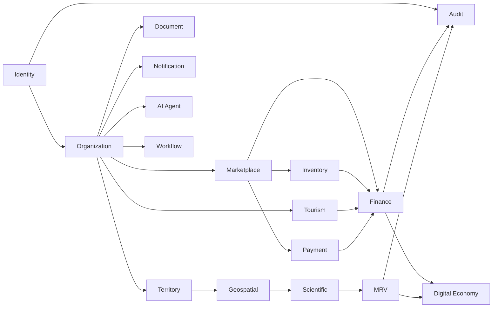
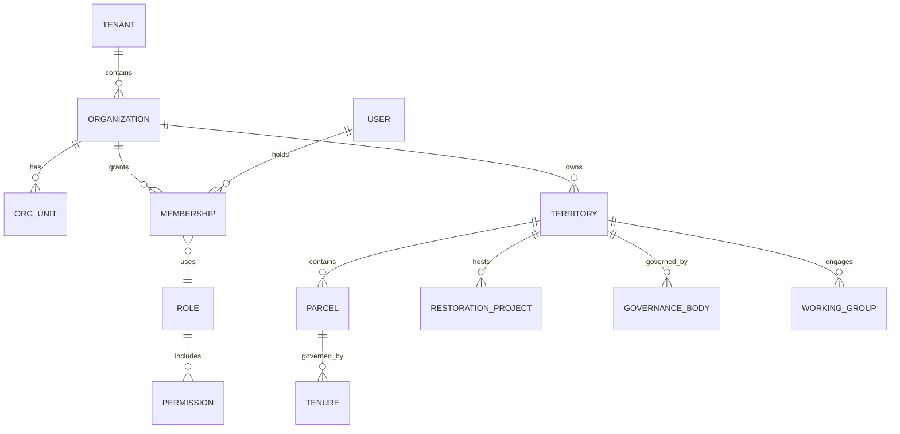
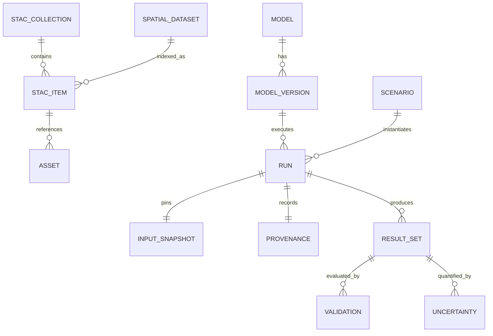
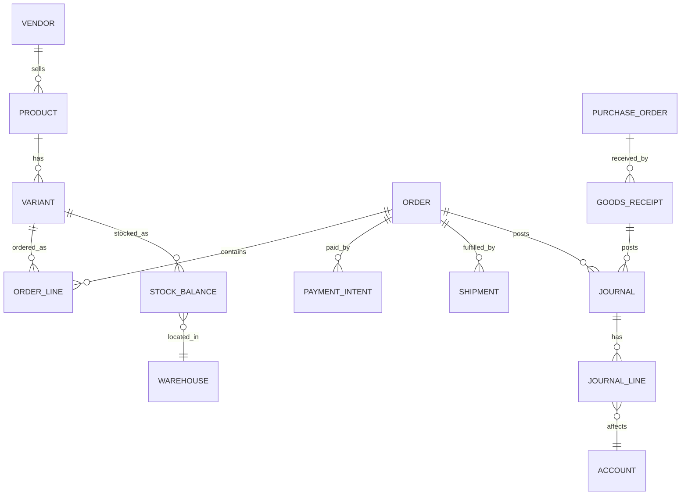

# مدل دامنه داده — Eco Nojin و HyDroMA

**Document ID:** ECO-NOJIN-DATA-DOMAIN-MODEL
**Version:** 1.0 (DESIGN — NOT APPROVED)
**Date:** 2026-11-17
**Status:** مدل مفهومی؛ انتخاب فناوری نهایی باز است.

---

## ۱. اصول مدل داده

| # | اصل | پیاده‌سازی پیشنهادی |
|---|---|---|
| D1 | مالکیت واحد | هر موجودیت یک دامنه مالک دارد؛ نوشتن فقط از API همان دامنه. |
| D2 | شناسه یکتا | UUIDv7 برای کلید اصلی؛ کد انسانی tenant-scoped برای ارجاع کاربر. |
| D3 | چندمستأجری | `tenant_id` در همه جداول دامنه؛ RLS؛ تست نشت در CI. |
| D4 | زمان | ذخیره UTC؛ `valid_from/valid_to` برای موجودیت‌های تاریخ‌مند؛ نمایش locale. |
| D5 | نسخه‌بندی | `version` افزایشی؛ تغییر حساس با history جداگانه؛ حذف نرم. |
| D6 | خط‌مبدأ | هر نتیجه/شاهد دارای provenance؛ هر سند مالی دارای actor و منبع. |
| D7 | طبقه‌بندی | `C0` عمومی، `C1` داخلی، `C2` محرمانه، `C3` محدود (PII/مالی/سند مالکیت)، `C4` راز (اعتبارنامه). |
| D8 | پول | اعشاری دقیق یا عدد صحیح مینور + مقیاس ارز؛ float ممنوع. |
| D9 | واحد | UCUM؛ مقدار + کد واحد + نسخه تبدیل. |
| D10 | هویت مکانی | هندسه در PostGIS؛ URI پایدار برای هر موجودیت مکانی. |
| D11 | یکپارچگی ارجاعی | FK داخل دامنه؛ ارجاع بین‌دامنه‌ای با شناسه + snapshot لازم. |
| D12 | نگهداشت | سیاست هر دامنه؛ حذف فیزیکی فقط پس از انقضای قانونی و تأیید. |

---

## ۲. نقشه دامنه‌ها

---

## ۳. دامنه‌ها، مالکیت و مرز

| دامنه | مالک | موجودیت‌های اصلی | مصرف‌کننده‌ها | داده حساس | نگهداشت پیشنهادی |
|---|---|---|---|---|---|
| Identity | PLT | User، Credential، Factor، Session، Invitation | همه | C3 هویت؛ C4 اعتبارنامه | حساب فعال + ۲ سال پس از حذف؛ audit طولانی‌تر |
| Organization | PLT | Tenant، Organization، OrgUnit، Membership، Role، Permission، Policy | همه | C2/C3 | ۱۰ سال پس از پایان رابطه |
| Territory | TER | Village، NomadicCommunity، Rangeland، Farm، Watershed، Landscape، Parcel، Tenure، RestorationProject | SCI، MRV، MKT، FIN | C3 سند بهره‌برداری | دائمی برای مرز/مالکیت؛ اسناد مطابق قانون |
| Geospatial | GIS | SpatialDataset، StacCollection، StacItem، Asset، Layer، MapView، FieldObservation | SCI، TER، MRV | C1/C2 | دارایی خام بر اساس منبع؛ فراداده دائمی |
| Scientific | SCI | Model، ModelVersion، Adapter، Scenario، Run، InputSnapshot، ResultSet، Provenance، Calibration، Validation، Uncertainty | MRV، TER، AI | C1/C2 | نتیجه و provenance دائمی |
| MRV | MRV | MonitoringRecord، Baseline، Evidence، MRVReport، Verification، UncertaintyStatement، InternalEstimate، RegistryCredit | FIN (فقط گزارش)، DEC (فقط داخلی) | C2/C3 | گزارش تأییدشده ۱۰+ سال؛ شاهد مطابق روش‌شناسی |
| Marketplace | MKT | Vendor، Catalog، Product، Variant، PriceRule، Listing، Order، OrderLine، Return، Commission، Settlement، Review | INV، FIN، TOU | C2/C3 | سفارش ۱۰ سال؛ KYC مطابق قانون |
| Inventory | INV | Warehouse، Location، Item، StockBalance، Movement، Batch، Reservation，PurchaseOrder، Supplier，ValuationLayer | MKT، FIN | C2 | حرکت ۱۰ سال؛ بچ مطابق محصول |
| Finance | FIN | Account، Journal، JournalLine，Period，Invoice，Payment，BankStatement，FXRate，TaxRule，Budget，StatementSnapshot | همه گزارش‌ها | C3 | ۱۰ سال یا بیشتر مطابق قانون |
| Payment | PAY | PaymentIntent، PaymentAttempt، Refund، GatewayEvent، PayoutInstruction | MKT، TOU، FIN | C3؛ بدون PAN | ۱۰ سال رکورد؛ داده کارت هرگز ذخیره نشود |
| Tourism | TOU | Destination، Stay، Experience، Tour，Guide، Availability، Reservation，Itinerary، Event | FIN | C3 اطلاعات مهمان | رزرو ۷ سال؛ مهمان حداقل‌سازی |
| Document | PLT | Document، DocumentVersion، AclEntry، ScanResult | همه | C2/C3 | مطابق طبقه‌بندی سند |
| Notification | PLT | Template، Notification، DeliveryAttempt، Preference | همه | C1 | ۱ سال؛ audit ارسال ۲ سال |
| AI | AI | AgentDefinition، ToolDefinition، AgentRun، ToolCall，ApprovalRequest，UsageRecord | ADM، AUD | C1/C2؛ ورودی ممکن است C3 | trace ۲ سال با redaction |
| Workflow | WF | WorkflowDefinition، WorkflowInstance، Task، Transition，Approval，DeadLetter | همه | C1 | نمونه ۲ سال؛ audit ۱۰ سال |
| Audit | PLT | AuditEvent، ChainCheckpoint، AccessDenial | AUD، COMPLY | C2 | حداقل ۱۰ سال؛ تغییرناپذیر |
| Digital Economy | FIN | InternalAccount، LedgerEntry، RewardRule، RewardGrant，WalletHold，RiskLimit | WAL، WAL-ADMIN | C2/C3 | ۱۰ سال؛ تعریف توکن = تصمیم مالک |

`ASSUMPTION` اعداد نگهداشت پیشنهادی‌اند؛ قانون محلی می‌تواند آن‌ها را تغییر دهد. `OWNER_DECISION_REQUIRED` سیاست نهایی.

---

## ۴. موجودیت‌های کلیدی و روابط

### ۴.۱ هویت، سازمان، سرزمین

| موجودیت | شناسه | مالک | روابط کلیدی | طبقه‌بندی | قواعد |
|---|---|---|---|---|---|
| Tenant | uuid | PLT | Organization 1:N | C2 | جداسازی کامل؛ حذف ممنوع بدون مجوز |
| User | uuid | PLT | Membership 1:N؛ Session 1:N | C3 | حذف نرم؛ حداقل PII |
| Membership | uuid | PLT | User×Org؛ Role N:M | C2 | نقش در عضویت؛ تاریخ اعتبار |
| Role / Permission | uuid/code | PLT | Policy | C1 | سیستم‌نقش‌ها غیرقابل حذف |
| Organization | uuid | PLT | OrgUnit؛ Territory | C2 | KYC اختیاری بر اساس نوع |
| Territory (abstract) | uuid | TER | Parcel؛ Project؛ Geometry | C2/C3 | نوع: village/nomad/rangeland/farm/watershed/landscape |
| Parcel | uuid | TER | Tenure؛ Geometry؛ LandUse | C3 | تاریخ اعتبار حق بهره‌برداری |
| RestorationProject | uuid | TER | Milestone؛ Indicator؛ Budget | C1/C2 | اتصال اجباری به خط پایه |

### ۴.۲ داده مکانی و علمی

| موجودیت | شناسه | مالک | روابط | طبقه‌بندی | قواعد |
|---|---|---|---|---|---|
| SpatialDataset | uuid | GIS | StacItem؛ Layer | C1 | منبع و مجوز داده الزامی |
| StacCollection / Item | uuid | GIS | Asset | C0/C1 | انطباق STAC 1.0؛ لینک مجوز |
| Asset | uuid | GIS | COG/Zarr URI | C1 | checksum؛ اندازه؛ نوع |
| Layer / MapView | uuid | GIS | Dataset؛ View | C1 | دسترسی بر اساس geo-scope |
| FieldObservation | uuid | GIS | Parcel؛ Survey | C2/C3 | GPS accuracy؛ device؛ provenance |
| Model | uuid | SCI | ModelVersion | C0/C1 | مجوز مدل؛ دامنه اعتبار |
| ModelVersion | semver+uuid | SCI | Adapter؛ Run | C1 | تغییرناپذیر؛ hash کد |
| Scenario | uuid | SCI | Run | C1/C2 | پارامترها و ورودی snapshot |
| Run | uuid | SCI | InputSnapshot؛ Result | C1 | وضعیت؛ هزینه؛ محدودیت |
| InputSnapshot | uuid | SCI | Dataset refs | C1 | hash ترکیبی؛ تغییرناپذیر |
| ResultSet | uuid | SCI | Validation؛ Uncertainty | C1/C2 | برچسب `UNCALIBRATED`/`VALIDATED` |
| Provenance | uuid | SCI | Run؛ Evidence | C2 | hash-chain؛ غیرقابل ویرایش |

### ۴.۳ MRV

| موجودیت | شناسه | مالک | روابط | طبقه‌بندی | قواعد |
|---|---|---|---|---|---|
| MonitoringRecord | uuid | MRV | Project؛ Indicator | C2 | بسامد و روش اندازه‌گیری |
| Baseline | uuid | MRV | Project؛ Methodology | C2 | نسخه‌دار؛ تغییر نیازمند تأیید |
| Evidence | uuid | MRV | Report؛ Hash | C3 | زنجیره نگهداشت؛ امضا |
| MRVReport | uuid | MRV | Verification | C2 | تفکیک draft/final |
| Verification | uuid | MRV | Report؛ Verifier | C2 | SoD؛ تأیید مستقل |
| InternalEstimate | uuid | MRV | Run؛ Methodology | C2 | «برآورد داخلی»؛ غیرقابل فروش |
| RegistryCredit | uuid | MRV (record only) | External registry id | C3 | فقط ثبت؛ صدور خارجی |

### ۴.۴ بازارگاه، انبار، مالی

| موجودیت | شناسه | مالک | روابط | طبقه‌بندی | قواعد |
|---|---|---|---|---|---|
| Vendor | uuid | MKT | Product؛ Settlement | C3 | KYC؛ وضعیت چرخه عمر |
| Product / Variant | uuid | MKT | Stock؛ Price | C0/C1 | واحد فروش؛ مالیات؛ منشأ |
| PriceRule | uuid | MKT | Variant | C1 | اعشاری؛ بازه اعتبار |
| Order / OrderLine | uuid | MKT | Payment؛ Shipment؛ Journal | C3 | snapshot قیمت در زمان سفارش |
| Return | uuid | MKT | Order؛ CreditNote | C2 | دلیل؛ شاهد؛ وضعیت |
| Commission / Settlement | uuid | MKT | Vendor؛ Journal | C3 | قاعده نسخه‌دار؛ تفکیک وظایف |
| Warehouse / Location | uuid | INV | Stock | C1 | ظرفیت؛ دسترسی انبار |
| StockBalance | uuid | INV | Item؛ Batch؛ Warehouse | C2 | مقدار + واحد؛ رزرو |
| Movement | uuid | INV | Balance؛ Source | C2 | تغییرناپذیر؛ نوع و مرجع |
| Batch | uuid | INV | Movement؛ Trace | C2 | تاریخ تولید/انقضا؛ شجره |
| PurchaseOrder / Receipt | uuid | INV | Supplier؛ Invoice | C2 | تطبیق سه‌طرفه |
| Account | code+uuid | FIN | JournalLine | C1 | نوع؛ ارز؛ ابعاد |
| Journal / JournalLine | uuid | FIN | Account؛ Source | C3 | متوازن؛ append-only |
| Period | code | FIN | Journal | C2 | بسته/باز؛ بازگشایی با تأیید |
| Invoice | uuid | FIN | Order؛ Payment | C3 | شماره‌گذاری؛ مالیات |
| Payment / Refund | uuid | PAY | Intent؛ Invoice | C3 | شناسه درگاه؛ بدون کارت |
| BankStatement / FXRate | uuid | FIN | Reconciliation | C3 | منبع نرخ؛ تاریخ |
| TaxRule / Budget | uuid | FIN | Jurisdiction/Project | C2 | نسخه‌دار |

### ۴.۵ گردشگری، سند، اعلان، AI، گردش‌کار، audit، اقتصاد داخلی

| موجودیت | شناسه | مالک | روابط | طبقه‌بندی | قواعد |
|---|---|---|---|---|---|
| Destination | uuid | TOU | Geometry؛ Content | C0 | تأیید محتوا |
| Stay / Experience / Tour | uuid | TOU | Availability؛ Reservation | C1 | ظرفیت؛ سیاست لغو |
| Availability | uuid | TOU | Calendar؛ Hold | C1 | قفل موقت؛ انقضای hold |
| Reservation | uuid | TOU | Payment؛ Guest | C3 | حداقل داده مهمان |
| Guide | uuid | TOU | Assignment؛ License | C2 | اعتبار مجوز |
| Event | uuid | TOU | Ticket | C0/C1 | تقویم؛ ظرفیت |
| Document | uuid | PLT | Version؛ ACL؛ Scan | C2/C3 | نسخه‌بندی؛ اسکن بدافزار |
| Notification | uuid | PLT | Template؛ Delivery | C1 | ترجیح کاربر؛ retry |
| AgentDefinition / Tool | uuid | AI | Run؛ Approval | C1 | دامنه ابزار؛ ریسک |
| AgentRun / ToolCall | uuid | AI | Trace؛ Usage | C1/C2 | redaction؛ هزینه |
| ApprovalRequest | uuid | WF | Run؛ Policy | C2 | TTL؛ چهارچشم |
| WorkflowInstance | uuid | WF | Task؛ Transition | C1 | idempotency؛ DLQ |
| AuditEvent | uuid | PLT | Actor؛ Target | C2 | hash-chain؛ فقط افزودن |
| InternalAccount / LedgerEntry | uuid | FIN | Reward؛ Wallet | C3 | دوطرفه؛ سقف؛ HITL |
| RewardGrant / RiskLimit | uuid | FIN | Policy | C2 | قاعده نسخه‌دار؛ تأیید |

---

## ۵. جداسازی انبارهای داده

| نیاز | انبار | چرا جدا |
|---|---|---|
| تراکنش دامنه | PostgreSQL (schema per bounded context) | ACID، FK، RLS، گزارش عملیاتی |
| هندسه و جست‌وجوی مکانی | PostGIS | ایندکس GiST/SP-GiST؛ توابع مکانی |
| فایل بزرگ و تغییرناپذیر | Object Storage (COG/PDF/شاهد) | هزینه پایین؛ دسترسی HTTP Range؛ نسخه‌بندی |
| کاتالوگ دارایی مکانی | STAC API + ایندکس DB | استاندارد؛ جست‌وجوی مکانی-زمانی |
| جست‌وجوی متنی/صفتی | Search Index | سرعت؛ facet؛ تحلیل |
| سری زمانی پایش | پارتیشن‌بندی زمانی (Timescale/parquet) | حجم بالا؛ بازه زمانی |
| نتایج علمی و سناریو | Parquet + متادیتا | تحلیلی؛ اسکن ستونی؛ بازتولید |
| گزارش BI و داشبورد | Analytical store/read replica | بار تحلیلی از OLTP جدا |
| صف و رویداد | Outbox + broker (در صورت نیاز) | جداسازی خطا؛ retry |

`RECOMMENDATION` Postgres+PostGIS به‌عنوان گزینه پایه ارزیابی شود؛ `OWNER_DECISION_REQUIRED` انتخاب نهایی و جایگزین‌ها.

---

## ۶. استانداردها

| حوزه | استاندارد | کاربرد |
|---|---|---|
| کاتالوگ مکانی | STAC 1.0 | مجموعه و آیتم دارایی |
| رستر | COG؛ GeoTIFF؛ Zarr | ذخیره و توزیع تصاویر |
| وکتور | GeoJSON RFC 7946؛ WKB | تبادل و ذخیره |
| سرویس مکانی | OGC API Features/Tiles/Maps/Coverages؛ WMS/WFS/WMTS | انتشار رسمی |
| فراداده | ISO 19115/19139 | توصیف داده |
| زمان | ISO 8601 | ذخیره و تبادل |
| ارز | ISO 4217 | کد و مقیاس |
| کشور/منطقه | ISO 3166 | مرجع |
| واحد | UCUM | کمیت علمی |
| زبان/قالب | CLDR/ICU | بومی‌سازی |
| هویت | OAuth2/OIDC؛ SCIM 2.0 | دسترسی و تدارک |
| API | OpenAPI 3.1؛ JSON Schema | قرارداد |
| رصد | OpenTelemetry | trace/metric/log |
| MRV | روش‌شناسی‌های رجیستری‌های معتبر (خارجی) | فقط انطباق؛ بدون تأیید حقوقی |

---

## ۷. قواعد پول، واحد و زمان

1. `RECOMMENDATION` پول: `NUMERIC(38,12)` یا integer minor units با `currency_scale`؛ جمع/ضرب با گردکردن بانکی در نقاط مشخص. یک ثابت سراسری `MONEY_SCALE=12` در PLT-SET تعریف و توسط همه ماژول‌های مالی/قیمت ارجاع شود تا دقت یکسان بماند.
2. نرخ ارز: موجودیت مستقل با `source`، `as_of`، `rate`؛ تبدیل در زمان ثبت با نرخ snapshot؛ گزارش چندارزی با نرخ جاری و تاریخی.
3. واحد: `quantity_value` + `unit_code` + `conversion_version`؛ API واحد SI کانونیک + نمایش محلی.
4. زمان: ذخیره UTC؛ `timezone` در سطح سازمان/سایت؛ تبدیل فقط در نمایش و گزارش.
5. اعداد و درصدها: ذخیره با مقیاس کافی؛ نمایش locale؛ عدم استفاده از float در محاسبات مالی یا علمی حساس.
6. شناسه‌های انسانی: یکتا در tenant؛ تولید با قاعده و بدون افشای ترتیب حساس.

---

## ۸. رویدادهای دامنه (قرارداد بین‌دامنه‌ای)

| رویداد | تولیدکننده | مصرف‌کننده | payload حداقلی |
|---|---|---|---|
| `org.created` | PLT | FIN؛ ADM | org_id؛ locale؛ currency |
| `territory.approved` | TER | GIS؛ SCI؛ MRV | territory_id؛ type؛ geometry_hash |
| `order.placed` | MKT | INV؛ FIN؛ PAY | order_id؛ lines؛ total؛ currency |
| `order.paid` | PAY | MKT؛ FIN | order_id؛ payment_id؛ amount |
| `order.cancelled` | MKT | INV؛ PAY؛ FIN | order_id؛ reason |
| `stock.reserved` | INV | MKT | variant_id؛ qty؛ warehouse |
| `goods.received` | INV | FIN | po_id؛ value؛ currency |
| `journal.posted` | FIN | ADM؛ DEC | journal_id؛ period؛ total |
| `run.completed` | SCI | MRV؛ TER؛ AI | run_id؛ result_id؛ status |
| `mrv.report.verified` | MRV | ADM؛ FIN | report_id؛ project_id؛ period |
| `credit.recorded` | MRV | ADM | registry_id؛ amount؛ registry |
| `agent.action.proposed` | AI | WF | run_id؛ tool؛ risk_class |
| `approval.granted` | WF | AI؛ MKT؛ FIN | request_id؛ approver؛ scope |
| `document.uploaded` | PLT | domain owner | doc_id؛ classification |

`RECOMMENDATION` هر رویداد دارای `event_id`، `occurred_at`، `tenant_id`، `schema_version`، `correlation_id` و `causation_id` باشد؛ مصرف‌کننده idempotent باشد. INT-EVENT-SCHEMA مالک نسخه و سازگاری schema رویداد است.

---

## ۹. مدل خواندن و گزارش

- هر داشبورد از **read model** محلی/کش‌شده استفاده می‌کند، نه join زنده بین schemaها.
- گزارش مالی از snapshot دوره + GL؛ گزارش علمی از ResultSet + provenance.
- مجوز گزارش با همان RBAC/ABAC دامنه؛ گزارش مشتق‌شده طبقه‌بندی والد را به ارث می‌برد.
- خروجی export: ثبت audit؛ watermark؛ محدودیت حجم؛ لینک موقت.

---

## ۱۰. حریم خصوصی و نگهداشت

| طبقه | نمونه | کنترل |
|---|---|---|
| C0 | محتوای عمومی، کاتالوگ منتشرشده | کش عمومی مجاز |
| C1 | فراداده پروژه، لایه داخلی | احراز هویت |
| C2 | گزارش MRV، سند تجاری | نقش + دامنه + لاگ دسترسی |
| C3 | PII، سند مالکیت، اطلاعات مالی، مهمان | حداقل‌سازی؛ رمزنگاری فیلد؛ دسترسی موردی |
| C4 | کلید، رمز، توکن درگاه | vault؛ بدون نمایش؛ چرخش |

- حذف حساب: ناشناس‌سازی هویتی، حفظ رکوردهای مالی/قانونی با مبنای مجاز.
- DSAR: خروجی محدود به داده شخصی؛ حذف رکوردهای دارای تعهد نگهداشت ممنوع.
- Legal hold: توقف حذف برای دامنه مشخص.
- داده بین‌مرزی: `OWNER_DECISION_REQUIRED`؛ معماری باید منطقه‌بندی داده را ممکن کند.

---

## ۱۱. تصمیمات باز مرتبط با داده

1. انتخاب نهایی DB و افزونه‌های مکانی/زمانی.
2. مدل چندمستأجری: shared با RLS یا hybrid schema.
3. انتخاب Object Storage و سیاست نسخه‌بندی.
4. انتخاب Search Index.
5. انتخاب انبار تحلیلی و ابزار BI.
6. سیاست نگهداشت و پاک‌سازی نهایی.
7. حداقل مجموعه داده لازم برای MRV قابل استناد.
8. سطح جزئیات PII در جوامع محلی.

**پایان سند.**
