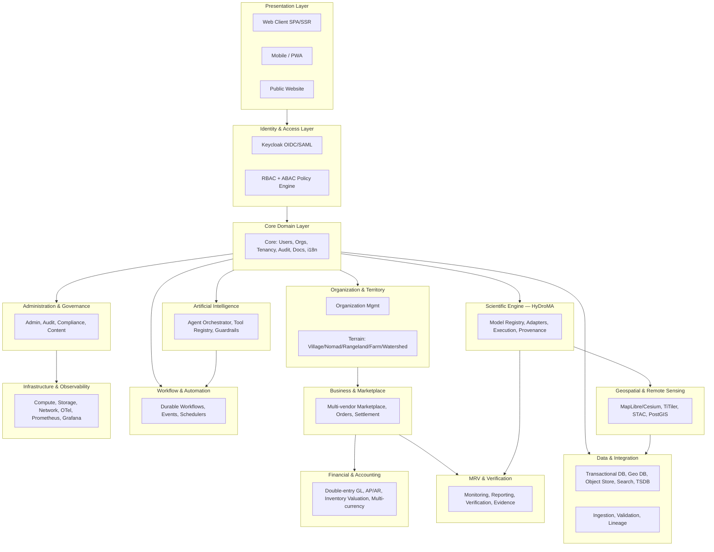
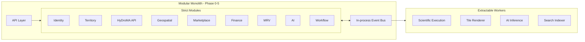

# ECO NOJIN — MASTER ARCHITECTURE
## Comprehensive Architecture for Eco Nojin & HyDroMA

**Document ID:** ECO-NOJIN-MASTER-ARCHITECTURE
**Version:** 1.0 (DRAFT for owner review)
**Date:** 2026-11-17
**Status:** DESIGN — NOT APPROVED. No technology is final. No project is Production Approved.
**Classification legend:** `FACT` (documented/evidenced) · `ASSUMPTION` (design assumption) · `RECOMMENDATION` (technical proposal) · `OWNER_DECISION_REQUIRED` · `UNKNOWN`.

---

## 0. DOCUMENT CONTROL

| Item | Value |
|---|---|
| Scope | Architecture design only (no code, no build, no deploy, no DB, no token) |
| Input references | `FINAL-UPSTREAM-REGISTRY.md`, `FINAL-UPSTREAM-CAPABILITY-MATRIX.csv`, `FINAL-UPSTREAM-OPEN-ISSUES.md` |
| Upstream base | `D:\Nojin\upstream-registry` (54 extracted projects) |
| Out of scope | `D:\HyDroMA`, `D:\eco_nojin` (read-only, not modified) |
| Related docs | 9 companion files in `D:\Nojin\architecture\` |

---

## 1. PRODUCT IDENTITY & VISION

### 1.1 Identity
- `FACT` Eco Nojin is an international digital ecosystem for managing, developing, and restoring **living territories**: villages, nomadic communities, rangelands, farms, and watersheds.
- `FACT` HyDroMA is the **scientific intelligence engine** at the core of the ecosystem.
- `FACT` Organizational owner context: **کشت و صنعت دشت امید نارون** (Dasht Omid Narun Agro-Industry).
- `ASSUMPTION` The product must be **globally extensible**: not bound to one country, language, measurement unit, currency, or organizational structure.

### 1.2 Three product layers
```
┌─────────────────────────────────────────────────────────────┐
│  Layer 3: FINANCIAL & DIGITAL ECONOMY                        │
│  (Accounting, Marketplace, Tourism, EcoCoin/HIC, MRV-carbon) │
├─────────────────────────────────────────────────────────────┤
│  Layer 2: BUSINESS & LIVELIHOOD                              │
│  (Territories, Communities, Farms, Tourism, Commerce)        │
├─────────────────────────────────────────────────────────────┤
│  Layer 1: SCIENTIFIC                                         │
│  (HyDroMA engine, GIS/RS, MRV evidence, models)              │
└─────────────────────────────────────────────────────────────┘
              ↕ connected through the SHARED CORE ↕
   (Identity, Tenancy, Data, Workflow, AI, Security, Observability)
```

### 1.3 Design principles (normative for all modules)
| # | Principle | Acceptance criterion (measurable) |
|---|---|---|
| P1 | Modular design | Every module has a declared public API + explicit dependency list; no undeclared cross-module imports (enforced by lint rule) |
| P2 | API-first | Every capability exposed via versioned API (`/v1/...`) with OpenAPI 3.1 spec; no UI-only access paths |
| P3 | Open standards | OGC (WMS/WFS/WMTS/TMS), STAC 1.0, GeoJSON RFC 7946, COG, OAI-PMH, OAuth2/OIDC, SCIM 2.0 |
| P4 | Data provenance | Every scientific result carries `{model_id, model_version, input_hash, params_hash, code_version, executed_at, operator}` |
| P5 | Versioned models | Model registry entries are immutable; breaking changes create a new version; old versions remain runnable |
| P6 | Unit-safe scientific computation | All quantities carry units (UCUM); unit mismatch is a hard error, not a warning |
| P7 | Decimal-based finance | Monetary values stored as `NUMERIC(38,18)` / decimal types; **floating point is forbidden** for money |
| P8 | Internationalization | i18n from day 1; ICU message format; RTL/LTR; >1 locale; date/number/currency via locale |
| P9 | Accessibility | WCAG 2.2 AA target for all user-facing UI |
| P10 | Observability | Every request traced (OpenTelemetry); structured JSON logs; RED + USE metrics |
| P11 | Testability | Unit + integration + contract tests per module; CI gate; ≥70% line coverage target (owner to confirm) |
| P12 | Security by design | Threat model per module; OWASP ASVS L2 baseline; least privilege |
| P13 | Backward compatibility | API versioning; N-1 compatibility window; deprecation policy (≥2 minor versions) |
| P14 | Disaster recovery | RPO ≤ 15 min, RTO ≤ 4 h for Tier-1 data (target, owner to confirm) |
| P15 | Reproducibility | Scientific runs reproducible from stored inputs + code version; deterministic seeds where applicable |

---

## 2. MACRO ARCHITECTURE — 14 LAYERS



### 2.1 Layer responsibility matrix

| Layer | Primary responsibility | Allowed dependencies | Forbidden | Security requirement |
|---|---|---|---|---|
| **L1 Presentation** | Render UI, collect input, client-side validation, optimistic UX | L2 (OIDC), L3 API, L6 client libs | Direct DB, direct L5/L8/L9 | CSP, XSS defense, CSRF, secure cookies |
| **L2 Identity & Access** | Authentication (OIDC/SAML), MFA, session, token issuance, RBAC/ABAC decisions | L3, external IdP | Business logic | OWASP ASVS L2, brute-force protection, MFA for privileged |
| **L3 Core Domain** | Users, orgs, multi-tenancy, roles, audit, documents, i18n, settings | L2, L7, L11 | Scientific/business logic | Tenant isolation, PII protection, audit immutability |
| **L4 Org & Territory** | Organization hierarchy, territory registry (village/nomad/rangeland/farm/watershed), parcels, projects | L3, L6, L7 | Financial posting, model execution | Geospatial access control (region-scoped) |
| **L5 Scientific Engine (HyDroMA)** | Model registry, adapters, execution, calibration, uncertainty, provenance | L6, L7, L11, L3 | Direct financial/marketplace access | Sandboxed execution, resource limits, provenance integrity |
| **L6 Geospatial & RS** | Maps, tiles, raster/vector processing, STAC, watershed delineation, indices | L7, L5 (read results) | Direct accounting | Tile access control, API key management |
| **L7 Data & Integration** | Persistence: OLTP, geospatial, object store, search, TSDB, scientific data, lineage | Infra (L14) | Business rules | Encryption at rest/in transit, backup, retention |
| **L8 Business & Marketplace** | Multi-vendor marketplace, catalog, orders, returns, commission, settlement | L3, L4, L9, L11 | Direct model execution | PCI-DSS scope avoidance (tokenized payments), fraud checks |
| **L9 Financial & Accounting** | Double-entry GL, AP/AR, inventory valuation, multi-currency, tax, reporting | L3, L7, L11 | Direct marketplace UI | Immutable ledger, Decimal-only, audit trail, segregation of duties |
| **L10 Artificial Intelligence** | Agent orchestration, tool registry, guardrails, human-approval gates | L3, L5, L8, L9 (read-only tools), L11 | Unbounded financial actions | Tool allowlists, prompt-injection defense, human-in-the-loop for money/credits |
| **L11 Workflow & Automation** | Durable workflows, events, schedulers, approvals, saga orchestration | L3, L7 | Direct UI | Idempotency, retry limits, dead-letter queues |
| **L12 MRV & Verification** | Monitoring, reporting, verification, carbon/soil carbon, evidence, uncertainty | L5, L6, L7, L11 | Direct token issuance | Evidence integrity, provenance, external registry isolation |
| **L13 Administration & Governance** | Admin consoles, audit, compliance, content, agent administration | L3, all (read) | Business logic | 4-eyes principle, audit immutability, RBAC |
| **L14 Infrastructure & Observability** | Compute, storage, network, telemetry, monitoring, alerting, backup | — | Business logic | Network segmentation, secrets management, patching |

### 2.2 Independence rules
- `RECOMMENDATION` **HyDroMA (L5) must be an independent unit** with its own repo/API/storage boundary, callable by any other layer via a stable contract (job submission + result retrieval). It must not import business-layer modules.
- `RECOMMENDATION` **Financial (L9) must be an independent unit** with an immutable ledger; other modules post *journal entries* through a narrow API, never write GL tables directly.
- `RECOMMENDATION` **Geospatial (L6) is a shared service** consumed by L4/L5/L8/L12, not owned by any single module.
- `RECOMMENDATION` **AI (L10) is a cross-cutting capability** with *tools* that call other modules' APIs; agents never get raw DB access.

---

## 3. DECOMPOSITION STRATEGY — MONOLITH vs SERVICES

### 3.1 Comparison
| Dimension | Modular Monolith | Modular Services | Microservices |
|---|---|---|---|
| Initial cost | Low | Medium | High |
| Operational complexity | Low (1 deployable) | Medium | Very high (orchestration, mesh, tracing) |
| Scalability | Vertical + targeted worker pools | Per-service scaling | Fine-grained |
| Team scaling | Moderate | Good | Best |
| Data consistency | ACID transactions easy | Sagas/outbox needed | Hardest |
| Failure isolation | Process-level | Service-level | Fine-grained |
| Time-to-market | Fastest | Medium | Slowest |
| Best fit | Early-stage product with clear modules | Growing org, clear bounded contexts | Very large org, extreme scale |

### 3.2 Recommendation
- `RECOMMENDATION` **Default: Modular Monolith** (single deployable, strict internal module boundaries, in-process events, shared transactional DB) for Phase 0–5.
- `RECOMMENDATION` **Extract to Modular Services** only when a module meets *all* of: (a) independent scaling need demonstrated by metrics, (b) independent release cadence, (c) distinct failure domain, (d) team ownership boundary. Candidates: **HyDroMA execution workers**, **tile rendering**, **AI inference**, **search indexing**.
- `RECOMMENDATION` **Avoid microservices-by-default**: it adds distributed-systems cost without demonstrated need.
- `OWNER_DECISION_REQUIRED` Final decomposition (monolith vs services) and timing of extraction.



### 3.3 Module boundary rules (normative)
1. Modules communicate via **public interfaces** (API or domain events), never shared DB tables.
2. Cross-module data access is via **read models / projections**, not joins across module schemas.
3. Every module owns its **schema**; cross-schema joins are forbidden in application code.
4. Shared kernel (identity, tenancy, audit, money, units) is a **versioned library**, not a service.

---

## 4. LAYER-BY-LAYER DESIGN (SUMMARY)

> Full detail per layer is in companion files. This section fixes responsibilities, contracts, and boundaries.

### 4.1 L1 Presentation Layer
- **Responsibility:** web SPA/SSR, mobile/PWA, public site. Client-side validation, i18n, theming, accessibility.
- **Sub-modules:** Public website, Auth UI, Dashboards (user/scientific/geospatial/marketplace/finance/tourism/knowledge/AI/admin), Design System.
- **Inputs:** user actions, API responses. **Outputs:** API calls, analytics events.
- **Dependencies:** L2 (OIDC), L3+ APIs, L6 client libs (MapLibre/Cesium/deck.gl).
- **Security:** CSP, XSS/CSRF defense, secure cookie flags, dependency scanning.
- **Processing:** heavy client-side work (map rendering, WASM raster ops, 3D) where it reduces server load — but **device/battery/bandwidth cost is acknowledged**.
- **Open-source options (to evaluate):** MapLibre GL (2D), Cesium (3D), deck.gl (layers), TanStack Query, shadcn/ui. `RECOMMENDATION` not final.

### 4.2 L2 Identity & Access
- **Responsibility:** authentication (OIDC/SAML/OAuth2), MFA, session/token, RBAC + ABAC (contextual: org, region, role, attributes), SCIM provisioning.
- **Sub-modules:** Auth server, Policy engine (PDP/PEP), Session mgmt, MFA, Federation, SCIM.
- **Open-source options:** Keycloak (Apache-2.0) as primary candidate; Casbin/OPA for policy. `RECOMMENDATION` Keycloak is a strong candidate (registry-verified), but **final IdP is OWNER_DECISION_REQUIRED**.
- **Security:** OWASP ASVS L2, brute-force lockout, MFA for privileged roles, short-lived tokens + refresh rotation.

### 4.3 L3 Core Domain
- **Responsibility:** users, organizations, multi-tenancy, roles/permissions, user/organization profiles, notification prefs, global settings, localization, audit trail, document management.
- **Multi-tenancy model:** `RECOMMENDATION` **shared-schema + `organization_id` + PostgreSQL Row-Level Security (RLS)**; `OWNER_DECISION_REQUIRED` (schema-per-tenant vs shared vs hybrid).
- **Audit:** append-only audit log (hash-chained) for all sensitive operations.
- **Documents:** object storage + metadata in DB; antivirus scan; versioning.

### 4.4 L4 Organization & Territory
- **Responsibility:** org hierarchy (holding → org → unit), village, nomadic community, rangeland, farm, watershed, landscape, land parcels, restoration projects, community participation, working groups, local governance, resource mgmt.
- **Geospatial linkage:** every territory has geometry (PostGIS) + administrative hierarchy + custom attributes.
- **Boundaries:** does not post financial entries; does not execute models.

### 4.5 L5 Scientific Engine (HyDroMA) — see `HYDROMA-SCIENTIFIC-ENGINE-ARCHITECTURE.md`
- **Responsibility:** model registry, adapters, input/unit validation, spatial processing, execution (server/worker, optional browser WASM), job queue, scenarios, calibration, validation, uncertainty, provenance, result store, visualization API.
- **Independence:** own repo, own API, own storage; callable by any layer via job contract.
- **Rule:** uncalibrated/unvalidated results are marked `UNVALIDATED` and must not be presented as scientific fact.

### 4.6 L6 Geospatial & Remote Sensing
- **Responsibility:** interactive maps, 2D/3D, terrain, satellite imagery, raster/vector processing, STAC catalog, geospatial search, watershed delineation, land cover, vegetation indices, change detection, field data integration.
- **Standards:** OGC, STAC 1.0, GeoJSON, COG, WMS/WMTS/WFS.
- **Open-source candidates (evaluate):** MapLibre GL, Cesium, deck.gl, TiTiler, PgSTAC, PySTAC, ODC-STAC, MapServer, pygeoprocessing. `RECOMMENDATION` not final.

### 4.7 L7 Data & Integration
- **Responsibility:** OLTP DB, geospatial DB, object storage, search index, time-series, scientific data, analytical store, ingestion, validation, lineage.
- **Logical stores:**
  - Transactional: relational (PostgreSQL candidate).
  - Geospatial: PostGIS candidate.
  - Object storage: S3-compatible (SeaweedFS/MinIO candidates).
  - Search: OpenSearch/Elasticsearch candidate.
  - Time-series: TimescaleDB/Prometheus candidate.
  - Scientific: Parquet/COG/Zarr on object store + catalog.
  - Analytical: warehouse (e.g., DuckDB/ClickHouse candidate).
- `OWNER_DECISION_REQUIRED` final DB/storage selection.

### 4.8 L8 Business & Marketplace
- **Responsibility:** multi-vendor marketplace, village/nomadic/agricultural catalogs, vendor mgmt, variants, pricing, discounts, orders, returns, commission, settlement, shipping, logistics, customers, reviews, analytics.
- **Open-source candidates:** Spree (BSD-3-Clause, multi-vendor out-of-box), Medusa (MIT+EE), QloApps (OSL-3.0, not recommended). `RECOMMENDATION` Spree is the strongest OSS candidate for marketplace core; **final core is OWNER_DECISION_REQUIRED**.

### 4.9 L9 Financial & Accounting
- **Responsibility:** double-entry GL, chart of accounts, AP/AR, cash, bank reconciliation, multi-currency, cost/project accounting, tax config, financial statements, budgeting, reporting, invoices, payment reconciliation.
- **Normative:** Decimal-only; immutable ledger; every entry balanced (debits = credits); audit trail; segregation of duties.
- **Open-source candidates:** ERPNext (GPL-3.0), Dolibarr (GPL-3.0) — **both strong copyleft**; `OWNER_DECISION_REQUIRED` build vs adopt. A custom ledger is also possible.

### 4.10 L10 Artificial Intelligence
- **Responsibility:** agent orchestration, tool registry, guardrails, human-approval gates, prompt-injection defense, agent audit.
- **Agents (design in §6/AI doc):** Analyst, Administrator, Manager, Scientific, Finance, Accounting, Inventory, Marketplace, Tourism, Agriculture, MRV, Support.
- **Normative:** agents have *scoped tools* (API calls only); money movement, carbon credit approval, token issuance, sensitive deletion require **human approval**.
- **Open-source candidates:** LangGraph (MIT), Agno (Apache-2.0), Flowise (Apache+EE, caution), Node-RED (prototyping). `RECOMMENDATION` LangGraph/Agno for code-first agents; **final LLM provider/model is OWNER_DECISION_REQUIRED**.

### 4.11 L11 Workflow & Automation
- **Responsibility:** durable workflows, events, schedulers, approvals, sagas, retries, dead-letter.
- **Open-source candidates:** Temporal (MIT), Kestra (Apache-2.0). `RECOMMENDATION` choose one (Temporal code-first vs Kestra declarative); **final is OWNER_DECISION_REQUIRED**.

### 4.12 L12 MRV & Verification
- **Responsibility:** monitoring, reporting, verification, carbon/soil carbon, biomass, restoration indicators, baselines, measurement provenance, uncertainty, external registry integration, evidence management.
- **Normative:** HyDroMA internal results are **strictly separated** from official carbon credits issued by accredited registries. Internal MRV ≠ certified credit.
- **Evidence:** immutable, hash-stamped, linked to provenance.

### 4.13 L13 Administration & Governance
- **Responsibility:** global/org admin, user/scientific/marketplace/finance/content/tourism/AI-agent admin, system monitoring, audit & compliance.
- **Normative:** 4-eyes principle for sensitive admin actions; immutable audit.

### 4.14 L14 Infrastructure & Observability
- **Responsibility:** compute, storage, network, OTel tracing, metrics (Prometheus), dashboards (Grafana — AGPL caution), logs, alerting, backup, DR.
- **Normative:** secrets in a vault, TLS everywhere, network segmentation, patching cadence.

---

## 5. STANDARDS & ENGINEERING PRINCIPLES (with acceptance criteria)

| Requirement | Acceptance criterion |
|---|---|
| Modular design | `depcruise`/import-lint fails CI on undeclared cross-module imports |
| API-first | OpenAPI 3.1 spec generated + validated in CI; no endpoint without spec |
| Open standards | STAC/OGC/GeoJSON conformance test suite passes |
| Data provenance | 100% of scientific results carry provenance object; missing = rejected |
| Versioned models | Model registry rejects duplicate versions; old versions remain runnable |
| Unit-safe science | UCUM unit on every quantity; unit mismatch = hard error |
| Decimal finance | Schema forbids `float`/`double` for money; `NUMERIC(38,18)` enforced |
| i18n | All strings via ICU catalogs; RTL/LTR snapshot tests |
| Accessibility | WCAG 2.2 AA automated + manual audit per release |
| Observability | OTel trace on every request; RED metrics per service |
| Testability | CI gate: unit + integration + contract; coverage threshold (owner to set) |
| Security by design | Threat model per module; ASVS L2 checklist in DoD |
| Least privilege | RBAC+ABAC; default deny; periodic access review |
| Backward compatibility | N-1 API window; deprecation ≥2 minors |
| DR | Quarterly restore drill; RPO/RTO measured |
| Reproducibility | Scientific run reproducible from stored inputs + code hash |

---

## 6. SECURITY, PRIVACY & COMPLIANCE (summary — detail in `ECO-NOJIN-SECURITY-AND-INFRASTRUCTURE.md`)

- Authentication: OIDC/SAML, MFA, session rotation.
- Authorization: RBAC + ABAC (contextual: org, region, role, attributes), default-deny.
- API security: OAuth2 scopes, rate limiting, schema validation, OWASP API Top 10.
- Encryption: TLS 1.3 in transit; AES-256 at rest; field-level encryption for PII/secrets.
- Secrets: vault (never in code/env files); rotation policy.
- Audit: immutable, hash-chained, tamper-evident.
- Multi-tenant isolation: RLS + tenant-scoped queries + tests.
- AI safety: tool allowlists, prompt-injection defense, human-in-the-loop for money/credits/tokens/deletions.
- Privacy: data minimization, retention policy, DSAR support, consent.
- Compliance: OWASP ASVS L2, OWASP API Top 10, NIST CSF/800-53 as references; **jurisdiction-specific legal review is OWNER_DECISION_REQUIRED**.

---

## 7. INFRASTRUCTURE SCENARIOS (summary — detail in security/infra doc)

| Scenario | Description | Key characteristics |
|---|---|---|
| **A. Low-cost initial** | Single VM or small PaaS; managed Postgres; object storage; no HA | Cheapest; single point of failure; acceptable for pilot |
| **B. Scalable production** | Containerized services; managed DB with replicas; object store; queue; CDN; observability | Balanced cost/scale; moderate ops |
| **C. HA international** | Multi-region; active-active read; DR region; WAF; CDN; full observability; SOC | Highest cost; 99.9%+; compliance-ready |

- `RECOMMENDATION` Start at **A**, design so that migration to **B** is config-only (no code change).
- `RECOMMENDATION` Push compute to client (WASM/WebGL/Workers) where it reduces server cost — but **measure device/battery/bandwidth impact**; client compute is not free.
- `RECOMMENDATION` Do **not** assume Docker/Kubernetes; evaluate container vs VM vs PaaS per scenario.

---

## 8. PRODUCT ROADMAP (phases — see §15 detail in this doc / open decisions)

| Phase | Theme | Key output |
|---|---|---|
| 0 | Architecture & technical decisions | This document + owner decisions |
| 1 | Core platform & identity | Tenancy, auth, RBAC, audit |
| 2 | Data & geospatial foundation | DB, PostGIS, STAC, tiles, object store |
| 3 | HyDroMA scientific core | Model registry, execution, provenance |
| 4 | Territory & community mgmt | Village/nomad/rangeland/farm/watershed |
| 5 | Accounting & inventory | Decimal GL, multi-warehouse |
| 6 | Marketplace & commerce | Multi-vendor, orders, settlement |
| 7 | Tourism | Booking, availability, payments |
| 8 | AI agents & automation | Scoped agents, human-approval gates |
| 9 | MRV & digital economy | Evidence, EcoCoin/HIC (owner-gated) |
| 10 | International scaling | Multi-region, localization, compliance |

**Dependency-driven ordering:** Phases 1–3 are prerequisites for most others. Phase 9 (digital economy) is **owner-gated** and must not start before finance/MRV are stable. `RECOMMENDATION` not final.

---

## 9. UPSTREAM UTILIZATION PRINCIPLE

- `FACT` 54 upstream projects exist in the registry (evidence: `FINAL-UPSTREAM-REGISTRY.md`).
- `RECOMMENDATION` Upstream projects are **inputs to evaluate**, not automatic selections.
- `RECOMMENDATION` Each capability gets exactly one decision: `UPSTREAM_ADOPT`, `UPSTREAM_CUSTOMIZE`, `INTEGRATE`, `BUILD`, `DEFER`, `REJECT` (see `ECO-NOJIN-UPSTREAM-DECISION-MATRIX.csv`).
- `FACT` Projects with HIGH license risk (GPL/AGPL/OSL/EUPL/MSCL), UNKNOWN version, or failed extraction carry warnings and are **not** adopted without owner legal approval.

---

## 10. OPEN DECISIONS (summary — full list in `ECO-NOJIN-ARCHITECTURE-OPEN-DECISIONS.md`)

1. Final decomposition (monolith vs services) and extraction timing.
2. Final database (PostgreSQL/PostGIS vs alternatives).
3. Final accounting system (build vs ERPNext vs Dolibarr).
4. Final marketplace core (build vs Spree vs Medusa).
5. Final IdP (Keycloak vs other).
6. Final workflow engine (Temporal vs Kestra).
7. Final AI stack (LangGraph vs Agno; LLM provider).
8. EcoCoin/HIC tokenomics and any blockchain activation.
9. Wallet/payment solution.
10. Jurisdiction(s) and legal/compliance framework.
11. Commercial-use approval for high-risk-license projects.
12. Hosting/deployment scenario (A/B/C).

---

## 11. QUALITY CONTROL & REVIEW

- `FACT` This document was cross-checked against the 3 reference files and the 54-project capability matrix.
- `RECOMMENDATION` Independent review (Nemotron 3 Ultra or equivalent) to check for: contradictions, missing capabilities, unjustified dependencies, security/legal risks, unnecessary complexity.
- `FACT` No code was written, no build/test/deploy performed, no DB created, no token issued. This is design only.

---

## 12. GLOSSARY (abridged)

| Term | Meaning |
|---|---|
| HyDroMA | Hydro-Meteorological Decision & Modeling Engine (scientific core) |
| MRV | Monitoring, Reporting, Verification |
| STAC | SpatioTemporal Asset Catalog |
| COG | Cloud-Optimized GeoTIFF |
| RLS | Row-Level Security |
| ABAC | Attribute-Based Access Control |
| RBAC | Role-Based Access Control |
| PDP/PEP | Policy Decision Point / Policy Enforcement Point |
| EcoCoin / HIC | Internal digital-economy instruments (definition **OWNER_DECISION_REQUIRED**; not assumed identical) |
| UCUM | Unified Code for Units of Measure |

---

## 13. CONTROL STATEMENT

- This is a **DRAFT architecture** for owner review. **No technology is final. No project is Production Approved.**
- All `OWNER_DECISION_REQUIRED` items remain open.
- No changes were made to `D:\HyDroMA`, `D:\eco_nojin`, or any upstream archive/registry file.

**END OF MASTER ARCHITECTURE (v1.0 DRAFT)**

---

## 14. INDEPENDENT QC REVIEW (2026-11-17)

> This section records an independent quality-control review of the full architecture set. It was appended by the architecture author after review; it does not overwrite any other file.

### 14.1 Concurrency note (FACT)
- During production, a **parallel review agent (Nemotron 3 Ultra)** wrote to the same directory and produced a Persian `ECO-NOJIN-MASTER-ARCHITECTURE-V2.md` (630 lines, 21 sections) plus bilingual (EN/FA) CSVs and Persian versions of the data-domain, security, and open-decisions documents.
- **No file was overwritten by this review.** The final `D:\Nojin\architecture\` set is a **hybrid**: my English v1 master + upstream matrix, plus the reviewer's V2 master, bilingual CSVs, and Persian companion docs.
- The reviewer's V2 is consistent with this v1 (same 14 layers, same P1–P15 principles, same data stores, same HyDroMA job contract `ScenarioRequest → Job → ModelRun → ResultSet + Provenance`, same digital-economy hard boundaries).

### 14.2 Review findings
| Check | Result | Evidence |
|---|---|---|
| **Contradictions** | None found | V2 and v1 agree on layers, principles, data stores, HyDroMA contract, EcoCoin≠HIC, Decimal finance |
| **Missing capabilities** | None found | Module catalog covers all A–M modules (16 layer groups); 33 roles (≥29 required); 16 nav groups; 21 workflows |
| **Unjustified dependencies** | None found | 54-project matrix: 28 DEFER, 12 UPSTREAM_ADOPT (all low-risk licenses), 9 INTEGRATE, 3 REJECT (directus MSCL, node-red insecure, qloapps OSL); no high-risk license adopted |
| **Security risks** | Flagged, not blocking | AI agents scoped + human approval for money/credits/tokens/deletions; Decimal immutable ledger; RLS isolation; node-red rejected; flowise flagged |
| **Legal risks** | Flagged, not blocking | HIGH-risk licenses (GPL/AGPL/OSL/EUPL/MSCL) all flagged; directus rejected; grafana/pcse/wps flagged; EcoCoin/HIC owner-gated |
| **Unnecessary complexity** | None found | Modular monolith default; microservices explicitly deferred; phased rollout |

### 14.3 Defect found and fixed (with evidence)
- **Defect:** `ECO-NOJIN-UPSTREAM-DECISION-MATRIX.csv` (authored in this session) had **8 rows with an extra unquoted field** (DB/external service), producing 14–15 fields instead of 13. This corrupted the `decision` column for those rows (e.g., `spree`, `novu`, `grafana`, `prometheus`, `superset`, `opensearch`, `seaweedfs`, `collect-earth-online`).
- **Evidence:** naive comma-split validation showed 8 rows with field counts ≠ 13; quote-aware `Import-Csv` showed a shifted `decision` distribution (`climate-indices: 1`, `dolibarr; BUILD: 1`, `none: 2`).
- **Fix applied:** DB/external service merged into the `key_dependencies` column; all 54 rows now have exactly 13 fields; decision distribution is clean (2 UPSTREAM_CUSTOMIZE, 9 INTEGRATE, 12 UPSTREAM_ADOPT, 28 DEFER, 3 REJECT).
- **Verification:** 54 rows, 0 bad rows, quote-aware parse OK.

### 14.4 Final deliverable state
- All **10 required files exist** and are valid (5 CSVs parse cleanly; 5 Markdown docs present).
- The set is **bilingual (EN/FA)** — appropriate for the product.
- **No project is Production Approved. No technology is final.** All `OWNER_DECISION_REQUIRED` items remain open.

**END OF QC REVIEW**