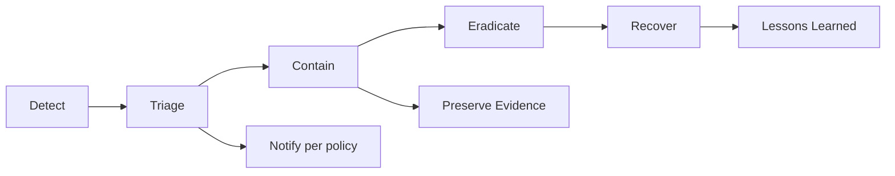

# امنیت، حریم خصوصی، انطباق و زیرساخت

**Document ID:** ECO-NOJIN-SECURITY-AND-INFRASTRUCTURE
**Version:** 1.0 (DESIGN — NOT APPROVED)
**Date:** 2026-11-17
**Status:** چارچوب طراحی؛ ارزیابی حقوقی/امنیتی مستقل انجام نشده است.

---

## ۱. دامنه و موضع

این سند الزامات امنیتی و گزینه‌های استقرار را تعریف می‌کند؛ **تأیید امنیتی یا حقوقی نیست**. هیچ ابزار اسکن، آزمون نفوذ، Build یا استقرار در این مأموریت اجرا نشده است.

مراجع ارزیابی: OWASP ASVS (سطح ۲ پایه)، OWASP API Security Top 10، NIST CSF و اصول NIST SP 800-53 (به‌عنوان راهنما، نه انطباق کامل).

---

## ۲. مدل تهدید (خلاصه)

### ۲.۱ دارایی‌ها
| دارایی | حساسیت | اثر نقض |
|---|---|---|
| دفتر مالی و اسناد | C3 | گزارش غلط؛ تقلب؛ مسئولیت قانونی |
| شاهد و گزارش MRV | C3 | ادعای سبز نادرست؛ از دست رفتن اعتبار |
| داده هویت و PII جوامع | C3 | آسیب به افراد؛ نقض حریم خصوصی |
| اسناد مالکیت/بهره‌برداری | C3 | منازعه حقوقی |
| نتایج علمی و provenance | C2 | تصمیم غلط؛ از دست رفتن اعتماد |
| اعتبارنامه‌ها و کلیدها | C4 | نفوذ کامل |
| کاتالوگ و محتوا | C0/C1 | دستکاری/شهرت |
| کیف پول داخلی | C3 | تقلب داخلی |

### ۲.۲ بازیگران و تهدیدها
| بازیگر | انگیزه | تهدید اصلی | کنترل |
|---|---|---|---|
| کاربر خارجی | دسترسی/سوءاستفاده | credential stuffing؛ IDOR | MFA؛ rate limit؛ مجوز سطح شیء |
| کاربر داخلی | منفعت/اشتباه | سوءاستفاده دسترسی؛ SoD ضعیف | تفکیک وظایف؛ ۴ چشم؛ audit |
| فروشنده | تسویه بیشتر | دستکاری سفارش/کمیسیون | محاسبه سمت سرور؛ تطبیق؛ سقف |
| عامل AI | خطا/تزریق | اجرای ابزار نادرست؛ نشت داده | allowlist؛ HITL؛ sandbox؛ audit |
| مهاجم زیرساخت | نفوذ | سرقت داده؛ باج‌گیری | بخش‌بندی؛ patch؛ backup؛ EDR |
| تأمین‌کننده/وابستگی | زنجیره تأمین | بسته آلوده | SBOM؛ pin؛ بررسی مجوز |
| ذی‌نفع محلی | اعتراض/شفافیت | دستکاری شاهد | hash-chain؛ دسترسی محدود |

### ۲.۳ سناریوهای کلیدی
1. تغییر نتیجه علمی پیش از ثبت در MRV → جلوگیری با provenance append-only و gate.
2. ثبت سند مالی نامتوازن یا حذف سند → DB constraint + append-only + معکوس‌سازی.
3. دسترسی فروشنده به سفارش فروشنده دیگر → مجوز سطح شیء + تست.
4. تزریق دستور در محتوای سند به عامل → جداسازی محتوا از دستور + ابزار محدود.
5. نشت PII از طریق export یا لاگ → redaction + مجوز صریح + watermark.
6. صدور/فروش اعتبار کربن بدون مرجع رسمی → موجودیت جدا + ممنوعیت تبدیل خودکار.

---

## ۳. کنترل‌های امنیتی

| حوزه | کنترل | معیار پذیرش |
|---|---|---|
| Authentication | OIDC؛ MFA برای نقش حساس؛ WebAuthn اختیاری | ۱۰۰٪ نقش‌های حساس MFA فعال |
| Session | توکن کوتاه‌عمر؛ refresh rotation؛ revoke فوری | ابطال < ۶۰ ثانیه |
| Authorization | RBAC+ABAC؛ default deny؛ مجوز سطح شیء | تست IDOR برای هر endpoint |
| Service Auth | mTLS یا توکن سرویس کوتاه‌عمر | صفر ارتباط بدون هویت سرویس |
| API | schema validation؛ rate limit؛ quota؛ idempotency | تست OWASP API Top 10 |
| Input | allowlist؛ اندازه؛ نوع؛ sanitization | صفر فایل اجرایی پذیرفته‌شده |
| Output | escaping؛ CSP؛ SRI | صفر XSS در تست خودکار |
| Encryption | TLS 1.3؛ AES-256 at rest؛ فیلد حساس | صفر داده بدون رمز |
| Secrets | vault؛ چرخش؛ حداقل دسترسی | صفر secret در repo |
| Audit | append-only؛ hash-chain؛ دسترسی محدود | آزمون دستکاری ناموفق |
| Tenant | RLS؛ تست نشت؛ کلید جداگانه در صورت نیاز | صفر نشت در تست |
| AI | tool allowlist؛ HITL؛ prompt-injection defense | صفر اقدام حساس بدون تأیید |
| Supply chain | SBOM؛ اسکن؛ pin؛ review مجوز | صفر وابستگی بدون مجوز مشخص |
| Backup | 3-2-1؛ رمزنگاری؛ آزمون بازیابی | RPO/RTO اندازه‌گیری‌شده |
| Patching | SLA بحرانی ۷ روز؛ بالا ۳۰ روز | گزارش انطباق |
| Incident | runbook؛ تماس؛ حفظ شواهد | تمرین سالانه |

### ۳.۱ نگاشت کوتاه به OWASP API Top 10
| ریسک | کنترل در معماری |
|---|---|
| Broken Object Level Authorization | مجوز سطح شیء در لایه API؛ تست خودکار |
| Broken Authentication | OIDC؛ MFA؛ قفل؛ rotation |
| Excessive Data Exposure | طرح پاسخ؛ فیلد‌محور؛ redaction |
| Lack of Resources and Rate Limiting | سهمیه؛ rate limit؛ صف |
| Broken Function Level Authorization | نقش/عمل + ABAC |
| Mass Assignment | schema allowlist |
| Security Misconfiguration | baseline؛ hardening؛ CI |
| Injection | پارامترسازی؛ validation؛ ORM/query builder |
| Improper Assets Management | کاتالوگ سرویس و نسخه |
| Insufficient Logging and Monitoring | audit + OTel + alert |

---

## ۴. هویت و دسترسی

### ۴.۱ ماتریس احراز هویت
| نقش | MFA | عمر نشست | بازبینی دسترسی |
|---|---|---|---|
| Super Admin | الزامی | کوتاه (≤ ۳۰ دقیقه) | ماهانه |
| Financial Manager / Accountant | الزامی | ≤ ۶۰ دقیقه | فصلی |
| MRV Specialist / Auditor | الزامی | ≤ ۶۰ دقیقه | فصلی |
| AI Agent Operator | الزامی | ≤ ۶۰ دقیقه | فصلی |
| Org Admin | الزامی | ≤ ۸ ساعت | فصلی |
| کاربر عادی | اختیاری (توصیه) | ≤ ۱۲ ساعت | سالانه |
| کاربر عمومی خریدار/گردشگر | اختیاری | ≤ ۲۴ ساعت | سالانه |

### ۴.۲ قواعد مجوز
1. پیش‌فرض deny؛ هر دسترسی نیازمند نقش + دامنه + طبقه‌بندی.
2. مجوز روی «شیء» بررسی می‌شود، نه فقط endpoint.
3. عملیات حساس نیازمند دو actor مستقل (SoD).
4. دسترسی ادمین به PII محدود، زمان‌دار و لاگ‌شده.
5. نقش‌های اضافی در بازبینی فصلی حذف می‌شوند.
6. حساب سرویس فقط scope لازم؛ چرخش دوره‌ای.

### ۴.۳ نقاط تصمیم
- PDP مرکزی برای سیاست (RBAC/ABAC)؛ PEP در Gateway و لایه دامنه.
- سیاست‌ها نسخه‌دار و قابل تست؛ تغییر سیاست = audit + بازبینی.
- تصمیم‌های deny نیز audit می‌شوند (برای تشخیص حمله).

---

## ۵. جداسازی مستأجر

| لایه | کنترل |
|---|---|
| داده | `tenant_id` + RLS + محدودیت query builder |
| API | استخراج tenant از token، نه از ورودی کاربر |
| کش | کلید شامل tenant؛ TTL کوتاه |
| جست‌وجو | فیلتر اجباری tenant در index |
| فایل | bucket/prefix جدا یا policy سطح شیء |
| صف | صف/پیام با tenant metadata و کنترل مصرف |
| گزارش | read model tenant-scoped |
| آزمون | تست نشت خودکار در CI + تست دستی دوره‌ای |

`OWNER_DECISION_REQUIRED` مدل نهایی: shared schema با RLS یا hybrid با schema جدا برای مستأجر بزرگ.

---

## ۶. حفاظت داده و رمزنگاری

| موضوع | الزام |
|---|---|
| Transit | TLS 1.3؛ HSTS؛ ممنوعیت TLS قدیمی |
| Rest | AES-256؛ کلید مدیریت‌شده؛ چرخش |
| Field-level | PII حساس، شماره حساب، سند هویتی |
| Backups | رمزنگاری مستقل؛ کلید جدا |
| Keys | vault؛ جداسازی محیط؛ حداقل دسترسی |
| Secrets | عدم حضور در repo، لاگ، تصویر |
| Data minimization | فقط فیلد لازم؛ پاک‌سازی دوره‌ای |
| Masking | نمایش نقاب‌دار در UI/گزارش |
| Deletion | حذف نرم + حذف امن پس از انقضا |
| Residency | امکان تعیین منطقه ذخیره‌سازی |

`UNKNOWN` الزامات رمزنگاری محلی و الگوریتم‌های تأییدشده در کشور میزبان.

---

## ۷. Audit و لاگ

- AuditEvent: actor، action، resource، before/after hash، correlation id، IP/UA (حداقل)، نتیجه.
- زنجیره hash برای تشخیص دستکاری؛ checkpoint دوره‌ای.
- جداسازی دسترسی: نویسنده audit نمی‌تواند تغییر دهد؛ حذف فقط با رویه حقوقی.
- لاگ فنی از audit دامنه جدا است؛ لاگ فنی PII ندارد.
- نگهداشت لاگ فنی کوتاه‌تر؛ audit دامنه بلندمدت.
- هشدار روی الگوهای مشکوک: تلاش دسترسی مکرر، تغییر نقش، اصلاح سند، export حجیم.

---

## ۸. امنیت اپلیکیشن و API

1. همه endpointها schema ورودی/خروجی دارند.
2. نسخه‌بندی API و deprecation اعلام‌شده.
3. Idempotency key برای عملیات مالی/سفارش.
4. محدودیت نرخ بر اساس کاربر/سرویس/IP.
5. فایل آپلود: نوع، اندازه، اسکن، ذخیره بیرون از web root، نام‌گذاری امن.
6. لینک دانلود موقت و امضاشده؛ بدون مسیر قابل حدس.
7. خطاها بدون افشای داخلی؛ شناسه همبستگی برای پشتیبانی.
8. CORS محدود؛ CSP سخت‌گیرانه؛ کوکی HttpOnly/Secure/SameSite.
9. جلوگیری از SSRF در دریافت داده خارجی (allowlist دامنه).
10. محدودیت طول و عمق query برای جست‌وجو/گزارش.

---

## ۹. امنیت عامل‌های هوشمند

| تهدید | کنترل |
|---|---|
| Prompt injection از محتوای سند/وب | جداسازی محتوا از دستور؛ حذف دستورهای جاسازی‌شده؛ منبع‌دهی |
| انتخاب ابزار خطرناک | allowlist + schema + risk class |
| اجرای اقدام مالی | ممنوعیت ابزار پرداخت؛ HITL اجباری |
| نشت داده در پاسخ | redaction؛ حداقل زمینه؛ سیاست خروجی |
| حلقه بی‌پایان | سقف گام/زمان/هزینه |
| سوءاستفاده از تأیید | TTL؛ چهارچشم؛ عدم تأیید خودکار |
| مدل آلوده/تغییر یافته | pin مدل؛ ثبت نسخه؛ ارزیابی دوره‌ای |
| خروج داده از مرز | سیاست منطقه؛ لاگ؛ محدودیت provider |

**قواعد سخت:**
- هیچ ابزار «اجرای SQL/کد دلخواه» به عامل داده نمی‌شود.
- هیچ انتقال وجه، تغییر موجودی مالی، صدور توکن، تأیید اعتبار کربن یا حذف داده حساس توسط عامل بدون تأیید انسانی انجام نمی‌شود.
- ارسال job به موتور علمی HyDroMA نیز ریسک کلاس ۳ است: مصرف سهمیه محاسباتی و تولید نتیجه بدون نظارت مجاز نیست.
- «kill switch» در سطح عامل و سازمان وجود دارد.
- هر اجرا trace کامل با هزینه و ابزارهای فراخوانی‌شده دارد.

---

## ۱۰. امنیت مالی

| کنترل | توضیح |
|---|---|
| Decimal-only | جلوگیری از خطای گردکردن و تقلب |
| Double-entry constraint | سند نامتوازن غیرقابل ثبت |
| Append-only | اصلاح فقط با سند معکوس |
| SoD | ایجاد ≠ تأیید ≠ پرداخت ≠ تطبیق |
| دوره قفل | تغییر گذشته ممنوع مگر با رویه بازگشایی |
| تطبیق بانکی | مقایسه مستقل صورت‌حساب |
| سقف تأیید | آستانه‌های چندسطحی |
| Payment scope | داده کارت هرگز وارد سیستم نمی‌شود؛ توکن درگاه |
| Reconciliation | مغایرت‌ها با شاهد و مالک مشخص |

---

## ۱۱. زنجیره تأمین و مجوز

- SBOM برای هر deployable؛ فهرست نسخه و مجوز.
- pin نسخه؛ بازبینی تغییرات امنیتی؛ ممنوعیت branch archive در تولید بدون commit.
- اسکن وابستگی و تصویر پایه در CI.
- بررسی مجوز در هر افزودن: GPL/AGPL/EUPL/OSL/MSCL/EE نیازمند تأیید مالک/حقوقی.
- ثبت منشأ کد و patch؛ عدم ادغام کد copyleft در هسته اختصاصی بدون بررسی.
- `FACT` چند پروژه Registry دارای نسخه/commit نامشخص هستند؛ مناسب تولید نیستند تا pin شوند.

---

## ۱۲. پشتیبان‌گیری و بازیابی

| رده | داده | RPO هدف | RTO هدف | نگهداشت |
|---|---|---|---|---|
| Tier 1 | دفتر مالی، audit، شاهد MRV | ≤ ۱۵ دقیقه | ≤ ۴ ساعت | ۱۰ سال+ |
| Tier 1 | هویت و مجوز | ≤ ۱۵ دقیقه | ≤ ۴ ساعت | مطابق قانون |
| Tier 2 | سفارش، انبار، گردشگری | ≤ ۱ ساعت | ≤ ۸ ساعت | ۷–۱۰ سال |
| Tier 2 | نتیجه علمی و provenance | ≤ ۱ ساعت | ≤ ۸ ساعت | دائمی برای منتشرشده |
| Tier 3 | محتوا، فایل موقت، کش | ≤ ۲۴ ساعت | ≤ ۲۴ ساعت | کوتاه |

قواعد: ۳ نسخه، ۲ رسانه، ۱ خارج از سایت؛ رمزنگاری؛ آزمون بازیابی فصلی؛ ثبت نتیجه آزمون؛ عدم نگهداری بکاپ در همان دامنه حمله.

---

## ۱۳. پاسخ به حادثه

1. شناسایی و طبقه‌بندی شدت.
2. مهار (قطع دسترسی/توکن/عامل).
3. حفظ شواهد (snapshot، لاگ، audit).
4. ریشه‌کنی و وصله.
5. بازیابی از بکاپ معتبر و بازبینی یکپارچگی.
6. اطلاع‌رسانی مطابق الزام قانونی (نیازمند مشاوره حقوقی).
7. گزارش پس‌رویداد و اقدام اصلاحی.

`OWNER_DECISION_REQUIRED` آستانه و مرجع اطلاع‌رسانی حقوقی.

---

## ۱۴. حریم خصوصی و انطباق

موضوعات قابل بررسی (بدون تأیید حقوقی و بدون انتخاب کشور):
| موضوع | پرسش باز |
|---|---|
| مبنای قانونی پردازش | رضایت/قرارداد/منفعت مشروع؟ |
| داده افراد جوامع | سطح رضایت و نمایندگی؟ |
| داده کودکان | محدودیت سنی و رضایت والد؟ |
| انتقال بین‌مرزی | کدام کشورها؛ چه تضمینی؟ |
| نگهداشت و حذف | حداقل/حداکثر قانونی؟ |
| حقوق صاحبان داده | دسترسی/اصلاح/حذف/اعتراض؟ |
| گزارش نقض | مهلت و مرجع؟ |
| داده مالی | الزامات حسابداری و مالیاتی محلی؟ |
| MRV و کربن | الزامات رجیستری و ادعای زیست‌محیطی؟ |
| هوش مصنوعی | الزامات شفافیت/ارزیابی اثر؟ |

`RECOMMENDATION` قبل از فاز ۱۰ یک ارزیابی حقوقی مستقل برای هر حوزه قضایی انجام شود؛ معماری باید «منطقه‌بندی داده» و «سیاست نگهداشت قابل تنظیم» را ممکن کند.

---

## ۱۵. سناریوهای استقرار

### ۱۵.۱ A — Low-cost Initial
| مؤلفه | انتخاب |
|---|---|
| محاسبه | ۱–۲ VM (Core + Engine + Geo روی همان میزبان یا دو میزبان) |
| DB | PostgreSQL + PostGIS مدیریت‌شده یا محلی |
| Storage | Object Storage سازگار S3 (مدیریت‌شده یا SeaweedFS) |
| وب | فایل استاتیک + reverse proxy/TLS |
| صف | جدول outbox + worker در همان فرایند |
| Observability | OTel + Prometheus سبک؛ لاگ فایل چرخشی |
| Backup | snapshot روزانه + کپی خارج |
| هزینه نسبی | کم |
| محدودیت | تک‌نقطه شکست؛ ظرفیت محدود؛ DR ضعیف |

`RECOMMENDATION` سناریوی A برای پایلوت و داده Tier-2/3 مناسب است؛ برای دفتر مالی و شاهد MRV (Tier-1) **کافی نیست** و حداقل سناریوی B لازم است تا RPO/RTO هدف محقق شود.

### ۱۵.۲ B — Scalable Production
| مؤلفه | انتخاب |
|---|---|
| محاسبه | LB + ۲–۴ گره Core؛ worker علمی جدا؛ سرویس Geo جدا |
| DB | PostgreSQL+PostGIS با replica؛ backup PITR |
| Storage | S3 مدیریت‌شده + lifecycle |
| Search | سرویس جست‌وجو اختیاری |
| صف | broker/outbox با DLQ |
| Observability | OTel Collector؛ metrics؛ dashboard؛ alert |
| امنیت | WAF؛ network segmentation؛ vault |
| Backup/DR | چند نسخه؛ آزمون بازیابی؛ منطقه دوم اختیاری |
| هزینه نسبی | متوسط |
| محدودیت | نیاز به مهارت عملیاتی؛ هزینه ثابت |

### ۱۵.۳ C — High-availability International
| مؤلفه | انتخاب |
|---|---|
| محاسبه | چند منطقه؛ autoscaling؛ گره GPU اختیاری برای مدل‌های سنگین |
| DB | HA multi-AZ؛ read replica منطقه‌ای؛ failover |
| Storage | S3 multi-region؛ CDN |
| Routing | GeoDNS؛ WAF؛ DDoS protection |
| Observability | چند منطقه؛ SLO/SLI؛ on-call |
| امنیت | منطقه‌بندی داده؛ کنترل دسترسی منطقه‌ای؛ ممیزی |
| Backup/DR | active-passive یا active-active read؛ RPO/RTO سخت |
| هزینه نسبی | بالا |
| محدودیت | پیچیدگی انطباق چندکشوری؛ هزینه |

`RECOMMENDATION` مسیر A → B → C با تغییر پیکربندی، نه بازنویسی. `OWNER_DECISION_REQUIRED` سناریوی هدف.

---

## ۱۶. پردازش سمت کلاینت و کاهش بار سرور

| فناوری | کاربرد مناسب | محدودیت |
|---|---|---|
| WebGL (MapLibre/Cesium/deck.gl) | رندر نقشه و لایه بزرگ | GPU ضعیف موبایل؛ باتری |
| Web Workers | پردازش موازی UI | حافظه محدود |
| WASM | محاسبات سبک (واحد/آمار/مدل کوچک) | اندازه دانلود؛ سازگاری |
| IndexedDB | داده میدانی آفلاین | سهمیه مرورگر؛ پاک‌سازی |
| COG + Range request | تصویر بدون سرور سنگین | پهنای باند |
| کش CDN | کاشی/دارایی ثابت | بی‌اعتباری کش |

`RECOMMENDATION` «پردازش مرورگری» فقط با اندازه‌گیری و fallback سروری؛ هزینه دستگاه کاربر و پهنای باند بخشی از هزینه کل است.

---

## ۱۷. Observability

| سیگنال | استاندارد | حداقل |
|---|---|---|
| Trace | OpenTelemetry | هر درخواست API و job |
| Metrics | Prometheus-compatible | RED برای سرویس؛ صف؛ خطا؛ تأخیر |
| Log | JSON ساخت‌یافته | correlation id؛ بدون PII |
| Alert | rule-based | خطای بالا؛ تأخیر؛ صف؛ گواهی TLS؛ بکاپ |
| SLO | تعریف‌شده | دسترس‌پذیری و تأخیر مسیرهای حیاتی |

`RECOMMENDATION` Grafana فقط به‌صورت standalone و بدون تغییر در صورت نیاز (AGPL)؛ جایگزین ساده‌تر برای پایلوت کافی است.

---

## ۱۸. چک‌لیست پذیرش امنیتی

| # | مورد | وضعیت هدف |
|---|---|---|
| 1 | threat model هر دامنه | موجود و بازبینی‌شده |
| 2 | ASVS L2 checklist | در DoD |
| 3 | تست IDOR/مجوز شیء | خودکار در CI |
| 4 | تست نشت مستأجر | خودکار |
| 5 | رمزنگاری transit/rest | فعال |
| 6 | vault و چرخش کلید | فعال |
| 7 | audit تغییرناپذیر | تست دستکاری |
| 8 | MFA نقش حساس | ۱۰۰٪ |
| 9 | SoD مالی | تست سناریو |
| 10 | AI tool allowlist و HITL | تست سناریو |
| 11 | backup/restore drill | فصلی |
| 12 | SBOM و اسکن وابستگی | هر انتشار |
| 13 | runbook حادثه | تمرین سالانه |
| 14 | سیاست نگهداشت داده | مصوب مالک |

---

## ۱۹. تصمیمات باز

1. سناریوی استقرار هدف و بودجه.
2. انتخاب IdP و مدل چندمستأجری.
3. انتخاب vault و مدیریت کلید.
4. الزامات اقامت داده و کشور میزبان.
5. سطح ASVS هدف (L2 یا L3 برای بخش مالی).
6. استفاده یا عدم استفاده از Grafana/Superset.
7. سیاست نگهداشت و حذف.
8. مدل تهدید خاص جوامع محلی و داده بومی.

**پایان سند.**
