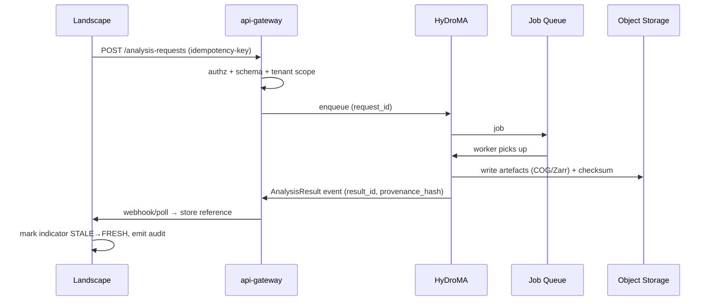

# LANDSCAPE-AND-HYDROMA-INTEGRATION
## قرارداد اتصال مدیریت منظر با موتور علمی HyDroMA

**Date:** 2026-11-18
**Status:** CONTRACT DESIGN — no model executed, no job queue created, no dataset produced.
**Principle:** HyDroMA **computes**; Landscape Management **manages**. Neither owns the other's data.

---

## 0. خلاصه

| Question | Answer |
|---|---|
| Can landscape compute a value? | Never. It stores a *reference* to a HyDroMA result plus its quality state |
| Can HyDroMA read landscape tables? | Never. It receives a request payload with geometry + dataset references |
| How is analysis requested? | asynchronous job through `contracts/api` + queue |
| What makes a number presentable? | model id + version + provenance + units + uncertainty + validation status |
| Can an uncalibrated result be shown? | Yes, with `UNCALIBRATED`/`EXPERIMENTAL` badge, and never in MRV evidence |

---

## 1. Boundary

```
services/landscape ──(AnalysisRequest)──▶ services/api-gateway ──▶ engines/hydroma
        ▲                                                              │
        └──────────(AnalysisResult event / poll)───────────────────────┘
```

Rules:
1. Landscape never imports HyDroMA code, models, or tables.
2. HyDroMA never reads `landscape.*` tables; it consumes immutable request payloads.
3. Results are immutable. A re-run creates a new result with a new id; nothing is overwritten.
4. Landscape stores: `analysis_result_id`, `model_version`, `quality_flag`, `uncertainty`,
   `units`, `output_ref`, `validated_at`, `supersedes`.
5. Scientific values are only ever displayed **with** their provenance affordance.

## 2. AnalysisRequest

| Field | Type | Required | Notes |
|---|---|---|---|
| `request_id` | uuid | ✔ | idempotency key (client-generated) |
| `landscape_id` | uuid | ✔ | for scoping/audit only |
| `geometry_ref` | object | ✔ | `{geojson_hash, srid, area_ha}`; **hash, not the whole polygon** when the polygon exceeds the payload limit |
| `analysis_type` | enum | ✔ | see §3 |
| `time_range` | object | ✔ | `{from, to, period: day|month|season|year}` |
| `input_datasets` | array | ✔ | dataset ids + versions (no implicit "latest") |
| `model` | object | optional | `{id?, version?, allow_experimental: bool}` |
| `resolution` | object | optional | `{spatial_m: 30|100|250|1000, temporal: daily|monthly}` |
| `indicators` | array | optional | requested output indicators |
| `context` | object | ✔ | `{organization_id, user_id, locale, priority}` |
| `callback` | object | optional | `{event: "analysis.completed", url?}` |

Validation: schema + `analysis_type ↔ required datasets` matrix + geometry validity (self-intersection,
CRS, area bounds) + time range not in the future + tenant permission.

## 3. Analysis types (mapped to the 15 HyDroMA domains)

| `analysis_type` | Domain(s) | Typical outputs | Minimum validation for `VALIDATED` |
|---|---|---|---|
| `water_balance` | `water` | ET, runoff, recharge, deficit (mm/period) | calibration basin + observed flow |
| `streamflow` | `hydrology` | discharge series, flow duration, extremes | gauge comparison, NSE/KGE reported |
| `groundwater_level` | `groundwater` | head, recharge, drawdown | observation wells |
| `soil_properties` | `soil` | texture, SOC, salinity, degradation index | lab/field reference samples |
| `erosion_risk` | `erosion` | soil loss rate, sediment yield | plot/check-dam data |
| `climate_indices` | `climate` | trends, extremes, projection bands | reference period + benchmark |
| `weather_series` | `meteorology` | bias-corrected series | station cross-validation |
| `crop_water_requirement` | `agriculture` | ETc, irrigation need, yield estimate | field trial / FAO-56 benchmark |
| `vegetation_condition` | `vegetation` | NDVI/EVI series, productivity, trend | ground transects |
| `rs_indices` | `remote-sensing` | analysis-ready indices, change detection | sensor cross-check |
| `catchment_delineation` | `gis` | catchments, slopes, flow accumulation | known outlet comparison |
| `rangeland_capacity` | `agriculture` + `vegetation` + `water` | carrying capacity (AU/ha), grazing pressure | **requires** calibration + uncertainty |
| `restoration_scenario` | `scenarios` + `simulation` | scenario deltas, trade-offs | baseline + stated assumptions |
| `mrv_evidence` | `mrv` | verifiable claim + evidence chain | approved validation record |
| `model_metadata` | `model-registry` | model id, version, licence, status | n/a |

## 4. AnalysisResult

| Field | Type | Notes |
|---|---|---|
| `result_id` | uuid | immutable |
| `request_id` | uuid | idempotent mapping |
| `model` | object | `{id, version, origin: {repo, commit}, licence}` |
| `input_provenance` | array | dataset id, version, source, retrieval date, checksum |
| `output` | object | `{dataset_ref, format: COG|Zarr|GeoJSON|Parquet, size, checksum}` |
| `units` | object | per output variable (UCUM codes) |
| `uncertainty` | object | method + value/interval + what is *not* quantified |
| `quality_flags` | array | `UNCALIBRATED | EXPERIMENTAL | VALIDATED | STALE_INPUT | LOW_COVERAGE` |
| `validation` | object | `{protocol, reference_dataset, metrics, report_ref}` or `null` |
| `execution` | object | `{status, started_at, finished_at, compute_seconds, worker, cost_units}` |
| `warnings` | array | human-readable, localized keys (not free text) |
| `provenance_hash` | string | hash over inputs+model+output for reproducibility |

Hard rule: if `validation` is `null`, `quality_flags` must include `UNCALIBRATED` or `EXPERIMENTAL`,
and the landscape API must refuse to mark the observation `authoritative`.

## 5. Landscape Intelligence Profile (LIP)

For each landscape, the profile is a **view**, not a table of copied numbers:

```
LIP = { landscape_id,
        sections: { water, soil, climate, vegetation, remote_sensing, restoration },
        entries: [ { indicator, latest_result_id, period, value, units,
                     quality_flag, uncertainty, stale_after, computed_at } ],
        coverage: { spatial: %, temporal: %, gaps[] },
        generated_at }
```

Rules:
- Each entry points to a result; nothing is recomputed inside landscape.
- `stale_after` is model-specific (e.g. NDVI 16 days, soil 5 years); stale entries are marked
  `STALE_INPUT`, never silently refreshed.
- Missing coverage is displayed as a gap, not as zero.
- The profile is cached per `(landscape_id, geometry_hash, model_set_version)`.

## 6. Carrying capacity (the highest-risk integration)

```
capacity = f(vegetation productivity, usable forage fraction, season length, water availability)
```

Required record for every capacity value:
model id+version, inputs (NDVI/EVI source + period, rainfall, soil), forage-use factor and its source,
season definition, valid region, calibration dataset, validation metrics, uncertainty interval,
and the explicit statement "not a legal grazing right".

Landscape stores it as `ResourceAssessment` with `quality_flag`; grazing pressure is computed as
`demand (from LivestockSystem) / capacity` **with both uncertainties propagated or explicitly ignored
and stated**. A ratio without that statement is a defect.

## 7. Async execution flow



- Retries: at-least-once with `request_id` dedupe; a duplicate request returns the existing result id.
- Timeouts: job-level deadline; partial results are never published as complete.
- Cancellation: allowed before the first artefact is written.
- Priority: `interactive | batch | mrv`; MRV runs are never starved by interactive ones.

## 8. Caching and invalidation

Cache key: `(geometry_hash, analysis_type, period, indicator_set, model_version, dataset_versions)`.
Invalidation triggers: new dataset version, model version change, geometry change, expiry
(`stale_after`). A cached result is returned with its original `computed_at` — never re-dated.

## 9. Security and tenancy

| Control | Rule |
|---|---|
| Service auth | HyDroMA accepts only gateway-signed requests (mTLS or signed token), never user tokens |
| Tenant scope | `organization_id` travels in the payload and is enforced on result retrieval |
| Dataset access | landscape may reference only datasets its tenant is licensed for |
| Output access | artefacts served through signed, short-lived URLs |
| Audit | every request/result pair logged with actor, tenant, model version, checksum |
| Data residency | artefact storage region follows tenant policy (deferred decision LND-05) |

## 10. Failure modes

| Failure | Landscape behaviour |
|---|---|
| HyDroMA unavailable | keep last valid result with `STALE_INPUT`; queue request; no fake zero |
| Model not calibrated for region | result stored with `EXPERIMENTAL`; UI disables "authoritative" actions |
| Geometry invalid | reject before enqueue with a precise validation error |
| Partial coverage | result returned with `LOW_COVERAGE` + gap map |
| Provenance mismatch (hash) | result rejected and logged as integrity incident |

## 11. Testing

| Test | Assertion |
|---|---|
| Contract | request/result validate against `contracts/scientific-models` schema |
| Provenance completeness | a result without model version/units/uncertainty is rejected |
| Determinism | same inputs + seed → same `provenance_hash` |
| Idempotency | duplicate `request_id` → same `result_id` |
| Staleness | expired result never presented as fresh |
| Tenancy | cross-tenant result retrieval returns 404 |
| Scientific validation | water-balance reference run within stated tolerance |

## 12. Acceptance criteria

1. A `water_balance` request for one landscape returns a result carrying model version, provenance,
   units, uncertainty, validation status and a checksummed artefact.
2. Landscape cannot display an `authoritative` indicator without a validated result reference.
3. Re-running with identical inputs produces an identical provenance hash.
4. No landscape table is read by HyDroMA and no HyDroMA table is read by landscape (verified by
   dependency tests).
5. With HyDroMA down, landscape pages render with `STALE_INPUT` and no fabricated values.
