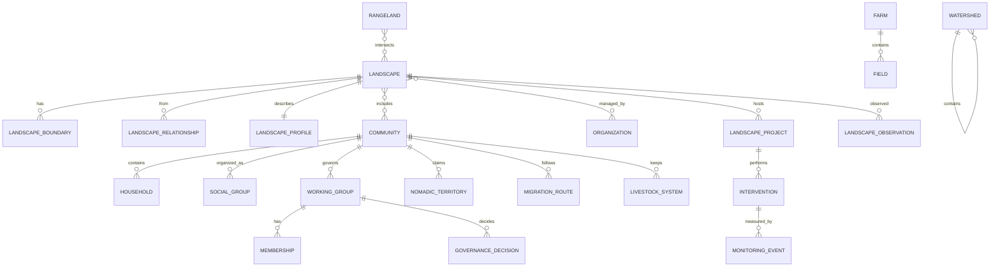

# LANDSCAPE-DOMAIN-MODEL
## مدل مفهومی دامنه منظر

**Date:** 2026-11-18
**Status:** CONCEPTUAL MODEL — no migration, no schema, no database object created.
**Scope:** entities, relationships, spatial/temporal rules and merge decisions for
Landscape Intelligence & Management. Table-level physical design is deferred (D-DB-01).

---

## 0. قواعد مدل‌سازی

1. **Conceptual ≠ physical.** This list is not one table per entity; merges are explicit in §5.
2. Every entity has `id` (UUIDv7), `organization_id`, `created_at`, `updated_at`, `recorded_by`.
3. Entities that describe the real world carry **validity** (`valid_from`, `valid_to`) in addition to
   record timestamps. Current state is a view, not a mutable truth.
4. Every externally sourced value carries `source_id`, `source_date`, `quality_flag`.
5. Geometry never lives in a business table; it is referenced through `GeometryReference`.

## 1. Core entities

| Entity | Key attributes | Owner module | Data class |
|---|---|---|---|
| `Landscape` | name (localized), native_name, type_id, country, region, geometry_ref, area_ha, elevation_range, climate_class, population_ref, ecosystem_type, authority_id, status | `TER-LND/registry` | public profile / restricted detail |
| `LandscapeType` | code, names (localized), parent_type, custom flag | `TER-LND/types` | public |
| `LandscapeBoundary` | landscape_id, geometry_ref, boundary_kind (`ecological|administrative|management`), source, accuracy, valid period | `TER-LND/boundary` | restricted |
| `LandscapeRelationship` | from_id, to_id, relation (`contains|overlaps|adjacent|shares_resource|corridor_crosses`), overlap_area, validity | `TER-LND/relationship` | restricted |
| `LandscapeProfile` | landscape_id, description (localized), economic_activities[], resource_profile, data_quality | `TER-LND/registry` | public |
| `LandscapeIndicator` | code, definition_id, unit, aggregation, direction, methodology_ref | `TER-OBS/indicators` | public |
| `LandscapeObservation` | indicator_id, landscape_id, value, unit, period_start/end, method, source, quality_flag, hydroma_result_id? | `TER-OBS/monitoring` | restricted |
| `LandscapeDocument` | landscape_id, document_id (content), type, language, visibility | `PLT-DOC` | restricted |

## 2. Community entities (shared by village and nomadic)

| Entity | Key attributes | Owner | Cardinality |
|---|---|---|---|
| `Community` | type (`settled|nomadic|mixed`), names (localized), country, region, social_structure, status | `TER-LND/community` | N communities ↔ N landscapes |
| `CommunityProfile` | community_id, description, economy, services, needs | `TER-VIL`/`TER-NOM` | 1:1 |
| `Household` | community_id, head_ref (minimized), size, livelihood, location_ref, data_class | `TER-VIL`, `TER-NOM` /households | N:1 |
| `CommunityMember` | household_id?, user_id?, role_in_community, consent | `TER-WG/membership` | N:1 |
| `SocialGroup` | community_id, kind (`tribal|council|cooperative|clan`), name, parent_group | `TER-LND/community` | N:1 |
| `Organization` | legal entity (owned by `services/organization`, referenced only) | organization | N:M via `LandscapeOrganization` |
| `LandscapeOrganization` | landscape_id, organization_id, role (`manager|partner|implementer|funder|observer`), valid period | `TER-LND/registry` | M:N |
| `WorkingGroup` | landscape_id, name, mandate, status | `TER-WG` | N:1 |
| `Membership` | working_group_id, membership_id (org), role, status, valid period, approved_by | `TER-WG/membership` | N:M |
| `GovernanceDecision` | working_group_id, type, subject_ref, decision, quorum_basis, decided_at, approver | `TER-WG/decisions` | N:1 |
| `CommunityAgreement` | parties[], subject, terms_ref, source, signed_at, version, visibility | `TER-GOV/agreements` | N:M |

## 3. Spatial entities

| Entity | Key attributes | Notes |
|---|---|---|
| `GeometryReference` | id, geometry (Point/LineString/Polygon/Multi*), srid, area_m2, length_m, accuracy_m, method, source_id, captured_at | the only place geometry is stored |
| `SpatialLayer` | code, name, kind (`vector|raster`), srid, stac_collection?, licence | references L6, does not copy tiles |
| `SpatialFeature` | layer_id, external_id, geometry_ref, attributes(jsonb), valid period | generic attachment for external layers |
| `Village` | community_id, settlement_type, admin_unit, population_ref, geometry_ref | 1:1 with a settled community |
| `Rangeland` | code, landscape_ids[], vegetation_type, area_ha, tenure_type, geometry_ref, status | may belong to several landscapes |
| `Watershed` | code, level (basin/subbasin), parent_id, area_ha, geometry_ref | hierarchy by `parent_id`, not by landscape |
| `Farm` | community_id, owner_ref, area_ha, irrigation_type, geometry_ref | |
| `Field` | farm_id, crop_system, area_ha, geometry_ref, season | |
| `NomadicTerritory` | community_id, season, geometry_ref, rights_basis, valid period | overlaps allowed |
| `MigrationRoute` | community_id, geometry_ref (line), season, window_start/end, corridor_width_m, status | time-bounded |
| `SeasonalCamp` | community_id, geometry_ref, capacity, water_point_id?, occupancy window | shareable |
| `WaterPoint` | code, type, geometry_ref, reliability_record[], accessibility, seasonal_status | reliability is observed, not declared |

## 4. Management entities

| Entity | Key attributes |
|---|---|
| `LandscapeProject` | id, landscape_id, type, implementing_org_id, funding_ref, budget_ref (finance), dates, spatial_extent_ref, objectives, baseline_ref, indicator_ids[], verification_status |
| `Intervention` | project_id, type, geometry_ref, planned/actual dates, inputs_ref (inventory), cost_ref (finance) |
| `RestorationPlan` | landscape_id, degradation_assessment_ref, priority_zones[], scenarios[], target_indicators[] |
| `ResourceAssessment` | landscape_id, resource (`water|soil|vegetation|biodiversity|forest`), method, values with units, source, hydroma_result_id? |
| `ManagementPlan` | landscape_id/community_id, period, objectives, allowed uses, grazing_plan_ref, status |
| `MonitoringEvent` | subject_ref, indicator_id, method (`field|remote|model`), value, unit, quality_flag, hydroma_result_id? |
| `Alert` | landscape_id, rule_id, severity, trigger_value, status, acknowledged_by |
| `Report` | scope, period, sections, generated_by (`human|agent`), provenance_refs[] |

## 5. Merge / non-duplication decisions

| Candidate duplication | Decision | Reason |
|---|---|---|
| `Landscape` vs `LandscapeProfile` | keep both, 1:1 | identity/lifecycle vs descriptive content that changes independently and is localized |
| `Village` vs `Community(settled)` | **merge concept**: village is the spatial/administrative *profile* of a settled community | prevents two household registries |
| `NomadicCommunity` vs `Community(nomadic)` | **merge concept**: nomadic profile over the same core | same reason |
| `Household` in village and in nomadic | one `Household` entity with `community_id` | one registry, one privacy policy |
| `WorkingGroup` vs `Organization` | **separate** | a working group is a landscape-scoped governance body, not a legal entity |
| `CommunityMember` vs `OrganizationMember` | **separate, linked** | community participation ≠ employment/organizational role |
| `SpatialFeature` vs `GeometryReference` | keep both | geometry storage vs external layer membership |
| `Rangeland` vs `Watershed` | separate | different delineation logic; linked through `LandscapeRelationship` |
| `ResourceAssessment` vs `LandscapeObservation` | assessment = study; observation = time-stamped value | different lifecycles |
| `Alert` vs `Notification` | separate | alert rule/state vs delivery channel |
| `Language`/`Locale` tables | **no DB table** | registry file (`contracts/i18n/languages.json`) is the source; no mutable language table |
| `Translation` per content row | variant rows on the owning entity (`ContentLocalization`) | translation belongs to its content, not to a global table |
| `Project` in landscape | **shared** `PRJ-REG` | projects exist outside landscape too |

## 6. Internationalization entities (conceptual placement)

| Entity | Lives in | Notes |
|---|---|---|
| `Language`, `Locale` | `contracts/i18n/languages.json` | immutable per release; changes are versioned |
| `ContentLocalization` | owning service (`content`, `marketplace`, `tourism`, `landscape`) | `(entity_id, locale, field, value, state, provider, reviewed_by)` |
| `Translation`, `TranslationMemory`, `GlossaryTerm`, `TranslationReview` | `services/translation` | see `TRANSLATION-GATEWAY-ARCHITECTURE.md` §5–§9 |
| Localized names on entities | `name_localized` map (`{fa, ar, en, …}`) or variant table | prefer variant table when text > 200 chars or needs review state |

Rule: a localized value always carries `state`; a public page may not render a localized value whose
state is below the surface's minimum (e.g. `approved` for legal pages).

## 7. Temporal model

- **Valid time:** `valid_from`, `valid_to` — when the real-world fact is true.
- **Record time:** `created_at`, `updated_at`, `superseded_by` — when we recorded it.
- Overlapping valid periods are allowed for claims (`NomadicTerritory`, `CommunityAgreement`).
- Queries must pass `as_of`; the default is *today* only for display, never for science.
- Deletion is soft (`retired_at`) for anything referenced by a project, observation or MRV record.

## 8. Relationship graph (conceptual)

## 9. Identifiers and keys

| Thing | Scheme | Why |
|---|---|---|
| Internal id | UUIDv7 | time-sortable, no enumeration |
| Public reference | `LAND-<country>-<slug>` + opaque id in URLs | human-readable without exposing sequences |
| External dataset id | source namespace + id (e.g. `STAC:item`) | traceability |
| Geometry | separate UUID + `srid` | reusable across entities |
| Version | monotonic per entity for plans/agreements | audit |

## 10. Data classification

| Class | Examples | Default visibility |
|---|---|---|
| `public` | landscape name/type/aggregate indicators | public surfaces |
| `registered` | project summaries, published reports | authenticated users |
| `community` | working-group minutes, agreements (published version) | community members |
| `restricted` | household counts, livestock counts, exact boundaries of private land | landscape staff |
| `confidential` | personal identifiers, financial details, legal documents | named roles only |

Every field carrying `restricted` or `confidential` must be named in a field-level access list; the
API must not return it by default.

## 11. Validation rules (model-level)

1. A landscape must have ≥ 1 boundary with a valid period.
2. Area must be computed from geometry, never typed manually.
3. `NomadicTerritory` requires a season and a validity window.
4. `MigrationRoute` requires start/end windows and at least two water points within the corridor.
5. `LandscapeProject` requires a landscape, type, and an indicator set before `active`.
6. `LandscapeObservation` requires unit + method + source + quality flag.
7. Any value derived from HyDroMA must store `hydroma_result_id` (no free-floating numbers).
8. `CommunityAgreement` requires source + date; unsigned drafts are not publishable.

## 12. Acceptance criteria

1. The entity set covers registry, village, nomadic, rangeland, watershed, agriculture, resources,
   restoration, governance, projects and observatory without a second source of truth.
2. Village and nomadic share `Community`, `Household`, `WorkingGroup`, `GeometryReference`.
3. No entity stores geometry outside `GeometryReference`.
4. Every real-world claim has a validity period; every scientific value has provenance fields.
5. Field-level classification is defined for every restricted/confidential attribute.
6. The model admits new landscape types and new locales without schema redesign.
