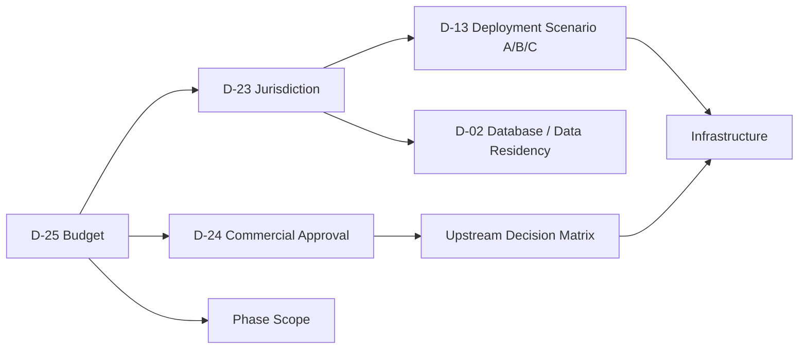

# OWNER DECISION RESTORATION
## Three Dropped Decisions — Scope, Options, Consequences, Dependencies, Phase

**Date:** 2026-11-17
**Mode:** READ-ONLY. No document was modified. This file proposes restoring three owner-critical decisions that were dropped between Set 1 (24 open decisions) and Set 2 (22 open decisions).
**Status:** `OWNER_DECISION_REQUIRED` — no option is selected. No option is decided by this document.

---

## 1. BACKGROUND

The Set 1 open-decisions document contained **24** items (D01–D24). The Set 2 document contains **22** items (D-01–D-22). The reconciliation audit found that Set 2 **dropped three owner-critical decisions**:

| # | Dropped decision | Set 1 ID | Set 2 status |
|---|---|---|---|
| 1 | Jurisdiction / Hosting Jurisdiction | D12 | **Absent** |
| 2 | Commercial Approval / Commercial Operating Model | D21 | **Absent** |
| 3 | Budget / Financial Constraints | D24 | **Absent** |

These are **not** optional technical details. They constrain data residency, legal compliance, commercial licensing (GPL/AGPL/OSL/EUPL/MSCL projects), and the entire delivery scope. Dropping them leaves the architecture without a legal and financial boundary.

**Recommendation:** restore all three as open decisions (D-23, D-24, D-25) pending owner decision.

---

## 2. DECISION 1 — JURISDICTION / HOSTING JURISDICTION

| Field | Value |
|---|---|
| **Scope** | Which country/ies host the Eco Nojin production data and services; which legal/regulatory framework applies; data-residency and cross-border transfer rules. |
| **Why it matters** | Determines data-residency compliance, privacy law (e.g., GDPR-like, LGPD, PDPL), tax jurisdiction, and whether the platform can serve international customers. |
| **Options** | (a) Single jurisdiction (e.g., Iran) — simplest, lowest cost, limited international reach. (b) Multi-jurisdiction with regional deployment — e.g., Iran + EU + GCC; higher cost, broader reach. (c) Jurisdiction-agnostic architecture with regional data residency — design for portability, decide per-market later. |
| **Consequences** | (a) Simple ops, but may block EU/international customers; data-transfer restrictions. (b) Complex ops, multi-region DB, higher cost, but international-ready. (c) Architectural overhead now, flexibility later; requires region-aware data model from day 1. |
| **Dependencies** | Depends on: target markets, customer base, legal counsel, cloud provider availability per region. Affects: data model (tenant/region scoping), deployment scenario (A/B/C), object storage, DB topology. |
| **Phase to decide** | **Phase 0 (Architecture)** — before data model and deployment are finalized. |
| **Status** | `OWNER_DECISION_REQUIRED` |

---

## 3. DECISION 2 — COMMERCIAL APPROVAL / COMMERCIAL OPERATING MODEL

| Field | Value |
|---|---|
| **Scope** | Whether Eco Nojin will use, distribute, or embed upstream projects with **copyleft or source-available licenses** (GPL-3.0, AGPL-3.0, OSL-3.0, EUPL-1.1, MSCL-1.0-GPL, LGPL-2.1/3.0), and whether it will operate as a commercial product, a non-profit, or a hybrid. |
| **Why it matters** | Copyleft licenses (GPL/AGPL/OSL/EUPL) impose source-disclosure obligations on derivative works. MSCL (Directus) is source-available, not open source. Using these in a proprietary product without legal review creates legal exposure. |
| **Affected upstream projects** | `hydromt-wflow` (GPL-3.0), `erpnext` (GPL-3.0), `dolibarr` (GPL-3.0), `farmos` (GPL-2.0-or-later), `qloapps` (OSL-3.0), `pcse` (EUPL-1.1), `grafana` (AGPL-3.0), `directus` (MSCL), `swatplus` (LGPL-2.1), `opentripplanner` (LGPL-3.0), `novu` (MIT + proprietary EE). |
| **Options** | (a) **Open-source-only** — embrace copyleft; publish all derivative code under GPL/AGPL. Simplest legally, but limits proprietary control. (b) **Permissive-only** — use only MIT/Apache/BSD/ISC projects; avoid all copyleft. Safest for proprietary, but excludes many domain tools (ERPNext, Dolibarr, farmOS, PCSE). (c) **Hybrid with isolation** — use copyleft projects as **standalone/containerized services** (separate process, no code linking) to avoid extending copyleft; use permissive projects for core. Requires legal review. (d) **Commercial license** — purchase commercial licenses for source-available/EE projects (Directus, Novu EE). |
| **Consequences** | (a) Strong legal position but no proprietary moat. (b) Safe but may require rebuilding ERP/accounting/MRV components. (c) Balanced, but requires disciplined architecture (no shared code with copyleft) + legal review. (d) Cost + dependency on vendors. |
| **Dependencies** | Depends on: business model, funding, legal counsel, target markets. Affects: which upstream projects can be adopted/integrated, architecture (standalone vs embedded), and the upstream decision matrix. |
| **Phase to decide** | **Phase 0 (Architecture)** — before any upstream adoption. |
| **Status** | `OWNER_DECISION_REQUIRED` |

---

## 4. DECISION 3 — BUDGET / FINANCIAL CONSTRAINTS

| Field | Value |
|---|---|
| **Scope** | The total budget envelope for architecture, development, infrastructure, and operations; the cost ceiling per phase; the acceptable run-rate for cloud/hosting; the budget for legal review and commercial licenses. |
| **Why it matters** | The deployment scenario (A/B/C), the upstream posture (build vs adopt), the multi-jurisdiction decision, and the commercial-approval decision all have major cost implications. Without a budget envelope, the architecture cannot be prioritized. |
| **Options** | (a) **Lean budget** — Scenario A (single VM/PaaS), permissive-only licenses, build minimal core, defer heavy integrations. (b) **Moderate budget** — Scenario B (managed services, replicas), hybrid licensing with legal review, adopt key upstream (Keycloak, Spree, TiTiler). (c) **Full budget** — Scenario C (multi-region HA), commercial licenses where needed, full upstream integration, SOC/compliance. |
| **Consequences** | (a) Fast, cheap, but limited scale/reach. (b) Balanced; recommended for early-stage. (c) Expensive; only if international scale is confirmed. |
| **Dependencies** | Depends on: funding, investor/owner commitment, target launch date. Affects: deployment scenario, upstream decisions, phase sequencing, team size. |
| **Phase to decide** | **Phase 0 (Architecture)** — before finalizing the deployment and upstream matrices. |
| **Status** | `OWNER_DECISION_REQUIRED` |

---

## 5. DEPENDENCY GRAPH

- **Budget** is the root constraint — it gates both Jurisdiction (multi-region costs) and Commercial Approval (license costs).
- **Jurisdiction** gates the data model (region scoping) and deployment scenario.
- **Commercial Approval** gates which upstream projects can be adopted/integrated.

---

## 6. RESTORATION PROPOSAL

Restore the three decisions to the open-decisions document as:

| New ID | Topic | Status |
|---|---|---|
| D-23 | Jurisdiction / Hosting Jurisdiction | `OWNER_DECISION_REQUIRED` |
| D-24 | Commercial Approval / Commercial Operating Model | `OWNER_DECISION_REQUIRED` |
| D-25 | Budget / Financial Constraints | `OWNER_DECISION_REQUIRED` |

**Note:** this restoration is a **proposal only**. The actual open-decisions document (`ECO-NOJIN-ARCHITECTURE-OPEN-DECISIONS.md`) was **not modified** in this mission (read-only constraint). The owner must approve the restoration and then a consolidation pass should add them.

---

## 7. SUMMARY

| Decision | Scope | Options | Phase | Status |
|---|---|---|---|---|
| D-23 Jurisdiction | Data residency, legal framework, cross-border | Single / Multi / Jurisdiction-agnostic | Phase 0 | `OWNER_DECISION_REQUIRED` |
| D-24 Commercial Approval | Copyleft/EE license usage, business model | Open-source / Permissive-only / Hybrid-isolation / Commercial-license | Phase 0 | `OWNER_DECISION_REQUIRED` |
| D-25 Budget | Cost envelope, run-rate, license budget | Lean / Moderate / Full | Phase 0 | `OWNER_DECISION_REQUIRED` |

**No option was selected. No decision was finalized. Awaiting owner decision.**