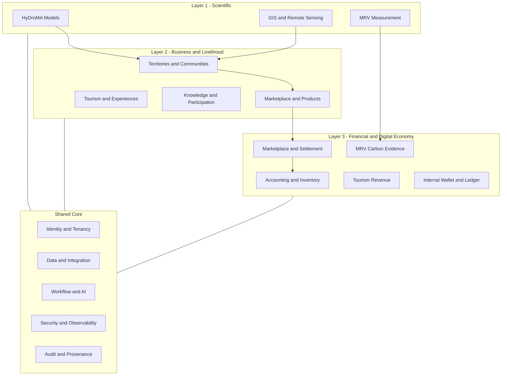
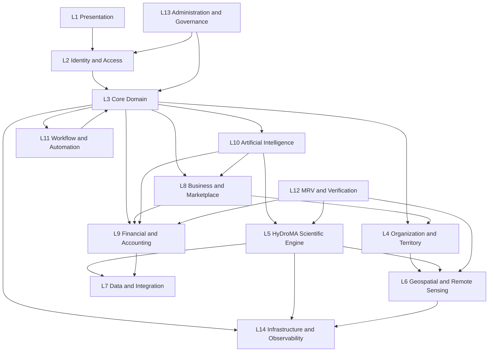
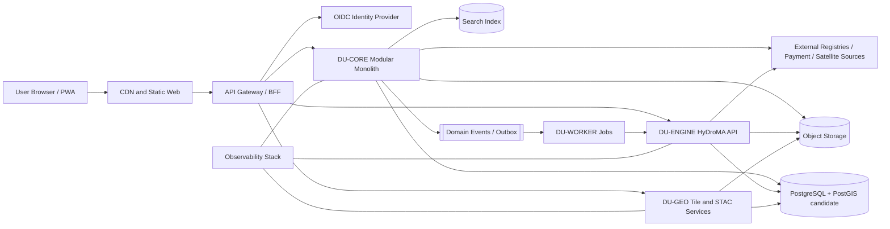
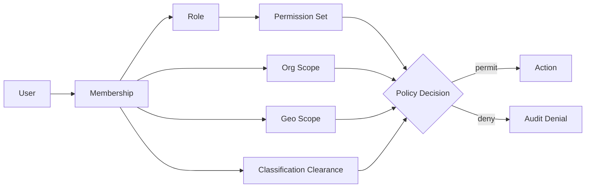
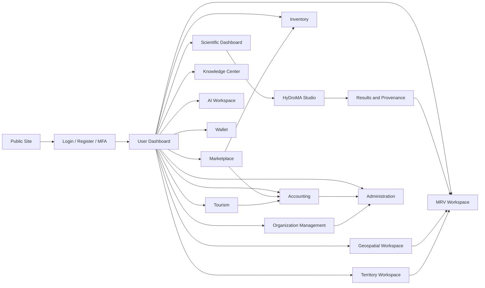
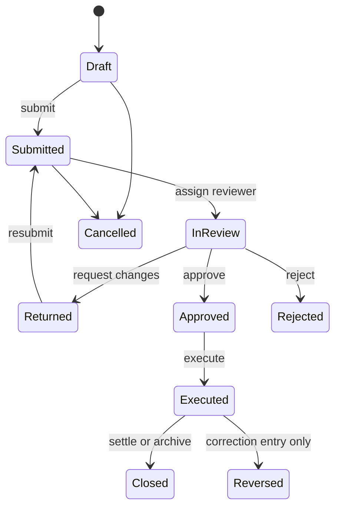
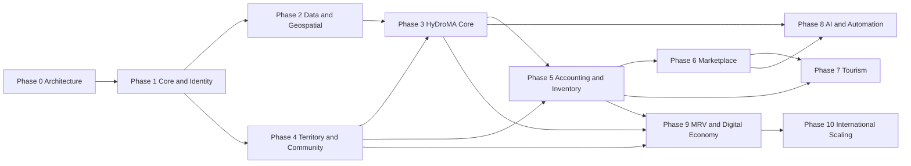

# معماری مادر Eco Nojin و HyDroMA — نسخه یکپارچه ۱

**Document ID:** ECO-NOJIN-MASTER-ARCHITECTURE-CONSOLIDATED-V1
**Version:** 1.0-CONSOLIDATED (DESIGN — NOT APPROVED)
**Date:** 2026-11-17
**Status:** سند یکپارچه؛ هیچ فناوری نهایی نیست؛ هیچ پروژه‌ای تأیید تولید ندارد.
**Language:** فارسی (اصطلاحات فنی به انگلیسی) — RTL
**Baseline:** `ECO-NOJIN-MASTER-ARCHITECTURE-V2.md` (v2.0) — این سند بر پایه V2 استخراج شده و اصلاحات تجمیع در بخش الحاقی اعمال شده است.
**Predecessor:** `ECO-NOJIN-MASTER-ARCHITECTURE.md` (v1 DRAFT) بدون تغییر حفظ شده است.

> **Consolidation basis (FACT):** این نسخه بر پایه `ECO-NOJIN-MASTER-ARCHITECTURE-V2.md` (۶۳۰ خط، ۲۱ بخش) ساخته شده و نتایج ممیزی‌های زیر در آن اعمال شده است:
> - `RECONCILIATION-AUDIT-REPORT.md` — تفاوت‌های دو مجموعه، ناسازگاری نقش‌های عمومی، ماتریس‌های Upstream متضاد.
> - `UPSTREAM-21-DECISIONS-AUDIT.md` — بازبینی مستقل ۲۱ تصمیم تغییر‌یافته Upstream.
> - `ROLE-AND-ACTOR-RECONCILIATION.csv` — طبقه‌بندی ۳۸ ارجاع Sitemap و ۱۱ توکن Workflow.
> - `OWNER-DECISION-RESTORATION.md` — بازگردانی سه تصمیم حذف‌شده (D-23 Jurisdiction، D-24 Commercial Approval، D-25 Budget).
>
> **اصل حاکم:** هیچ تصمیم پیشنهادی به تصمیم قطعی مالک تبدیل نشده است. تمام تصمیمات Upstream و معماری با وضعیت `PENDING_OWNER_APPROVAL` باقی می‌مانند.
>
> **موارد غیرقابل‌بازیابی (FACT):** نسخه Set 1 (۱۸۲ ماژول) قابل بازیابی نیست (`HISTORICAL_VERSION_NOT_RECOVERABLE`)؛ چهار ماژول افزوده در Set 2 (۱۸۸ ماژول) هویت‌گذاری نشده‌اند و در بخش الحاقی ثبت شده‌اند.

**راهنمای برچسب‌ها:** `FACT` واقعیت مستند · `ASSUMPTION` فرض طراحی · `RECOMMENDATION` پیشنهاد فنی · `OWNER_DECISION_REQUIRED` نیازمند تصمیم مالک · `UNKNOWN` ناموجود.

---

## ۰. کنترل سند

| مورد | مقدار |
|---|---|
| دامنه | فقط طراحی و مستندسازی معماری؛ بدون کد، Build، نصب، اجرا، DB، API فعال، توکن یا قرارداد |
| ورودی‌های مرجع | `FINAL-UPSTREAM-REGISTRY.md`، `FINAL-UPSTREAM-CAPABILITY-MATRIX.csv`، `FINAL-UPSTREAM-OPEN-ISSUES.md` و گزارش‌های ارزیابی قبلی |
| پایگاه بالادستی | `D:\Nojin\upstream-registry` — ۵۴ پروژه استخراج‌شده (FACT) |
| خارج از دامنه تغییر | `D:\HyDroMA`، `D:\eco_nojin`، آرشیوها و Registry |
| اسناد همراه | ۹ فایل هم‌خانواده در `D:\Nojin\architecture\` |
| اصل حاکم | معماری بر پایه نیاز واقعی محصول؛ نه بر پایه موجود بودن مخزن |

### ۰.۱ نقشه اسناد

| فایل | نقش |
|---|---|
| `ECO-NOJIN-MASTER-ARCHITECTURE-V2.md` | سند مرجع کلان (همین فایل) |
| `ECO-NOJIN-MODULE-CATALOG.csv` | فهرست ماژول/زیرماژول، مسئولیت، وابستگی، واحد استقرار، فاز |
| `ECO-NOJIN-USER-ROLE-MATRIX.csv` | نقش‌ها، دامنه، مجاز/ممنوع، سطح تأیید |
| `ECO-NOJIN-FRONTEND-SITEMAP.csv` | صفحات، URL، نقش مجاز، اجزا، وضعیت‌ها |
| `ECO-NOJIN-WORKFLOW-CATALOG.csv` | گردش‌کارها، حالت‌ها، خطاها، تأییدها |
| `ECO-NOJIN-DATA-DOMAIN-MODEL.md` | مدل مفهومی داده، مالکیت، نگهداری، تفکیک انبارها |
| `HYDROMA-SCIENTIFIC-ENGINE-ARCHITECTURE.md` | معماری مستقل موتور علمی |
| `ECO-NOJIN-UPSTREAM-DECISION-MATRIX-V2.csv` | تطبیق ۵۴ پروژه با قابلیت‌ها و تصمیم پیشنهادی (مرجع). فایل هم‌نام بدون V2 پیش‌نویس قبلی است و بازنویسی نشد. |
| `ECO-NOJIN-SECURITY-AND-INFRASTRUCTURE.md` | امنیت، حریم خصوصی، انطباق، سه سناریوی استقرار |
| `ECO-NOJIN-ARCHITECTURE-OPEN-DECISIONS.md` | تصمیمات باز، فرضیات، ریسک‌ها، QA و گزارش بازبینی |

---

## ۱. هویت، چشم‌انداز و لایه‌های محصول

### ۱.۱ هویت
- `FACT` Eco Nojin اکوسیستم دیجیتال بین‌المللی برای مدیریت، توسعه و احیای سرزمین‌های زنده است: روستاها، جوامع عشایری، مراتع، مزارع و حوضه‌های آبریز.
- `FACT` HyDroMA موتور علمی و هسته هوشمند این اکوسیستم است.
- `FACT` زمینه سازمانی مالک: کشت و صنعت دشت امید نارون.
- `ASSUMPTION` گسترش جهانی مستلزم چندزبانگی، چندارزی، چندواحدی و چندسازمانی از روز اول است؛ نه افزودنی بعدی.

### ۱.۲ سه لایه محصول و هسته مشترک

`RECOMMENDATION` لایه علمی هرگز نباید منطق مالی یا بازارگاه را import کند. وابستگی فقط یک‌طرفه و از طریق قراردادهای عمومی است.

### ۱.۳ اصول طراحی و معیار پذیرش قابل سنجش

| # | اصل | معیار پذیرش قابل سنجش |
|---|---|---|
| P1 | Modular Design | هر ماژول API عمومی اعلام‌شده دارد؛ CI هر import بین‌ماژولی غیرمجاز را رد می‌کند (dependency lint). |
| P2 | API-first | ۱۰۰٪ قابلیت‌ها با OpenAPI 3.1 نسخه‌دار (`/v1`)؛ هیچ مسیر UI-only برای داده وجود ندارد. |
| P3 | Open Standards | تست انطباق STAC 1.0 / OGC API / GeoJSON RFC 7946 / OIDC در CI. |
| P4 | Data Provenance | ۱۰۰٪ نتایج علمی دارای provenance؛ نتیجه بدون provenance ذخیره نمی‌شود. |
| P5 | Versioned Models | ثبت نسخه تکراری در Model Registry رد؛ نسخه قدیم قابل اجرا می‌ماند. |
| P6 | Unit-safe Computation | هر کمیت دارای واحد UCUM؛ ناسازگاری واحد خطای سخت است. |
| P7 | Decimal Finance | Schema برای پول نوع اعشاری/صحیح مینور را الزام می‌کند؛ float ممنوع و با تست schema رد می‌شود. |
| P8 | Internationalization | همه رشته‌ها از ICU catalog؛ تست snapshot برای RTL و LTR؛ تاریخ/عدد/ارز locale-aware. |
| P9 | Accessibility | WCAG 2.2 AA؛ بررسی خودکار + دستی در هر انتشار. |
| P10 | Observability | trace با OpenTelemetry روی هر درخواست؛ متریک RED برای هر سرویس. |
| P11 | Testability | گیت CI: unit + contract + integration؛ آستانه پوشش توسط مالک تعیین شود. |
| P12 | Security by Design | Threat model هر ماژول؛ چک‌لیست ASVS L2 در DoD. |
| P13 | Least Privilege | پیش‌فرض deny؛ RBAC + ABAC؛ بازبینی دوره‌ای دسترسی. |
| P14 | Backward Compatibility | پنجره سازگاری N-1؛ deprecation حداقل دو نسخه minor. |
| P15 | Disaster Recovery | RPO ≤ ۱۵ دقیقه و RTO ≤ ۴ ساعت برای Tier-1 به‌عنوان هدف؛ آزمون بازیابی فصلی. |
| P16 | Reproducibility | هر اجرای علمی از ورودی ذخیره‌شده + hash کد + seed بازتولیدپذیر است. |

---

## ۲. معماری کلان — ۱۴ لایه

جهت فلش = «مجاز است به»؛ معکوس آن ممنوع است مگر از طریق قرارداد عمومی/رویداد.

### ۲.۱ جدول مسئولیت، مرز و وابستگی مجاز لایه‌ها

| لایه | مسئولیت اصلی | زیرماژول‌ها (شناسه) | ورودی/خروجی | وابستگی مجاز | ممنوع | امنیت | پردازش |
|---|---|---|---|---|---|---|---|
| L1 Presentation | تجربه کاربر، اعتبارسنجی سمت کاربر، نمایش | PUB، AUTH-UI، DASH، GIS-UI، MKT-UI، ACC-UI، INV-UI، TOU-UI، KNW-UI، AI-UI، WAL-UI، ADM-UI | ورودی کاربر ← فراخوانی API | L2، APIهای L3–L13، کتابخانه‌های نقشه L6 | DB مستقیم، منطق مالی، اجرای مدل | CSP، XSS/CSRF، کوکی امن، SRI | سنگین سمت مرورگر (WebGL/WASM/Worker) |
| L2 Identity & Access | احراز هویت، MFA، نشست، تصمیم دسترسی | PLT-IAM، PLT-RBAC، PLT-SESSION، PLT-MFA، PLT-FED، PLT-SCIM | Credential/Token ← Claims/Decision | IdP، L3 | منطق کسب‌وکار | ASVS L2، قفل brute-force، MFA نقش‌های حساس | سبک |
| L3 Core Domain | کاربر، سازمان، چندمستأجری، نقش، پروفایل، تنظیمات، i18n، audit، سند | PLT-* | هویت و پیکربندی ← زمینه درخواست | L2، L7، L11 | علم/مالی/بازار | جداسازی مستأجر، PII، audit تغییرناپذیر | سبک-متوسط |
| L4 Organization & Territory | سلسله‌مراتب سازمانی و ثبت سرزمین | TER-* | هندسه و صفات ← موجودیت سرزمین | L3، L6، L7 | سند مالی، اجرای مدل | دسترسی منطقه‌ای، حداقل PII | متوسط |
| L5 HyDroMA | رجیستری مدل، آداپتور، اجرا، کالیبراسیون، عدم‌قطعیت، provenance | SCI-* | داده محیطی ← نتیجه علمی + provenance | L6، L7، L11، L3 | مالی، بازار، دسترسی مستقیم به DB دامنه‌های دیگر | sandbox اجرا، سهمیه منابع، یکپارچگی provenance | سنگین، صف‌محور |
| L6 Geospatial & RS | نقشه، کاشی، پردازش رستر/وکتور، STAC، شاخص گیاهی، تغییر کاربری | GIS-* | دارایی مکانی ← کاشی/لایه/تحلیل | L7 | حسابداری، منطق سفارش | کنترل دسترسی کاشی، اعتبارسنجی فایل | متوسط-سنگین، cache |
| L7 Data & Integration | OLTP، Geo، Object، Search، TS، علمی، تحلیلی، خط‌مبدأ | INT-* | رویداد/فایل ← داده معتبر | L14 | قواعد کسب‌وکار | رمزنگاری، پشتیبان، نگهداشت | متوسط |
| L8 Business & Marketplace | فروشنده، کاتالوگ، سفارش، بازگشت، کمیسیون، تسویه، ارسال | MKT-* | سفارش ← تعهد مالی/انبار | L3، L4، L9، L11 | اجرای مدل، نوشتن مستقیم GL | ضدتقلب، عدم ورود داده کارت | متوسط |
| L9 Financial & Accounting | دفتر دوطرفه، AP/AR، نقد، بانک، چندارزی، بهای تمام‌شده، گزارش | ACC-*، INV-* | سند ← ترازنامه/سودوزیان | L3، L7، L11 | UI بازارگاه، منطق علمی | دفتر تغییرناپذیر، تفکیک وظایف | متوسط |
| L10 Artificial Intelligence | عامل‌ها، رجیستری ابزار، guardrail، تأیید انسانی، audit | AI-* | قصد کاربر ← پیشنهاد/اقدام مجاز | APIهای L3–L9 و L12 (ابزار محدود) | DB مستقیم، اقدام مالی بدون تأیید | allowlist ابزار، دفاع prompt injection | متوسط، وابسته به مدل |
| L11 Workflow & Automation | گردش‌کار پایدار، رویداد، زمان‌بند، تأیید، saga | WF-* | رخداد ← انتقال حالت | L3، L7 | UI مستقیم | idempotency، سقف retry، DLQ | متوسط |
| L12 MRV & Verification | پایش، گزارش، راستی‌آزمایی، کربن، شواهد، عدم‌قطعیت | MRV-* | اندازه‌گیری ← گزارش/شاهد | L5، L6، L7، L11 | صدور مستقیم اعتبار کربن | شواهد hash‌شده، تفکیک رجیستری | متوسط |
| L13 Administration & Governance | مدیریت جهانی/سازمانی/علمی/مالی/محتوا/عامل، پایش، انطباق | ADM-* | پیکربندی/بازبینی ← تغییر کنترل‌شده | L2، L3 (و خواندن سایرین) | منطق دامنه | اصل چهار چشم، audit | سبک |
| L14 Infrastructure & Observability | محاسبه، ذخیره، شبکه، telemetry، پشتیبان، DR | INF-* | — | — | منطق کسب‌وکار | بخش‌بندی شبکه، vault، patch | زیرساختی |

### ۲.۲ قواعد استقلال (normative)
1. `RECOMMENDATION` HyDroMA مستقل از Core مستقر می‌شود: API پایدار «ارسال job / دریافت نتیجه»، انبار داده مستقل، بدون import از دامنه‌های کسب‌وکار.
2. `RECOMMENDATION` دفتر مالی مستقل و تغییرناپذیر است؛ سایر ماژول‌ها فقط «سند» ثبت می‌کنند و هرگز جدول GL را مستقیم نمی‌نویسند.
3. `RECOMMENDATION` GIS سرویس مشترک است و مالک انحصاری ندارد؛ مصرف‌کننده‌ها L4/L5/L8/L12 هستند.
4. `RECOMMENDATION` AI یک قابلیت عرضی است با ابزارهای محدود؛ عامل هرگز دسترسی خام DB ندارد.
5. `RECOMMENDATION` MRV مالک «شواهد» است، نه مالک «اعتبار صادرشده»؛ اعتبار رسمی فقط از رجیستری معتبر می‌آید.

### ۲.۳ مرزهای داده بین لایه‌ها
- مالکیت داده با دامنه است؛ cross-schema join در کد برنامه ممنوع.
- ارتباط بین دامنه‌ها: API یا رویداد دامنه‌ای (transactional outbox).
- Read model محلی برای گزارش مجاز است، اما منبع حقیقت تغییر نمی‌کند.
- هر موجودیت دارای `tenant_id`، `org_id` (در صورت لزوم)، `created_at/By`، `updated_at/By`، `version` است.

### ۲.۴ قرارداد نوع وابستگی لایه‌ها (Normative — MC2)

> نوع هر ارتباط بین لایه‌ای صریحاً مشخص می‌شود. چرخه در گراف وابستگی لایه‌ها لزوماً به معنای چرخه فراخوانی اجرایی نیست.

| ارتباط | نوع | قاعده |
|---|---|---|
| L3 Core → L10 AI | Synchronous API Call (فقط برای تنظیم/پیکربندی عامل) | AI هرگز مستقیماً به جداول Core دسترسی ندارد؛ از API استفاده می‌کند. |
| L10 AI → L5 HyDroMA | **Asynchronous Job Submission** (صف پایدار) | درخواست اجرای مدل علمی از AI باید از قرارداد Job Submission و صف پایدار (SCI-QUEUE) استفاده کند؛ نه فراخوانی synchronous. |
| L5 HyDroMA → L3/L10/L11 | **Domain Event** (تغییر وضعیت Job/Result) | HyDroMA برای اطلاع‌رسانی تغییر وضعیت Job از Domain Event استفاده می‌کند (outbox). |
| L11 Workflow → L3 Core | Asynchronous Job Submission یا Read-only Query | Workflow نباید با فراخوانی بازگشتی synchronous به Core باعث چرخه شود؛ از صف/ رویداد استفاده می‌کند. |
| L5 HyDroMA → L6 Geo | Read-only Query یا Domain Event | HyDroMA داده مکانی را read-only مصرف می‌کند؛ مالکیت تغییر با L6 است. |
| L8 Marketplace → L9 Finance | Synchronous API Call (ثبت سند) + Domain Event (تسویه) | ثبت رویداد مالی از API؛ تسویه از رویداد. |
| L9 Finance → L3 Core | Read-only Query | Finance هویت/سازمان را read-only می‌خواند. |

**قواعد الزامی:**
1. چرخه وابستگی لایه‌ای به چرخه فراخوانی synchronous تبدیل نمی‌شود.
2. اجرای مدل علمی از AI → L5 همیشه Asynchronous Job Submission است.
3. HyDroMA تغییر وضعیت Job را از طریق Domain Event اطلاع می‌دهد.
4. Workflow هرگز با فراخوانی بازگشتی synchronous به Core چرخه ایجاد نمی‌کند.
5. مالکیت داده و تغییر وضعیت هر Domain نزد همان Domain باقی می‌ماند.
6. وابستگی‌های مجاز (allowed)، ممنوع (forbidden) و ارتباط‌های رویدادمحور (event-driven) از یکدیگر تفکیک شده‌اند.

---

## ۳. استراتژی تفکیک و استقرار

### ۳.۱ مقایسه Modular Monolith / Modular Services / Microservices

| معیار | Modular Monolith | Modular Services | Microservices |
|---|---|---|---|
| هزینه اولیه | کم | متوسط | زیاد |
| پیچیدگی عملیاتی | کم | متوسط | بسیار زیاد |
| مقیاس‌پذیری | عمودی + worker pool هدفمند | مقیاس per-service | ریزدانه |
| سازگاری داده | ACID ساده | saga/outbox | سخت‌ترین |
| جداسازی خطا | سطح فرایند | سطح سرویس | ریزدانه |
| زمان عرضه | سریع‌ترین | متوسط | کندترین |
| نیاز واقعی Eco Nojin | بالا (دامنه‌های به‌هم‌پیوسته) | متوسط | پایین در آغاز |
| ریسک | مرزهای نرم‌شده | دوباره‌کاری | هزینه توزیع‌یافتگی |

`RECOMMENDATION` **پیش‌فرض: Modular Monolith** برای دامنه‌های کسب‌وکار + جدا کردن تنها سه بار پردازشی/فنی:
1. `DU-CORE` — هسته ماژولار (پلتفرم، سرزمین، بازار، مالی، انبار، گردشگری، دانش، MRV workflow، ادمین)
2. `DU-ENGINE` — موتور علمی HyDroMA (اجرای مدل، provenance، نتیجه)
3. `DU-GEO` — سرویس‌های مکانی (کاشی، STAC API، OGC، پردازش رستر/وکتور)
4. `DU-WEB` — کلاینت وب (استاتیک/CDN) و در صورت نیاز BFF
5. سرویس‌های جانبی اختیاری: IdP، Object Storage، Search، Orchestrator، Observability، Notification

معیار استخراج یک ماژول به سرویس مستقل (همه باید برقرار باشند): فشار مقیاس اندازه‌گیری‌شده، چرخه انتشار مستقل، دامنه خطای متمایز، مالکیت تیمی مشخص.

### ۳.۲ توپولوژی هدف

`ASSUMPTION` Docker/Kubernetes الزام معماری نیست. هر واحد استقرار باید روی VM با systemd، PaaS یا container اجرا شود؛ انتخاب با مالک است. برای سناریوی B بدون container: reverse proxy/TLS، چند نمونه فرایند با process manager، سرویس‌های جدا با systemd unit، DB مدیریت‌شده، و پیکربندی با IaC سبک. سناریوی B با container ساده‌تر است اما الزام نیست.

### ۳.۳ حالت‌های شکست و رفتار مورد انتظار
| شکست | رفتار |
|---|---|
| قطع موتور علمی | Core فعال می‌ماند؛ job در صف می‌ماند؛ وضعیت «در انتظار اجرا» نمایش داده می‌شود. |
| قطع سرویس کاشی | نقشه با کش قبلی؛ پیام تخریب‌شده؛ سایر ماژول‌ها مستقل. |
| قطع IdP | نشست‌های معتبر تا انقضا کار می‌کنند؛ ورود جدید مسدود؛ ادمین اضطراری خارج از مسیر IdP ممنوع. |
| قطع Object Storage | آپلود/دانلود مسدود؛ ثبت تراکنش‌های مالی متوقف نمی‌شود (وابستگی معکوس ممنوع). |
| خطای پرداخت | سفارش در حالت `PAYMENT_PENDING`؛ هیچ سند دریافت ثبت نمی‌شود. |
| شکست job علمی | retry محدود؛ پس از سقف → DLQ + اعلان + ثبت علت. |

---

## ۴. مشخصات لایه‌ها

### ۴.۱ L1 Presentation
- **مسئولیت:** SPA/SSR، PWA، سایت عمومی، داشبوردها، Design System، i18n/RTL، تم‌پذیری برند.
- **قابلیت‌ها:** احراز هویت UI، ناوبری نقش‌محور، فرم‌های داده میدانی آفلاین، داشبورد تحلیلی، نقشه‌ها، چاپ/PDF، اعلان درون‌برنامه.
- **ورودی/خروجی:** اقدام کاربر ← درخواست API؛ پاسخ ← state/نمایش.
- **ارتباط:** فقط با Gateway/BFF و کتابخانه‌های کلاینتی نقشه.
- **مرز:** هیچ قاعده مالی/علمی در کلاینت به‌عنوان منبع حقیقت.
- **امنیت:** CSP سخت‌گیرانه، عدم ذخیره توکن در localStorage برای داده حساس (ترجیح httpOnly cookie + rotation)، SRI، پاکسازی خروجی.
- **پردازش:** رندر WebGL، محاسبات سبک WASM، Web Worker برای دیتاست بزرگ؛ محدودیت دستگاه/باتری/پهنای باند اندازه‌گیری شود.
- **گزینه‌های متن‌باز:** MapLibre GL JS، CesiumJS، deck.gl، Giro3D، کتابخانه‌های UI عمومی (ارزیابی، نه انتخاب).

### ۴.۲ L2 Identity & Access
- **قابلیت‌ها:** OIDC/OAuth2/SAML، MFA (TOTP/WebAuthn)، مدیریت نشست، SCIM، federation، سیاست دسترسی زمینه‌ای.
- **مدل:** RBAC برای نقش‌های پایه + ABAC برای قیدهای زمینه (سازمان، منطقه، وضعیت پروژه، مالکیت داده).
- **ورودی/خروجی:** credential ← token/claims؛ decision request ← permit/deny + obligations.
- **وابستگی مجاز:** IdP، L3 برای نقش/عضویت.
- **امنیت:** ASVS L2، قفل پس از تلاش ناموفق، MFA اجباری برای Super Admin/Finance/MRV، توکن کوتاه‌عمر، چرخش refresh، revoke فوری.
- **گزینه‌ها:** Keycloak (Apache-2.0) و Casbin/OPA به‌عنوان PDP — `OWNER_DECISION_REQUIRED` نهایی.

### ۴.۳ L3 Core Domain
- **قابلیت‌ها:** کاربر، سازمان، چندمستأجری، نقش/مجوز، پروفایل، ترجیحات اعلان، تنظیمات جهانی، بومی‌سازی، Audit Trail، مدیریت سند.
- **چندمستأجری:** `RECOMMENDATION` shared-schema + `tenant_id` + PostgreSQL RLS؛ `OWNER_DECISION_REQUIRED` گزینه نهایی.
- **Audit:** append-only، hash-chained، شامل actor، action، target، before/after hash، correlation id، IP/UA (با حداقل‌سازی).
- **سند:** Object Storage + متادیتا، نسخه‌بندی، اسکن بدافزار، کنترل دسترسی، سیاست نگهداشت.
- **ورودی/خروجی:** هویت و پیکربندی ← زمینه درخواست برای همه لایه‌ها.
- **مرز:** هیچ منطق مالی/علمی؛ فقط ارائه contexto و policy hooks.

### ۴.۴ L4 Organization & Territory
- **قابلیت‌ها:** Village، Nomadic Community، Rangeland، Farm، Watershed، Landscape، Land Parcel، Restoration Project، Participation، Working Group، Local Governance، Resource Management.
- **داده:** هندسه (Polygon/MultiPolygon/Point)، سلسله‌مراتب اداری، صفات سفارشی، دوره اعتبار، مالکیت/بهره‌برداری، اسناد حقوقی.
- **ورودی/خروجی:** GeoJSON/مرز رسمی ← موجودیت سرزمین؛ سرزمین ← زمینه برای علم، بازار، MRV.
- **مرز:** سند مالی صادر نمی‌کند؛ مدل اجرا نمی‌کند.
- **امنیت:** دسترسی منطقه‌ای (geo-scope)، حداقل‌سازی داده افراد جامعه.
- **گزینه‌ها:** farmOS (GPL-2.0-or-later، فقط standalone و پس از تأیید حقوقی) به‌عنوان مرجع دامنه؛ هسته داخلی پیشنهاد اصلی.

### ۴.۵ L5 Scientific Engine — HyDroMA
- **مسئولیت:** تبدیل داده محیطی به نتیجه علمی قابل ردیابی، قابل کالیبراسیون و قابل بازتولید.
- **زیرماژول‌ها:** SCI-REG، SCI-ADP، SCI-IN، SCI-UNIT، SCI-SPATIAL، SCI-EXEC، SCI-QUEUE، SCI-SCEN، SCI-CAL، SCI-VAL، SCI-UNC، SCI-PROV، SCI-STORE، SCI-VIZ-API.
- **مدل‌ها:** هیدرولوژی سطحی (wflow-jl/SWAT+)، آب زیرزمینی (MODFLOW6 + FloPy)، فرسایش (RHEM)، کربن آلی خاک (RothC — در Registry نیست)، مدل زراعی (AquaCrop/PCSE)، شاخص اقلیمی (xclim/climate-indices)، خدمات اکوسیستم (InVEST)، ژئومورفولوژی (Landlab).
- **مرز سخت:** بدون کالیبراسیون/اعتبارسنجی، نتیجه با وضعیت علمی `UNCALIBRATED` یا `CALIBRATED` (کالیبره‌شده، اعتبارسنجی‌نشده) نمایش داده می‌شود و در MRV قابل استناد نیست. وضعیت `VALIDATED` فقط با معیار اعتبارسنجی علمی معتبر اعطا می‌شود. مدل چهارحالتی (`UNCALIBRATED`/`CALIBRATED`/`VALIDATED`/`NOT_VALIDATED`) در `HYDROMA-SCIENTIFIC-ENGINE-ARCHITECTURE.md §6-الف` تعریف شده است. `EXPERIMENTAL`/`PROVISIONAL`/`REJECTED` وضعیت بلوغ/انتشار هستند، نه وضعیت علمی.
- **استقلال:** انبار نتیجه و registry مستقل؛ فراخوانی از طریق job API.
- **جزئیات کامل:** `HYDROMA-SCIENTIFIC-ENGINE-ARCHITECTURE.md`.

### ۴.۶ L6 Geospatial & Remote Sensing
- **قابلیت‌ها:** نقشه تعاملی ۲بعدی، کره سه‌بعدی، زمین‌نمایی، تصاویر ماهواره‌ای، پردازش رستر/وکتور، STAC، جست‌وجوی مکانی، مرزبندی حوضه، کاربری زمین، شاخص گیاهی، تغییرات، تلفیق داده میدانی.
- **استانداردها:** OGC API – Features/Tiles/Maps/Coverages، WMS/WFS/WMTS، STAC 1.0، COG، GeoJSON، GeoTIFF، Zarr (اختیاری).
- **ورودی/خروجی:** STAC Item/COG ← کاشی/لایه؛ هندسه ← تحلیل؛ داده میدانی ← لایه تأییدشده.
- **پردازش:** تولید کاشی از COG، تحلیل سمت سرور برای دیتاست بزرگ، تحلیل سبک سمت کلاینت.
- **امنیت:** دسترسی کاشی با توکن کوتاه‌عمر، اعتبارسنجی فایل ورودی، محدودیت نرخ.
- **گزینه‌ها:** MapLibre/Cesium/Giro3D/deck.gl، TiTiler، PgSTAC، PySTAC، ODC-STAC، MapServer، pygeoprocessing (ارزیابی).

### ۴.۷ L7 Data & Integration
- **قابلیت‌ها:** ذخیره تراکنشی، ذخیره مکانی، Object Storage، Search Index، Time-series، داده علمی، داده تحلیلی، ingestion، اعتبارسنجی، lineage.
- **ورودی/خروجی:** فایل/API/رودخانه داده ← داده معتبر و ردیابی‌شده؛ خواندن ← API/کاتالوگ.
- **مرز:** هیچ قاعده کسب‌وکاری در لایه ذخیره‌سازی؛ سیاست نگهداشت در سطح دامنه تعریف می‌شود.
- **جزئیات:** `ECO-NOJIN-DATA-DOMAIN-MODEL.md`.

### ۴.۸ L8 Business & Marketplace
- **قابلیت‌ها:** بازارگاه چندفروشنده، بازارگاه روستایی، محصولات عشایری/کشاورزی، خدمات محلی، کاتالوگ، فروشنده، تنوع محصول، قیمت، تخفیف، سفارش، بازگشت، کمیسیون، تسویه، ارسال، لجستیک، مشتری، نظر، تحلیل بازار.
- **ورودی/خروجی:** سفارش ← تعهد مالی/انبار؛ تسویه ← سند پرداخت.
- **مرز:** موجودی و دفتر را مستقیم تغییر نمی‌دهد؛ از API انبار/مالی استفاده می‌کند.
- **امنیت:** عدم ورود داده کارت به دامنه؛ توکنیزه‌سازی پرداخت؛ کنترل تقلب؛ جداسازی داده فروشنده.
- **گزینه‌ها:** Spree (BSD-3-Clause، چندفروشنده out-of-box)، Medusa (MIT+EE)، ساخت داخلی — `OWNER_DECISION_REQUIRED`.

### ۴.۹ L9 Financial & Accounting
- **قابلیت‌ها:** دفتر دوطرفه، دفتر کل، کدینگ حساب، AP، AR، نقد، مغایرت بانکی، چندارزی، بهای تمام‌شده، حسابداری پروژه، پیکربندی مالیات، صورت‌های مالی، بودجه، گزارش، فاکتور، تطبیق پرداخت.
- **قواعد سخت:**
  - پول هرگز float نیست؛ `NUMERIC(38,12)` یا integer minor units با مقیاس ارز.
  - هر سند باید متوازن باشد (بدهکار = بستانکار)؛ ثبت نامتوازن در سطح DB/API رد می‌شود.
  - دفتر append-only؛ اصلاح با سند معکوس، نه حذف.
  - نرخ ارز با منبع و تاریخ؛ تبدیل در زمان ثبت با نرخ snapshot.
  - تفکیک وظایف: ایجاد سند ≠ تأیید ≠ پرداخت.
- **ورودی/خروجی:** رویداد کسب‌وکار ← سند؛ سند ← صورت مالی/گزارش.
- **مرز:** هیچ UI بازارگاه/گردشگری در این لایه؛ فقط API سند و گزارش.
- **گزینه‌ها:** ساخت هسته دفتر (پیشنهاد پایه)، ERPNext/Dolibarr (GPL-3.0، فقط standalone و پس از تأیید حقوقی). دامنه حداقلی فاز ۵: دفتر دوطرفه، کدینگ، AP/AR، فاکتور، بانک، چندارزی و صورت‌های پایه؛ حسابداری بهای تمام‌شده و پروژه در گام بعد. برآورد تلاش ساخت = UNKNOWN (U-11).

### ۴.۱۰ L10 Artificial Intelligence
- **اجزا:** AI-GATEWAY، AI-REGISTRY، AI-TOOLS، AI-POLICY، AI-APPROVAL، AI-AUDIT و ۱۲ عامل دامنه.
- **اصل:** عامل = «پیشنهاددهنده و اجراکننده محدود»، نه «کاربر روباتیک با دسترسی نامحدود».
- **ورودی/خروجی:** قصد + زمینه مجاز ← پیشنهاد/درخواست اقدام؛ اقدام حساس ← درخواست تأیید انسانی.
- **محدودیت‌ها:** allowlist ابزار، سقف بودجه/توکن/زمان، ممنوعیت نوشتن مستقیم در DB، ممنوعیت انتقال وجه، ممنوعیت صدور اعتبار کربن، ممنوعیت حذف داده حساس. ارسال job به HyDroMA نیز **ریسک کلاس ۳** است و بدون تأیید انسانی مجاز نیست (جلوگیری از مصرف سهمیه و تولید نتیجه بدون نظارت).
- **امنیت:** دفاع prompt injection (جداسازی محتوا/دستور، sanitization، tool schema validation)، ثبت کامل ورودی/خروجی با redaction.
- **مدل‌ها:** اتصال از طریق Gateway به ارائه‌دهنده مدل؛ `OWNER_DECISION_REQUIRED` انتخاب مدل/ارائه‌دهنده.

#### ۴.۱۰.۱ عامل‌های هوشمند

| عامل | مسئولیت | ورودی | خروجی | ابزارها | ممنوعیت | تأیید انسانی |
|---|---|---|---|---|---|---|
| AI Analyst | تحلیل داده و گزارش مدیریتی | داشبورد، نتایج علمی، KPI | تحلیل، نمودار، هشدار | read-only analytics | تغییر داده | برای گزارش رسمی |
| AI Admin | کمک به پیکربندی و پایش | تنظیمات، لاگ، وضعیت | پیشنهاد تنظیم، هشدار | read config، پیشنهاد تغییر | اعمال تغییر حساس | همیشه برای تغییر |
| AI Manager | هماهنگی وظایف و گردش‌کار | وظایف، وضعیت پروژه | تخصیص پیشنهادی، خلاصه | workflow read/trigger | تصمیم منابع مالی | برای اقدام اثرگذار |
| AI Scientific | کمک به انتخاب مدل/سناریو | ورودی محیطی، registry | پیشنهاد مدل/پارامتر | job submit (scenario) | تفسیر به‌عنوان واقعیت تأییدشده | برای نتیجه رسمی |
| AI Finance | تحلیل مالی و تطبیق | دفتر، فاکتور، بانک | مغایرت، پیش‌نویس سند | read ledger، draft entry | ثبت/تأیید سند، انتقال وجه | همیشه |
| AI Accounting | کمک به کدینگ و بستن دوره | اسناد، کدینگ | پیش‌نویس، چک‌لیست | read، draft | بستن دوره، اصلاح دفتر | همیشه |
| AI Inventory | پیشنهاد موجودی/خرید | انبار، سفارش | هشدار کمبود، پیش‌نویس PO | read، draft PO | تعدیل موجودی، ارزش‌گذاری | همیشه |
| AI Marketplace | پشتیبانی فروشنده/کاتالوگ | کاتالوگ، سفارش | پیش‌نویس محتوا، هشدار | read، draft | انتشار قیمت، تسویه | برای انتشار/تسویه |
| AI Tourism | پیشنهاد تجربه/مسیر | مقصد، ظرفیت | پیش‌نویس محتوا/مسیر | read، draft | تأیید رزرو/پرداخت | برای تغییر رزرو |
| AI Agriculture | توصیه زراعی/مرتعی | مدل زراعی، آب‌وهوا | توصیه فصلی | read model results | دستور قطعی کشت | برای توصیه رسمی |
| AI MRV | کمک به تدوین گزارش | اندازه‌گیری، شواهد | پیش‌نویس گزارش/عدم‌قطعیت | read، draft evidence | تأیید راستی‌آزمایی، صدور اعتبار | همیشه |
| AI Support | پاسخ به پرسش کاربران | KB، وضعیت سیستم | پاسخ/ارجاع | read KB، ticket draft | تغییر داده کاربر | برای اقدام حساب |

### ۴.۱۱ L11 Workflow & Automation
- **قابلیت‌ها:** تعریف گردش‌کار، نسخه‌بندی، اجرای پایدار، retry/timeout، تأیید چندسطحی، زمان‌بند، DLQ، مشاهده‌پذیری.
- **الگو:** outbox رویداد + مصرف‌کننده idempotent؛ saga برای تسویه/رزرو.
- **مرز:** گردش‌کار «هماهنگ‌کننده» است، نه مالک قاعده دامنه.
- **گزینه‌ها:** موتور داخلی سبک در آغاز؛ Temporal یا Kestra در صورت نیاز واقعی — `OWNER_DECISION_REQUIRED`، هرگز هر دو.

### ۴.۱۲ L12 MRV & Verification
- **قابلیت‌ها:** پایش، گزارش، راستی‌آزمایی، کربن، کربن خاک، زیست‌توده، شاخص احیا، خط پایه پروژه، provenance اندازه‌گیری، گزارش عدم‌قطعیت، اتصال رجیستری خارجی، مدیریت شواهد.
- **تفکیک الزامی:** `INTERNAL_ESTIMATE` (برآورد داخلی HyDroMA) از `REGISTRY_ISSUED_CREDIT` (اعتبار رسمی) جدا در موجودیت، جدول، مجوز و API. تبدیل خودکار ممنوع.
- **ورودی/خروجی:** اندازه‌گیری + مدل + شاهد ← گزارش MRV؛ گزارش تأییدشده ← بسته ارسال به رجیستری (خارجی).
- **امنیت:** شاهد hash‌شده، زنجیره نگهداشت، امضای تأییدکننده، دسترسی محدود.
- **مرز:** مجوز صدور/فروش اعتبار کربن ندارد.

### ۴.۱۳ L13 Administration & Governance
- **قابلیت‌ها:** مدیریت جهانی، سازمانی، کاربر، علمی، بازار، مالی، محتوا، گردشگری، عامل، پایش سیستم، audit و انطباق.
- **قواعد:** اصل چهار چشم برای اقدام حساس، تفکیک نقش ادمین از نقش عملیاتی، ثبت audit برای هر تغییر پیکربندی، محیط staging اجباری برای تغییرات حساس.
- **مرز:** ادمین «خدای داده» نیست؛ دسترسی خواندن PII حتی برای ادمین محدود و لاگ‌شده است.

### ۴.۱۴ L14 Infrastructure & Observability
- **قابلیت‌ها:** compute، storage، network، secret management، backup، DR، CI/CD، observability (traces/metrics/logs)، alerting.
- **استاندارد:** OpenTelemetry؛ Prometheus-compatible metrics؛ لاگ ساخت‌یافته با correlation id.
- **امنیت:** بخش‌بندی شبکه، TLS همه‌جا، حداقل دسترسی، patching، تصویر پایه قابل ردیابی.
- **جزئیات:** `ECO-NOJIN-SECURITY-AND-INFRASTRUCTURE.md`.

---

## ۵. چارچوب چندمستأجری و بین‌المللی‌سازی

### ۵.۱ مدل مستأجر
- سلسله‌مراتب: `Platform → Tenant (Holding) → Organization → Org Unit → Territory`.
- هر رکورد دامنه‌ای `tenant_id` دارد؛ RLS اجباری؛ تست نشت بین مستأجرها در CI.
- داده مشترک سراسری (کاتالوگ مرجع، واحدها، ارزها، کدهای کشور) در schema مرجع و فقط‌خواندنی.
- هویت: یک کاربر می‌تواند عضو چند سازمان باشد؛ نقش در «عضویت» تعریف می‌شود، نه در «کاربر».

### ۵.۲ بومی‌سازی
| موضوع | سیاست |
|---|---|
| زبان | ICU MessageFormat؛ fallback زنجیره‌ای؛ محتوای کاربر ترجمه نمی‌شود مگر با تأیید |
| جهت | RTL/LTR مستقل از زبان؛ آینه‌سازی layout؛ تست snapshot |
| عدد/تاریخ | CLDR؛ تقویم قابل انتخاب (میلادی پیش‌فرض، شمسی/قمری اختیاری) |
| ارز | ISO 4217؛ نمایش locale؛ ذخیره با مقیاس ارز؛ نرخ FX جدا |
| واحد | UCUM برای علمی؛ SI نمایش پیش‌فرض؛ واحد محلی قابل نمایش |
| منطقه/زمان | IANA TZ؛ ذخیره UTC؛ نمایش محلی؛ DST-aware |
| نشانی/تلفن | قالب‌های منطقه‌ای؛ اعتبارسنجی قابل تنظیم |
| محتوا | CMS چندزبانه با وضعیت ترجمه و گردش تأیید |

`RECOMMENDATION` منطق تجاری و علمی «واحد-محور» نوشته شود، نه «کشور-محور»؛ هیچ فرض سخت‌کدشده درباره ایران/یک ارز/یک زبان.

---

## ۶. طراحی کاربران و نقش‌ها (خلاصه)

- ۳۴ نقش دامنه‌ای (Domain Roles) در `ECO-NOJIN-USER-ROLE-MATRIX.csv` تعریف شده است (شامل MRV_VERIFIER مستقل از MRV_SPECIALIST). به‌علاوه ۱ نقش سیستمی (`SYSTEM`)، ۲ وضعیت هویتی (`AUTHENTICATED`، `ANONYMOUS`) و ۳ قابلیت دسترسی (`AI_ACCESS`، `GEO_SCOPE`، `WALLET_ACCESS`) — مجموعاً **۴۰ ورودی** در ماتریس. این ۴۰ ورودی به‌هیچ‌وجه ۴۰ نقش انسانی نیستند؛ تفکیک `role_type` (DOMAIN_ROLE / SYSTEM_ROLE / IDENTITY_STATE / PERMISSION_CAPABILITY) در ماتریس حفظ شده است.
- ترکیب دسترسی: **RBAC** (نقش) + **ABAC** (سازمان، منطقه، مالکیت، وضعیت، طبقه‌بندی داده) + **SoD** (تفکیک وظایف).
- هر نقش: دامنه داده، عملیات مجاز/ممنوع، دامنه جغرافیایی، سطح تأیید، رابطه با سایر نقش‌ها.
- نقش‌های حساس (Super Administrator، Financial Manager، MRV Specialist، Auditor، AI Agent Operator) نیازمند MFA و بازبینی دوره‌ای هستند.
- نقش سازمانی با «عضویت» گره می‌خورد؛ کاربر می‌تواند چند نقش داشته باشد اما هر عمل با «زمینه فعال» ثبت می‌شود.

---

## ۷. معماری Frontend و Sitemap

- ۱۷ گروه ناوبری و ۲۲۷ صفحه در `ECO-NOJIN-FRONTEND-SITEMAP.csv` (شامل گروه مستقل MRV).
- هر صفحه: هدف، نقش مجاز، اجزا، داده، عملیات، ارتباط، حالت‌ها، الزام واکنش‌گرایی.
- کدگذاری فشرده: `states = L(E) Empty E(rror) S X` در CSV: `L` loading، `EM` empty، `ER` error، `S` success، `UX` unauthorized؛ `resp = D/M/B` (Desktop/Mobile/Both).
- قواعد: بدون صفحه تکراری؛ هر صفحه یک جایگاه ناوبری؛ Deep-link پایدار؛ Breadcrumb؛ جست‌وجوی سراسری.

### ۷.۱ Navigation Flow

### ۷.۲ الزامات UX
- **Loading:** skeleton + قفل عملیات تکراری.
- **Empty:** توضیح + اقدام بعدی، بدون صفحه خالی.
- **Error:** پیام قابل فهم + شناسه همبستگی + تلاش مجدد.
- **Unauthorized:** 403 با مسیر درخواست دسترسی، نه 404 گمراه‌کننده (مگر برای عدم افشای وجود داده).
- **Offline (میدانی):** ذخیره محلی، صف همگام‌سازی، تعارض با merge دستی.
- **Accessibility:** فوکوس قابل مشاهده، ARIA، کنتراست، ناوبری کیبورد، اندازه هدف لمسی.
- **Performance:** بارگذاری تنبل نقشه/داشبورد سنگین؛ بودجه عملکرد تعریف شود.

---

## ۸. گردش‌کارها

- ۲۱ گردش‌کار اصلی در `ECO-NOJIN-WORKFLOW-CATALOG.csv` با Actor، Trigger، Steps، States، Data، Permission، Error، Approval.
- الگوی مشترک: `Draft → Submitted → In Review → Approved/Rejected → Executed → Closed` + مسیر `Cancelled/Expired`.
- هر گذار: مجوز، precondition، اثر داده، رویداد تولیدی، audit.
- اقدامات حساس: تأیید انسانی دو سطحی یا چهارچشمی.

---

## ۹. معماری داده (خلاصه)

| انبار | کاربرد | گزینه‌های ارزیابی |
|---|---|---|
| Transactional DB | موجودیت‌های دامنه، دفتر، سفارش، کاربر | PostgreSQL |
| Geospatial DB | هندسه، توپولوژی، جست‌وجوی مکانی | PostGIS |
| Object Storage | COG، PDF، شاهد، فایل میدانی، بکاپ | S3-compatible (SeaweedFS/MinIO/S3) |
| Search Index | جست‌وجوی کاتالوگ/دانش/سند | OpenSearch |
| Time-series | داده ایستگاه، جریان، دما، بارش | TimescaleDB/parquet |
| Scientific Store | خروجی مدل، سناریو، provenance | Parquet + Catalog (STAC) |
| Analytical | BI، داشبورد، تحلیل حجمی | DuckDB/ClickHouse/warehouse |

- شناسه‌ها: UUIDv7 + کد انسانی tenant-scoped.
- موجودیت‌ها، مالکیت، روابط، داده حساس و نگهداشت: `ECO-NOJIN-DATA-DOMAIN-MODEL.md`.
- `OWNER_DECISION_REQUIRED` انتخاب نهایی DB و انبارها.
- هیچ فناوری داده‌ای در این سند «نهایی» اعلام نمی‌شود.

---

## ۱۰. معماری علمی HyDroMA (خلاصه)

- قرارداد اصلی: `ScenarioRequest → Job → ModelRun → ResultSet + Provenance`.
- اجزای الزامی: Model Registry، Adapter، Input Manager، Unit Validation، Spatial Processing، Execution Manager، Queue، Scenario Manager، Calibration، Validation، Uncertainty، Provenance، Result Store، Visualization API.
- هر مدل: ورودی/خروجی/واحد/منبع داده/وابستگی/هزینه/محدودیت/امکان اجرای مرورگری یا سروری در سند اختصاصی.
- قابلیت تعویض مدل: آداپتور استاندارد؛ وابستگی انحصاری به یک کتابخانه ممنوع.
- نتیجه بدون کالیبراسیون/اعتبارسنجی: وضعیت علمی `UNCALIBRATED` یا `CALIBRATED` (کالیبره‌شده، اعتبارسنجی‌نشده)؛ غیرقابل استناد در MRV. وضعیت `VALIDATED` فقط با اعتبارسنجی مستقل. مدل چهارحالتی (`UNCALIBRATED`/`CALIBRATED`/`VALIDATED`/`NOT_VALIDATED`) در `HYDROMA-SCIENTIFIC-ENGINE-ARCHITECTURE.md §6-الف` تعریف شده است. `EXPERIMENTAL`/`PROVISIONAL`/`REJECTED` وضعیت بلوغ/انتشار هستند، نه وضعیت علمی.
- جزئیات: `HYDROMA-SCIENTIFIC-ENGINE-ARCHITECTURE.md`.

---

## ۱۱. اقتصاد دیجیتال — مرزهای سخت

- `FACT` EcoCoin و HIC در اسناد موجود یکسان تعریف نشده‌اند.
- `RECOMMENDATION` تا تصمیم مالک: **دو مفهوم مستقل** با دفتر داخلی مشترک، بدون انتشار توکن.
- `RECOMMENDATION` کیف پول = نمای دفتر داخلی؛ بدون ادعای پشتوانه یا قابلیت نقدشوندگی.
- ممنوعیت‌های قطعی تا تصمیم مالک: انتشار توکن، deploy قرارداد، اتصال به زنجیره، تبدیل به پول واقعی، فروش اعتبار کربن.
- الزامات: دفتر داخلی با همان قواعد Decimal و دوطرفه؛ سقف انتشار؛ تأیید انسانی؛ حسابرسی؛ گزارش ریسک و انطباق.

---

## ۱۲. امنیت و انطباق (خلاصه)

| حوزه | الزام |
|---|---|
| Authentication | OIDC، MFA برای نقش حساس، WebAuthn اختیاری، session rotation |
| Authorization | RBAC+ABAC، default deny، SoD |
| API Security | OAuth2 scope، rate limit، schema validation، OWASP API Top 10 |
| Encryption | TLS 1.3؛ at-rest AES-256؛ field-level برای PII |
| Secrets | vault؛ چرخش؛ ممنوعیت در repo/env |
| Audit | append-only hash-chained؛ نگهداشت مطابق طبقه‌بندی |
| Backup/DR | 3-2-1؛ آزمون بازیابی؛ RPO/RTO هدف |
| Privacy | حداقل‌سازی، DSAR، رضایت، نگهداشت |
| Tenant Isolation | RLS + تست نشت + کلید/سطح دسترسی |
| AI Security | tool allowlist، prompt-injection defense، HITL، audit |
| Incident Response | runbook، اطلاع‌رسانی، حفظ شواهد |

مراجع ارزیابی: OWASP ASVS، OWASP API Security Top 10، NIST CSF/800-53. انطباق حقوقی هر کشور = `OWNER_DECISION_REQUIRED`؛ این سند تأیید حقوقی نیست.

---

## ۱۳. زیرساخت و استقرار (خلاصه)

| سناریو | اجزا | مناسب برای | ریسک اصلی |
|---|---|---|---|
| A. Low-cost Initial | یک یا دو VM، Postgres محلی/مدیریت‌شده، Object Storage، TLS، بکاپ خارج | پایلوت، تیم کوچک | تک‌نقطه شکست، ظرفیت محدود |
| B. Scalable Production | LB، ۲–۴ گره Core، worker جدا، Managed Postgres+PostGIS، S3، Search، Observability، CI/CD | رشد واقعی | هزینه و پیچیدگی متوسط |
| C. HA International | چند منطقه، replica، CDN/WAF، DR، جداسازی داده منطقه‌ای، GPU اختیاری | مقیاس جهانی | هزینه، انطباق چندکشوری |

- `RECOMMENDATION` شروع A با طراحی قابل ارتقا به B بدون بازنویسی.
- کاهش بار سرور: COG و کاشی از پیش تولیدشده، cache لبه، پردازش سمت کلاینت برای محاسبات سبک، صف برای کارهای سنگین، batch در ساعات کم‌بار.
- `ASSUMPTION` Docker الزام نیست؛ گزینه‌های VM/PaaS/container به‌صورت مستقل ارزیابی شوند.

---

## ۱۴. استانداردها و الزامات مهندسی

| الزام | معیار پذیرش | ابزار/شاهد |
|---|---|---|
| Modular | dependency lint؛ صفر import غیرمجاز | CI report |
| API-first | OpenAPI 3.1 معتبر برای هر endpoint | spec diff gate |
| Open Standards | تست انطباق STAC/OGC/GeoJSON | conformance suite |
| Provenance | صفر نتیجه بدون provenance | DB constraint + test |
| Versioned Models | نسخه تکرارنشدنی؛ اجرای نسخه قدیم | registry test |
| Unit-safe | خطای سخت در ناسازگاری واحد | unit test suite |
| Decimal Finance | ممنوعیت نوع اعشاری شناور برای پول | schema lint + property test |
| i18n | صفر رشته سخت‌کد؛ snapshot RTL/LTR | i18n lint |
| Accessibility | WCAG 2.2 AA | axe + manual |
| Observability | trace/metric/log هر درخواست | OTel collector |
| Testability | gate قرارداد و یکپارچگی | CI |
| Security | چک‌لیست ASVS در DoD | review artifact |
| Least Privilege | بازبینی فصلی نقش | access review |
| Backward Compatibility | N-1 و deprecation حداقل ۲ minor | API policy |
| DR | بازیابی آزمایشی فصلی | drill report |
| Reproducibility | بازتولید نتیجه با همان hash ورودی/کد | reproducibility test |

---

## ۱۵. نقشه راه فازبندی و وابستگی

`RECOMMENDATION` ترتیب واقعی بر پایه وابستگی: ۱ → ۲ → ۴ → ۳ → ۵ → ۶ → ۷ → ۸ → ۹ → ۱۰؛ فاز ۴ می‌تواند موازی فاز ۳ باشد. اقتصاد دیجیتال (۹) پس از پایداری مالی و MRV. وابستگی دقیق: ثبت مرتع/حوضه (TER-RNG/TER-WSH) بدون Science ممکن است، اما «اتصال به مدل» آن‌ها به SCI-REG (فاز ۳) نیاز دارد؛ بنابراین در فاز ۴ فقط ثبت و مرز انجام می‌شود و اتصال مدل پس از آماده‌شدن رجیستری فعال می‌گردد.

### ۱۵.۱ جزئیات فازها

| فاز | پیش‌نیاز | ماژول‌ها | خروجی قابل تحویل | معیار پذیرش | ریسک | فعال‌نشدنی‌ها |
|---|---|---|---|---|---|---|
| 0 | تأیید مالک | همه (طراحی) | اسناد معماری، ADRها، threat model | تصمیم‌های بحرانی حداقل‌سازی‌شده؛ QA سبز | تصمیم‌های باز زیاد | هر قابلیت تولیدی |
| 1 | فاز 0 | PLT-* | tenancy، auth، RBAC، audit، i18n، سند | تست نشت صفر؛ MFA حساس؛ audit کامل | پیچیدگی مدل مجوز | بازار/مالی/علم |
| 2 | فاز 1 | INT-*، GIS-* پایه | DB، PostGIS، STAC، کاشی، Object Storage | conformance STAC/OGC؛ دسترسی کاشی کنترل‌شده | حجم داده و هزینه | مدل علمی، MRV |
| 4 | فاز 1،2 | TER-*، KNW-* پایه | ثبت سرزمین، پارسل، پروژه احیا، مشارکت | CRUD کامل + geo-scope + audit | کیفیت داده مرزی | بازار/مالی |
| 3 | فاز 2،4 | SCI-* | registry، adapter، اجرا، provenance، نتیجه | بازتولید نتیجه؛ برچسب اعتبارسنجی | دقت علمی/انتظار کاربر | MRV رسمی |
| 5 | فاز 3،4 | ACC-*، INV-* | دفتر دوطرفه، انبار، AP/AR، مغایرت بانکی | تراز همیشه؛ صفر float؛ SoD | مهاجرت داده و قوانین محلی | بازار، تسویه خودکار |
| 6 | فاز 5 | MKT-* | کاتالوگ، سفارش، کمیسیون، تسویه | سفارش↔انبار↔دفتر سازگار | کلاهبرداری/تسویه | توکن/کیف پول واقعی |
| 7 | فاز 6،5 | TOU-* | مقصد، اقامت، تجربه، رزرو | رزرو↔ظرفیت↔دفتر | فصل‌بودن و لغو | شهرت بدون کنترل |
| 8 | فاز 3–6 | AI-*، WF-* | عامل‌های محدود، تأیید، audit | صفر اقدام حساس بدون تأیید | prompt injection | اقدام مالی خودکار |
| 9 | فاز 3،5،4 | MRV-*، DEC-* داخلی | گزارش MRV، شواهد، دفتر داخلی | تفکیک برآورد/اعتبار رسمی | ادعای سبز (greenwashing) | انتشار توکن، قرارداد |
| 10 | فاز 9 | INF، بومی‌سازی | چندمنطقه، چندارزی/زبانی، انطباق | DR تست‌شده؛ locale کامل | انطباق چندکشوری | بازار جدید بدون بررسی حقوقی |

---

## ۱۶. تطبیق بالادستی و حکمرانی تصمیم

- `FACT` ۵۴ پروژه استخراج‌شده در Registry؛ یک آرشیو نامعتبر (WRF) خارج از Registry؛ RothC پردازش‌نشده.
- `RECOMMENDATION` هیچ پروژه‌ای «انتخاب قطعی» نیست؛ تصمیم‌ها پیشنهاد معماری‌اند.
- تصمیم‌ها: `ADOPT_CANDIDATE`، `INTEGRATE_CANDIDATE`، `UPSTREAM_ADOPT`، `INTEGRATE`، `DEFER`، `REJECT`، `LEGAL_REVIEW_REQUIRED`، `INSUFFICIENT_EVIDENCE` در `ECO-NOJIN-UPSTREAM-DECISION-MATRIX.csv` (نسخه یکپارچه). واژگان قدیمی V2 (`UPSTREAM_CUSTOMIZE`، `BUILD`) دیگر در ماتریس یکپارچه وجود ندارند و با طبقه‌بندی بالا جایگزین شده‌اند؛ ماتریس V2 (بدون پسوند) پیش‌نویس قبلی است و بازنویسی نشد.
- پروژه‌های پرریسک مجوز (GPL/AGPL/EUPL/OSL/MSCL/EE) فقط با تأیید حقوقی مالک؛ ترجیح استقرار standalone و بدون ادغام کد.
- `FACT` هیچ Build/آزمون/اجرای پروژه‌ها در این مأموریت انجام نشده و هیچ ادعای موفقیت وجود ندارد.

### ۱۶.۱ هم‌پوشانی‌های کلیدی
| قابلیت | گزینه‌های هم‌پوشان | تصمیم پیشنهادی |
|---|---|---|
| کارتوگرافی ۲بعدی | MapLibre / geolibre / MapServer | MapLibre + MapServer فقط برای OGC |
| کره سه‌بعدی | Cesium / Giro3D / deck.gl | Cesium یا Giro3D بر پایه نیاز |
| STAC | PySTAC / PgSTAC / ODC-STAC / TiTiler | لایه‌های مکمل، نه رقیب |
| گردش‌کار | Temporal / Kestra / Node-RED | یکی؛ Node-RED فقط prototyping |
| عامل‌های AI | LangGraph / Agno / Flowise | LangGraph (کد-محور) |
| بازارگاه | Spree / Medusa | Spree قوی‌ترین OSS چندفروشنده |
| حسابداری | ERPNext / Dolibarr / ساخت | تصمیم مالک؛ دفتر داخلی پیشنهاد پایه |
| هیدرولوژی | wflow / SWAT+ / hydromt-wflow | مدل‌محور با آداپتور، بدون وابستگی انحصاری |
| فرسایش | RHEM (دو واریانت) | یک موتور با دو حالت |

---

## ۱۷. ماتریس ردیابی قابلیت → ماژول → صفحه → گردش‌کار

| قابلیت | ماژول | صفحات کلیدی | گردش‌کار |
|---|---|---|---|
| هویت و نقش | PLT-IAM/PLT-RBAC | Auth، Members، Roles | 1، 2، 20 |
| سرزمین | TER-* | Territory dashboard، Parcel، Project | 3، 4، 5 |
| داده میدانی | GIS-FIELD | Field Data، Survey | 6 |
| سنجش از دور | GIS-STAC/GIS-RASTER | STAC Browser، Raster Tools | 7 |
| مدل علمی | SCI-* | Model Registry، Run Detail، Scenarios | 8، 9 |
| MRV | MRV-* | MRV Workspace، Evidence | 10 |
| بازارگاه | MKT-* | Storefront، Orders، Vendor | 11، 12، 13 |
| خرید/فروش | MKT-ORDER، INV-* | Orders، Purchase، Sales | 14، 15 |
| حسابداری | ACC-* | Journal، GL، Statements | 16 |
| تسویه | MKT-SETTLE، ACC-PAYREC | Settlement، Payments | 17 |
| گردشگری | TOU-* | Stays، Experiences، Reservations | 18 |
| اقتصاد داخلی | DEC-* | Wallet، Rewards، Compliance | 19 |
| تأیید حساس | WF-APPROVAL | Approvals Inbox | 20 |
| عامل‌ها | AI-* | Agent Gallery، Approvals، Run History | 21 |

---

## ۱۸. کنترل کیفیت معماری

| بررسی | نتیجه | شاهد |
|---|---|---|
| تطبیق همه ماژول‌های A–M | انجام شد؛ ۱۳ گروه ماژول پوشش داده شد | Module Catalog |
| ارتباط صفحات و ماژول‌ها | هر صفحه به ماژول/نقش نگاشت شد | Sitemap + Traceability |
| یکپارچگی گردش مالی | هر گردش مالی به سند متوازن/تأیید منتهی می‌شود | Workflow Catalog |
| استقلال موتور علمی | SCI فقط به L6/L7/L11/L3 وابسته؛ بدون import دامنه کسب‌وکار | این سند §2 و HyDroMA doc |
| ارتباط داده مکانی و علمی | از طریق STAC/COG/GeoJSON و provenance | Data Model + HyDroMA doc |
| مرز دسترسی عامل‌ها | ابزار allowlist + HITL + audit؛ ممنوعیت وجه/توکن/کربن | §4.10، Security doc |
| هم‌پوشانی مخازن | ثبت شد | §16.1 و Decision Matrix |
| موارد نیازمند تصمیم مالک | فهرست شد | Open Decisions |
| قابلیت بدون جایگاه | صفر مورد شناخته‌شده | Traceability |

---

## ۱۹. محدودیت‌ها و موارد نامشخص

- `UNKNOWN` نسخه/commit دقیق برخی آرشیوهای شاخه‌ای؛ قابلیت بازتولید Build محدود است.
- `UNKNOWN` مجوز WPS در آرشیو؛ قابل استفاده نیست تا تأیید.
- `UNKNOWN` وضعیت RothC (در آرشیو موجود، در Registry پردازش‌نشده).
- `UNKNOWN` بار واقعی مدل‌ها و هزینه اجرا؛ ارزیابی‌ها مهندسی و غیرbenchmark هستند.
- `UNKNOWN` الزامات حقوقی کشور میزبان و رژیم داده؛ نیازمند مشاوره حقوقی.
- `ASSUMPTION` ترافیک اولیه پایین و تیم کوچک؛ در صورت تغییر، بازنگری ظرفیت لازم است.
- `ASSUMPTION` دسترسی به داده ماهواره‌ای پایدار با شرایط قابل قبول فراهم است.

---

## ۲۰. واژه‌نامه

| واژه | معنا |
|---|---|
| HyDroMA | موتور علمی هسته اکوسیستم |
| MRV | پایش، گزارش‌دهی، راستی‌آزمایی |
| STAC | کاتالوگ دارایی مکانی-زمانی |
| COG | GeoTIFF بهینه ابر |
| RLS | امنیت سطح سطر |
| ABAC / RBAC | کنترل دسترسی ویژگی‌محور / نقش‌محور |
| PDP / PEP | نقطه تصمیم سیاست / نقطه اجرای سیاست |
| SoD | تفکیک وظایف |
| UCUM | کد یکسان واحد اندازه‌گیری |
| EcoCoin / HIC | ابزارهای اقتصاد دیجیتال؛ تعریف و رابطه = تصمیم مالک |

---

## ۲۱. بیانیه کنترل

- این سند **طراحی** است، نه تأیید. هیچ فناوری نهایی نیست؛ هیچ پروژه‌ای تأیید تولید ندارد.
- تمام موارد `OWNER_DECISION_REQUIRED` باز می‌مانند.
- هیچ کد، Build، نصب، سرور، DB، API فعال، توکن، قرارداد یا عملیات مالی ایجاد نشد؛ هیچ فایلی در Registry/آرشیو/پروژه‌های قدیمی تغییر نکرد.
- نسخه v1 موجود (`ECO-NOJIN-MASTER-ARCHITECTURE.md`) بازنویسی نشد و به‌عنوان پیش‌نویس قبلی حفظ شده است.

**پایان سند — آماده بازبینی مستقل و تصمیم مالک.**

---

## الحاقیه تجمیع (Consolidation Amendments) — اعمال‌شده در این نسخه

> این بخش تغییرات اعمال‌شده بر پایه V2 را ثبت می‌کند. هیچ اصل یا لایه‌ای از V2 حذف نشده؛ فقط اصلاحات ممیزی‌شده اضافه شده‌اند.

### الف) ماتریس Upstream یکپارچه
- **FACT:** ماتریس V2 (۱۹ INTEGRATE، ۲۰ DEFER، ۱۲ ADOPT، ۳ REJECT) به‌عنوان مبنای اولیه حفظ شده، اما **پیشنهاد نهایی** هر پروژه بر اساس `UPSTREAM-21-DECISIONS-AUDIT.md` تعیین شده است.
- **FACT:** برای ۲۱ پروژه تغییر‌یافته، پیشنهاد مستقل ممیزی (۴ ADOPT، ۴ INTEGRATE، ۱ LEGAL_REVIEW، ۱۲ DEFER) جایگزین INTEGRATE تهاجمی V2 شده است.
- **FACT:** تمام ۵۴ پروژه در `ECO-NOJIN-UPSTREAM-DECISION-MATRIX.csv` با ستون‌های V1، V2، پیشنهاد ممیزی، تصمیم پیشنهادی نهایی، شواهد، ریسک حقوقی، محدودیت اجرا و وضعیت پذیرش مالک ثبت شده‌اند.
- **FACT:** وضعیت پذیرش مالک برای تمام ۵۴ پروژه = `PENDING_OWNER_APPROVAL`.

### ب) نقش‌ها و هویت‌ها
- **FACT:** ۳۴ نقش دامنه‌ای V2 حفظ شده + ۱ نقش سیستمی `SYSTEM` (برای scheduler) + ۲ وضعیت هویتی `AUTHENTICATED` و `ANONYMOUS` + ۳ قابلیت دسترسی `ai_access`, `geo_scope`, `wallet_access`.
- **FACT:** ماتریس نقش با ستون `role_type` (DOMAIN_ROLE / IDENTITY_STATE / SYSTEM_ROLE / PERMISSION_CAPABILITY) به‌روزرسانی شده است.
- **FACT:** ارجاع‌های عمومی Sitemap و Workflow به وضعیت‌های هویتی و نقش‌های مشخص نگاشت شده‌اند؛ هیچ ارجاع شکسته باقی نمانده است.

### ج) سه تصمیم بازگردانی‌شده
- **FACT:** D-23 (Jurisdiction)، D-24 (Commercial Approval)، D-25 (Budget) به سند تصمیمات باز اضافه شده‌اند. شناسه‌های D-01..D-22 بدون تغییر حفظ شده‌اند.

### د) موارد غیرقابل‌بازیابی
- **FACT:** نسخه Set 1 (۱۸۲ ماژول) قابل بازیابی نیست (`HISTORICAL_VERSION_NOT_RECOVERABLE`). چهار ماژول افزوده در Set 2 (۱۸۸ ماژول) هویت‌گذاری نشده‌اند؛ این چهار مورد به‌عنوان `UNIDENTIFIED_MODULE_ADDITIONS` ثبت شده‌اند و محتوای آن‌ها حدس زده نشده است.

### ه) آنچه قطعی نشده است
- **FACT:** هیچ فناوری، دیتابیس، IdP، هسته حسابداری، هسته بازارگاه، موتور Workflow، ارائه‌دهنده AI، کشور میزبان، مدل EcoCoin/HIC، بلاکچین یا بودجه‌ای قطعی نشده است. تمام این موارد `OWNER_DECISION_REQUIRED` باقی می‌مانند.

**پایان الحاقیه تجمیع.**

---

## الحاقیه ۳ — راهنمای وضعیت صفحات Sitemap (RC6)

> کدهای ستون `states` در `ECO-NOJIN-FRONTEND-SITEMAP.csv` به‌صورت رسمی تعریف می‌شوند:

| کد | وضعیت | توضیح |
|---|---|---|
| `L` | Loading | در حال بارگذاری داده |
| `EM` | Empty | بدون داده (خالی) |
| `ER` | Error | خطا در بارگذاری/اجرا |
| `S` | Success | بارگذاری موفق |
| `UX` | Unauthorized/Disabled | دسترسی غیرمجاز یا غیرفعال |

- هر صفحه حداقل یکی از این وضعیت‌ها را دارد؛ ترکیب‌ها با `;` جدا می‌شوند (مثلاً `L;EM;ER;S;UX`).
- ستون `module_ids` در Sitemap، هر صفحه را به ماژول(های) مرتبط متصل می‌کند (۰ صفحه بدون ماژول).

**پایان الحاقیه ۳.**

---

## الحاقیه ۴ — اصلاحات RC1–RC8 (اعمال‌شده)

> این بخش اصلاحات انجام‌شده بر اساس `INDEPENDENT-ARCHITECTURE-REVIEW.md` را ثبت می‌کند.

| RC | اصلاح | وضعیت | فایل |
|---|---|---|---|
| RC1 | مدل چهارحالتی HyDroMA (`UNCALIBRATED`/`CALIBRATED`/`VALIDATED`/`NOT_VALIDATED`) + تفکیک از بلوغ/انتشار | اعمال شد | HYDROMA §6-الف |
| RC2 | یکپارچه‌سازی مستر: §6 نقش (۴۰ ورودی)، §16 واژگان矩阵 | اعمال شد | مستر §6، §16 |
| RC3 | ماژول‌های امنیت AI: AI-INJECTION-GUARD، AI-COMMS، AI-COST، AI-SOD + الحاقیه امنیت | اعمال شد | ماژول ۴→۱۹۴، سند امنیت |
| RC4 | ماژول‌های مالی: ACC-PERIOD، ACC-IDEMP | اعمال شد | ماژول ۱۹۴ |
| RC5 | قراردادهای علمی حوزه‌ای (آب/خاک/اقلیم/کشاورزی/RS/گیاهی) | اعمال شد | HYDROMA §6-ب |
| RC6 | Sitemap: legend وضعیت + ستون module_ids | اعمال شد | مستر الحاقیه ۳، Sitemap |
| RC7 | RothC: `PRESENT_UNPROCESSED` در Intake | اعمال شد | Open Decisions الحاقیه ۲ |
| RC8 | WPS (مجوز باز) + FloPy (نسخه dev) | اعمال شد | Open Decisions الحاقیه ۲ |

**تعداد ماژول‌ها پس از اصلاحات: ۱۹۴ (۱۸۸ + ۴ AI + ۲ مالی).**

**پایان الحاقیه ۴.**

---

## الحاقیه ۵ — بازسازمان‌دهی AI و Idempotency (MC3–MC6)

### MC3 — کنترل‌های امنیتی AI به‌عنوان اجزای داخلی AI-POLICY
- `AI-INJECTION-GUARD`، `AI-COMMS`، `AI-COST`، `AI-SOD` دیگر ماژول‌های دامنه‌ای مستقل نیستند؛ **کنترل‌های داخلی** `AI-POLICY` هستند.
- تمام قابلیت‌ها حفظ شده‌اند: Prompt Injection Defense، Agent-to-Agent Authorization، Cost/Budget Enforcement، Segregation of Duties.
- Security Annex (AI-1..AI-12) بدون حذف باقی است.

### MC4/MC8 — انتقال Idempotency به L7
- `ACC-IDEMP` → `INT-IDEMP` (L7 Integration). این یک نگرانی cross-cutting است، نه ماژول دامنه مالی.
- مشخصات Idempotency (برای Data Domain Model):
  - Idempotency key format: `{tenant_id}:{domain}:{operation}:{business_key}`
  - Tenant scope: `tenant_id` اجباری
  - Domain and operation scope: هر دامنه/عملیات namespace جدا
  - Business key: شناسه کسب‌وکار (مثلاً order_id، invoice_id)
  - Request payload fingerprint: hash payload
  - Deduplication retention/TTL: **بر اساس نوع عملیات** (مالی: ≥7 سال؛ سایر: ۳۰ روز) — TTL کوتاه عمومی ممنوع
  - Concurrent request handling: قفل توزیع‌شده + unique constraint
  - Collision detection: fingerprint متفاوت با کلید یکسان → conflict
  - Replay protection: idempotency key + fingerprint
  - Result replay semantics: پاسخ قبلی برگردانده می‌شود، بدون ثبت دوباره
  - Transactional Outbox integration: ثبت نتیجه + outbox اتمیک
  - Consumer-side deduplication: مصرف‌کننده هم dedupe می‌کند
  - Failure and retry behavior: retry با همان کلید → بدون ثبت تکراری

### MC5 — Agent Manifest در AI-REGISTRY
- ۱۲ عامل (`AI-AGENT-*`) دیگر ماژول دامنه‌ای مستقل نیستند؛ **پیکربندی اجرایی** در `AI-REGISTRY` هستند.
- هر Agent manifest شامل: `agent_id`، `name`، `purpose`، `version`، `owner`، `allowed_tools`، `allowed_scopes`، `allowed_agent_peers`، `risk_class`، `budget`، `approval_policy`، `audit_policy`، `execution_policy`.

### MC6 — DEC-TOKEN
- `DEC-TOKEN` وضعیت `REJECT (activate)` دارد — فقط مستندسازی، غیرفعال.
- هیچ توکن/قرارداد هوشمندی ایجاد یا فعال نشد.
- ارجاع در D-15 (EcoCoin/HIC) و Open Decisions حفظ شده است.

**پایان الحاقیه ۵.**

---

## الحاقیه ۶ — تفکیک رکوردها و شمارش مستقل ماژول‌ها (MC-COUNT)

> این بخش شمارش ۱۹۴ را شفاف می‌کند: ۱۹۴ = تعداد **رکورد** در کاتالوگ، اما تعداد **ماژول‌های مستقل** کمتر است.

### ۶.۱ تفکیک انواع رکورد
ستون `record_type` در `ECO-NOJIN-MODULE-CATALOG.csv`:

| record_type | تعداد | توضیح |
|---|---:|---|
| `MODULE` | **۱۷۸** | ماژول‌های دامنه‌ای مستقل (شمارش معماری واقعی) |
| `INTERNAL_CONTROL` | **۴** | کنترل‌های داخلی AI-POLICY (AI-INJECTION-GUARD, AI-COMMS, AI-COST, AI-SOD) — ماژول مستقل نیستند |
| `AGENT_MANIFEST` | **۱۲** | پیکربندی اجرایی عامل در AI-REGISTRY (AI-AGENT-*) — ماژول مستقل نیستند |
| **جمع رکوردها** | **۱۹۴** | — |

**نتیجه:** تعداد واقعی ماژول‌های مستقل معماری = **۱۷۸** (نه ۱۹۴). رکوردهای AI (۱۶ مورد) در شمارش ماژول‌های مستقل وارد نمی‌شوند، اما شناسه‌ها، قابلیت‌ها و ارجاعاتشان حفظ شده‌اند.

### ۶.۲ توزیع ۱۷۸ ماژول مستقل به تفکیک لایه
| لایه | ماژول مستقل |
|---|---:|
| L1 Presentation | 3 |
| L2 Identity | 2 |
| L3 Core | 18 |
| L4 Territory | 12 |
| L5 Scientific | 14 |
| L6 Geospatial | 14 |
| L7 Integration | 10 |
| L8 Marketplace | 25 |
| L9 Finance | 36 |
| L10 AI (ماژول مستقل) | 6 |
| L11 Workflow | 5 |
| L12 MRV | 14 |
| L13 Admin | 11 |
| L14 Infrastructure | 8 |
| **جمع** | **۱۷۸** |

(شمارش ۱۹۴ = ۱۷۸ ماژول + ۴ کنترل داخلی + ۱۲ manifest عامل)

### ۶.۳ چهار ماژول ناشناس Set 2
- ستون `provenance_status` در کاتالوگ:
  - `SET2_BASE` — رکوردهای پایه Set 2 (۱۸۸ رکورد)
  - `RC3_AI_SECURITY` — ۴ کنترل امنیتی AI (افزوده RC3)
  - `RC4_FINANCE` — ACC-PERIOD + INT-IDEMP (افزوده RC4)
- **FACT:** از ۱۸۸ رکورد Set 2، چهار مورد هویت‌گذاری‌نشده (`HISTORICAL_VERSION_NOT_RECOVERABLE`) هستند. هیچ شاهد کافی برای شناسایی دقیق آن‌ها وجود ندارد؛ حدس زده نشد.
- **قاعده:** حذف، ادغام یا تغییر هویت این چهار مورد نیازمند تصمیم مالک است. تا آن زمان، این چهار مورد به‌عنوان رکوردهای تاریخی با وضعیت `SET2_BASE` حفظ می‌شوند و از ماژول‌های تأییدشده تفکیک نمی‌شوند (چون شناسه آن‌ها نامعلوم است).

**پایان الحاقیه ۶.**

---

## الحاقیه ۷ — وضعیت طراحی در برابر پیاده‌سازی (Design vs Implementation)

> تا زمانی که کد و آزمون اجرایی واقعی وجود ندارد، وضعیت این قابلیت‌ها صریحاً `DESIGNED — IMPLEMENTATION_NOT_STARTED` است. وجود مشخصات معماری، آزمون CSV یا Validation ساختاری به معنای پیاده‌سازی نیست.

| قابلیت | وضعیت | توضیح |
|---|---|---|
| INT-IDEMP | `DESIGNED — IMPLEMENTATION_NOT_STARTED` | مشخصات Idempotency در مستر (الحاقیه ۵) و Data Domain Model ثبت شده؛ کد نوشته نشده |
| SCI-ADP | `DESIGNED — IMPLEMENTATION_NOT_STARTED` | قرارداد Adapter و نسخه‌بندی (§6-ج HyDroMA) تعریف شده؛ Adapter کد نشده |
| AI-REGISTRY | `DESIGNED — IMPLEMENTATION_NOT_STARTED` | ساختار Agent Manifest (۱۲ فیلد) تعریف شده؛ Manifest اجرایی نوشته نشده |
| Domain Events | `DESIGNED — IMPLEMENTATION_NOT_STARTED` | قرارداد رویداد (§2.4) تعریف شده؛ پیاده‌سازی نشده |
| Asynchronous Job Submission | `DESIGNED — IMPLEMENTATION_NOT_STARTED` | قرارداد Job Submission (§2.4) تعریف شده؛ صف/کد اجرا نشده |

**قاعده:** هیچ‌کدام از این موارد `IMPLEMENTED` یا `PRODUCTION_READY` نیستند. آزمون‌های ساختاری (CSV/Validation) فقط سازگاری سند را بررسی می‌کنند، نه صحت پیاده‌سازی.

**پایان الحاقیه ۷.**
