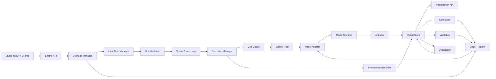
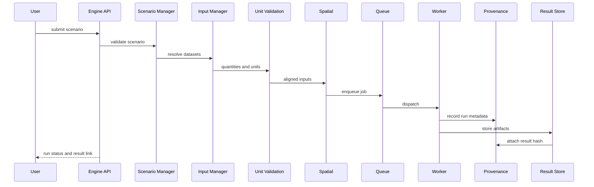

# معماری موتور علمی HyDroMA

**Document ID:** HYDROMA-SCIENTIFIC-ENGINE-ARCHITECTURE
**Version:** 1.0 (DESIGN — NOT APPROVED)
**Date:** 2026-11-17
**Status:** استقلال موتور و قرارداد مدل تعریف شده است؛ انتخاب مدل‌های نهایی باز است.
**Companion:** `ECO-NOJIN-MASTER-ARCHITECTURE-V2.md` · `ECO-NOJIN-DATA-DOMAIN-MODEL.md`

---

## ۱. دامنه و اصول

HyDroMA موتور علمی اکوسیستم است: تبدیل داده محیطی به نتیجه قابل ردیابی، قابل کالیبراسیون و قابل بازتولید برای سرزمین، مرتع، مزرعه، حوضه و پروژه احیا.

| # | اصل | معیار پذیرش |
|---|---|---|
| S1 | استقلال کامل | موتور هیچ ماژول کسب‌وکار را import نمی‌کند؛ فقط job می‌گیرد و نتیجه می‌دهد. |
| S2 | مدل‌محور و قابل تعویض | هر مدل از طریق Adapter؛ حذف/جایگزینی مدل بدون تغییر هسته. |
| S3 | واحد-امن | هر کمیت UCUM؛ ناسازگاری = خطای سخت پیش از اجرا. |
| S4 | خط‌مبدأ اجباری | نتیجه بدون provenance ذخیره یا منتشر نمی‌شود. |
| S5 | دروازه اعتبار | وضعیت علمی هر نتیجه یکی از `UNCALIBRATED`/`CALIBRATED`/`VALIDATED`/`NOT_VALIDATED` است؛ `UNCALIBRATED` و `NOT_VALIDATED` هرگز به‌عنوان واقعیت تأییدشده نمایش داده نمی‌شوند. |
| S6 | بازتولیدپذیری | snapshot ورودی + hash کد + seed + محیط اجرا ثبت می‌شود. |
| S7 | مهار منابع | سهمیه CPU/RAM/زمان/دیسک؛ توقف در نقض. |
| S8 | شفافیت محدودیت | هر مدل «دامنه اعتبار» و «محدودیت» اعلام‌شده دارد. |
| S9 | عدم وابستگی انحصاری | هیچ کتابخانه/نرم‌افزار واحدی تنها راه اجرا نیست. |
| S10 | تفکیک از MRV | نتیجه علمی ≠ اعتبار کربن؛ هیچ تبدیل خودکار وجود ندارد. |

---

## ۲. معماری اجزا



### ۲.۱ مسئولیت اجزا

| جزء | مسئولیت | ورودی | خروجی | مرز |
|---|---|---|---|---|
| Model Registry | ثبت نسخه، مجوز، دامنه اعتبار، وضعیت | manifest | entry نسخه‌دار | تغییرناپذیر؛ حذف ممنوع |
| Model Adapter | ترجمه قرارداد عمومی به ورودی/خروجی مدل | dataset + params | invocation spec | هر مدل یک adapter |
| Input Data Manager | انتخاب، snapshot و hash ورودی | dataset refs | input snapshot | بدون تغییر منبع |
| Unit Validation | تبدیل و بررسی ابعاد | quantities | validated quantities | خطای سخت |
| Spatial Processing | همراستاسازی، reproject، zonal | raster/vector | aligned grid | بدون تفسیر علمی |
| Execution Manager | اجرا، نظارت، timeout، artifact | job | run record | sandbox |
| Job Queue | اولویت، retry، DLQ | job | scheduled job | idempotent |
| Scenario Manager | تعریف/نسخه سناریو و مقایسه | params | scenario | بدون اجرای مستقیم |
| Calibration | تخمین پارامتر | observations | parameter set + diagnostics | ثبت نسخه |
| Validation | ارزیابی عملکرد | predictions + obs | verdict + metrics | مستقل از سازنده |
| Uncertainty | ensemble/sensitivity | runs | interval + report | صریح در روش |
| Provenance | زنجیره تولید | metadata | provenance record | append-only |
| Result Store | نگهداری artifact + index | artifacts | result set | نسخه‌دار؛ سیاست نگهداشت |
| Visualization API | ارائه سری/لایه/نمودار | result | JSON/tiles/chart | فقط خواندن |

### ۲.۲ قرارداد Job (مفهومی)

| فیلد | نوع | الزام |
|---|---|---|
| `job_id` | UUIDv7 | یکتا؛ idempotency key |
| `tenant_id` / `org_id` | UUID | زمینه امنیتی |
| `model_id` / `model_version` | string | از Registry |
| `scenario_id` | UUID | اختیاری برای اجرای مستقیم |
| `inputs[]` | {dataset_id؛ variable؛ unit؛ time_range؛ bbox} | حداقل یک ورودی |
| `parameters` | map | مطابق schema مدل |
| `spatial` | {crs؛ resolution؛ aoi} | اجباری برای مدل مکانی |
| `time` | {start؛ end؛ timestep} | اجباری برای سری زمانی |
| `calibration_ref` | UUID | اختیاری |
| `requested_by` | subject | از token؛ غیرقابل جعل |
| `priority` / `quota` | enum/int | سیاست |
| `callback` | object | اختیاری و امضاشده |

**وضعیت اجرا:** `SUBMITTED → QUEUED → RUNNING → COMPLETED|FAILED|CANCELLED` (وضعیت اجرا).
**وضعیت علمی (مستقل):** `UNCALIBRATED`/`CALIBRATED`/`VALIDATED`/`NOT_VALIDATED` — رکورد `ScientificResult` (بخش ۶-الف).

---

## ۳. چرخه اجرا



**قواعد:**
1. اعتبارسنجی ورودی قبل از صف؛ job نامعتبر هرگز اجرا نمی‌شود.
2. هر اجرا immutable است؛ اصلاح = اجرای جدید با نسخه/پارامتر جدید.
3. شکست عددی → artifact تشخیصی + وضعیت `FAILED`؛ retry خودکار فقط برای خطای گذرا.
4. سقف retry = ۳؛ سپس DLQ + اعلان مالک.
5. نتیجه بدون provenance → رد.

---

## ۴. کاتالوگ مدل‌ها (ارزیابی معماری)

| مدل (منبع) | حوزه | ورودی اصلی | خروجی اصلی | واحد | داده موردنیاز | وابستگی | هزینه پردازش | محدودیت | مرورگر/سرور | مجوز |
|---|---|---|---|---|---|---|---|---|---|---|
| wflow-jl (Wflow.jl 1.0.4) | هیدرولوژی توزیع‌شده | بارش؛ دما؛ DEM؛ کاربری؛ خاک | دبی؛ تبخیر؛ رطوبت خاک | mm/day؛ m³/s | ERA5/ایستگاه؛ DEM؛ LULC؛ soil | Julia runtime | متوسط-سنگین | نیاز به تنظیم شبکه؛ پارامترمحور | سرور (WASM نامحتمل) | MIT |
| SWAT+ (62.0.1) | حوضه کشاورزی | اقلیم؛ مدیریت؛ خاک؛ DEM | آب؛ رسوب؛ نیتروژن؛ محصول | mm؛ t/ha؛ kg/ha | ایستگاه؛ مدیریت زمین | Fortran executable | سنگین | ورودی حجیم؛ کالیبراسیون دشوار | سرور | LGPL-2.1 |
| MODFLOW 6 (6.8.1) + FloPy | آب زیرزمینی | هد مرزی؛ هدایت؛ تغذیه؛ پمپاژ | هد؛ بیلان؛ جهت جریان | m؛ m³/day | چاه؛ زمین‌شناسی؛ شبکه | Fortran + Python | سنگین | مدل‌سازی مفهومی آبخوان لازم | سرور | CC0 / public domain |
| HydroMT-wflow (1.1.0) | آماده‌سازی مدل | داده مکانی؛ پارامتر | مدل wflow آماده | — | DEM؛ LULC؛ soil | Python + wflow | متوسط | وابسته به wflow | سرور | GPL-3.0 |
| RHEM singlestorm | فرسایش رگبار | بارش؛ شیب؛ خاک؛ پوشش | رسوب؛ رواناب | t/ha؛ mm | رگبار؛ DEM؛ خاک | Fortran | سبک-متوسط | رگبار منفرد | سرور یا WASM (بررسی) | MIT |
| RHEM cligen | فرسایش بلندمدت | اقلیم تولیدی؛ خاک؛ پوشش | فرسایش سالانه | t/ha/yr | CLIGEN؛ خاک | Fortran | متوسط | نیاز اقلیم تولیدی | سرور | MIT |
| AquaCrop-OSPy (3.1.0) | محصول/آب | اقلیم؛ خاک؛ مدیریت؛ کشت | عملکرد؛ بهره‌وری آب | t/ha؛ kg/m³ | اقلیم روزانه؛ خاک | Python | سبک-متوسط | تقویم کشت | هر دو (سبک) | Apache-2.0 (تأیید) |
| PCSE/WOFOST (6.0.13) | شبیه‌سازی محصول | اقلیم؛ خاک؛ مدیریت | عملکرد؛ مراحل رشد | t/ha؛ day | اقلیم روزانه؛ پارامتر محصول | Python | سبک | کالیبراسیون واریته | هر دو | EUPL-1.1 |
| xclim (0.62.0) | شاخص اقلیمی | دما؛ بارش؛ سری زمانی | شاخص‌ها (CDD؛ GDD؛ ...) | °C؛ mm؛ day | dataset شبکه‌ای | Python | سبک-متوسط | نیاز سری زمانی معتبر | هر دو | Apache-2.0 |
| climate-indices (3.0.0) | خشکسالی | بارش؛ دما | SPI؛ SPEI؛ PDSI | dimensionless | سری زمانی بلند | Python/Rust | سبک | هم‌پوشانی با xclim | هر دو | BSD-3-Clause |
| InVEST | خدمات اکوسیستم | LULC؛ DEM؛ بارش | ارزش/حجم خدمت | متنوع | LULC؛ پارامتر | Python | متوسط | فرض‌های اقتصادی | سرور | Apache-2.0 |
| Landlab (2.11.0) | ژئومورفولوژی | توپوگرافی؛ فرایندها | تغییر شکل زمین | m؛ m/yr | DEM | Python/C++ | متوسط | مدل‌سازی فرایندمحور | سرور | MIT |
| SOIL_CARBON_MODEL_TBD | کربن خاک | ورودی مدل منتخب | ذخیره/تغییر کربن | tC/ha | مدیریت؛ اقلیم؛ خاک | نامشخص | نامشخص | **مجاز نیست تا تصمیم D-18**؛ RothC در Registry پردازش نشده است | هر دو (پس از تأیید) | UNKNOWN |

`FACT` فهرست بالا از ارزیابی Registry است؛ هیچ Build/اجرا در این مأموریت انجام نشده و هیچ ادعای صحت عددی وجود ندارد.
`OWNER_DECISION_REQUIRED` مجموعه مدل‌های فاز اول (پیشنهاد: wflow-jl، MODFLOW6+FloPy، xclim، AquaCrop؛ سپس RHEM و SWAT+).

### ۴.۱ هم‌پوشانی و انتخاب
- **xclim vs climate-indices:** هم‌پوشانی در شاخص‌ها؛ یکی به‌عنوان پیش‌فرض، دیگری به‌عنوان تأیید متقابل.
- **wflow-jl vs SWAT+:** wflow برای هیدرولوژی توزیع‌شده و سبک‌تر؛ SWAT+ برای حوضه کشاورزی جامع‌تر و سنگین‌تر.
- **AquaCrop vs PCSE:** AquaCrop ساده‌تر و آب‌محور؛ PCSE/WOFOST دقیق‌تر ولی نیازمند کالیبراسیون واریته.
- **RHEM دو واریانت:** یک adapter با دو حالت `single_storm` و `cligen`.

---

## ۵. منابع داده

| منبع | نوع | کاربرد | محدودیت | تصمیم |
|---|---|---|---|---|
| ایستگاه هواشناسی/آب | نقطه‌ای سری زمانی | کالیبراسیون و مرجع | کیفیت و پوشش | مالک/سازمان محلی |
| ERA5/داده بازتحلیل | شبکه‌ای | ورودی اقلیمی | تفکیک مکانی | شرایط مجوز بررسی شود |
| DEM (ملی/جهانی) | رستر | توپوگرافی/حوضه | دقت | منبع رسمی ترجیح |
| تصاویر ماهواره‌ای (STAC) | رستر | پوشش گیاهی/کاربری | ابر؛ هزینه؛ مجوز | ارائه‌دهنده = تصمیم مالک |
| نقشه خاک | وکتور/رستر | پارامتر خاک | مقیاس | مرجع ملی |
| داده میدانی | نقطه/پلی‌گون | صحت‌سنجی | پراکندگی | WF-06 |
| داده socioeconomic | جدولی | InVEST/تحلیل | حساسیت | حداقل‌سازی |
| مرز اداری/حقوقی | وکتور | زمینه سرزمین | دقت حقوقی | سند رسمی |

`UNKNOWN` دسترسی پایدار و شرایط حقوقی برخی منابع؛ باید قبل از فاز ۳ تأیید شود.

---

## ۶. کالیبراسیون، اعتبارسنجی و عدم‌قطعیت

| مرحله | روش پیشنهادی | خروجی | دروازه |
|---|---|---|---|
| Calibration | بهینه‌سازی پارامتر (مثلاً SCE-UA/بهینه‌سازی محدود) | parameter set + diagnostics | ثبت نسخه و دامنه اعتبار |
| Validation | تقسیم زمانی/مکانی؛ KGE/NSE/RMSE؛ confusion برای طبقه‌بندی | metrics + verdict | تأیید مستقل |
| Uncertainty | ensemble چند پارامتر/مدل؛ تحلیل حساسیت؛ بازه اطمینان | interval + method | گزارش صریح |
| Baseline | دوره مرجع؛ عدم‌قطعیت پایه | baseline record | تأیید روش |
| Gate | آستانه‌های کیفیت | `VALIDATED` فقط با عبور | قابل استناد در MRV |

قواعد:
1. اعتبارسنجی توسط فرد/نقش مستقل از اجراکننده.
2. آستانه‌ها باید از پیش اعلام و نسخه‌دار باشند.
3. تغییر داده مرجع یا روش = اعتبارسنجی جدید.
4. نبود داده کافی → `NOT_VALIDATED` (نه `VALIDATED`).

---

## ۶-الف. مدل چهارحالتی وضعیت علمی (Normative — RC1)

> این مدل **مستقل** از وضعیت اجرا (SUBMITTED/QUEUED/RUNNING/COMPLETED/FAILED/CANCELLED) و **مستقل** از وضعیت بلوغ/انتشار (EXPERIMENTAL/PROVISIONAL/REJECTED) است. هر `ScientificResult` دقیقاً یکی از چهار وضعیت علمی زیر را دارد.

### ۶-الف.۱ تعاریف قطعی

| وضعیت | تعریف | شرط ورود | شواهد لازم | قابل نمایش به‌عنوان واقعیت؟ |
|---|---|---|---|---|
| `UNCALIBRATED` | مدل با پارامترهای پیش‌فرض/ادبیات اجرا شده؛ هیچ کالیبراسیونی انجام نشده | ثبت اجرا با پارامترهای اولیه | run + provenance + پارامترهای اولیه | **نه** — فقط اکتشافی |
| `CALIBRATED` | پارامترها بر اساس مشاهدات کالیبره شده‌اند؛ اما اعتبارسنجی مستقل انجام نشده | اجرای کالیبراسیون + ثبت مجموعه پارامتر + diagnostics | `calibration_ref` + parameter set + diagnostics + version | **نه** — مشروط؛ باید برچسب «کالیبره‌شده، اعتبارسنجی‌نشده» بخورد |
| `VALIDATED` | اعتبارسنجی مستقل (توسط طرفی جدا از کالیبراتور) با عبور از آستانه‌های از پیش اعلام‌شده | کالیبراسیون + اعتبارسنجی مستقل + عبور از آستانه | `validation_ref` + metrics + verdict + شواهد + version | **بله** — قابل استفاده در MRV (با رعایت S10) |
| `NOT_VALIDATED` | اعتبارسنجی انجام شده ولی شکست خورده، یا داده کافی برای اعتبارسنجی وجود ندارد | تلاش برای اعتبارسنجی/کالیبراسیون با نتیجه منفی یا داده ناکافی | گزارش شکست/داده ناکافی + دلیل | **نه** — صریحاً «اعتبارسنجی‌نشده» |

### ۶-الف.۲ تفکیک Calibration از Validation
- **Calibration** = تنظیم پارامترها با مشاهدات (توسط دانشمند/عامل علمی با تأیید انسانی).
- **Validation** = ارزیابی مستقل عملکرد مدل با داده‌های held-out (توسط اعتبارسنج مستقل — نقش `MRV_SPECIALIST` یا `ENVIRONMENTAL_EXPERT` — که **نباید** همان کالیبراتور باشد).
- **قاعده جدایی:** کالیبراتور و اعتبارسنج باید دو موجودیت مستقل باشند (Separation of Duties).

### ۶-الف.۳ گذارها (State Transitions)

```
UNCALIBRATED ──(calibration run + params + diagnostics)──▶ CALIBRATED
CALIBRATED ──(independent validation + thresholds passed)──▶ VALIDATED
CALIBRATED ──(validation attempted, failed)──▶ NOT_VALIDATED
UNCALIBRATED ──(insufficient data)──▶ NOT_VALIDATED
NOT_VALIDATED ──(new calibration with more data)──▶ CALIBRATED
NOT_VALIDATED ──(new validation with more data)──▶ VALIDATED
VALIDATED ──(model/data/params changed → re-validation required)──▶ CALIBRATED
```

- **مدل خطی نیست:** گذار از `VALIDATED` به `CALIBRATED` با تغییر مدل/داده/پارامترها رخ می‌دهد (invalidates prior validation). گذار مستقیم `UNCALIBRATED → VALIDATED` بدون کالیبراسیون مجاز نیست.

### ۶-الف.۴ چه کسی مجاز به تغییر وضعیت است؟

| تغییر | مجاز | تأیید |
|---|---|---|
| → `CALIBRATED` | `SCIENTIST` یا `AI_AGENT_SCIENCE` | تأیید انسانی برای عامل AI |
| → `VALIDATED` | `MRV_SPECIALIST` یا `ENVIRONMENTAL_EXPERT` (مستقل از کالیبراتور) | ثبت دوطرفه |
| → `NOT_VALIDATED` | `SCIENTIST` یا `MRV_SPECIALIST` | ثبت دلیل |
| هر تغییر وضعیت | — | ثبت در `ScientificStateChangeLog` (append-only) |

### ۶-الف.۵ ثبت تغییر وضعیت (ScientificStateChangeLog)
هر تغییر وضعیت باید شامل موارد زیر باشد (append-only، غیرقابل ویرایش):
- `result_id`، `from_state`، `to_state`
- `model_id` / `model_version`
- `data_version` / `input_hashes[]`
- `params_hash` / `calibration_ref`
- `calibration_method` (برای → CALIBRATED)
- `validation_method` + `validation_ref` + `metrics` (برای → VALIDATED)
- `reason` (برای → NOT_VALIDATED)
- `actor` (نقش/کاربر)، `approved_by` (در صورت لزوم)
- `timestamp` (UTC)

### ۶-الف.۶ تفکیک وضعیت بلوغ/انتشار از وضعیت علمی
وضعیت‌های زیر **متعلق به چرخه بلوغ/انتشار/ارزیابی هستند**، نه وضعیت علمی، و **نباید** با چهار وضعیت علمی ترکیب شوند:
- `EXPERIMENTAL` — بلوغ پایین (maturity).
- `PROVISIONAL` — انتشار/پذیرش موقت (release/acceptance).
- `REJECTED` — رد ارزیابی (evaluation outcome).
- **قاعده:** یک مدل می‌تواند همزمان `EXPERIMENTAL` (بلوغ) و `UNCALIBRATED` (وضعیت علمی) باشد. این دو محور مستقل‌اند.

---

## ۶-ب. قراردادهای علمی حوزه‌ای (Normative — RC5)

> هر حوزه علمی قرارداد مستقل خود را دارد. قراردادها بر پایه شواهد واقعی مدل‌های موجود در Registry تعریف شده‌اند؛ قرارداد صوری بدون محتوا ممنوع است.

### ۶-ب.۱ Water (آب)
- **مدل‌های مرجع:** wflow-jl 1.0.4، modflow6 6.8.1 + flopy 3.13.0.dev0، swatplus 62.0.1.
- **ورودی‌ها:** بارش (mm/time)، دما (°C)، پتانسیل تبخیر-تعرق (mm)، پوشش گیاهی، خاک، توپوگرافی (DEM)، مرزهای حوضه.
- **خروجی‌ها:** رواناب (mm/time)، جریان رودخانه (m³/s)، سطح آب زیرزمینی (m)، تعادل آبی (mm).
- **واحدها:** mm، m³/s، m — UCUM.
- **محدوده اعتبار:** حوضه‌های با داده کافی؛ نه مناطق بدون داده.
- **محدودیت‌ها:** نیاز به کالیبراسیون؛ عدم قطعیت بالا در مناطق خشک.
- **Provenance:** کد مدل + نسخه + داده ورودی + پارامترها.
- **اعتبارسنجی:** KGE/NSE/RMSE روی جریان مشاهده‌شده.

### ۶-ب.۲ Soil (خاک)
- **مدل‌های مرجع:** landlab 2.11.0، rhem-engine-singlestorm/cligen، pcse 6.0.13 (بخش خاک).
- **ورودی‌ها:** نوع خاک، بافت،容量 نگهداشت آب، مواد آلی، شیب، پوشش.
- **خروجی‌ها:** فرسایش (t/ha/yr)، رواناب سطحی، SOC (t/ha).
- **واحدها:** t/ha/yr، mm، t/ha — UCUM.
- **محدوده اعتبار:** پارسل‌های با داده خاک.
- **محدودیت‌ها:** عدم قطعیت در棋盘 ارزیابی فرسایش.
- **اعتبارسنجی:** مقایسه با پلات‌های اندازه‌گیری.

### ۶-ب.۳ Climate (اقلیم)
- **مدل‌های مرجع:** xclim 0.62.0، climate-indices 3.0.0.
- **ورودی‌ها:** سری زمانی دما/بارش (NetCDF/CSV).
- **خروجی‌ها:** شاخص‌های اقلیمی (ETCCDI)، خشکسالی (SPI/SPEI).
- **واحدها:** °C، mm، dimensionless indices — UCUM.
- **محدوده اعتبار:** دوره آماری کافی (≥30 سال).
- **محدودیت‌ها:** وابستگی به کیفیت داده.
- **اعتبارسنجی:** مقایسه با شاخص‌های مرجع.

### ۶-ب.۴ Agriculture (کشاورزی)
- **مدل‌های مرجع:** aquacrop-ospy 3.1.0، pcse 6.0.13.
- **ورودی‌ها:** رقم، تاریخ کاشت، خاک، آب، اقلیم، مدیریت.
- **خروجی‌ها:** عملکرد (t/ha)، آب‌مصرفی، بهره‌وری آب.
- **واحدها:** t/ha، mm، kg/m³ — UCUM.
- **محدوده اعتبار:** ارقام/مناطق کالیبره‌شده.
- **محدودیت‌ها:** نیاز به داده خاک/اقلیم.
- **اعتبارسنجی:** مقایسه با عملکرد مشاهده‌شده.

### ۶-ب.۵ Remote Sensing (سنجش‌ازدوا)
- **مدل‌های مرجع:** pygeoprocessing 3.0.5، odc-stac 0.5.3، titiler 2.4.1، collect-earth-online.
- **ورودی‌ها:** تصاویر ماهواره‌ای (COG/STAC)، باندها، ابر.
- **خروجی‌ها:** شاخص‌های گیاهی (NDVI/EVI)، پوشش زمین، تغییرات.
- **واحدها:** dimensionless، ha، m — UCUM.
- **محدوده اعتبار:** محدوده مکانی/زمانی داده.
- **محدودیت‌ها:** ابر، کیفیت Sensör.
- **اعتبارسنجی:** مقایسه با داده مرجع زمینی.

### ۶-ب.۶ Vegetation (پوشش گیاهی)
- **مدل‌های مرجع:** invest 3.0.0، collect-earth-online، pygeoprocessing.
- **ورودی‌ها:** NDVI/EVI، بارش، خاک، مدیریت.
- **خروجی‌ها:** پوشش گیاهی (fraction)، بیومس (t/ha)، خدمات اکوسیستمی.
- **واحدها:** fraction، t/ha — UCUM.
- **محدوده اعتبار:** مناطق با داده.
- **محدودیت‌ها:** فرضیات اقتصادی مدل invest.
- **اعتبارسنجی:** مقایسه با پلات‌های میدانی.

---

## ۷. Provenance و بازتولیدپذیری

| فیلد | توضیح |
|---|---|
| `run_id` | شناسه اجرا |
| `model_id` / `version` | نسخه دقیق |
| `adapter_version` | نسخه آداپتور |
| `code_hash` | hash کد/تصویر اجرا |
| `input_hashes[]` | hash هر snapshot ورودی |
| `params_hash` | hash پارامترها |
| `calibration_ref` | مرجع کالیبراسیون |
| `env` | نسخه runtime؛ کتابخانه‌ها |
| `seed` | در صورت تصادفی بودن |
| `executed_at` / `duration` | زمان |
| `operator` | کاربر/سرویس آغازکننده |
| `host` | گره اجرا |
| `result_hashes[]` | hash خروجی |
| `license_snapshot` | مجوز مدل/داده در زمان اجرا |

**آزمون بازتولید:** اجرای مجدد با همان snapshot باید نتیجه در محدوده تحمل اعلام‌شده تولید کند؛ در غیر این صورت علامت‌گذاری و بررسی.

---

## ۸. ذخیره و نسخه‌بندی نتیجه

- هر ResultSet دارای `run_id`، `model_version`، `provenance_id`، `validation_status`، `uncertainty_id` است.
- Artifact بزرگ (رستر) در Object Storage با checksum؛ متادیتا در DB.
- نسخه‌بندی: نتیجه هرگز بازنویسی نمی‌شود؛ نتیجه جدید = نسخه جدید.
- سیاست نگهداشت: نتیجه منتشرشده دائمی؛ اجراهای موقت با TTL قابل تنظیم.
- حذف فقط با مجوز و ثبت audit؛ شاهد MRV تحت legal hold.

---

## ۹. API نمایش

| endpoint (مفهومی) | خروجی | کنترل |
|---|---|---|
| `GET /v1/runs/{id}` | وضعیت + متادیتا | scope |
| `GET /v1/runs/{id}/series` | سری زمانی | scope |
| `GET /v1/runs/{id}/layers` | لایه/کاشی | geo-scope |
| `GET /v1/runs/{id}/provenance` | زنجیره | نقش علمی/حسابرسی |
| `GET /v1/scenarios/{id}/compare` | مقایسه | scope |
| `GET /v1/models` | رجیستری عمومی | عمومی/داخلی |

`RECOMMENDATION` API نتیجه هرگز داده خام PII یا مسیر داخلی انبار را افشا نکند؛ لینک دانلود موقت و امضاشده باشد.

---

## ۱۰. پردازش سمت مرورگر در برابر سرور

| مدل | مرورگر (WASM/JS) | سرور | ارزیابی |
|---|---|---|---|
| xclim / climate-indices (سری کوچک) | ممکن | ترجیحی برای دیتاست بزرگ | کاهش بار برای تحلیل سریع |
| AquaCrop (تک‌مزرعه) | ممکن با WASM | پیش‌فرض | تجربه تعاملی |
| RHEM | شاید با کامپایل WASM | پیش‌فرض | بررسی فنی لازم |
| wflow / SWAT+ / MODFLOW | نامحتمل | الزامی | حافظه و زمان اجرا |
| InVEST / Landlab | نامحتمل | الزامی | وابستگی سنگین |
| کالیبراسیون/ensemble | خیر | الزامی | بار محاسباتی |

`RECOMMENDATION` پردازش مرورگری فقط برای «پیش‌نمایش/تحلیل سریع» با برچسب `PREVIEW`؛ نتیجه رسمی همیشه سروری و دارای provenance است.
`ASSUMPTION` هزینه محاسبه سمت کاربر حذف نمی‌شود؛ مصرف باتری، حافظه و پهنای باند اندازه‌گیری شود.

---

## ۱۱. امنیت و مهار اجرا

| تهدید | کنترل |
|---|---|
| ورودی مخرب (فایل/رستر) | اعتبارسنجی schema؛ محدودیت اندازه؛ sandbox؛ کتابخانه امن |
| اجرای کد دلخواه | فقط adapterهای ثبت‌شده؛ بدون اجرای اسکریپت کاربر |
| فرار از sandbox | کاربر غیرمجاز؛ mount فقط‌خواندنی؛ شبکه محدود؛ seccomp/AppArmor در صورت وجود |
| مصرف بی‌رویه منابع | سهمیه CPU/RAM/زمان/دیسک؛ kill خودکار |
| دستکاری نتیجه | hash-chain؛ دسترسی نوشتن محدود؛ audit |
| نشت داده | رمزنگاری؛ دسترسی بر اساس scope؛ redaction لاگ |
| وابستگی آلوده | SBOM؛ pin نسخه؛ بازبینی مجوز |

`RECOMMENDATION` موتور علمی در شبکه جدا از دامنه مالی اجرا شود؛ تنها از طریق API محدود و با احراز سرویس ارتباط داشته باشد.

**قاعده عامل:** فراخوانی job توسط عامل هوشمند ریسک کلاس ۳ است و نیازمند تأیید انسانی؛ عامل نمی‌تواند نتیجه را «اعتبارسنجی‌شده» علامت بزند یا شاهد MRV بسازد.

---

## ۱۲. عملکرد و هزینه (چارچوب ارزیابی)

| مؤلفه | محرک هزینه | اندازه‌گیری لازم |
|---|---|---|
| اجرای مدل | زمان CPU؛ حافظه؛ I/O | زمان اجرا به ازای سناریو؛ سهمیه |
| ذخیره نتیجه | حجم رستر/سری | GB به ازای هر run |
| آماده‌سازی داده | reproject/resample | زمان preprocessing |
| ensemble | تعداد اجرا | ضریب هزینه |
| کالیبراسیون | تعداد تکرار | ساعت محاسبه |
| انتقال داده | حجم COG | پهنای باند |

`UNKNOWN` هزینه واقعی تا اجرای پایلوت؛ هیچ عدد benchmark ادعا نمی‌شود.
`RECOMMENDATION` کش نتیجه تکراری بر اساس `hash(inputs+params+model)` برای جلوگیری از اجرای مجدد.

---

## ۱۳. کیفیت و پذیرش

| بررسی | معیار |
|---|---|
| قرارداد adapter | همه مدل‌ها schema یکسان ورودی/خروجی دارند |
| واحد | صفر کمیت بدون واحد در artifact |
| provenance | ۱۰۰٪ اجراها دارای رکورد کامل |
| اعتبار | صفر نتیجه `VALIDATED` بدون تأیید مستقل |
| بازتولید | اجرای مجدد در محدوده تحمل |
| مهار | صفر اجرای بدون سهمیه |
| نسخه | عدم بازنویسی نسخه ثبت‌شده |
| مجوز | ثبت مجوز مدل/داده و پرچم ریسک |

---

## ۱۴. تصمیمات باز

1. مجموعه مدل‌های فاز اول و ترتیب افزودن.
2. منبع داده اقلیمی/ماهواره‌ای و شرایط حقوقی آن.
3. سیاست کالیبراسیون و آستانه پذیرش هر مدل.
4. سطح پردازش مرورگری برای هر مدل.
5. انتخاب runtime و روش sandbox.
6. سیاست نگهداشت نتیجه و شاهد.
7. مدل کربن خاک (RothC یا جایگزین) و روش‌شناسی MRV؛ تا تعیین تکلیف، روش تجربی (empirical) با عدم‌قطعیت آشکار مجاز است و RothC قابل استناد نیست.
8. پذیرش حقوقی مدل‌های GPL/EUPL (HydroMT، PCSE).

**پایان سند.**

---

## ۶-ج. نسخه‌بندی و چرخه عمر Adapter (Normative — MC5 علمی)

> سیاست نسخه‌بندی Adapter برای `SCI-REG` و `SCI-ADP`.

| قاعده | الزام |
|---|---|
| Immutable Adapter Version | هر نسخه Adapter تغییرناپذیر است؛ تغییر = نسخه جدید |
| Adapter-to-Model Version Binding | هر Adapter به نسخه دقیق Model متصل است؛ تغییر مدل = Adapter جدید |
| Input/Output Schema Version | schema ورودی/خروجی نسخه‌دار؛ تغییر schema = نسخه جدید |
| Backward Compatibility | Adapter جدید باید schema قبلی را پشتیبانی کند (N-1) |
| N-1 Compatibility | حداقل یک نسخه قبلی Model/Adapter قابل اجرا می‌ماند |
| Deprecation Notice | اعلام رسمی deprecate با دلیل و مهلت |
| Deprecation Period | حداقل ۲ نسخه minor یا ۶ ماه (هرکدام بیشتر) |
| Reproducibility of Historical Runs | اجرای تاریخی با نسخه دقیق Adapter/Model بازتولیدپذیر است |
| Migration and Replacement Policy | مهاجرت تدریجی؛ حذف ناگهانی ممنوع |

**قاعده کلیدی:** تغییر Adapter نباید اجرای مجدد یک `ModelRun` تاریخی را تغییر دهد. تمام Provenanceهای تاریخی باید نسخه دقیق Adapter و Model را ثبت کنند (`adapter_version` + `model_version` + `code_hash`).

**پایان الحاقیه.**
