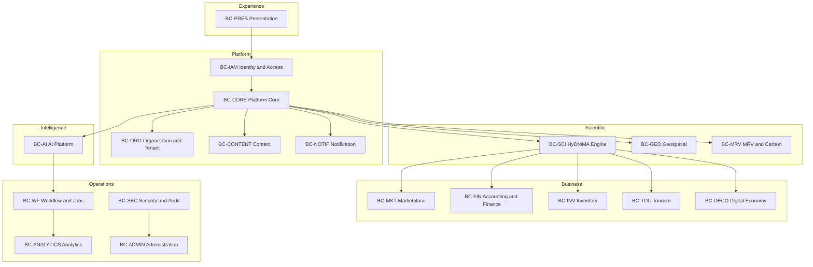

# ECO NOJIN — EXECUTABLE ARCHITECTURE
## Eco Nojin & HyDroMA — From Accepted Architecture to Executable Design

**Document ID:** ECO-NOJIN-EXECUTABLE-ARCHITECTURE
**Version:** 1.0 (EXECUTABLE DESIGN — NOT APPROVED)
**Date:** 2026-11-17
**Baseline:** `ARCHITECTURE_BASELINE_ACCEPTED_WITH_LIMITATIONS`
**Status:** EXECUTABLE DESIGN — no code, no build, no deploy. No project is Production Approved.

---

## 0. DOCUMENT CONTROL

| Item | Value |
|---|---|
| Input baseline | `D:\Nojin\architecture\consolidated-v1\` (accepted with limitations) |
| Catalog records | 194 (178 MODULE + 4 INTERNAL_CONTROL + 12 AGENT_MANIFEST) |
| Bounded contexts | 19 executable + 5 scientific sub-domains |
| Communication contracts | Synchronous API / Asynchronous Job / Domain Event / Read-only Query |
| Companion files | `MODULE-EXECUTION-MAP.csv`, `IMPLEMENTATION-ROADMAP.md` |

**Legend:** `FACT` · `ASSUMPTION` · `RECOMMENDATION` · `OWNER_DECISION_REQUIRED` · `UNKNOWN`.

---

## 1. EXECUTABLE MACRO ARCHITECTURE

### 1.1 Bounded Contexts (19 executable + 5 scientific sub-domains)



### 1.2 Bounded Context Responsibility Matrix

| BC | Responsibility | Modules | Data Owner | Key Contracts |
|---|---|---|---|---|
| BC-PRES | Web/mobile/public UI, design system, offline shell | 3 | none (read-only) | Synchronous API |
| BC-IAM | Authentication, session, RBAC/ABAC, MFA | 2 | Identity | Synchronous API |
| BC-CORE | Org, tenancy, RBAC, users, audit, docs, i18n, settings, storage, cache | 11 | Core | Synchronous API |
| BC-ORG | Villages, nomadic, rangeland, farm, watershed, landscape, parcels, restoration | 12 | Territory | Synchronous API |
| BC-CONTENT | Knowledge base, training, local knowledge, participation, working groups, research, experts, discussions, verification, search | 10 | Content | Synchronous API + Read-only Query |
| BC-NOTIF | Notifications, delivery channels | 2 | Notification | Synchronous API |
| BC-SCI | Model registry, adapters, input, units, spatial, execution, queue, scenarios, calibration, validation, uncertainty, provenance, results, viz API | 14 | Scientific | Asynchronous Job + Domain Event |
| BC-GEO | 2D/3D maps, terrain, imagery, raster, vector, STAC, search, watershed, LULC, vegetation, change, field, satellite ingestion | 15 | Geospatial | Synchronous API + Read-only Query |
| BC-MRV | Monitoring, reporting, verification, carbon, SOC, biomass, indicators, baselines, provenance, uncertainty, registry, evidence, estimates, credits | 15 | MRV | Synchronous API + Domain Event |
| BC-AI | Gateway, registry, tools, policy, approval, audit + 12 agent manifests | 22 | AI | Asynchronous Job |
| BC-MKT | Vendors, catalog, variants, pricing, orders, returns, commission, settlement, shipping, customers, reviews, analytics | 13 | Marketplace | Synchronous API |
| BC-FIN | COA, journal, period, idempotency, AP, AR, cash, bank, FX, cost, project, tax, statements, budget, reports, invoices, payment reconciliation, payment adapter | 17 | Finance | Synchronous API |
| BC-INV | Warehouses, stock, transfers, procurement, PO, SO, batches, expiry, traceability, suppliers, valuation, reconciliation, analytics | 13 | Inventory | Synchronous API |
| BC-TOU | Destinations, accommodation, experiences, tours, guides, reservations, availability, pricing, payments, routes, content, events | 12 | Tourism | Synchronous API |
| BC-DECO | Internal ledger, wallet, tokenization, rewards, transactions, compliance, risk | 7 | Digital Economy | Synchronous API (owner-gated) |
| BC-WF | Workflow engine, definitions, approvals, scheduler, events, event schema, idempotency, jobs | 9 | Workflow | Asynchronous Job + Domain Event |
| BC-ANALYTICS | Observability metrics | 1 | Analytics | Read-only Query |
| BC-SEC | Secrets, backup, gateway, webhooks | 4 | Security | Synchronous API |
| BC-ADMIN | Global/org/user/scientific/marketplace/finance/content/tourism/agent admin, monitoring, audit, CI/CD | 12 | Administration | Synchronous API |

### 3.1 Scientific Sub-Domains (within BC-SCI, not separate modules)
| Sub-domain | Models (upstream candidates) | Owner |
|---|---|---|
| Hydrology | wflow-jl, swatplus | BC-SCI |
| Groundwater | modflow6, flopy | BC-SCI |
| Soil Science | landlab, rhem-engine-* | BC-SCI |
| Agro-ecology | aquacrop-ospy, pcse | BC-SCI |
| Climate Science | xclim, climate-indices, wps (blocked) | BC-SCI |
| Remote Sensing | pygeoprocessing, odc-stac, titiler, collect-earth-online | BC-SCI/BC-GEO |
| Vegetation/Land Cover | collect-earth, collect-earth-online, invest | BC-SCI/BC-GEO |
| Land Degradation | landlab, rhem-engine-* | BC-SCI |
| Restoration Modeling | invest, landlab | BC-SCI |
| Carbon and MRV | (MRV modules) | BC-MRV |
| Environmental Monitoring | (MRV + GEO) | BC-MRV/BC-GEO |
| Scientific Simulation | SCI-EXEC + model adapters | BC-SCI |

---

## 2. MODULE EXECUTION STRUCTURE

### 2.1 Record Types (from catalog)
| record_type | Count | Execution meaning |
|---|---:|---|
| `MODULE` | 178 | Independent bounded-context module with its own API, data, tests |
| `INTERNAL_CONTROL` | 4 | Internal control of AI-POLICY (not independently deployable) |
| `AGENT_MANIFEST` | 12 | Runtime configuration in AI-REGISTRY (not a module) |
| **Total** | **194** | — |

### 2.2 Module Execution Fields (in `MODULE-EXECUTION-MAP.csv`)
Each of the 194 records has: `module_id, module_name, record_type, layer_code, layer_name, bounded_context, internal_dependencies, external_dependencies, data_ownership, communication_contract, security_zone, test_path, dev_status, phase, notes`.

### 4.3 Communication Contracts (normative)
| Contract | When | Modules (count) |
|---|---|---|
| **Synchronous API** | CRUD, queries, config, UI-driven | 180 |
| **Asynchronous Job** | Long-running, scientific execution, workflow | 8 |
| **Domain Event** | State changes, cross-context notification | 2 |
| **Read-only Query** | Catalog, search, read-heavy | 4 |

**Rules:**
1. No synchronous call cycles (L3↔L10↔L5↔L11 must use jobs/events).
2. AI → HyDroMA always Asynchronous Job Submission.
3. HyDroMA → others Domain Event (outbox).
4. Workflow → Core never synchronous recursive.
5. Data ownership stays with the owning domain.

---

## 3. DATA & COMMUNICATION ARCHITECTURE

### 3.1 Data Stores (logical)
| Store | Content | Owner |
|---|---|---|
| Transactional DB (PostgreSQL) | All domain entities | BC-CORE (shared, per-schema) |
| Geospatial DB (PostGIS) | Geometries, rasters metadata | BC-GEO |
| Object Storage | COG, documents, model artifacts, evidence | BC-CORE (INF-STORAGE) |
| Search Index | Full-text, faceted | BC-CONTENT (INT-SEARCH) |
| Time-series | Metrics, monitoring | BC-ANALYTICS (INF-OBS) |
| Scientific Store | Model inputs/outputs, provenance | BC-SCI |
| Analytics | Aggregated facts | BC-ANALYTICS |

### 3.2 Data Ownership Rules (normative)
1. Each module owns its schema; cross-schema joins forbidden.
2. Financial data (BC-FIN) is append-only; corrections via reversal.
3. Scientific results (BC-SCI) are immutable; corrections via new versions.
4. MRV evidence (BC-MRV) is hash-stamped and immutable.
5. Audit log (BC-CORE) is append-only and hash-chained.
6. Multi-tenant isolation via `tenant_id` + RLS.

### 5.3 Key Entities (from Data Domain Model)
User, Organization, Territory, Parcel, RestorationProject, ModelRun, ScientificResult, Provenance, MonitoringRecord, MRVReport, Verification, Evidence, Vendor, Product, Order, Payment, Settlement, InventoryStock, StockMovement, Account, JournalEntry, JournalLine, Reservation, Document, Notification, AIAgent, WorkflowInstance, AuditLog, EcoCoinAccount, Wallet.

---

## 4. HY DROMA — SCIENTIFIC ENGINE

### 4.1 Architecture (BC-SCI, 14 modules)
Model Registry (SCI-REG) → Model Adapter (SCI-ADP) → Input Manager (SCI-INPUT) → Unit Validation (SCI-UNIT) → Spatial Processing (SCI-SPATIAL) → Execution Manager (SCI-EXEC) → Job Queue (SCI-QUEUE) → Scenario Manager (SCI-SCEN) → Calibration (SCI-CAL) → Validation (SCI-VAL) → Uncertainty (SCI-UNC) → Provenance (SCI-PROV) → Result Store (SCI-STORE) → Visualization API (SCI-VIZAPI).

### 4.2 Four-State Scientific Model (normative — unchanged)
`UNCALIBRATED` / `CALIBRATED` / `VALIDATED` / `NOT_VALIDATED`
- Defined in `HYDROMA-SCIENTIFIC-ENGINE-ARCHITECTURE.md §6-الف`.
- `EXPERIMENTAL`/`PROVISIONAL`/`REJECTED` are maturity/release states, NOT scientific states.
- MRV may only consume `VALIDATED` results.

### 4.3 Scientific Sub-Domains
See §1.2. Each sub-domain has: inputs, models, outputs, units (UCUM), validity limits, external data deps, offline capability, compute needs, API.

### 4.4 Adapter Versioning (from §6-ج)
Immutable Adapter Version, Adapter-to-Model Version Binding, Input/Output Schema Version, N-1 Compatibility, Deprecation Notice/Period, Reproducibility of Historical Runs.

---

## 5. INTERNATIONAL ARCHITECTURE

| Capability | Design |
|---|---|
| Multi-Tenant | `tenant_id` + RLS |
| Multi-Organization | Org hierarchy |
| Multi-Language | ICU catalogs, RTL/LTR |
| Multi-Currency | ISO 4217, Decimal, FX rates |
| Multi-Timezone | UTC storage, locale display |
| Multi-Region | Region-aware data model (owner-gated) |
| Locale-aware Formatting | ICU/CLDR |
| International Accounting | Multi-currency GL, jurisdiction config |
| Configurable Jurisdiction | Tax config per jurisdiction (owner-gated) |
| RBAC + ABAC | Roles + attributes (org, region, role) |

**Open (owner decision):** hosting jurisdiction (D-23), commercial model (D-24), budget (D-25).

---

## 6. FRONTEND ARCHITECTURE

### 6.1 Structure
- **BC-PRES** (3 modules: UI-SHELL, UI-DESIGN, UI-OFFLINE).
- Sitemap: 227 pages in 17 nav groups → mapped to bounded contexts.
- Design System: shared (UI-DESIGN), RTL/LTR, responsive, WCAG 2.2 AA.

### 6.2 Navigation
```
Public → Auth → Dashboard
  ├── Scientific (BC-SCI)
  ├── Geospatial (BC-GEO)
  ├── Territory (BC-ORG)
  ├── Marketplace (BC-MKT)
  ├── Accounting (BC-FIN)
  ├── Inventory (BC-INV)
  ├── Tourism (BC-TOU)
  ├── Knowledge (BC-CONTENT)
  ├── AI Workspace (BC-AI)
  ├── Wallet (BC-DECO)
  ├── Organization (BC-CORE)
  └── Administration (BC-ADMIN)
```

### 6.3 Page-to-Module Traceability
All 227 pages have `module_ids` in the sitemap → mapped to modules in the catalog. 0 broken references.

---

## 7. SECURITY & OPERATIONS

| Control | Module(s) | Status |
|---|---|---|
| Authentication | PLT-IAM, PLT-SESSION | DESIGN |
| Authorization | PLT-RBAC | DESIGN |
| Audit Logging | PLT-AUDIT | DESIGN |
| Secrets Management | INF-SECRETS | DESIGN |
| Data Protection | BC-CORE + INF-BACKUP | DESIGN |
| API Security | INT-GATEWAY | DESIGN |
| AI Security | AI-POLICY + 4 internal controls | DESIGN |
| Rate Limiting | INT-GATEWAY | DESIGN |
| Idempotency | INT-IDEMP | DESIGN |
| Backup/Recovery | INF-BACKUP | DESIGN |
| Monitoring | INF-OBS | DESIGN |
| Observability | INF-OBS | DESIGN |
| Job Monitoring | INF-JOBS + BC-WF | DESIGN |
| Error Handling | All BCs | DESIGN |

**All security controls are DESIGNED — IMPLEMENTATION_NOT_STARTED.**

---

## 8. ECONOMICS & CAPACITY

### 8.1 Compute Placement
| Workload | Placement | Rationale |
|---|---|---|
| Map rendering | Client (WebGL) | GPU-accelerated, low server cost |
| Raster previews | Client (WASM) | Reduce server load; device cost acknowledged |
| Scientific execution | Server (worker) | Heavy compute, accuracy |
| Workflow orchestration | Server | Durable execution |
| AI inference | Server (or client for small) | Model hosting |
| Search indexing | Server | Index maintenance |
| Accounting | Server | Consistency, Decimal |

### 8.2 Capacity Principles
- Start with Scenario A (low-cost), design for Scenario B (config-only migration).
- Measure device/battery/bandwidth impact of client compute.
- No Docker assumption; evaluate container vs VM vs PaaS.

**No benchmarks were run. All capacity figures are ASSUMPTION.**

---

## 9. DEVELOPMENT STATUS

| Status | Count | Meaning |
|---|---:|---|
| DESIGN | 194 | Architecture defined; no implementation |
| IMPLEMENTATION | 0 | None |
| TESTING | 0 | None |
| VALIDATION | 0 | None |
| BLOCKED | 0 | None (WPS license is an upstream issue, not a module block) |

**No module is implemented. No module is Production Approved.**

---

## 10. OPEN DECISIONS (OWNER_DECISION_REQUIRED)

D-01..D-25 (25 items) remain open. Key: D-23 (Jurisdiction), D-24 (Commercial model), D-25 (Budget), D-15 (EcoCoin/HIC), D-09 (AI provider), D-02 (DB), D-06 (Marketplace core).

---

## 11. CONTROL STATEMENT

- This is an **EXECUTABLE DESIGN**, not an implementation.
- No code, no build, no deploy, no DB, no token.
- All owner decisions remain open.
- **No project is Production Approved.**

**END OF EXECUTABLE ARCHITECTURE.**