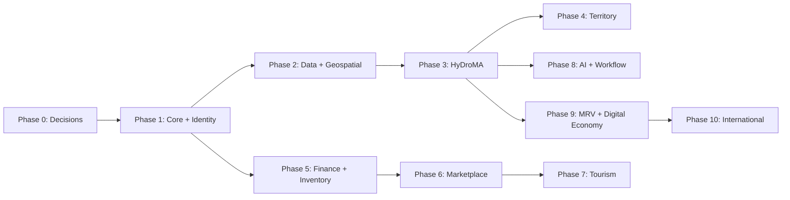

# ECO NOJIN — IMPLEMENTATION ROADMAP
## Phased Development Plan for Executable Architecture

**Document ID:** ECO-NOJIN-IMPLEMENTATION-ROADMAP
**Version:** 1.0 (DRAFT — NOT APPROVED)
**Date:** 2026-11-17
**Status:** ROADMAP — no code, no build. No project is Production Approved.

---

## 1. PHASES (dependency-driven)

### Phase 0 — Architecture and Technical Decisions
- **Prerequisites:** owner decisions D-01..D-25.
- **Modules:** none (governance).
- **Deliverable:** approved architecture baseline, tech stack decisions, DB/IdP/workflow/AI choices.
- **Acceptance:** all blocking owner decisions resolved.
- **Risk:** HIGH (owner dependency).
- **Not enabled:** any implementation.

### Phase 1 — Core Platform and Identity
- **Prerequisites:** Phase 0 (IdP, DB).
- **Modules:** BC-IAM (2), BC-CORE (11), BC-PRES (3).
- **Deliverable:** working auth, tenancy, RBAC, audit, i18n, design system shell.
- **Acceptance:** login + tenant isolation + RBAC tests pass; WCAG AA.
- **Risk:** MEDIUM (Keycloak ops).
- **Not enabled:** scientific, marketplace, finance.

### Phase 2 — Data and Geospatial Foundation
- **Prerequisites:** Phase 1.
- **Modules:** BC-GEO (15), BC-CONTENT (10), BC-NOTIF (2), BC-ANALYTICS (1).
- **Deliverable:** PostGIS, STAC catalog, TiTiler, MapLibre maps, object storage.
- **Acceptance:** 2D/3D map + raster tiles + STAC search.
- **Risk:** MEDIUM (GDAL ops).
- **Not enabled:** marketplace, finance.

### Phase 3 — HyDroMA Scientific Core
- **Prerequisites:** Phase 2.
- **Modules:** BC-SCI (14).
- **Deliverable:** model registry, adapters, job queue, execution, provenance, 4-state results.
- **Acceptance:** run a model (e.g., wflow or modflow) → `CALIBRATED` result with provenance; `VALIDATED` only via independent validation.
- **Risk:** HIGH (scientific correctness).
- **Not enabled:** MRV credit issuance.

### Phase 4 — Territory and Community
- **Prerequisites:** Phase 1–2.
- **Modules:** BC-ORG (12).
- **Deliverable:** village/nomadic/rangeland/farm/watershed registry + restoration projects.
- **Acceptance:** CRUD + map + community participation.
- **Risk:** MEDIUM.

### Phase 5 — Accounting and Inventory
- **Prerequisites:** Phase 1.
- **Modules:** BC-FIN (17), BC-INV (13).
- **Deliverable:** double-entry GL (Decimal), AP/AR, bank rec, multi-currency, warehouses, stock, valuation.
- **Acceptance:** journal entries balance; no float; idempotency prevents duplicate postings; period close.
- **Risk:** HIGH (financial correctness).
- **Not enabled:** marketplace settlement (needs Phase 6).

### Phase 6 — Marketplace and Commerce
- **Prerequisites:** Phase 1, 5.
- **Modules:** BC-MKT (13).
- **Deliverable:** multi-vendor catalog, orders, commission, settlement.
- **Acceptance:** order → payment → settlement → GL posting.
- **Risk:** MEDIUM (Spree integration).

### Phase 7 — Tourism
- **Prerequisites:** Phase 1, 5, 6.
- **Modules:** BC-TOU (12).
- **Deliverable:** destinations, accommodations, experiences, reservations, payments.
- **Acceptance:** booking → payment → confirmation.
- **Risk:** MEDIUM.

### Phase 8 — AI and Workflow
- **Prerequisites:** Phase 1, 3.
- **Modules:** BC-AI (22), BC-WF (9).
- **Deliverable:** agent registry, tool allowlists, human approval, durable workflows.
- **Acceptance:** agent with scoped tools; sensitive actions require human approval; workflow durability.
- **Risk:** HIGH (AI security, prompt injection).
- **Not enabled:** autonomous financial actions.

### Phase 9 — MRV and Digital Economy
- **Prerequisites:** Phase 3, 5.
- **Modules:** BC-MRV (15), BC-DECO (7).
- **Deliverable:** monitoring, reporting, verification, evidence, internal ledger, wallet (owner-gated).
- **Acceptance:** MRV report with `VALIDATED` results only; EcoCoin/HIC **owner-gated, not activated**.
- **Risk:** HIGH (legal, owner-gated).
- **Not enabled:** token issuance, blockchain.

### Phase 10 — International Scaling
- **Prerequisites:** all above.
- **Modules:** BC-ADMIN (12), BC-SEC (4), BC-ANALYTICS (1).
- **Deliverable:** multi-region, multi-currency, multi-language, SOC, DR.
- **Acceptance:** multi-region deployment, i18n, DR drills.
- **Risk:** HIGH (cost, complexity).

---

## 2. DEPENDENCY GRAPH

| Phase | Depends on | Blocks |
|---|---|---|
| 0 | — | all |
| 1 | 0 | 2,4,5,8,9 |
| 2 | 1 | 3,4 |
| 3 | 2 | 8,9 |
| 4 | 1,2 | 6,7 |
| 5 | 1 | 6,7,9 |
| 6 | 1,5 | 7 |
| 7 | 1,5,6 | — |
| 8 | 1,3 | 9 |
| 9 | 3,5 | 10 |
| 10 | all | — |

---

## 3. ACCEPTANCE CRITERIA (per phase)

| Phase | Acceptance |
|---|---|
| 0 | All blocking owner decisions resolved |
| 1 | Login + tenant isolation + RBAC + audit + i18n |
| 2 | 2D/3D map + raster tiles + STAC + search |
| 3 | Model run → CALIBRATED + provenance; VALIDATED via independent validation |
| 4 | Territory CRUD + map + participation |
| 5 | Balanced journal entries, Decimal, idempotency, period close |
| 6 | Order → payment → settlement → GL |
| 7 | Booking → payment → confirmation |
| 8 | Scoped agents + human approval + durable workflows |
| 9 | MRV with VALIDATED results; EcoCoin/HIC owner-gated |
| 10 | Multi-region + i18n + DR |

---

## 4. RISKS

| Risk | Mitigation |
|---|---|
| Owner decisions delayed | Phase 0 gate; no implementation without decisions |
| Scientific correctness | Calibration/validation; 4-state; independent review |
| Financial correctness | Decimal; append-only; idempotency; audit |
| AI security | Tool allowlists; human approval; prompt-injection defense |
| License (GPL/AGPL/OSL/EUPL) | Legal review; standalone deployment |
| Cost overrun | Scenario A start; measure; scale |
| Scope creep | Phase gates; owner approval |

---

## 5. STATUS

**ROADMAP ONLY.** No phase has started. No project is approved for production.

**END OF ROADMAP.**