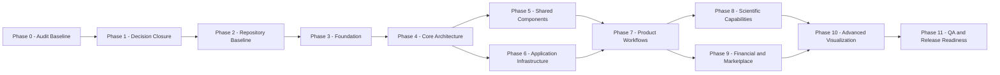

# FRONTEND IMPLEMENTATION ROADMAP

**Deliverable:** DEL-05 (per `37-FRONTEND-STANDARDS-INTEGRATION-IMPLEMENTATION-READINESS-AND-GOVERNANCE.md` §16)
**Audit date:** 2026-11-18
**Basis:** Dependency analysis of the 36 present standards documents; `37` §8 Layer model and §9 phase model
**Prerequisite:** This roadmap is a proposal for owner review. It authorizes no implementation.

---

## 1. Roadmap Principles

1. **Order is dependency-driven, not document-number-driven.** `37` §8 states this explicitly. Document 35 (routing) precedes document 12 (scientific visualization) in implementation order despite being numbered later.
2. **No phase may begin while a decision on its critical path is OPEN.** `37` §18 permits proceeding with noncritical decisions unresolved, but forbids proceeding when an unresolved decision materially affects safety, architecture, integrity or expected result.
3. **Nothing in this roadmap selects a technology.** Where a phase depends on an unresolved choice, the chosen option is marked `[DECISION REQUIRED]` rather than assumed. `37` §11.3 requires an explicit technology decision record.
4. **Status vocabulary** is from `37` §13.3: DOCUMENTED, REVIEWED, APPROVED, MAPPED, IMPLEMENTED, TESTED, VALIDATED, ACCEPTED, RELEASED, DEFERRED, REJECTED.
5. **Protected repositories.** `D:\HyDroMA` and `D:\eco_nojin` MUST remain unchanged. Only the confirmed target repository for `Eco Nojin` frontend work is in scope, and only after owner confirmation (`37` §10.1–§10.2).

---

## 2. Phase Map

Solid arrows are hard dependencies. Phase 6 does not require Phase 5 completion, but shared components are consumed by Phase 7 and later.

---

## 3. Phase 0 — Audit Baseline (this mission)

| Field | Value |
|---|---|
| Category | Foundation (documentation) |
| Status | COMPLETE for this deliverable set |

**Objectives**

- Establish the actual file inventory for documents 01–37.
- Determine coverage across 35 domains.
- Record cross-document conflicts.
- Consolidate all unresolved decisions.
- Identify gaps and produce a dependency-based plan.

**Prerequisites:** Access to the target directory.

**Expected outputs (produced)**

- `FRONTEND-STANDARDS-MASTER-INDEX.md`
- `FRONTEND-STANDARDS-COVERAGE-MATRIX.csv` (203 requirements)
- `FRONTEND-STANDARDS-CONFLICT-REGISTER.md` (13 conflicts)
- `FRONTEND-ARCHITECTURE-DECISION-REGISTER.md` (480 decisions)
- `FRONTEND-IMPLEMENTATION-ROADMAP.md` (this file)
- `FRONTEND-STANDARDS-GAP-REPORT.md`
- `FRONTEND-STANDARDS-AUDIT-REPORT.md`

**Dependencies:** None.

**Risks**

- The audit could be mistaken for an authorization to implement. Mitigated by explicit non-authorization statements in every deliverable.
- Document 04's status could be misread as "not needed". Mitigated by recording it as a P0 gap, not a judgement.

**Acceptance criteria**

- Every file in the directory appears in the master index with metadata taken from the file itself.
- No document is described as approved.
- Every conflict and gap cites a section reference that exists.
- The CSV parses with a consistent column count.

---

## 4. Phase 1 — Decision Closure

| Field | Value |
|---|---|
| Category | Foundation (governance) |
| Status | NOT STARTED |

**Objectives**

- Resolve the decisions that gate all construction.
- Assign the authoritative document for each duplicated domain.
- Record decisions in the register with a terminal status.

**Prerequisites:** Phase 0 complete; owner available to decide.

**Critical-path decisions that must close before any code phase**

| Order | Decision | Reference | Why it gates everything |
|---|---|---|---|
| 1 | Authority matrix | `GOV-03` (10 §18) | Defines who may decide anything else |
| 2 | Agent authority policy | `GOV-08` (10 §18) | Defines the limits of any implementation agent |
| 3 | Application framework | `AUDIT-MISS-01` (this audit) | Six documents contain framework-specific provisions; the choice is unrecorded |
| 4 | Authoritative document for API | `CONF-013` | Two full API standards exist |
| 5 | Authoritative document for security | `CONF-002` | Three full security standards exist |
| 6 | Authoritative document for accessibility | `CONF-003` | Two full accessibility standards exist |
| 7 | Error model reconciliation | `CONF-001` | Two incompatible `ApiError` shapes |
| 8 | Visual identity selection | `ID-07`, `COLOR-01`, `TYPO-01..06`, `DS-03` | All visual work depends on it |
| 9 | Authentication and session model | `SEC-D01`, `SEC-D02` (document to be designated) | All authenticated surfaces |
| 10 | Browser and AT support matrix | `D-020-07`, `QA-D16`, `A11Y-03`/`A11Y-D03` | Testing and release criteria |
| 11 | Package manager and registry | `D-033-01`, `D-033-03` | Reproducible install |
| 12 | Environment architecture and deployment method | `DEP-D01`, `DEP-D05` | Any non-local execution |

**Expected outputs**

- Updated decision register with statuses other than OPEN for the twelve items above.
- A one-page "authoritative document per domain" table signed off by the owner.
- A recorded position on Document 04 (produce, fold into 05/09, or formally waive).

**Dependencies:** Phase 0.

**Risks**

- Decision fatigue leads to premature blanket approval. Mitigation: decide only the twelve gating items; defer the remaining 468 entries.
- Framework decision made without an evaluation record, violating `37` §11.3. Mitigation: require a technology decision record.

**Acceptance criteria**

- Each of the twelve items has a recorded status, decision owner, date and rationale.
- No decision is recorded as APPROVED without an owner identifier.
- Duplicated-domain designations (items 4–6) are recorded in the conflict register as resolved by decision, not by an agent.

---

## 5. Phase 2 — Repository and Runtime Baseline (read-only)

| Field | Value |
|---|---|
| Category | Foundation |
| Status | NOT STARTED |

**Objectives** (reproduced from `37` §19, which is the recommended first implementation mission)

1. Verify the actual target repository.
2. Record current branch, commit and working-tree status.
3. Inspect the current frontend structure.
4. Inventory routes and layouts.
5. Inventory existing shared components.
6. Inspect API integration.
7. Inspect authentication and authorization boundaries.
8. Inspect state management.
9. Inspect forms and validation.
10. Inspect localization and RTL/LTR support.
11. Inspect accessibility.
12. Inspect build and test infrastructure.
13. Compare actual implementation against the standards.
14. Identify existing reusable capabilities and implementation gaps.
15. Produce a prioritized, evidence-based implementation backlog.

**Prerequisites:** Phase 1 items 1–3 closed; owner confirms which repository is the target.

**Expected outputs**

- `FRONTEND-IMPLEMENTATION-BASELINE.md` (`37` DEL-06) — path, branch, commit, status, build and test commands, baseline results.
- `FRONTEND-IMPLEMENTATION-TRACEABILITY.csv` (`37` DEL-07) — requirement to code to test mapping.
- Baseline evidence in the classes defined by `37` §13.2 (SOURCE, TEST, BUILD, RUNTIME).

**Dependencies:** Phase 1 (specifically the repository confirmation).

**Risks**

- Wrong repository inspected or modified → `37` §15 `GOV-004`. Mitigation: read-only access, explicit path confirmation recorded before inspection.
- Existing uncommitted work overwritten → `GOV-005`. Mitigation: before-change snapshot per `37` §10.3.
- Baseline audit drifts into implementation. Mitigation: `37` §19 states the mission is read-only unless a separate repair task is authorized.

**Acceptance criteria**

- No file in `D:\HyDroMA` or `D:\eco_nojin` is modified; verified by status comparison before and after.
- Baseline document records an actual build result and an actual test result, or explicitly records that no build or test command exists.
- Every claim in the backlog cites file paths and line references.
- No dependency is installed and no configuration is changed.

---

## 6. Phase 3 — Foundation

| Field | Value |
|---|---|
| Category | Foundation |
| Status | NOT STARTED |

**Objectives**

- Establish the runtime and toolchain baseline that every later phase depends on.
- Establish design tokens as machine-readable artefacts.
- Establish typography and localization foundations.
- Establish the dependency inventory and lockfile policy.

**Prerequisites**

- Phase 1 items 1, 2, 3, 8 (partial — at least color route and font selection), 11, 12.
- Phase 2 baseline recorded.

**Work packages**

| WP | Scope | Blocking decisions |
|---|---|---|
| 3.1 | Repository scaffolding, lint, format, type-check, test commands | `AUDIT-MISS-01`, `D-033-01`, `QA-D01` |
| 3.2 | Design token source files at primitive and semantic tiers | `COLOR-01..03`, `COLOR-07`, `DS-02` |
| 3.3 | Theme layer for three brands over shared tokens | `DS-03`, `COLOR-05`, `COLOR-06`, `D-014-05` |
| 3.4 | Typography scale, font loading strategy, font files | `TYPO-01..08`, `ML-03`, `ML-04`, `ML-11` |
| 3.5 | Spacing, grid, radius, elevation tokens | `DS-04`, `DS-05`, `DS-07`, `D-020-01`, `D-020-04` |
| 3.6 | i18n scaffolding and message catalog structure (default language only) | `I18N-D01`, `I18N-D06`, `I18N-D07` |
| 3.7 | RTL/LTR baseline and logical-property conventions | `DS-12`, `ML-09` |
| 3.8 | Dependency inventory, lockfile, SBOM baseline | `D-033-02`, `D-033-04` |
| 3.9 | Environment configuration skeleton (local only) | `DEP-D01`, `DEP-D03` |

**Expected outputs**

- A building, linting and type-checking skeleton with zero product features.
- Token artefacts consumable by both code and design tooling.
- Font and i18n foundations with one language.
- A recorded dependency inventory with provenance.

**Dependencies:** Phase 2.

**Risks**

- Token architecture chosen before the color system is decided → complete rework. Mitigation: gate 3.2 and 3.3 on `COLOR-01` and `DS-03`.
- Font licensing discovered late. Mitigation: `TYPO-08` is a Phase 1 gating item for 3.4.
- Token build tooling invented without a decision record. Mitigation: add a token-pipeline decision to the register; none exists today (gap `GAP-014`).

**Acceptance criteria**

- Build, lint and type-check succeed on a clean checkout.
- Token files are generated from a single source, not hand-duplicated.
- Every token name traces to a section in 03 §15 or 06 §4.
- No visual component exists yet; this phase is infrastructure only.

---

## 7. Phase 4 — Core Application Architecture

| Field | Value |
|---|---|
| Category | Core architecture |
| Status | NOT STARTED |

**Objectives**

- Establish application entry points, layout shell and route registry.
- Establish the API client layer with a single error contract.
- Establish authentication and authorization boundaries without implementing a login flow.
- Establish error boundaries and shared state and data-access boundaries.

**Prerequisites**

- Phase 3 complete.
- Phase 1 items 4, 7, 9 closed.
- `D-035-01`, `D-035-02`, `D-034-01..D-034-04`, `STATE-D01..D03` decided.

**Work packages**

| WP | Scope | Notes |
|---|---|---|
| 4.1 | Application entry, bootstrap and provider composition | Depends on framework decision |
| 4.2 | Layout shell: header, navigation region, content region, footer | Uses `D-016-11`, `D-035-07` |
| 4.3 | Route registry and route classification (public, private, admin) | `D-035-02..D-035-06` |
| 4.4 | Navigation system with permission-aware rendering | `D-035-08`, `D-035-18` |
| 4.5 | API client layer with request, response and error normalization | Single error contract after CONF-001 |
| 4.6 | Authentication boundary: token or cookie handling per decision | `SEC-D01`, `SEC-D02`, `D-034-10` |
| 4.7 | Route guards and unauthorized/forbidden states | `D-035-05` |
| 4.8 | Error boundaries per boundary scope | `D-034-04` |
| 4.9 | Shared state and data-access boundaries | `STATE-D01..D03`, `STATE-D05` |

**Expected outputs**

- An empty but navigable application with working route transitions, error states, and a stubbed API client.
- A contract test proving the error model round-trips.

**Dependencies:** Phase 3.

**Risks**

- Building against an undecided backend contract produces a client that cannot be wired. Mitigation: 4.5 must use the contract agreed with the backend team; `30` §1.1 requires real backend review before final selection.
- Two error models leak into the codebase. Mitigation: CONF-001 must close before 4.5 starts.
- Route taxonomy diverges from page architecture. Mitigation: reconcile `D-016-01..03` with `D-035-02..07` in one decision.

**Acceptance criteria**

- Every route in the registry resolves to a layout and a placeholder view.
- Unknown routes render the not-found state; guarded routes render the unauthorized state.
- One and only one normalized API error type exists in the codebase.
- No product feature is implemented.

---

## 8. Phase 5 — Shared UI Infrastructure

| Field | Value |
|---|---|
| Category | Shared components |
| Status | NOT STARTED |

**Objectives**

- Implement the component foundation that product workflows will assemble.
- Implement form and validation infrastructure.
- Implement dialogs, notifications, tables, filters, loading and empty states.
- Implement the accessibility foundation.

**Prerequisites**

- Phase 4 complete.
- `D-014-01`, `D-014-04`, `DS-08`, `DS-09`, `FR-D01`, `FR-D02`, `FR-D03`, `D-014-11` decided.

**Work packages**

| WP | Scope | Source |
|---|---|---|
| 5.1 | Primitive components and state coverage | 14 §3.1, §5 |
| 5.2 | Composite components | 14 §3.2 |
| 5.3 | Form field infrastructure, validation wiring, error display | 36 §4, §7, §9; 14 §6 |
| 5.4 | Table, filter and pagination patterns | 14 §7, §16 |
| 5.5 | Dialog, modal, drawer and confirmation patterns | 14 §16, §17 |
| 5.6 | Loading, empty, error and partial states | 15 §4, §9, §10; 14 §5.2–§5.3 |
| 5.7 | Notification and feedback system | 15 §22; 14 §17 |
| 5.8 | Accessibility acceptance for each component | 21 §28 or 32 §30 (one set after CONF-003) |
| 5.9 | Component documentation and visual regression | `D-014-02`, `D-014-03`, `QA-D04` |

**Expected outputs**

- A component library with documented states, accessibility acceptance records and visual baselines.
- A form prototype proving validation, submission and duplicate prevention end to end.

**Dependencies:** Phase 4.

**Risks**

- Building components before the identity is final causes full rework. Mitigation: 5.1–5.2 gated on `ID-07` and `DS-03`.
- Two accessibility acceptance sets produce ambiguous pass criteria. Mitigation: CONF-003 closed in Phase 1.
- Component API churn after product usage begins. Mitigation: `D-014-04` must close before 5.1.

**Acceptance criteria**

- Each component has documented states, keyboard behaviour and an accessibility record.
- The form prototype prevents duplicate submission under simulated double-click and network retry.
- No product-specific component is included; those belong to Phase 7.

---

## 9. Phase 6 — Application Infrastructure (Public and Per-Brand Entry)

| Field | Value |
|---|---|
| Category | Application infrastructure |
| Status | NOT STARTED |

**Objectives**

- Build the public-facing entry surfaces for Eco Nojin.
- Establish per-brand shells for HyDroMA and Nojin Marketplace without their domain features.
- Establish SEO, metadata and public route behaviour.

**Prerequisites**

- Phase 4 complete; Phase 3 complete.
- `D-016-01..D-016-05`, `D-035-15`, SEO decisions `D-016-11`/`D-019-11` at least directionally decided.

**Work packages**

| WP | Scope |
|---|---|
| 6.1 | Eco Nojin public home and static pages |
| 6.2 | Public page composition pattern and page header |
| 6.3 | SEO metadata, canonical URLs, structured data, sitemap |
| 6.4 | Public content rendering from the content layer |
| 6.5 | HyDroMA and Marketplace brand shells |

**Expected outputs**

- Public pages that render real content with correct metadata.
- A sitemap and robots configuration consistent with the environment.

**Dependencies:** Phase 4. May run in parallel with Phase 5.

**Risks**

- SEO work begun without a canonicalization rule produces index pollution. Mitigation: `GAP-231` must be closed with at least a URL policy decision.
- Public pages leak authenticated data. Mitigation: `37` §5.3 prohibition; test with an authenticated session against public routes.

**Acceptance criteria**

- Public routes render without authentication.
- Metadata is present and unique per page.
- No private data appears in HTML, in metadata, or in a sitemap.

---

## 10. Phase 7 — Product-Specific Workflows

| Field | Value |
|---|---|
| Category | Product-specific workflows |
| Status | NOT STARTED |

**Objectives**

- Implement HyDroMA workspace surfaces that do not require scientific computation.
- Implement Nojin Marketplace browsing, cart and order workflows without live financial operation.
- Implement tourism service workflows.
- Implement user profile and administrative interfaces.

**Prerequisites**

- Phase 5 and Phase 6 complete enough to supply components and shells.
- Domain decisions: `D-016-06..D-016-10`, product routing rules in `35` §19, `FR-D01..FR-D16` for forms.

**Work packages**

| WP | Scope | Blocking note |
|---|---|---|
| 7.1 | HyDroMA dashboards and data views (non-computational) | Requires `SCI-03`, `SCI-04` for KPI and chart standards |
| 7.2 | Marketplace catalog, search, product detail, cart | Requires `D-034-17` only for price display; defer payment |
| 7.3 | Tourism pages, service listing and enquiry | Defer reservation integrity (`GAP-303`) |
| 7.4 | User profile and account settings | Requires auth boundary from 4.6 |
| 7.5 | Administrative interfaces | Requires `SEC-D24` and role model `SEC-D06` |
| 7.6 | Domain-specific tests | Per `25` §6–§11 |

**Expected outputs**

- Working workflows for each product that stop short of irreversible or financial operations.
- Domain test suites.

**Dependencies:** Phases 5 and 6.

**Risks**

- Marketplace payment implemented before `D-034-17` and the financial contract. Mitigation: WP 7.2 explicitly defers payment; `37` §12.4 prohibits activating financial operations.
- Administrative interface built on an undefined role model. Mitigation: `SEC-D06` is gating for 7.5.
- Tourism scope expands into booking without a standard. Mitigation: `GAP-303` recorded as a known limitation.

**Acceptance criteria**

- Each workflow completes with no irreversible state change available to the user.
- Financial amounts, where displayed, are decimal-safe and server-authoritative.
- Every administrative action is denied without the required permission.

---

## 11. Phase 8 — Scientific Capabilities

| Field | Value |
|---|---|
| Category | Scientific capabilities |
| Status | NOT STARTED |

**Objectives**

- Implement scientific visualization and simulation configuration interfaces.
- Implement uncertainty display, provenance display and capability status.
- Integrate with the HyDroMA scientific API.

**Prerequisites**

- Phase 7 WP 7.1 complete.
- HyDroMA backend contracts available in a non-production environment.
- `SCI-01..SCI-11`, `D-014-06`, `D-014-08`, `D-034-11`, `D-034-18`, `FR-D09` decided.

**Work packages**

| WP | Scope |
|---|---|
| 8.1 | KPI and chart components bound to real data |
| 8.2 | Uncertainty and data-status display |
| 8.3 | Simulation configuration forms |
| 8.4 | Scientific job lifecycle and progress |
| 8.5 | Provenance and dataset and model version display |
| 8.6 | Scientific validation tests with reference datasets |

**Expected outputs**

- Scientific surfaces where every displayed value is traceable to a data source, a model version and a capability status.

**Dependencies:** Phase 7. Independent of Phases 9 and 10.

**Risks**

- Presenting a chart as proof of computation → `37` §5.5 and `12` §23 prohibit this. Mitigation: capability status displayed alongside every scientific surface.
- Reference data unavailable for validation → `25` §9 cannot be satisfied. Mitigation: record the dependency explicitly; do not claim VALIDATED without data.
- Scientific API shapes still undefined (`API-D21`). Mitigation: gating.

**Acceptance criteria**

- Every number displayed has an attributable source and version.
- Uncertainty is displayed wherever the underlying data carries it.
- Capability status is visible and never implies IMPLEMENTED when only DESIGNED.
- No frontend computation presents itself as an authoritative scientific result.

---

## 12. Phase 9 — Financial and Marketplace Capabilities

| Field | Value |
|---|---|
| Category | Financial and marketplace capabilities |
| Status | NOT STARTED — requires separate owner authorization |

**Objectives**

- Enable order placement, payment integration and transaction state display.
- Enable financial reporting surfaces.

**Prerequisites**

- Phase 7 WP 7.2 complete.
- `D-034-17` decided; financial backend contract available and reviewed.
- **Separate explicit owner authorization** per `37` §12.4 ("Activate real financial operations" is prohibited without approval) and `37` §20.

**Work packages**

| WP | Scope |
|---|---|
| 9.1 | Decimal-safe price, tax and total computation display |
| 9.2 | Idempotent order submission |
| 9.3 | Payment provider integration boundary |
| 9.4 | Transaction state machine and audit display |
| 9.5 | Financial error and recovery surfaces |
| 9.6 | Financial acceptance tests including duplicate-submission and failure-injection |

**Expected outputs**

- A financial workflow that never displays a success state not confirmed by the server.

**Dependencies:** Phase 7; independent of Phases 8 and 10.

**Risks**

- False payment confirmation → `37` §5.6 prohibits. Mitigation: success state derives exclusively from server confirmation.
- Floating-point drift in totals → `CONF-011`. Mitigation: single normative decimal rule agreed in Phase 1.
- Duplicate charge from retried submission → `API-D10`. Mitigation: idempotency key required before 9.2.
- Financial activation without authorization. Mitigation: this phase is gated on a written authorization that does not exist at audit time.

**Acceptance criteria**

- Duplicate submission is provably rejected or idempotently absorbed.
- No UI path shows success before server confirmation.
- All monetary values round-trip without precision loss.
- Written owner authorization is on record before any live transaction.

---

## 13. Phase 10 — Advanced Visualization

| Field | Value |
|---|---|
| Category | Advanced visualization |
| Status | NOT STARTED |

**Objectives**

- Deliver geospatial interfaces, time-series analysis, 3D and remote-sensing surfaces.
- Implement offline and weak-connectivity behaviour for field use.

**Prerequisites**

- Phases 8 and 9 substantially complete (or at least Phase 8 for scientific maps).
- `D-014-07` (map engine), `D-035-14` (rendering), `PERF-D09`, `PERF-D10` decided.
- **A coordinate reference system standard must exist** (`GAP-254`). None exists today.

**Work packages**

| WP | Scope |
|---|---|
| 10.1 | Map surface with layer management |
| 10.2 | Non-visual map and chart alternatives |
| 10.3 | 3D and GPU surfaces with fallback |
| 10.4 | Remote-sensing image surfaces |
| 10.5 | Offline cache and queue for field use |
| 10.6 | Performance validation for map, chart and 3D surfaces |

**Expected outputs**

- Geospatial and 3D interfaces that degrade acceptably on low-end devices and offline.

**Dependencies:** Phases 8 and 9.

**Risks**

- Wrong CRS handling produces silently incorrect geospatial output. Mitigation: `GAP-254` is a hard blocker; no map work begins before a CRS decision.
- 3D surfaces fail on low-end hardware with no fallback. Mitigation: `GAP-222`.
- Offline state implies success. Mitigation: `37` §5.4 prohibition.

**Acceptance criteria**

- Coordinates reproject correctly against a known reference dataset.
- Every map and chart has a text or table alternative.
- GPU fallback renders a functional, if reduced, experience.
- Offline operations never display a confirmed state.

---

## 14. Phase 11 — Quality Assurance and Release Readiness

| Field | Value |
|---|---|
| Category | Quality assurance and release readiness |
| Status | NOT STARTED |

**Objectives**

- Satisfy the quality gates in `37` §14.
- Complete the readiness checklist in `37` §17.
- Obtain release authorization as a separate act.

**Prerequisites**

- Phases 3–10 complete for the release scope.
- Test tooling decided (`QA-D01..D07`).
- Release approval criteria decided (`QA-D15`, `DEP-D08`).

**Gate mapping**

| Gate | Required evidence |
|---|---|
| QG-01 Target repository verified | Phase 2 baseline |
| QG-02 Working-tree state preserved | Before/after status comparison |
| QG-03 Applicable standards reviewed | Standards review record |
| QG-04 Critical architecture decisions approved | Phase 1 record |
| QG-05 Implementation scope authorized | Owner authorization |
| QG-06 Build succeeds | Captured build output |
| QG-07 Relevant tests pass | Captured test report |
| QG-08 No unresolved critical security issue | Security review record |
| QG-09 Applicable accessibility checks pass | Automated and manual accessibility evidence |
| QG-10 Domain integrity validated | Scientific and financial validation evidence |
| QG-11 Performance measured | Measured report against `23` §4 thresholds |
| QG-12 Implementation evidence complete | Evidence index by `37` §13.2 class |
| QG-13 Owner acceptance recorded | Signed acceptance |
| QG-14 Release authorization separately obtained | Written authorization |

**Expected outputs**

- A release candidate with a complete evidence index.
- A gate-by-gate record with no gate marked passed without evidence (`37` §14).

**Risks**

- Gates marked passed without evidence → `GOV-014`. Mitigation: evidence index required per gate.
- Premature production release → `GOV-013`. Mitigation: QG-14 is a distinct act, never bundled with QG-13.
- Accessibility and security treated as optional → `GOV-011`, `GOV-012`. Mitigation: both are gates, not advisories.

**Acceptance criteria**

- All fourteen gates have an evidence artefact or an explicit recorded failure.
- No gate is recorded as passed on the basis of document existence alone.
- Release authorization is recorded separately from acceptance.

---

## 15. Parallelization Matrix

| Work package group | Can start independently of | Cannot start before |
|---|---|---|
| 3.8 Dependency inventory | 3.2–3.7 | Phase 2 |
| 3.9 Environment skeleton | 3.4, 3.5 | Phase 2, `DEP-D01` |
| 4.1–4.4 Shell and routing | 4.5–4.9 | Phase 3, `D-035-02` |
| 4.5–4.9 API, auth, state boundaries | 4.1–4.4 | Phase 3, `SEC-D01`, `D-034-01..04` |
| 5.1–5.2 Primitive and composite components | 5.3–5.7 | Phase 4, `ID-07`, `D-014-04` |
| 5.3–5.7 Form, table, dialog, state components | 5.1–5.2 only partially | Phase 4, `FR-D01..D03` |
| 6.1–6.5 Public surfaces | Phase 5 | Phase 4 |
| 7.1 Scientific dashboards (non-computational) | 7.2, 7.3 | Phase 5, `SCI-03` |
| 7.2 Marketplace catalog | 7.1, 7.5 | Phase 5 |
| 7.3 Tourism | 7.2 | Phase 5 |
| 7.5 Administrative | 7.2, 7.3 | `SEC-D06`, `SEC-D24` |
| 8.x Scientific capabilities | 9.x, 10.x | Phase 7.1, HyDroMA contracts |
| 9.x Financial | 8.x, 10.x | Phase 7.2, `D-034-17`, written authorization |
| 10.1–10.2 Maps and alternatives | 10.3–10.5 | Phase 8, **CRS standard** |
| 10.3–10.4 3D and remote sensing | 10.1 | Phase 8, `D-014-07` |
| 11 Gates and evidence | — | All phases in release scope |

---

## 16. What Cannot Proceed Today

| Task | Blocking condition |
|---|---|
| Any code production in the target repository | No framework decision (`AUDIT-MISS-01`); Phase 1 open |
| Visual implementation of any kind | No identity, color, or font selected (`ID-07`, `COLOR-01`, `TYPO-01..06`) |
| Authenticated features | `SEC-D01`/`SEC-D02` unresolved in three documents |
| Any backend-connected feature | Two competing API standards (`CONF-013`) and two competing error models (`CONF-001`) |
| Any map feature | No CRS standard (`GAP-254`) |
| Any financial feature | `D-034-17` open and no financial authorization |
| Any deployment | `DEP-D01`/`DEP-D05` open; `37` §12.4 prohibits deployment without approval |
| Any logo or lockup work | Document 04 missing (`CONF-008`) |

**What can proceed today:** the read-only repository baseline (Phase 2) if the owner confirms the target repository, and the Phase 1 decision closure itself.

---

## 17. Estimated Phase Gating Summary

| Phase | Decision prerequisites met at audit time |
|---|---|
| 0 | Yes — complete |
| 1 | No — owner action required |
| 2 | Partially — one decision (target repository confirmation) outstanding |
| 3 | No |
| 4 | No |
| 5 | No |
| 6 | No |
| 7 | No |
| 8 | No |
| 9 | No |
| 10 | No |
| 11 | No |

No implementation phase is unblocked as of 2026-11-18.
