# FRONTEND STANDARDS MASTER INDEX

**Deliverable:** DEL-01 (per `37-FRONTEND-STANDARDS-INTEGRATION-IMPLEMENTATION-READINESS-AND-GOVERNANCE.md` §16)
**Audit date:** 2026-11-18
**Target directory:** `D:\Nojin\brand\eco-nojin-visual-identity-v3\`
**Basis of record:** Direct filesystem inspection of the target directory (not conversation history, not assumed filenames)
**Audit status:** COMPLETE for inventory; NOT_VERIFIED for approval

---

## 1. Inventory Method and Integrity Statement

The inventory below was produced by enumerating the actual directory contents:

- 36 files present.
- 1 file extension type present (`.md`).
- 0 subdirectories present.
- Numbers observed: 01, 02, 03, 05 … 37 (contiguous except 04).
- **Document 04 is absent from the directory.**
- No file required renaming, moving, or modification to complete this audit.

Metadata for each document was read from its own header block (`Document ID`, `Version`, `Status`, title) and its own section headings. Where a document declares no `Document ID`, this index records `NONE DECLARED` rather than inferring one.

### 1.1 Integrity Findings (Summary)

| Check | Result | Evidence |
|---|---|---|
| Duplicate document numbers | NONE | Numbers 01–03, 05–37 each appear once |
| Duplicate filenames | NONE | All 36 filenames distinct |
| Missing document numbers | **04** | Document 04 referenced by `05-*.md` §1 but absent |
| Inconsistent numbering style | YES | 01–13 use `NN — TITLE`; 14–37 use `Title Case` without number prefix in H1 |
| Empty or incomplete documents | NONE FOUND | All 36 files have title, status, purpose and ≥12 numbered sections |
| Incorrect extensions | NONE | All `.md` |
| Conflicting metadata schemas | YES | 3 different metadata block styles; 4 different Document ID namespaces; 3 different versions |
| Filename/content mismatch | NONE FOUND | All 36 filenames match their document titles |

Detail of metadata inconsistencies is in §4 below and in `FRONTEND-STANDARDS-CONFLICT-REGISTER.md` (CONF-007, CONF-009).

---

## 2. Master Document Table (01–37)

Statuses are reproduced verbatim from each document. No status has been upgraded. Every document in this set is unapproved.

| No | Exact Filename | Document ID | Title (from document) | Version | Status (verbatim) | Primary Scope | Related / Parent Declared | Open Decisions | Verification |
|---|---|---|---|---|---|---|---|---|---|
| 01 | `01-VISUAL-IDENTITY-EXPLORATION-BRIEF.md` | NONE DECLARED | ECO NOJIN — VISUAL IDENTITY EXPLORATION V3 | 1.0 | EXPLORATION — NOT APPROVED | Brand strategy, four design routes, typography and Latin font research plan, UI principles, accessibility mandate | Self-declared root brief | 0 (status table in §11 instead) | INSPECTED — metadata/structure verified; not owner-approved |
| 02 | `02-PERSIAN-LATIN-TYPOGRAPHY-LAB.md` | EN-VI-02 | ECO NOJIN — PERSIAN & LATIN TYPOGRAPHY LAB | 1.0 | RESEARCH & EXPLORATION — NOT APPROVED | Persian and Latin font candidate evaluation, pairing matrix, technical font requirements | Parent: `01-*.md` | 9 (TYPO-01…09) | INSPECTED — not owner-approved |
| 03 | `03-FOUR-COLOR-SYSTEMS.md` | NONE DECLARED | 03 — FOUR COLOR SYSTEMS | 1.0 | EXPLORATION — NOT APPROVED | Four candidate color systems, semantic color tokens, scientific/map/marketplace color, WCAG contrast, token format | Brands: Eco Nojin / HyDroMA / Nojin Marketplace | 13 (COLOR-01…13) | INSPECTED — not owner-approved |
| 04 | **ABSENT** | — | (referenced as "معماری لوگوتایپ سه برند" — Logotype Architecture of the Three Brands) | — | — | Logotype architecture for three brands | Cited as prior standard by `05-*.md` §1 | — | **MISSING — file not present** |
| 05 | `05-BRAND-APPLICATION-AND-ART-DIRECTION.md` | NONE DECLARED | 05 — BRAND APPLICATION AND ART DIRECTION | 1.0 | EXPLORATION — NOT APPROVED | Brand application architecture, art direction per brand, imagery, icon and motion architecture, evaluation method | Documents 01–04 (04 missing) | 14 (ART-01…14) | INSPECTED — not owner-approved |
| 06 | `06-DESIGN-SYSTEM-ARCHITECTURE.md` | NONE DECLARED | 06 — DESIGN SYSTEM ARCHITECTURE | 1.0 | PROPOSED — NOT APPROVED | Seven-layer design system, three-tier token architecture, three brand themes, typography/color/space/grid/radius/elevation, component categories, RTL, a11y, motion, file structure | Project-level (no parent list) | 13 (DS-01…13) | INSPECTED — not owner-approved |
| 07 | `07-DIGITAL-EXPERIENCE-AND-IMPLEMENTATION-GUIDELINES.md` | NONE DECLARED | 07 — DIGITAL EXPERIENCE AND IMPLEMENTATION GUIDELINES | 1.0 | PROPOSED — NOT APPROVED | Digital experience principles, per-brand experience, public pages, scientific dashboard, map environment, simulation, marketplace, tourism, financial/admin dashboards, frontend implementation rules, scientific accuracy in presentation | Project-level (no parent list) | 11 (UX-01…11) | INSPECTED — not owner-approved |
| 08 | `08-VISUAL-IDENTITY-EVALUATION-AND-OWNER-DECISION.md` | NONE DECLARED | 08 — VISUAL IDENTITY EVALUATION AND OWNER DECISION | 1.0 | PROPOSED — NOT APPROVED | Evaluation framework, scoring, rejection criteria, typography/color/logotype evaluation, legal/IP review, owner approval process and decision form | Project-level (no parent list) | 8 (ID-01…08) | INSPECTED — not owner-approved |
| 09 | `09-BRAND-ASSETS-AND-DIGITAL-ASSET-MANAGEMENT.md` | NONE DECLARED | 09 — BRAND ASSETS AND DIGITAL ASSET MANAGEMENT | 1.0 | PROPOSED — NOT APPROVED | Asset classification, logotype/font/image/illustration/icon/scientific/3D/motion/UI assets, naming, repository structure, Asset Registry, licensing, backup, security, release | Project-level (no parent list) | 9 (BA-01…09) | INSPECTED — not owner-approved |
| 10 | `10-BRAND-GOVERNANCE-AND-CHANGE-CONTROL.md` | NONE DECLARED | 10 — BRAND GOVERNANCE AND CHANGE CONTROL | 1.0 | PROPOSED — NOT APPROVED | Brand governance structure, decision levels, authority matrix, change classification and workflow, document versioning, hierarchy, AI/agent policy, drift control, audits | Project-level (no parent list) | 10 (GOV-01…10) | INSPECTED — not owner-approved |
| 11 | `11-BRAND-EXPERIENCE-AND-WEB-PAGE-STANDARDS.md` | NONE DECLARED | 11 — BRAND EXPERIENCE AND WEB PAGE STANDARDS | 1.0 | PROPOSED — NOT APPROVED | Three-brand experience architecture, public/scientific/marketplace page standards, rural experience, visual language, typography, RTL, imagery, motion, responsive, UI states, page performance, a11y, content, page QA | Project-level (no parent list) | 10 (WEB-01…10) | INSPECTED — not owner-approved |
| 12 | `12-SCIENTIFIC-DATA-VISUALIZATION-STANDARDS.md` | NONE DECLARED | 12 — SCIENTIFIC DATA VISUALIZATION STANDARDS | 1.0 | PROPOSED — NOT APPROVED | Scientific visual language, scientific colors, KPI cards, charts, uncertainty display, scientific maps, remote sensing, water/soil/climate data, modeling and simulation, MRV and carbon, scientific tables, data status, formulas, data interaction, performance, a11y, data security, capability status classification | Scientific engine: HyDroMA | 11 (SCI-01…11) | INSPECTED — not owner-approved |
| 13 | `13-MULTILINGUAL-TYPOGRAPHY-AND-RTL-LTR-STANDARDS.md` | NONE DECLARED | 13 — MULTILINGUAL TYPOGRAPHY AND RTL/LTR STANDARDS | 1.0 | PROPOSED — NOT APPROVED | Language strategy, language/direction separation, typography architecture, Persian and Latin labs, pairing, weights, type scale, line height, numerals, separators, decimals, units, dates, timezones, mixed text, RTL CSS, icons in RTL, forms, charts, tables, translation, file structure, font loading, a11y, multilingual tests | Project-level (no parent list) | 11 (ML-01…11) | INSPECTED — not owner-approved |
| 14 | `14-DESIGN-SYSTEM-COMPONENT-AND-PATTERN-STANDARDS.md` | EN-VIS-014 | Design System Component and Pattern Standards | 1.0.0 | DRAFT — PROPOSED — NOT APPROVED | Component architecture (4 levels), component contract, states, form/table/card/chart/map/simulation/MRV/marketplace/financial/navigation components, dialog, notifications, responsive, RTL, a11y, motion, performance, security, file structure, docs, tests, versioning, acceptance | Parent Documents: 01 تا 13 | 12 (D-014-01…12) | INSPECTED — not owner-approved |
| 15 | `15-UI-INTERACTION-AND-STATE-MANAGEMENT-STANDARDS.md` | EN-VIS-015 | UI Interaction and State Management Standards | 1.0.0 | DRAFT — PROPOSED — NOT APPROVED | Interaction principles, interaction taxonomy, UI state model and state machine, UI vs server state, buttons, forms, network requests, loading, error/recovery, offline, dashboards, scientific/map/marketplace/financial/tourism interactions, navigation state, micro-interactions, keyboard, RTL, notifications, persistence, observability, FE/BE contract, tests | Parent Documents: 01 تا 14 | 12 (D-015-01…12) | INSPECTED — not owner-approved |
| 16 | `16-PAGE-ARCHITECTURE-AND-USER-EXPERIENCE-STANDARDS.md` | EN-VIS-016 | Page Architecture and User Experience Standards | 1.0.0 | DRAFT — PROPOSED — NOT APPROVED | Ecosystem macro-architecture, user groups, information architecture for Eco Nojin/HyDroMA/Marketplace, tourism, financial and admin page architectures, page structure pattern, header, density, user journeys, search/discovery, filters, breadcrumb, multi-step pages, responsive pages, content, SEO/metadata, performance, a11y, page security, Page Registry, page process, acceptance | Parent Documents: 01 تا 15 | 12 (D-016-01…12) | INSPECTED — not owner-approved |
| 17 | `17-ICONOGRAPHY-ILLUSTRATION-AND-GRAPHIC-ASSET-STANDARDS.md` | EN-VIS-017 | Iconography, Illustration and Graphic Asset Standards | 1.0.0 | DRAFT — PROPOSED — NOT APPROVED | Visual language philosophy, per-brand visual architecture, icon system, icon families, icon technical standard, icon library selection, illustration, photography, scientific/spatial imagery, graphic elements, public/dashboard/marketplace/tourism imagery, motion graphics, video, color and typography in assets, a11y, performance, IP, Asset Registry, file structure, production process, acceptance | Parent Documents: 01 تا 16 | 12 (D-017-01…12) | INSPECTED — not owner-approved |
| 18 | `18-UX-RESEARCH-AND-USABILITY-VALIDATION-STANDARDS.md` | EN-VIS-018 | UX Research and Usability Validation Standards | 1.0.0 | DRAFT — PROPOSED — NOT APPROVED | Research scope, methodology, user groups, research taxonomy, exploratory research, usability testing, usability metrics, sampling, per-product and rural research, multilingual and a11y research, behavioral data, pre-development design validation, A/B testing, analysis, findings template, reporting, ethics/privacy, risk, link to development, design acceptance, research repository, tools | Parent Documents: EN-VIS-001 تا EN-VIS-017 (**dangling: 01–13 declare no EN-VIS ID**) | 12 (D-018-01…12) | INSPECTED — not owner-approved |
| 19 | `19-CONTENT-STRATEGY-VOICE-AND-MESSAGING-STANDARDS.md` | EN-VIS-019 | Content Strategy, Voice and Messaging Standards | 1.0.0 | DRAFT — PROPOSED — NOT APPROVED | Ecosystem communication architecture, master message, per-brand verbal identity, tone matrix, content architecture per surface, microcopy, form copy, scientific/environmental/financial writing, multilingual content, Persian and English rules, content governance, versioning, SEO, educational content, UGC, quality, production/release, acceptance | Parent Documents: EN-VIS-001 تا EN-VIS-018 | 12 (D-019-01…12) | INSPECTED — not owner-approved |
| 20 | `20-RESPONSIVE-DESIGN-AND-CROSS-DEVICE-STANDARDS.md` | EN-VIS-020 | Responsive Design and Cross-Device Standards | 1.0.0 | DRAFT — PROPOSED — NOT APPROVED | Responsive principles, device scope, breakpoint architecture, grid, responsive typography, navigation, dashboards, data visualization, maps, simulation UI, marketplace, forms, touch, tables, modal/drawer, keyboard and input, RTL responsive, low-end performance, network-aware UX, cross-device continuity, responsive content, orientation, browser compatibility, device test matrix, visual regression, technical criteria, a11y, implementation structure, process, acceptance | Parent Documents: EN-VIS-001 تا EN-VIS-019 | 12 (D-020-01…12) | INSPECTED — not owner-approved |
| 21 | `21-FRONTEND-ACCESSIBILITY-AND-INCLUSIVE-DESIGN-STANDARDS.md` | EN-VI-021 | 21. FRONTEND ACCESSIBILITY AND INCLUSIVE DESIGN STANDARDS | 1.0.0 | DRAFT — PROPOSED — NOT APPROVED | Inclusive design principles, accessibility architecture, semantic HTML, keyboard, screen readers, color/contrast, typography, RTL a11y, forms, interactive components, touch/motor, motion, accessible data viz, map a11y, HyDroMA scientific workflows, marketplace, tourism/rural, cognitive, older/low-literacy users, media, responsive, low-bandwidth, security, WCAG 2.2 AA internal checklist, testing, component acceptance, debt, documentation, workflow, metrics, governance | Not declared | 10 (A11Y-01…10) | INSPECTED — not owner-approved |
| 22 | `22-FRONTEND-SECURITY-AND-CLIENT-SIDE-DATA-PROTECTION-STANDARDS.md` | EN-VI-022 | 22. FRONTEND SECURITY AND CLIENT-SIDE DATA PROTECTION STANDARDS | 1.0.0 | DRAFT — PROPOSED — NOT APPROVED | Security reference framework, frontend security architecture, authentication, session management, authorization, XSS, CSRF, CORS, API communication, client data protection, financial security, HyDroMA data security, file upload/download, third-party dependency security, config security, browser headers, privacy/consent, logging, error security, routing security, secure state, worker/cache security, maps/external data, UGC, security testing, test environments, incident response, acceptance checklist, severity, evidence, status model | Not declared | 12 (SEC-D01…D12) | INSPECTED — not owner-approved |
| 23 | `23-FRONTEND-PERFORMANCE-OPTIMIZATION-AND-MONITORING-STANDARDS.md` | EN-VI-023 | 23. FRONTEND PERFORMANCE OPTIMIZATION AND MONITORING STANDARDS | 1.0.0 | DRAFT — PROPOSED — NOT APPROVED | Performance principles, reference standards, Core Web Vitals (LCP ≤2.5s / INP ≤200ms / CLS ≤0.1 @ p75), performance budgets, bundle optimization, rendering strategy, React performance standards, images, fonts, CSS, network, API data, HyDroMA dashboard, charts, maps, simulation, 3D/GPU, marketplace, financial, low-bandwidth, mobile, a11y+perf, memory, caching, monitoring, observability, regression control, test matrix, acceptance, defect management, workflow, governance | Not declared | 12 (PERF-D01…D12) | INSPECTED — not owner-approved |
| 24 | `24-FRONTEND-SECURITY-AND-PRIVACY-STANDARDS.md` | EN-VIS-024 | 24. Frontend Security and Privacy Standards | 1.0.0 | DRAFT — PROPOSED — NOT APPROVED | Security governance/frameworks, trust boundaries, authentication and session, MFA and passkeys, authorization, web attack protection, input validation/output handling, file upload, secrets/config, dependency and supply chain, secure build/deploy, privacy by design, sensitive data, browser storage/caching, API communication, WebSocket/realtime, HyDroMA requirements, Marketplace requirements, logging/telemetry, a11y+secure interaction, security testing, threat modeling, incident handling, security UX, acceptance, governance | Not declared | 20 (SEC-D01…D20) | INSPECTED — not owner-approved |
| 25 | `25-FRONTEND-TESTING-QUALITY-ASSURANCE-AND-RELEASE-VALIDATION-STANDARDS.md` | EN-VIS-025 | 25. Frontend Testing, Quality Assurance and Release Validation Standards | 1.0.0 | DRAFT — PROPOSED — NOT APPROVED | Quality engineering principles, quality dimensions, testing pyramid, test planning, functional testing, API integration testing, auth testing, scientific/numerical validation, data visualization testing, marketplace/financial testing, visual regression, responsive, browser compatibility, RTL/localization, accessibility, performance/reliability, security, automation infrastructure, CI quality gates, defect management, regression, coverage metrics, release validation, post-release, evidence/auditability, feature completion model, agent execution rules | Not declared | 17 (QA-D01…D17) | INSPECTED — not owner-approved |
| 26 | `26-FRONTEND-DEPLOYMENT-ENVIRONMENT-AND-RELEASE-MANAGEMENT-STANDARDS.md` | EN-VIS-026 | 26. Frontend Deployment, Environment and Release Management Standards | 1.0.0 | DRAFT — PROPOSED — NOT APPROVED | Deployment principles, deployment architecture, environment architecture, environment configuration, source control, build management, deployment strategies, FE/BE compatibility, release management, deployment security, rollback/recovery, cache and CDN, deployment monitoring, release communication, failure management, release acceptance, deployment status model, governance | Not declared | 18 (DEP-D01…D18) | INSPECTED — not owner-approved |
| 27 | `27-FRONTEND-OBSERVABILITY-LOGGING-ERROR-TRACKING-AND-ANALYTICS-STANDARDS.md` | EN-VIS-027 | 27. Frontend Observability, Logging, Error Tracking and Analytics Standards | 1.0.0 | DRAFT — PROPOSED — NOT APPROVED | Observability principles, architecture, event taxonomy, logging, error tracking, API observability, performance observability, RUM, synthetic monitoring, product analytics, HyDROMA scientific observability, financial/marketplace observability, alerting/incident detection, dashboards, privacy/retention, telemetry reliability, observability testing, tool selection principles, governance, acceptance | Not declared | 18 (OBS-D01…D18) | INSPECTED — not owner-approved |
| 28 | `28-FRONTEND-INTERNATIONALIZATION-LOCALIZATION-AND-MULTILINGUAL-UX-STANDARDS.md` | EN-VIS-028 | 28. Frontend Internationalization, Localization and Multilingual UX Standards | 1.0.0 | DRAFT — PROPOSED — NOT APPROVED | i18n principles, language strategy, translation architecture, RTL/LTR architecture, typography/font localization, numerals and formatting, date/time/calendar, currency/financial localization (IRR), measurement/scientific localization, content localization, search/sort localization, charts/maps/scientific viz, a11y+multilingual, per-product architecture, testing, translation governance, performance/security, acceptance | Not declared | 18 (I18N-D01…D18) | INSPECTED — not owner-approved |
| 29 | `29-FRONTEND-STATE-MANAGEMENT-DATA-FLOW-AND-CACHING-ARCHITECTURE-STANDARDS.md` | EN-VIS-029 | 29. Frontend State Management, Data Flow and Caching Architecture Standards | 1.0.0 | DRAFT — PROPOSED — NOT APPROVED | State principles, state classification, state architecture, data flow, server state, cache architecture, optimistic/pessimistic updates, async/concurrency, persistence, offline/low-connectivity, consistency/conflict resolution, product-specific state, technology evaluation, performance/memory, security/privacy, testing, observability, governance, acceptance | Not declared | 18 (STATE-D01…D18) | INSPECTED — not owner-approved |
| 30 | `30-FRONTEND-API-INTEGRATION-CONTRACTS-AND-ERROR-HANDLING-STANDARDS.md` | EN-FE-STD-030 | Frontend API Integration, Contracts and Error Handling Standards | 1.0.0 | DRAFT — PROPOSED — NOT APPROVED | Document control, purpose, scope, architectural principles, API integration architecture, API contract standards, HTTP/transport, request/response structure, auth integration, timeout/retry/cancellation, idempotency, error taxonomy and normalization, pagination/filter/sort, versioning/compatibility, long-running ops, HyDroMA scientific API, Marketplace API, file upload/download, rate limiting, network resilience/offline, correlation IDs, API security, mocking, testing/contract verification, observability, lifecycle, implementation workflow, acceptance, risks, implementation restrictions, DoD | Not declared | 24 (API-D01…D24) | INSPECTED — not owner-approved |
| 31 | `31-FRONTEND-SECURITY-AND-DATA-PROTECTION-STANDARDS.md` | EN-FE-STD-031 | Frontend Security and Data Protection Standards | 1.0.0 | DRAFT — PROPOSED — NOT APPROVED | Security principles, threat modeling, authentication, session/token, authorization, browser security, CSP, secure API communication, data classification, personal data, financial data, scientific/geospatial data, community/rural data, file upload, third-party/supply chain, build/deploy security, storage/caching, service worker/PWA, maps/charts/3D security, **administrative interface security**, error disclosure, logging/audit, security testing, vulnerability severity/remediation, incident response, product-specific requirements, acceptance, risks, restrictions, DoD | Not declared | 26 (SEC-D01…D26) | INSPECTED — not owner-approved |
| 32 | `32-FRONTEND-ACCESSIBILITY-AND-INCLUSIVE-UX-STANDARDS.md` | EN-FE-STD-032 | Frontend Accessibility and Inclusive UX Standards | 1.0.0 | DRAFT — PROPOSED — NOT APPROVED | Principles, conformance target (WCAG 2.2 AA — Proposed), semantic HTML, keyboard, screen reader, color/contrast, typography, Persian/RTL/multilingual a11y, responsive/reflow, forms, navigation, dialogs, motion, audio/video, accessible charts and scientific viz, accessible maps/geospatial, data tables, financial/marketplace workflows, scientific forms, cognitive, low-bandwidth/device, auth a11y, testing, defect management, design-system a11y requirements, governance, acceptance, risks, restrictions, DoD | Not declared | 15 (A11Y-D01…D15) | INSPECTED — not owner-approved |
| 33 | `33-FRONTEND-THIRD-PARTY-DEPENDENCY-AND-SUPPLY-CHAIN-GOVERNANCE-STANDARDS.md` | EN-FE-STD-033 | Frontend Third-Party Dependency and Supply Chain Governance Standards | 1.0.0 | DRAFT — PROPOSED — NOT APPROVED | Governance principles, dependency selection/evaluation, registry and provenance, version/lockfile governance, lifecycle, vulnerability management, SBOM, license compliance, install scripts/build-time execution, third-party runtime scripts, per-product dependency management, update strategy, observability/inventory, CI/CD supply-chain controls, open-source governance, performance governance, security exceptions, roles, acceptance, risk register, evidence, roadmap, DoD | Not declared | 15 (D-033-01…15) | INSPECTED — not owner-approved |
| 34 | `34-FRONTEND-API-INTEGRATION-DATA-CONTRACTS-AND-ERROR-HANDLING-STANDARDS.md` | EN-FE-STD-034 | Frontend API Integration, Data Contracts and Error Handling Standards | 1.0.0 | DRAFT — PROPOSED — NOT APPROVED | Architectural principles, API architecture, contract standards, request/response standards, **error handling architecture**, retry/recovery, auth integration, pagination/filter/sort, file upload, long-running ops, HyDroMA scientific API, Marketplace financial API, marketplace/inventory, offline behavior, versioning, rate limiting, privacy, testing, observability, documentation, risk register, roadmap, DoD | Not declared | 20 (D-034-01…20) | INSPECTED — not owner-approved |
| 35 | `35-FRONTEND-ROUTING-NAVIGATION-AND-URL-MANAGEMENT-STANDARDS.md` | EN-FE-STD-035 | Frontend Routing, Navigation and URL Management Standards | 1.0.0 | DRAFT — PROPOSED — NOT APPROVED | Routing principles, routing architecture, URL design, route classification, auth-aware routing, authorization-aware navigation, navigation system, nested routes/layouts, query params and URL state, deep linking, route loading/lazy loading, route error handling, redirects/legacy routes, multilingual and RTL routing, a11y and navigation, SEO and public route metadata, per-product routing, navigation performance, security, testing, observability, governance, risk, roadmap, acceptance, DoD | Not declared | 18 (D-035-01…18) | INSPECTED — not owner-approved |
| 36 | `36-FRONTEND-FORMS-INPUT-VALIDATION-AND-USER-INTERACTION-STANDARDS.md` | EN-FE-036 | Frontend Forms, Input Validation and User Interaction Standards | **0.1.0** | DRAFT — PROPOSED — NOT APPROVED (Implementation Status: NOT VERIFIED; Architecture Decision Status: OPEN) | Form architecture, input types and data representation, lifecycle and interaction states, validation architecture, validation schemas, error handling and feedback, submission management, multi-step forms, file upload, draft persistence/recovery, HyDroMA scientific forms, financial/marketplace forms, auth forms, a11y/inclusive interaction, i18n, responsive/mobile, weak connectivity/offline, security/privacy, performance, testing, observability, governance, roadmap, risks, open architecture decisions, acceptance, DoD | Related: State Management, Routing, Accessibility, Security, Testing, i18n, Performance | 16 (FR-D01…D16) | INSPECTED — not owner-approved |
| 37 | `37-FRONTEND-STANDARDS-INTEGRATION-IMPLEMENTATION-READINESS-AND-GOVERNANCE.md` | EN-FE-037 | Frontend Standards Integration, Implementation Readiness and Governance | **0.1.0** | DRAFT — PROPOSED — NOT APPROVED (Standards Verification: PENDING; Architecture Approval: NOT GRANTED; Production Authorization: NOT GRANTED) | Documentation program scope, standards inventory and traceability, cross-document consistency and precedence, final gap analysis (API/browser/SEO/PWA/maps/financial/supply chain), standards-to-implementation traceability, architecture decision governance, implementation dependency map (6 layers), controlled implementation phases (0–5), repository and data protection, tool and dependency selection, agent governance, verification/evidence model, 14 quality gates, risk register, required deliverables, readiness checklist, start conditions, recommended first mission | Related Documents: 01–36 | 0 (defines governance; see §7) | INSPECTED — not owner-approved |

---

## 3. Document Numbering Anomalies

| Anomaly | Detail | Consequence |
|---|---|---|
| Missing 04 | No `04-*.md` file exists. `05-*.md` §1 explicitly cites "سند ۰۴: معماری لوگوتایپ سه برند" as a preceding standard. | The logotype architecture standard referenced by the brand application standard has no recorded content. Brand/logotype implementation lacks its stated prerequisite. |
| Two title conventions | 01–13 open with `NN — TITLE` or brand-suite titles; 14–37 open with title case without number. | Machine indexing by prefix works for both, but human cross-reference is inconsistent. |
| `37 §2` premise | `37` §2 states "Documents 01–35 represent the original planned documentation scope", implying a contiguous 01–35 set. | The claim is arithmetically consistent with a 35-document plan but is contradicted by the absence of 04. `37` does not record any missing document. |

---

## 4. Metadata Schema Inconsistencies

Four identifier namespaces and three metadata block styles coexist in one document set:

| Namespace pattern | Documents | Notes |
|---|---|---|
| `EN-VI-0NN` | 02 (`EN-VI-02`), 21 (`EN-VI-021`), 22 (`EN-VI-022`), 23 (`EN-VI-023`) | 02 uses a two-digit form (`EN-VI-02`) while 21–23 use three digits — same namespace, two formats |
| `EN-VIS-0NN` | 14–20, 24–29 | Used consistently within itself |
| `EN-FE-STD-0NN` | 30–35 | New namespace introduced at 30 |
| `EN-FE-0NN` | 36, 37 | Namespace changes again at 36 |
| No ID | 01, 03, 05, 06, 07, 08, 09, 10, 11, 12, 13 | Eleven documents carry no Document ID at all |

| Metadata style | Documents |
|---|---|
| Bold key/value lines (`**Document ID:** …`) | 01, 02, 03, 05–13, 21, 22, 23, 33, 34, 35 |
| Persian-labelled table (`\| مشخصه \| مقدار \|`) | 14–20, 24–29, 36 |
| English "Document Control" table | 30, 31, 32, 37 |

| Version scheme | Documents |
|---|---|
| `1.0` | 01–13 |
| `1.0.0` | 14–35 |
| `0.1.0` | 36, 37 |

| Status vocabulary | Documents |
|---|---|
| `EXPLORATION — NOT APPROVED` | 01, 03, 05 |
| `RESEARCH & EXPLORATION — NOT APPROVED` | 02 |
| `PROPOSED — NOT APPROVED` | 06–13 |
| `DRAFT — PROPOSED — NOT APPROVED` | 14–37 |

**Fact:** No document in the set carries an APPROVED status. **Fact:** No document records an owner signature, approval date, or approval reference.

---

## 5. Dangling Cross-References

| Referencing document | Reference | Target | State |
|---|---|---|---|
| `05` §1 | "سند ۰۴: معماری لوگوتایپ سه برند" | Document 04 | **Target absent** |
| `18` §1 (metadata) | "Parent Documents: EN-VIS-001 تا EN-VIS-017" | EN-VIS-001 … EN-VIS-017 | **IDs 001–013 do not exist**; documents 01–13 declare no Document ID |
| `19` §1 | "Parent Documents: EN-VIS-001 تا EN-VIS-018" | EN-VIS-001 … EN-VIS-018 | Same defect; also includes EN-VIS-018 which is document 18 itself under a different namespace |
| `20` §1 | "Parent Documents: EN-VIS-001 تا EN-VIS-019" | EN-VIS-001 … EN-VIS-019 | Same defect; doc 21 uses `EN-VI-021`, not `EN-VIS-021` |
| `36` §1 | "Related Standards: State Management, Routing, Accessibility, Security, Testing, i18n, Performance" | Titles only | Reference by title, not by ID |
| `37` §1 | "Related Documents: Frontend Standards Documents 01–36" | Range | Range includes non-existent 04 |

---

## 6. Document Dependency Map (as declared vs as required)

```mermaid
graph TD
  D01[01 Exploration Brief] --> D02[02 Typography Lab]
  D01 --> D03[03 Four Color Systems]
  D02 --> D04[04 Logotype Architecture - MISSING]
  D03 --> D04
  D04 -.missing.-> D05[05 Brand Application]
  D05 --> D06[06 DS Architecture]
  D06 --> D07[07 Digital Experience]
  D07 --> D08[08 Evaluation & Owner Decision]
  D08 --> D09[09 Brand Assets]
  D09 --> D10[10 Brand Governance]
  D10 --> D11[11 Brand Experience & Web Pages]
  D11 --> D12[12 Scientific Visualization]
  D12 --> D13[13 Multilingual & RTL]
  D13 --> D14[14 Components & Patterns]
  D14 --> D15[15 Interaction & State]
  D15 --> D16[16 Page Architecture]
  D16 --> D17[17 Iconography]
  D17 --> D18[18 UX Research]
  D18 --> D19[19 Content Strategy]
  D19 --> D20[20 Responsive]
  D20 --> D21[21 Accessibility v1]
  D21 --> D22[22 Security v1]
  D22 --> D23[23 Performance]
  D23 --> D24[24 Security & Privacy v2]
  D24 --> D25[25 Testing & QA]
  D25 --> D26[26 Deployment]
  D26 --> D27[27 Observability]
  D27 --> D28[28 i18n & l10n]
  D28 --> D29[29 State & Caching]
  D29 --> D30[30 API v1]
  D30 --> D31[31 Security v3]
  D31 --> D32[32 Accessibility v2]
  D32 --> D33[33 Supply Chain]
  D33 --> D34[34 API v2]
  D34 --> D35[35 Routing]
  D35 --> D36[36 Forms]
  D36 --> D37[37 Integration & Readiness]
```

The chain above reproduces the declared `Parent Documents` sequence (14–20) and the numeric sequence for 21–37. It is a **documentation** sequence, not an implementation dependency order. `37` §8 explicitly states implementation must follow dependency order rather than document numbering. The implementation order is defined in `FRONTEND-IMPLEMENTATION-ROADMAP.md`.

---

## 7. Documents Without Their Own Open-Decision Register

Only `37` contains no open-decision table. This is consistent with its role: `37` states governance rules and requires a central register (`37` §7.1) which this audit supplies as `FRONTEND-ARCHITECTURE-DECISION-REGISTER.md`.

`01` likewise has no decision table; it records status in §11 ("تمام گزینه‌ها: EXPLORATION — NOT APPROVED").

---

## 8. Verification Status Definitions Used in This Index

| Value | Meaning in this index |
|---|---|
| INSPECTED | File opened, metadata and section structure read from the actual file |
| NOT_VERIFIED | Owner approval, technical validation, or implementation evidence has not been produced |
| MISSING | Referenced or expected document number with no file on disk |

No document in this set qualifies as COMPLETE in the sense of "approved and validated". All 36 present documents are `INSPECTED` and `NOT_VERIFIED`.

---

**Inventory totals**

- Documents found: **36**
- Documents expected by numbering (01–37): **37**
- Missing: **1** (04)
- Documents successfully inspected: **36 of 36**
- Documents approved: **0**
- Documents with their own open-decision register: **34** (02–36)
