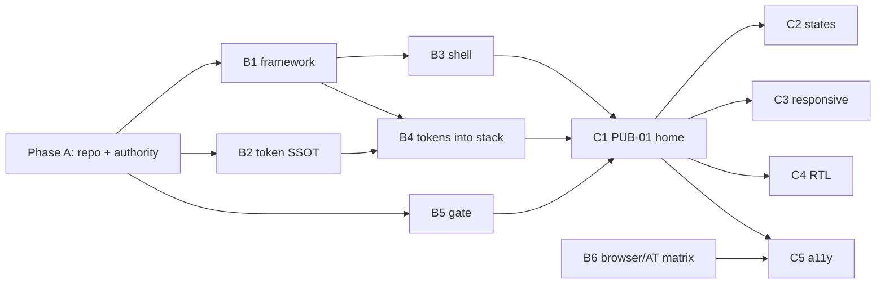

# NEXT DEVELOPMENT ROADMAP

**Date:** 2026-11-18
**Basis:** `FRONTEND-REPOSITORY-TECHNICAL-AUDIT.md`, `FIRST-DEVELOPMENT-SLICE-REPORT.md`, `FINAL-UNIFIED-AUDIT-AND-DECISION-REPORT.md`
**Scope:** three phases only. No re-audit, no new standards documents.

---

## 1. Where the Project Actually Stands

| Measure | Value |
|---|---|
| Pages planned | 227 |
| Pages implemented | 0 |
| Modules planned | 188 |
| Modules implemented | 0 |
| Application source files | 0 |
| Git repositories | 0 |
| Runnable automated gate | 1 (geo-measure, 23 tests) |
| Approved decisions | 0 |

The project is not behind on *design*. It is at zero on *implementation*, and the reason is structural rather than analytical: there is no repository to implement into.

**The critical path is therefore not "decide more things". It is "create the repository and decide the framework".**

---

## 2. Phase A — Repository and Authority

**Objective:** create the conditions in which code can exist and be rolled back.

**Owner actions (only these):**

| # | Action | Reference |
|---|---|---|
| A1 | Create the target repository at a path the owner names; `git init`; commit the existing design-system baseline as the first commit | A43 |
| A2 | Record the authority matrix | GOV-03 / A16 |
| A3 | Record the agent authority policy | GOV-08 / A17 |
| A4 | Relocate Document 04 into `brand\eco-nojin-visual-identity-v3\` | A40 (already resolved content-wise) |
| A5 | Confirm whether `experiments/geospatial-poc/geo-measure/` moves into the new repository | housekeeping |

**Why these and nothing else:** without A1 there is no diff, no rollback and no audit trail — the single most serious finding of the technical audit. Without A2 and A3, every subsequent decision is contestable.

**Dependencies:** none. All five are owner acts.

**Acceptance criteria**

- `git rev-parse --show-toplevel` returns a path inside the new repository.
- A first commit exists containing the current design-system baseline.
- A2 and A3 are recorded with an owner identifier and a date.
- Document 04 sits beside documents 01–03 and 05–37.
- The two protected directories are untouched and recorded as out of scope.

**Exit condition:** a repository exists with at least one commit.

---

## 3. Phase B — Framework and Foundation

**Objective:** make the first real application code possible.

**Prerequisite:** Phase A complete. **B01 is decidable only after A1**, because the repository contents are the evidence for the decision. With no repository, B01 would be decided on assumption — exactly what `37` §7.3 forbids.

**Work packages**

| # | Package | Depends on | Notes |
|---|---|---|---|
| B1 | Decide framework and rendering; record a technology decision record | Phase A | Recommended evidence: the empty repository plus the static design system's CSS architecture |
| B2 | Token single source of truth (fix the `tokens.css` / `themes.css` duplication) | A1 | F6 in the technical audit; needs no identity decision |
| B3 | App shell: entry, layout regions, header, navigation skeleton | B1 | First visible product code |
| B4 | Port the design-system token layer into the chosen stack | B1, B2 | No visual change intended |
| B5 | Establish the automated gate: type-check, lint, unit, build | B1 | Replace the stub `npm test` |
| B6 | Ratify browser and AT matrix | none (owner) | Gates release, not B3 |
| B7 | Address the ARIA alert gap (`role="alert"` / `aria-live`) **with** a screen-reader pass | B6 | Do not add `role="alert"` to static demo alerts without testing — it would announce all of them on load |

**Dependencies:** B3 and B4 depend on B1. B2 and B5 are independent of B1 and can start immediately after Phase A.

**Risks**

| Risk | Control |
|---|---|
| Framework chosen before the repository exists | Phase A gate |
| Rebuilding tokens in a new stack and drifting from the approved set | B2 before B4 |
| Adding ARIA live regions without AT testing, making accessibility worse | B7 requires a screen-reader pass |
| Building the shell before identity is chosen, then re-skinning | Shell must be token-driven with no hard-coded colour |

**Acceptance criteria**

- `git diff` shows the shell and no unrelated changes.
- Type-check, lint, unit tests and build all pass in CI-equivalent local commands.
- A token change alters the rendered shell without editing components.
- No colour, font or layout value is hard-coded in components.
- No visual identity decision is implied by the implementation.

**Exit condition:** an application shell that builds, tests green, and reads its appearance entirely from tokens.

---

## 4. Phase C — First Product Surface

**Objective:** deliver the first real user-facing page.

**Prerequisite:** Phase B complete. Page selection must come from the sitemap, not from convenience.

**Recommended first page:** `PUB-01` — Home (`/`), from `ECO-NOJIN-FRONTEND-SITEMAP.csv`:

| Field | Value from sitemap |
|---|---|
| `page_id` | PUB-01 |
| Nav group | Public Website |
| URL | `/` |
| Purpose | معرفی اکوسیستم و مسیرهای ورود |
| Allowed roles | public |
| Required data | none |
| States required | L; EM; ER; S (loading, empty, error, success) |
| Responsive phases | D; M; B (desktop, mobile, basic) |
| Links to | PUB-03, AUTH-02, PUB-09 |
| Phase | 1 |

PUB-01 is the correct first page because it requires **no data, no authentication and no backend**, it is in phase 1, and it is the natural host for the shared shell from B3.

**Work packages**

| # | Package | Depends on |
|---|---|---|
| C1 | Home page composition using shared components | B3, B4 |
| C2 | Loading, empty, error and success states | C1 |
| C3 | Responsive verification at 375 / 768 / 1440 | C1 |
| C4 | RTL verification with Persian content | C1 |
| C5 | Accessibility verification including a keyboard pass | C1 |
| C6 | Link targets PUB-03 and PUB-09 created as stubs with correct 404 behaviour | C1 |

**Explicitly excluded from Phase C:** AUTH-02 (needs A20), any page requiring data (needs B09/B10), any map (needs B14), any marketplace or financial page (needs A34 and separate authorization).

**Risks**

| Risk | Control |
|---|---|
| Building a data-dependent page first | PUB-01 requires no data by design |
| Scope creep into authentication | AUTH-02 excluded explicitly |
| Accessibility claimed without testing | C5 requires an actual keyboard pass; screen reader only if available |

**Acceptance criteria**

- `/` renders with the four required states.
- No horizontal overflow at 375, 768 and 1440.
- Persian content renders RTL correctly; English content LTR.
- Keyboard-only traversal reaches every interactive element with a visible focus.
- Automated gate green; no console errors.
- `git diff` reviewable and limited to the page and any shared component it needed.

**Exit condition:** one production-shaped page, tested, with evidence.

---

## 5. Dependency Chain

## 6. Decisions That Must Not Be Taken Early

| Decision | Why it waits |
|---|---|
| Colour route (A01) | Phase C must be token-driven; the route can change without touching components |
| Typography (A07, A08) | Same — swap at token layer |
| Authentication (A20) | No page in Phase C needs it |
| API contract (B10) | No page in Phase C needs it |
| CRS (B14) | No map in Phase C |
| Financial (A34) | No financial surface in Phase C |
| The remaining 26 non-blocking decisions | They gate later phases only |

**This is the mechanism that avoids rework:** identity and security decisions are deliberately deferred while the shell and first page are built entirely from tokens and states.

## 7. Summary

| Phase | Duration estimate | Owner effort | Exit condition |
|---|---|---|---|
| A | hours | 3 recorded decisions + 1 repository | repository with a first commit |
| B | days | 1 framework decision | shell that builds and tests green |
| C | days | review only | one tested page with evidence |

**The shortest path to a visible product is: create the repository, choose the framework, build the token-driven shell, then ship PUB-01.**

No further audit is required before Phase A. Further auditing without a repository would produce documents, not progress.