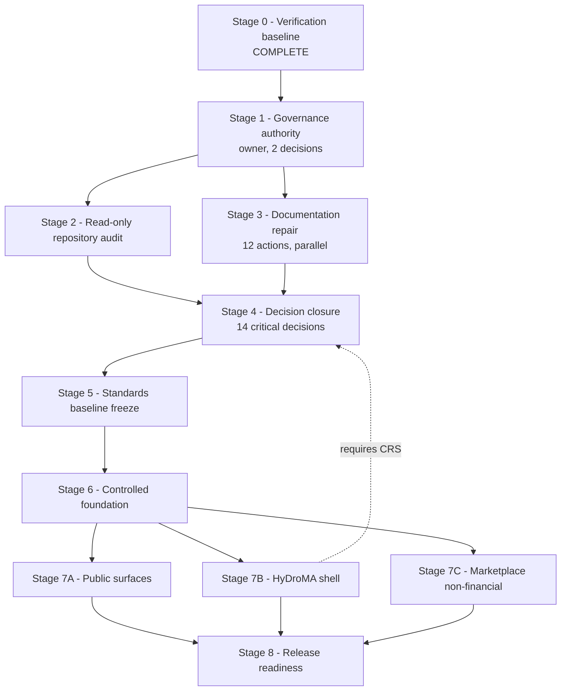

# REVISED FRONTEND READINESS ROADMAP

**Supersedes the sequencing in:** `FRONTEND-IMPLEMENTATION-ROADMAP.md` (see §1.2)
**Date:** 2026-11-18
**Status:** PROPOSED. Authorizes no implementation.

---

## 1. Why This Roadmap Replaces the Previous Order

### 1.1 The defect

The prior roadmap placed the framework decision in Phase 1 and required it to be closed before the repository baseline in Phase 2.

That is inverted. `37` §19 defines the first implementation mission as a **read-only repository audit** whose outputs include "inventory dependencies", "inspect the current frontend structure" and "identify existing reusable capabilities". Those outputs are the primary evidence for the framework decision. Requiring the decision first forces a choice on assumption.

### 1.2 What changes

| Item | Previous roadmap | This roadmap |
|---|---|---|
| Framework decision position | Stage 1, before the audit | Stage 4, after the audit |
| Repository audit | Stage 2, gated on 3 decisions | Stage 2, gated on 2 decisions (authority + target path) |
| Documentation repair | Not a distinct stage | Stage 3, runs in parallel with the audit |
| Decision closure | One block of 12 | 14 critical decisions, informed by the audit |
| Baseline freeze | Not explicit | Stage 5, explicit |
| Owner decision count | 12 | 14 critical, 61 total across the programme |

### 1.3 What stays

The layer model from `37` §8 remains correct and is retained: foundation, core architecture, shared UI, domain interfaces, advanced capabilities, quality and release. Only the *gate order* changes.

---

## 2. Stage Map

Hard arrows are gates. Stage 3 is genuinely parallel: document repair touches no code.

---

## 3. Stage 0 — Verification Baseline

| Field | Value |
|---|---|
| Status | **COMPLETE** (this mission) |
| Owner effort | none |

**Outputs**

- Seven audit deliverables verified against SHA-256.
- 480 decision entries independently reproduced; 63 clusters computed.
- 13 conflicts reclassified; 28 gaps confirmed, 5 rejected.
- 61 owner-facing decisions identified.

**Exit criteria** — met: every prior finding either confirmed or corrected with evidence.

---

## 4. Stage 1 — Governance Authority

| Field | Value |
|---|---|
| Type | Owner decision |
| Duration | 1 session |
| Owner effort | 3 decisions |

**Objectives**

- Establish who may approve what.
- Define what an agent may do without asking.
- Name the repository that is in scope.

**Decisions required**

| Ref | Decision | Why it is first |
|---|---|---|
| A16 | Governance authority model | Every later decision's legitimacy depends on it |
| A17 | Agent authority policy | Defines the boundary for all subsequent missions |
| A43 | Target repository path (no existing identifier) | The audit needs a subject |

**Prerequisites** — none.

**Outputs**

- Recorded status, owner, date and rationale for A16, A17, A43.
- Written confirmation of which directories are read-accessible.

**Dependencies** — none. This is the only stage that can start immediately.

**Risks**

- Authority left implicit → later decisions contested (`37` §15 GOV-003).
- Repository named by assumption → wrong tree audited (`GOV-004`).

**Exit criteria**

- Three recorded decisions with owner identifiers.
- `D:\HyDroMA` and `D:\eco_nojin` explicitly marked protected or explicitly authorized for read access.

---

## 5. Stage 2 — Read-Only Repository Audit

| Field | Value |
|---|---|
| Type | Technical, read-only |
| Duration | 2–5 days |
| Owner effort | none during execution; review at the end |

**Objectives** — exactly `37` §19, plus one addition:

1. Verify the target repository and record branch, commit and working-tree state.
2. Inspect the current frontend structure and entry points.
3. Inventory routes, layouts and navigation.
4. Inventory existing shared components and their reuse potential.
5. Inspect API integration and the existing client pattern.
6. Inspect authentication and authorization boundaries.
7. Inspect state management in use.
8. Inspect forms and validation in use.
9. Inspect localization and RTL/LTR support.
10. Inspect accessibility posture and existing tooling.
11. Inspect build and test infrastructure; run the existing build and tests and record actual results.
12. **Inventory the existing toolchain: framework, package manager, bundler, TypeScript config, lint rules, CSS approach.**
13. Compare observed implementation against the standards and record deltas.
14. Identify reusable capabilities and duplicated functionality.
15. Produce a prioritized, evidence-based backlog.

**What is explicitly NOT required to start this stage**

- Framework decision
- Security policy decisions
- API contract
- CRS decision
- Any design decision

None of these is needed to observe and record what exists. This is the central correction to the prior roadmap.

**Prerequisites**

- Stage 1 complete (A43 supplies the path; A17 supplies permission).

**Outputs**

- `FRONTEND-IMPLEMENTATION-BASELINE.md` (`37` DEL-06): absolute path, branch, commit, status, build command, test command, actual results, toolchain inventory.
- `FRONTEND-IMPLEMENTATION-TRACEABILITY.csv` (`37` DEL-07): provisional mapping of requirement to existing code.
- A technology findings note that **feeds** the Stage 4 framework decision with evidence instead of assumption.

**Dependencies** — Stage 1.

**Risks**

| Risk | Control |
|---|---|
| Wrong repository | Path confirmed in writing at Stage 1 |
| Existing uncommitted work lost | Before-change snapshot per `37` §10.3; read-only access |
| Audit drifts into implementation | `37` §19 states the mission is read-only unless a repair task is separately authorized |
| Protected repositories touched | Stage 1 records them as protected; audit skips them |

**Exit criteria**

- Baseline document exists with a **real** build result and a **real** test result, or an explicit "no build/test command exists" finding.
- Every backlog item cites a file path and line reference.
- Zero files modified; verified by before/after status comparison.
- The framework question can now be answered with evidence.

---

## 6. Stage 3 — Documentation Repair (parallel)

| Field | Value |
|---|---|
| Type | Editorial, no code |
| Duration | parallel with Stage 2 |
| Owner effort | 3 one-line designations |

**Objectives**

- Remove the twelve sources of ambiguity that would otherwise be inherited by implementation.

**Work items** (from `OWNER-DECISION-PRIORITY-PACK.md` §6)

| ID | Action | Owner input needed |
|---|---|---|
| DOC-01 | Designate authoritative security standard | Yes — one line |
| DOC-02 | Designate authoritative accessibility standard and acceptance set | Yes — one line |
| DOC-03 | Designate authoritative API standard | Yes — one line |
| DOC-04 | Publish one normative ApiError contract | No |
| DOC-05 | Declare component taxonomy precedence | No |
| DOC-06 | Publish document-number-to-ID map; fix parent ranges in 18, 19, 20 | No |
| DOC-07 | Adopt one metadata schema | No |
| DOC-08 | Authoring-language policy and bilingual glossary | No |
| DOC-09 | Restate decimal rule once at MUST | No |
| DOC-10 | De-duplicate state decisions between 15 and 29 | No |
| DOC-11 | Assign requirement identifiers | No |
| DOC-12 | Unify breakpoint tokens | No |

**Prerequisites** — A16 and A17, because editing standards is a governed act.

**Outputs** — a revised document set with no dangling references, one authority per duplicated domain, and stable requirement identifiers.

**Dependencies** — parallel to Stage 2; must complete before Stage 5.

**Risks**

- Editing standards without authority → contested changes. Control: A16/A17 first.
- Over-editing during repair. Control: each item is scoped to one defect in the verification CSV.

**Exit criteria**

- No document cites a file that does not exist.
- Each duplicated domain has exactly one authoritative document.
- A requirement identifier scheme exists and is applied.
- Every repair is traceable to a row in `INDEPENDENT-CONFLICT-AND-GAP-VERIFICATION.csv`.

---

## 7. Stage 4 — Decision Closure

| Field | Value |
|---|---|
| Type | Owner decisions, informed by Stage 2 evidence |
| Duration | 3–5 sessions |
| Owner effort | 14 critical decisions |

**Objectives**

- Close the 14 critical-path decisions.
- Convert the 19 group-B items from "unknown" into "recommendation ready".

**Recommended batching**

| Batch | Decisions | Evidence needed |
|---|---|---|
| Identity | A01, A07, A08, A13 | None beyond the standards themselves |
| Framework and stack | B01, B02, B03, B05, B09, B17 | **Stage 2 toolchain inventory** |
| Security | A20, A22, A24, A25, A26, A41, A42 | Backend team input on session model |
| Data and API | B10, B11, B12, B13, B09 | Backend contract agreement |
| Geospatial | B14 (incl. CRS), B15, B16 | HyDroMA input; existing map code |
| Operations | A29, A32, A35, A36, A39 | None |
| Financial | A34 | Backend financial contract; separate activation act |

**Prerequisites** — Stage 2 (for all B items), Stage 3 (for the designations).

**Outputs**

- Decisions recorded with identifier, status, owner, date and rationale in the decision register.
- A technology decision record per `37` §11.3 for each B item adopted.
- Framework-specific passages in `23` §8, `27` §6.1 and `29` §14.1 either confirmed or made framework-neutral as a consequence of B01.

**Dependencies** — Stage 2 for evidence; Stage 3 for a clean baseline.

**Risks**

| Risk | Control |
|---|---|
| Framework decided without evidence | Stage 2 must precede; B01 cannot be recorded before the toolchain inventory exists |
| Blanket approval to clear the backlog | Only 14 items are required now; the remaining 47 can stay open |
| Security decided by an agent | A17 must forbid it explicitly |

**Exit criteria**

- All 14 critical decisions recorded as a terminal status (APPROVED, REJECTED or DEFERRED with reason).
- No decision recorded without an owner identifier and a date.
- The framework decision cites the Stage 2 toolchain inventory as its evidence base.

---

## 8. Stage 5 — Standards Baseline Freeze

| Field | Value |
|---|---|
| Type | Governance |
| Duration | 1 session |
| Owner effort | approval only |

**Objectives**

- Declare a single, dated, unambiguous baseline: which documents, which versions, which decisions are binding.

**Prerequisites** — Stages 3 and 4.

**Outputs**

- A baseline manifest: document list, version, status, authoritative scope per domain.
- A frozen decision set: approved decisions only.
- An explicit list of what remains OPEN and is therefore not binding.

**Risks** — freezing too early entrenches unresolved items; freezing too late lets implementation drift from the documents.

**Exit criteria**

- Every one of the 36 documents appears with a status.
- Every duplicated domain has one authoritative document named in the manifest.
- The manifest states plainly that unapproved decisions are not binding.

---

## 9. Stage 6 — Controlled Foundation

| Field | Value |
|---|---|
| Type | Implementation (first code stage) |
| Duration | 2–4 weeks |
| Owner effort | review gates |

**Objectives**

- Build the runtime baseline, tokens, typography, i18n skeleton, lint/type/test commands.
- No product feature.

**Prerequisites** — Stage 5 baseline frozen.

**Work packages** — unchanged in content from the prior roadmap Phase 3, now correctly gated:

| WP | Scope | Gated on |
|---|---|---|
| 6.1 | Repo scaffolding, lint, type-check, test commands | B01, B19 |
| 6.2 | Design tokens at primitive and semantic tiers | A01, B17 |
| 6.3 | Three-brand theme layer | A01, B17 |
| 6.4 | Typography scale and font loading | A07, A08 |
| 6.5 | Spacing, grid, radius, elevation | B02, DOC-12 |
| 6.6 | i18n scaffolding, one language | A13, B06 |
| 6.7 | RTL/LTR baseline | A12 |
| 6.8 | Dependency inventory and lockfile | A36, B19 |

**Risks**

- Token work before identity selection → full rework. Control: A01 gate.
- Font licensing discovered late. Control: `TYPO-08` inside A08 must close before 6.4.

**Exit criteria**

- Build, lint and type-check pass on a clean checkout.
- Tokens generated from one source.
- Every token name traces to a section in `03` §15 or `06` §4.
- No product component exists yet.

---

## 10. Stage 7 — Domain Implementation (three parallel tracks)

Foundation work from Stage 6 enables three independent tracks. None of them blocks another.

### 7A — Public surfaces

Gate: Stage 6; A30 (page inventory, SEO, URL policy).
Scope: public pages, metadata, sitemap, canonical, structured data.
Additional work: specify the structured-data types and canonicalization rule (DOC-level, from GAP-231).

### 7B — HyDroMA shell and scientific surfaces

Gate: Stage 6; B13 (scientific contract); for maps, **B14 CRS must be approved**.
Scope: dashboards, KPI, charts, then scientific forms; maps and 3D only after CRS.
Critical rule: capability status must be displayed on every scientific surface (`12` §23); no chart implies computation.

### 7C — Marketplace non-financial

Gate: Stage 6; A32 (product boundary); B12 (cache/offline).
Scope: catalog, search, product detail, cart. **Payment excluded.**
Financial UI only after A34 and `D-034-17` are ratified, and activation only with a separate written authorization (`37` §12.4).

**Cross-track prerequisites:** shared components from Stage 6; routing (B05); API client (B09).

**Risks**

- 7B builds a map before CRS approval → silently wrong area figures. Control: hard gate.
- 7C drifts into payment. Control: activation is a separate authorization, not a task.

---

## 11. Stage 8 — Release Readiness

| Field | Value |
|---|---|
| Type | Verification and authorization |
| Owner effort | acceptance, then separate release approval |

**Objectives** — satisfy all 14 quality gates in `37` §14 with evidence.

**Additional work introduced by this review**

- Ratify the browser and AT matrix (A29) — required by `37` §5.2 before release requirements are final.
- Resolve Document 04 or record the waiver (A40) — required before any brand asset release.
- Confirm the accessibility acceptance authority (DOC-02) — otherwise QG-09 has no source.

**Exit criteria**

- Every gate has an evidence artefact or an explicit recorded failure.
- No gate marked passed on the basis of document existence.
- Release authorization recorded separately from acceptance.

---

## 12. What Can Start Today

| Activity | Precondition | Available now |
|---|---|---|
| Stage 0 | none | **COMPLETE** |
| Stage 1 decisions | none | **Yes** |
| Stage 2 audit | A43 path + A17 permission | Yes, after 2 recorded decisions |
| Stage 3 document repair | A16 + A17 | Yes, in parallel |
| Stage 4 identity decisions | none | Yes, but sequence after Stage 3 for a clean baseline |
| Stage 4 framework decision | Stage 2 evidence | **No — must wait** |
| Any code | Stage 5 | No |

**The single most important line in this roadmap:** the framework decision must not be taken before the repository audit. Everything else in the ordering follows from that one correction.

---

## 13. Rework Avoidance

| Potential rework | Avoided by |
|---|---|
| Framework chosen, then contradicted by existing code | Stage 2 before Stage 4 |
| Components built, then re-skinned | A01 before Stage 6 |
| Fonts swapped after licence discovery | A08 before WP 6.4 |
| API client written twice | DOC-04 + B10 before WP 6.1/7C |
| Two security policies implemented | DOC-01 before Stage 6 |
| Accessibility passing one table, failing another | DOC-02 before release gating |
| Map area figures wrong by latitude | B14 CRS before any geospatial work |
| Payment shown as successful before confirmation | A34 and `37` §12.4 gate |
| Decisions contested later | A16/A17 first |
| Requirement traceability restarted | DOC-11 before Stage 6 |

---

## 14. Stage Gate Summary

| Stage | Gate condition | Status today |
|---|---|---|
| 0 | Verification complete | **PASSED** |
| 1 | 3 decisions recorded | Not started |
| 2 | Baseline with real build and test results | Blocked on Stage 1 |
| 3 | 12 repairs closed, no dangling references | Not started |
| 4 | 14 critical decisions recorded | Blocked on 2 and 3 |
| 5 | Baseline manifest signed | Blocked on 3 and 4 |
| 6 | Build, lint, types pass; tokens from one source | Blocked on 5 |
| 7 | Each track's own gates | Blocked on 6 |
| 8 | 14 quality gates evidenced; separate authorization | Blocked on 7 |

Only Stage 1 is actionable today. Stage 2 becomes actionable after two recorded decisions.
