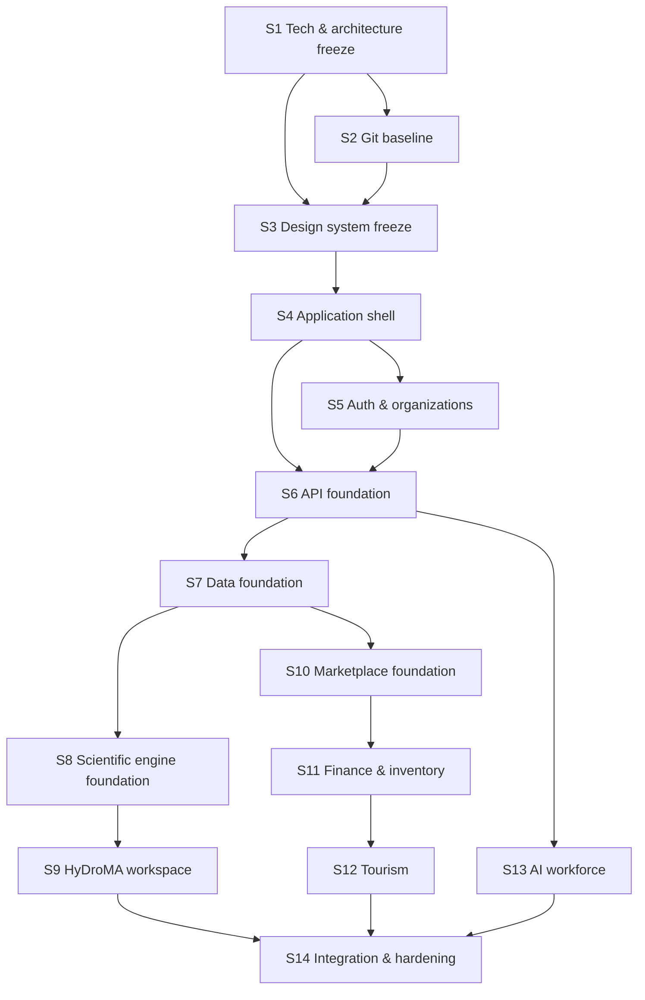

# REAL-DEVELOPMENT-ROADMAP
## نقشه شروع توسعه واقعی

**Date:** 2026-11-18
**Rule:** stages run in dependency order. Parallel work is allowed only inside a stage, never across
dependent stages. Every stage ends with evidence (command + output), not a claim.

Milestones: **M1** = shell + auth + API + data (S1–S7) · **M2** = first scientific slice (S8–S9) ·
**M3** = commerce (S10–S11) · **M4** = tourism (S12) · **M5** = governed agents + hardening (S13–S14).

---

## S1 — Architecture and technology freeze

| | |
|---|---|
| **Prerequisites** | owner availability for 4 decisions; this audit + technology proposal |
| **Deliverables** | ADRs for D-FE-01 (framework + exact version), D-04 (identity), D-ARC-02 (`app/` fate), D-PROD-01 (first slice); updated `ARCHITECTURE-DECISIONS-OPEN.md`; version pins |
| **Dependencies** | none |
| **Required tests** | none (decision stage); a written spike result for each closed decision |
| **Acceptance** | 4 ADRs in `ACCEPTED` state; no implementation starts before; framework version pinned with a rationale |
| **Main risks** | deciding D-FE-01 without the Angular comparison; choosing identity for speed and inheriting vendor lock-in |

## S2 — Local Git baseline

| | |
|---|---|
| **Prerequisites** | `.gitignore` reviewed; D-GIT-01 approved; archive/data exclusion verified |
| **Deliverables** | `git init` (no remote), first baseline commit containing code + docs only, `.gitattributes` for line endings, tag `baseline-0` |
| **Dependencies** | S1 (ignore rules may follow ADR updates) |
| **Required tests** | `git status` clean; `git ls-files | measure` shows no `node_modules`, no `*.zip`, no data payload; secret scan clean |
| **Acceptance** | a fresh clone reproduces the tree excluding deps/archives; no secret in history |
| **Main risks** | committing `app/dist`, `brand/**/node_modules`, or archives; unrecoverable if secrets enter history |

## S3 — Design system freeze (tokens + RTL + typography)

| | |
|---|---|
| **Prerequisites** | S1 (framework), S2; owner sign-off on COLOR-01/TYPO-01..06 or an explicit "provisional" label |
| **Deliverables** | `packages/design-system`: colour/type/space/radius/motion tokens as CSS variables; Persian type scale (Vazirmatn + Samim, OFL-1.1); logical-property utilities; icon mirroring rule; a11y baseline (focus rings, contrast); `packages/ui` primitives (button, input, dialog, dropdown, table, toast) with `dir` support |
| **Dependencies** | S3 blocks every UI stage |
| **Required tests** | visual regression at 1440/768/390 in fa+ar+en × light/dark; axe checks on primitives; a lint rule banning `ml|mr|pl|pr|left|right` utilities |
| **Acceptance** | a page built only from `packages/ui` renders correctly in RTL/LTR with no physical utilities; Persian numerals/dates via formatters |
| **Main risks** | designing tokens around one project's palette; skipping the lint rule and reintroducing physical utilities |

## S4 — Application shell

| | |
|---|---|
| **Prerequisites** | S3; S1 decision on `app/`→`apps/portal` |
| **Deliverables** | `apps/console` shell: nav (role-aware placeholder), org switcher placeholder, command palette, theme switch, locale switch, error/empty/loading states; `apps/portal` migration plan (or executed migration) from `app/` |
| **Dependencies** | S3 |
| **Required tests** | Playwright: navigation, locale switch (fa↔en↔ar), theme switch, keyboard focus order, mobile drawer; no horizontal overflow at 390 px |
| **Acceptance** | shell usable in all three locales/directions; zero console errors; Lighthouse a11y ≥ 95 on shell pages |
| **Main risks** | over-building navigation before roles exist (S5); duplicating the `app/` portal instead of migrating it |

## S5 — Authentication and organizations

| | |
|---|---|
| **Prerequisites** | S1 (D-04), S4 shell, S6 contracts (can start in parallel with S6's contract design) |
| **Deliverables** | `services/identity` (sessions, MFA-ready, OIDC adapter), `services/organization` (legal entity, branches, memberships, roles), `services/user-management` (profile, locale/timezone/calendar, consent); permission matrix; audit records for membership changes |
| **Dependencies** | S4, S6 (API shape) |
| **Required tests** | security tests: tenant isolation, role escalation attempts, session fixation, permission denied paths; contract tests for token claims; e2e login→switch-org→permission-visible nav |
| **Acceptance** | a user can belong to 2 orgs with different roles; every command re-checks permission server-side; audit row per mutation |
| **Main risks** | conflating identity with organization (already guarded in the architecture); client-side permission logic |

## S6 — API foundation

| | |
|---|---|
| **Prerequisites** | S1, S2; S4 (client needs a contract) |
| **Deliverables** | `services/api-gateway` (single FastAPI edge): routing, token verification, rate limits, request validation; uniform error envelope; correlation IDs; `contracts/api` OpenAPI as source of truth; generated typed client in `packages/api-client`; audit middleware |
| **Dependencies** | S5 claims shape |
| **Required tests** | contract tests (schema diff), 401/403/404/422 matrix, idempotency keys, rate-limit behaviour, OpenAPI→client generation reproducibility |
| **Acceptance** | one command regenerates the client and CI fails on drift; no endpoint exists without a contract entry |
| **Main risks** | hand-written client drifting from contract; error shapes diverging per module |

## S7 — Data foundation

| | |
|---|---|
| **Prerequisites** | S6; D-DB-01/D-DB-02 decided (or provisional with a written constraint) |
| **Deliverables** | PostgreSQL + PostGIS instance (local dev), one schema per module, organization scoping on every table, migration tooling, reference-data loader, seed **fixtures** clearly separated from real data; backup/restore script |
| **Dependencies** | S6 |
| **Required tests** | migration up/down idempotency; tenancy tests (query without org filter must fail); restore drill; seed loader idempotency |
| **Acceptance** | a migration failure cannot leave a half-applied schema; cross-tenant query returns zero rows by construction |
| **Main risks** | schema coupling between modules; treating fixtures as real data |

## S8 — Scientific engine foundation

| | |
|---|---|
| **Prerequisites** | S7; D-17 open (allowed: only the water-balance domain, which already has a validated test pattern) |
| **Deliverables** | `engines/hydroma` skeleton: execution contract schema (inputs/outputs/units/resolution), model registry entries, provenance envelope, uncertainty descriptor; **first domain: `water`** with the water-balance implementation and its validation report; job queue + worker; artefacts to object storage |
| **Dependencies** | S7 |
| **Required tests** | Pytest scientific validation with reference dataset + tolerance; unit tests for unit conversion; a run without provenance must be rejected; deterministic re-run (same seed → same output hash) |
| **Acceptance** | one water-balance run produces an artefact carrying units, model version, source, provenance and uncertainty; validation metrics reported |
| **Main risks** | adopting an upstream model without review (D-17); "numbers without provenance" |

## S9 — HyDroMA scientific workspace

| | |
|---|---|
| **Prerequisites** | S4 shell, S6 contracts, S8 engine |
| **Deliverables** | `apps/scientific-workspace`: scenario definition, run submission/monitoring, result viewer with units + uncertainty + provenance, MRV evidence view; empty/error states; RTL-safe charts |
| **Dependencies** | S8 (hard) |
| **Required tests** | e2e: define scenario → run → result with provenance panel; a11y on data tables; chart labels in fa/en/ar; long-running run survives page reload |
| **Acceptance** | a scientist can run the water-balance scenario end-to-end and export a provenance report |
| **Main risks** | UI computing values client-side; hiding uncertainty for nicer visuals |

## S10 — Marketplace foundation

| | |
|---|---|
| **Prerequisites** | S5, S6, S7; D-APP-01 (app vs module) |
| **Deliverables** | `services/marketplace` (listings, offers, order lifecycle) + `apps/marketplace` or console module; catalog reads through `contracts/api` |
| **Dependencies** | S5, S6, S7 |
| **Required tests** | order state-machine tests (illegal transition rejected), tenancy, listing review flow, e2e browse→cart→order (no payment) |
| **Acceptance** | an order can be created and tracked without any money movement; stock is only referenced, never owned |
| **Main risks** | inventing payment logic early; stock ownership leaking into marketplace |

## S11 — Finance and inventory

| | |
|---|---|
| **Prerequisites** | S10; D-INT-02 can stay deferred (invoicing without capture) |
| **Deliverables** | `services/finance` (invoices, ledgers as records, multi-currency amounts in minor units) and `services/inventory` (stock ledger, units/conversions, reservations); no payment provider |
| **Dependencies** | S10 |
| **Required tests** | money arithmetic (no floats), rounding, unit conversion, reservation conflicts, double-entry invariants, currency mismatch rejection |
| **Acceptance** | invoice totals reconcile with order lines; stock ledger balances; every mutation audited |
| **Main risks** | enabling capture/wallet prematurely; float money bugs |

## S12 — Tourism

| | |
|---|---|
| **Prerequisites** | S11 (finance/inventory), S5, S6 |
| **Deliverables** | `services/tourism` (properties, availability, bookings, rate rules) + `apps/tourism` or console module; calendar handling (Jalali/Gregorian), timezone-correct availability |
| **Dependencies** | S11 |
| **Required tests** | availability edge cases (DST, timezone, overlap), cancellation policy math, calendar conversion tests, tenancy |
| **Acceptance** | a booking cannot double-book a unit across timezones; price breakdown matches finance invoice |
| **Main risks** | date/time bugs across calendars; rate math drifting from finance |

## S13 — AI workforce

| | |
|---|---|
| **Prerequisites** | S6, S7; D-AI-01; audit + approval UX from S4 |
| **Deliverables** | `engines/ai-workforce`: model-gateway (provider abstraction, redaction, cost caps), agent-registry (definitions, versions, tool allowlists), run orchestration with durable queue, human approval gates, append-only run log |
| **Dependencies** | S6, S7 |
| **Required tests** | tool-policy enforcement (agent cannot call a disallowed tool), redaction tests, cost-cap enforcement, audit completeness (every tool call logged), approval-required paths |
| **Acceptance** | an analyst agent answers a question using read-only tools, with full audit and zero write capability; no financial tool exists |
| **Main risks** | prompt-injection through tool outputs; silent cost growth; permission creep |

## S14 — Integration and hardening

| | |
|---|---|
| **Prerequisites** | M1–M4 |
| **Deliverables** | integration adapters (satellite/weather/geospatial) with licence records; performance budgets; security review; backup/restore drill; observability; release checklist |
| **Dependencies** | S9, S12, S13 |
| **Required tests** | load test on critical paths, security scan (SAST/DAST-lite), restore drill, licence audit of every dataset, full e2e suite in CI |
| **Acceptance** | every dataset has licence + checksum; SLOs defined; restore verified; no high-severity finding open |
| **Main risks** | integration licence violations; performance regressions discovered late |

---

## Cross-cutting gates (apply to every stage)

| Gate | Rule |
|---|---|
| RTL/i18n | any UI change ships with fa/ar/en + RTL screenshots; physical CSS utilities are lint-blocked |
| Security | every mutation audited; tenancy test added with the feature |
| Scientific | any numeric output carries units, model version, provenance, uncertainty |
| Evidence | stage closes only with command output or screenshots attached |
| Scope | no payment, wallet, token, financial agent, Docker, database provisioning outside its stage |

## Suggested sequencing caution

Do **not** run S9 and S10 in parallel: they both consume the shell and the API, and the scientific
slice is the differentiator (D-PROD-01 recommendation). Do **not** start S13 before S6/S7 close —
agent audit without a real audit trail is theatre.
