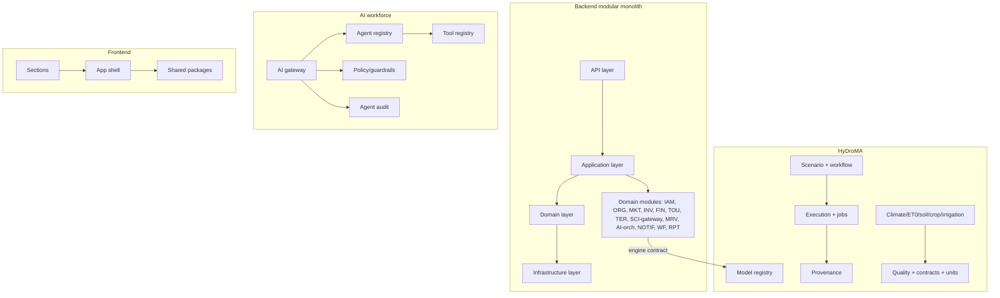

# C3 — Component Diagram

**Status:** SCAFFOLDED. Component organization inside the backend, engine, AI and frontend. `[ ]` =
planned; `[[ ]]` = exists. This is a boundary view, not a code map.

## Layer responsibilities (backend)

- **API layer:** transport, request validation, auth, rate limit, request id. No business rules.
- **Application layer:** use-case orchestration, transactions, audit emission.
- **Domain layer:** business rules and invariants; the home of truth.
- **Infrastructure layer:** persistence, engine gateway client, adapters, messaging.
- **Modules:** one owner per schema; cross-module only via contracts/events.

## Rule

Business rules live in the domain layer, never in the API or the frontend. Modules do not reach into
another module's internals (F4).