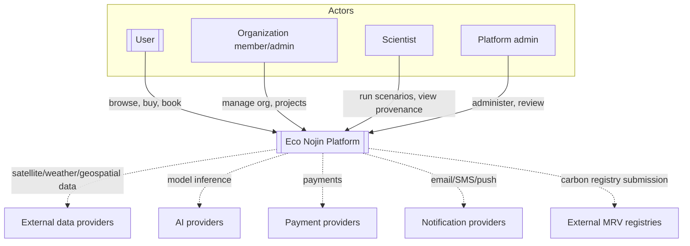

# C1 — System Context

**Status:** SCAFFOLDED. Context diagram. Solid = existing; dashed = planned. Boxes in `[[ ]]` exist.

## Notes

- Users, organizations, scientists and admins are **actors**, not components.
- External providers are **outside** the system boundary and are reached only through adapters
  (dashed = planned; none active).
- The platform is a single system; its internal containers are in the C2 diagram.