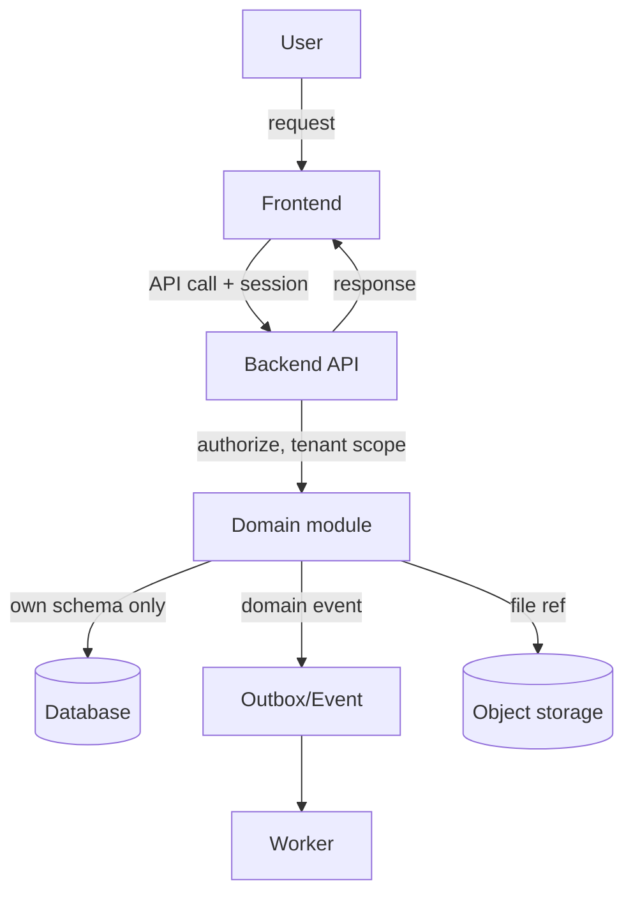
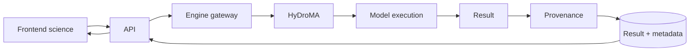

# Data Flow

**Status:** SCAFFOLDED. Describes how data moves through the system, the trust/processing zones, and
the scientific run lifecycle. Zones are defined in `data/README.md`; scientific provenance in
`engines/hydroma/README.md`.

## 1. Data trust zones (data/README.md)

```
raw (immutable, checksummed)
  → processed (reproducible from raw + code)
  → reference (versioned, licensed)
  → {geospatial, climate, hydrology, soil, agriculture, remote-sensing}
  → scientific-models (params + provenance)
  → fixtures (synthetic, labelled)   [never mixed with real]
metadata (checksums, licences, provenance) required for every dataset
```

Mixing trust levels is a defect. Real / sample / synthetic / simulated data must be distinguishable
by path/filename.

## 2. Operational data flow (target)



- Every write is tenant-scoped and audited (actor, org, before/after, correlation id).
- Files: metadata + ref in DB; bytes in object storage.

## 3. Scientific run lifecycle (target flow; engine part implemented)



Distinguish **existing** vs **planned** connections:

- Existing (software-tested, local): `HyDroMA` model execution → result → provenance (SHA-256) →
  in-memory/SQLite job store. Frontend reaches via `hydroma-client` to an explicit base URL.
- Planned: API → engine gateway as the *only* backend path; durable result store; scheduling;
  distributed workers.

## 4. Provenance & integrity

Every completed scientific run carries a `ProvenanceRecord` (schema_version, model id/version, code
version, input/result SHA-256, parameter hash, environment, operator, software maturity, scientific
status). A hash proves integrity/reproducibility, **not** scientific correctness.

## 5. Maturity reminder

Data flow existing ≠ validated. Software `tested` ≠ scientifically `VALIDATED`. See
[architecture-status.md](./architecture-status.md).