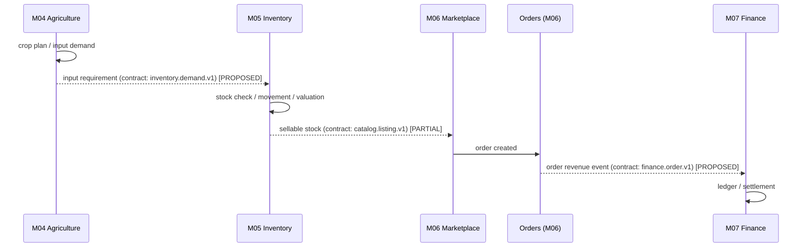
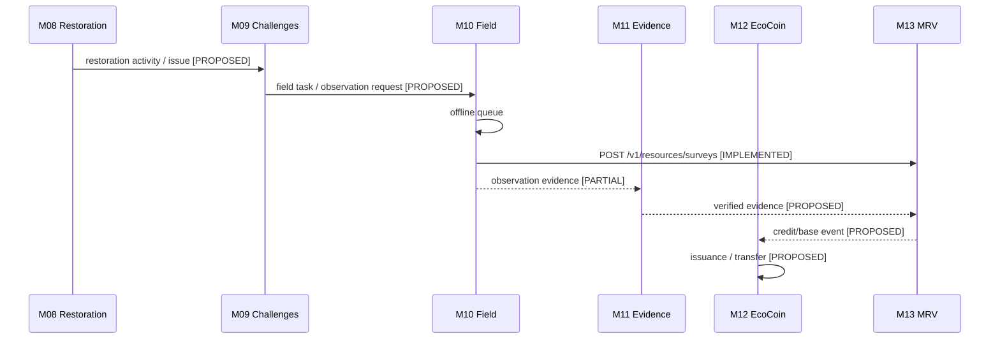
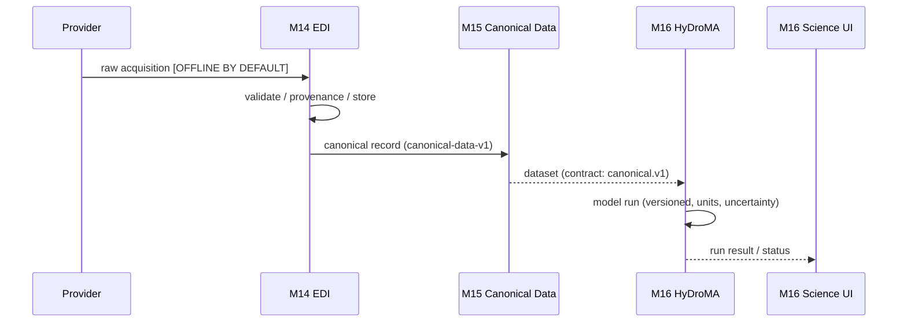
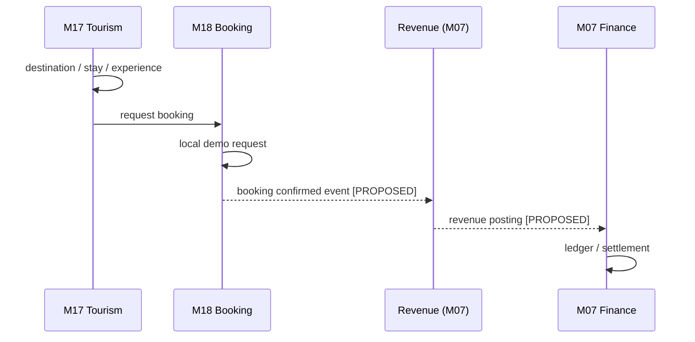
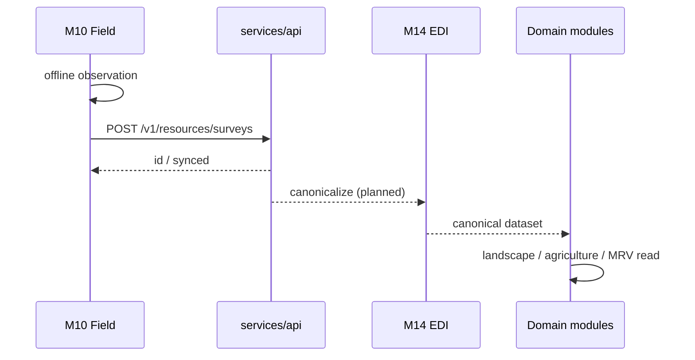

# Cross-Module Flows

**Document ID:** `ECO-NOJIN-FE-FLOW-007`
**Status:** Target flows + current implementation status
**Verified:** 2026-11-23 · HEAD `3dbd465`

> A cross-module flow is a sequence of module responsibilities connected by **contracts**. It does not mean one module imports another module's code or reads its tables. Where a step is not implemented, the flow is marked **BLOCKED** and the missing module is named.

---

## 0. Flow status summary

| Flow | Status | Implemented today | Missing |
|---|---|---|---|
| F1 Agriculture → Inventory → Marketplace → Finance | BLOCKED | Agriculture pages, market catalog/cart, finance pages | M05 Inventory, real agriculture writes, order/ledger contracts |
| F2 Restoration → Challenges → Field → Evidence → EcoCoin → MRV | PARTIAL | M08 pages, M10 field + real sync, M13 pages | M09 Challenges, M11 evidence store, M12 EcoCoin, baseline engine |
| F3 EDI → Canonical Data → HyDroMA | BACKEND_ONLY | EDI canonical schema/storage; HyDroMA engine + client | Frontend contract adapter, EDI live acquisition, engine run wiring |
| F4 Tourism → Booking → Revenue → Finance | PARTIAL | M17 content, M18 local booking, M07 pages | Availability, payment, revenue posting |
| F5 Field → EDI / Domain Data | PARTIAL | M10 local queue + `POST /v1/resources/surveys` | EDI canonicalization, domain read model |

---

## 1. F1 — Agriculture → Inventory → Marketplace → Finance

### 1.1 Sequence

### 1.2 Current state

| Step | Status | Evidence |
|---|---|---|
| Agriculture pages | PARTIALLY_EXISTING | `/platform/agriculture/*` 10 pages; local content. |
| Input demand → inventory | ABSENT | M05 Inventory is `PROPOSED`. |
| Inventory → marketplace stock | ABSENT | Market catalog is content-backed; no stock contract. |
| Order → finance | ABSENT | Orders are local demo records; no revenue event. |
| Finance ledger | ABSENT | `/platform/finance/*` pages are local placeholders. |

### 1.3 Contracts needed

- `inventory.demand.v1` (agriculture → inventory)
- `catalog.listing.v1` (inventory → marketplace)
- `finance.order.v1` (order → finance)
- Money is minor units + ISO currency (`@eco-nojin/domain-types/money`).

### 1.4 Owner decisions

- Inventory valuation method (weighted average / FIFO / specific).
- Whether marketplace stock is reserved at order time.
- Revenue recognition and settlement rules.

---

## 2. F2 — Restoration → Challenges → Field → Evidence → EcoCoin → MRV

### 2.1 Sequence

### 2.2 Current state

| Step | Status | Evidence |
|---|---|---|
| Restoration project pages | PARTIALLY_EXISTING | `/platform/projects/*`, `/platform/mrv/restoration`. |
| Challenges | ABSENT | M09 `PROPOSED`. |
| Field task assignment | ABSENT | M10 is a manual observation form. |
| Field sync | IMPLEMENTED | `POST /v1/resources/surveys`, status from API. |
| Evidence register | PARTIALLY_EXISTING | `/platform/mrv/provenance`, `/verification` pages; no evidence store. |
| EcoCoin | ABSENT | M12 `PROPOSED`; definition is owner decision D-15. |
| MRV report/credit | PARTIALLY_EXISTING | `/platform/mrv/*` pages; no registry credit issuance. |

### 2.3 Contracts needed

- `restoration.activity.v1`
- `field.task.v1`
- `evidence.record.v1` (hash, method, uncertainty, verifier)
- `mrv.credit.v1` (only after methodology and registry approval)

### 2.4 Non-negotiable rule

No EcoCoin or carbon-credit issuance may be inferred from a field observation. MRV must include method, uncertainty, provenance and an approved registry. The platform must not claim credits it cannot verify.

---

## 3. F3 — EDI → Canonical Data → HyDroMA

### 3.1 Sequence

### 3.2 Current state

| Step | Status | Evidence |
|---|---|---|
| EDI service | BACKEND_ONLY | `services/edi`, canonical SQLite/Parquet, security, tests. |
| Canonical schema | IMPLEMENTED | `services/edi/edi/schemas/canonical-data-v1.schema.json`. |
| Live acquisition | DISABLED | Offline by default; security gate + owner approval required. |
| HyDroMA engine | IMPLEMENTED | `engines/hydroma` (Python/FastAPI), independent. |
| Frontend model registry | IMPLEMENTED | `/science/models`, `useHydromaModels`; explicit unavailable state. |
| EDI → HyDroMA adapter | ABSENT | No code connects canonical records to engine datasets. |
| Frontend EDI contract view | PROPOSED | `/platform/integrations/edi` not implemented. |

### 3.3 Independence rules

- EDI must not import HyDroMA, and HyDroMA must not import EDI.
- The frontend must not import either Python package.
- The only integration is a versioned canonical contract plus an adapter.
- Every result must carry units, model version, dataset id/version, provenance and uncertainty.

### 3.4 Conflict

`services/edi/` is untracked in Git (`?? services/edi/`). The code exists on disk but is not reproducible from the repository. See C-08.

---

## 4. F4 — Tourism → Booking → Revenue → Finance

### 4.1 Sequence

### 4.2 Current state

| Step | Status | Evidence |
|---|---|---|
| Tourism content | PARTIALLY_EXISTING | `/tourism/*`; content-backed destinations/stays. |
| Host gate | IMPLEMENTED | Real business-org session. |
| Booking request | PARTIALLY_EXISTING | Local `eco.tourism.bookings`; no availability lock. |
| Payment | ABSENT | Explicitly disabled. |
| Revenue event | ABSENT | No finance contract. |
| Finance ledger | ABSENT | `/platform/finance/*` local pages. |

### 4.3 Contracts needed

- `tourism.availability.v1`
- `tourism.booking.v1`
- `finance.revenue.v1`

### 4.4 UI rule

The booking UI must keep the explicit “demo request / payments not enabled” label. It must never imply a confirmed reservation or a paid order.

---

## 5. F5 — Field → EDI / Domain Data

### 5.1 Sequence

### 5.2 Current state

| Step | Status | Evidence |
|---|---|---|
| Offline queue | IMPLEMENTED | `localStorage` `eco.field.observations`. |
| Real sync | IMPLEMENTED | `POST /v1/resources/surveys`; API status. |
| EDI canonicalization | ABSENT | No adapter. |
| Domain read model | ABSENT | Domain pages use local registry content. |

### 5.3 Required fields for canonicalization

A field observation must carry: `siteName`, `notes`, `collectedAt`, `organizationId` (server-derived), plus optional coordinates, method, sensor, unit and uncertainty. Without these it cannot become a canonical EDI record.

---

## 6. Flow governance

1. **Contract first** — a flow is not implemented until its contract is versioned.
2. **No table sharing** — modules read through contracts, not SQL.
3. **Provenance is mandatory** — every scientific/economic event carries source, method, unit, uncertainty.
4. **Human approval** — credit issuance, payments and deletions require an authorized human.
5. **Explicit failure** — a missing module blocks the flow; it is never replaced by demo data.

---

## 7. References

- [module-registry.json](./module-registry.json)
- [MODULES_AND_ROUTES.md](./MODULES_AND_ROUTES.md)
- `architecture/ECO-NOJIN-DATA-DOMAIN-MODEL.md`
- `architecture/HYDROMA-SCIENTIFIC-ENGINE-ARCHITECTURE.md`
- `services/edi/README.md`
- `services/edi/edi/schemas/canonical-data-v1.schema.json`