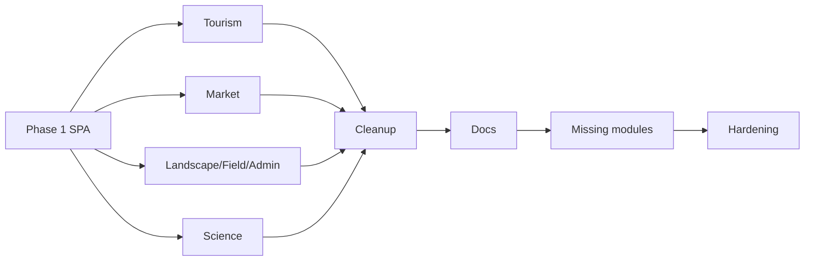

# Migration Plan

**Document ID:** `ECO-NOJIN-FE-MIG-008`
**Status:** Phases 0–7 complete; phase 8 (documentation) in progress; later phases proposed
**Verified:** 2026-11-23 · HEAD `3dbd465`

> The migration is incremental and reversible. No phase authorises deleting a legacy app, changing the API contract, or deploying. Owner approval is required at the marked stop points.

---

## 1. Where we are

| Phase | Scope | Status | Evidence |
|---|---|---|---|
| 0 | Real API, real session, field app, Python engine | COMPLETE | `services/api`, `packages/auth-client`, `engines/hydroma` |
| 1 | Platform SPA + public core + login + five-env | COMPLETE | `apps/platform` |
| 2 | Registry v2 + `check:apps` + docs | COMPLETE | `packages/configuration/apps.json` |
| 3 | Tourism section at `/tourism` | COMPLETE | `sections/tourism` |
| 4 | Marketplace section at `/market` (hybrid catalog) | COMPLETE | `sections/market` |
| 5a | Landscape at `/landscape` | COMPLETE | `sections/landscape` |
| 5b | Field at `/landscape/field` with real sync | COMPLETE | `sections/landscape/field` |
| 5c | Admin at `/landscape/admin` | COMPLETE | `sections/landscape/admin` |
| 5d | Profile/security in public core | COMPLETE | `src/public/app/AccountPage.tsx` |
| 6 | Science at `/science` + `GET /v1/runs` | COMPLETE | `sections/science`, `services/api` |
| 7 | Archive legacy apps, budget gate, SPA-only host | COMPLETE (folders archived) | `archive/legacy-*`, `check:bundle` |
| 8 | Architecture documentation + registries | IN PROGRESS | this document set |
| 9 | Missing modules (M05, M09, M12, M14/M15 integration) | PROPOSED | — |
| 10 | Production hardening (MFA, rate limit, CSRF, permission handles) | PROPOSED | — |

Current runtime:

```text
apps/platform  (only product SPA)
apps/brand     (design sandbox)
archive/legacy-{console,marketplace,tourism,field-collection,scientific-workspace}
```

---

## 2. Migration principles

1. **One route tree** — the platform router is the only router.
2. **One session** — the root `RealSessionProvider`; sections consume it.
3. **Same-origin** — `/api` only; no absolute session API URL.
4. **Contract before capability** — no cross-module table access.
5. **No fake data** — unavailable is labelled, never simulated.
6. **Reversible** — legacy code stays in `archive/legacy-*`; no destructive git operations.
7. **One work package per commit** — only with owner approval.

---

## 3. Phase details and exit criteria

### Phase 3 — Tourism

- **Dependency:** phase 1.
- **Work:** move pages/content/store; internal section; root session; host gate.
- **Exit criteria:** `/tourism` e2e + a11y green; section chunk under budget; `verify` green.
- **Status:** COMPLETE.

### Phase 4 — Marketplace

- **Dependency:** phase 1; owner catalog decision.
- **Work:** 12 routes; sellers from API; catalog content-backed; local cart/orders.
- **Exit criteria:** `/market` e2e + a11y; explicit payment-disabled label; `verify` green.
- **Owner stop:** catalog content vs API vs hybrid. **Decision:** hybrid.
- **Status:** COMPLETE.

### Phase 5 — Landscape, field, admin, account

- **Dependency:** phase 1; API resources.
- **5a:** landscape pages from `PAGES` to `/landscape`.
- **5b:** field queue + `POST /v1/resources/surveys`; statuses from API.
- **5c:** console → `/landscape/admin`; identity/users/notifications.
- **5d:** profile/security in public core.
- **Exit criteria:** landscape/field/admin/account e2e + a11y; field sync test; `verify` green.
- **Owner stop:** phase 5 staging. **Decision:** step-by-step.
- **Status:** COMPLETE.

### Phase 6 — Science

- **Dependency:** HyDroMA engine; `hydroma-client`.
- **Work:** 13 routes; lazy pages; explicit unavailable; `GET /v1/runs`.
- **Exit criteria:** `/science` e2e + a11y; engine-down state; API test.
- **Status:** COMPLETE.

### Phase 7 — Cleanup and budget

- **Dependency:** phases 3–6.
- **Work:** archive legacy apps; skip archived in build/dev/serve; bundle budget gate.
- **Exit criteria:** registry only `platform`/`brand`; `check:bundle` in `verify`; no archived app served.
- **Owner stop:** deleting/moving app folders. **Decision:** approved; folders under `archive/legacy-*`.
- **Status:** COMPLETE.

### Phase 8 — Documentation (current)

- **Work:** this document set + JSON registries.
- **Exit criteria:** 10 documents present; JSON parses; route/module counts verified; no source change.
- **Owner review:** required before any implementation phase resumes.

---

## 4. Phase 9 — Missing modules (proposed)

Order by dependency:

| Step | Module | Prerequisite | Exit criteria |
|---|---|---|---|
| 9.1 | M05 Inventory | M04 agriculture data contract | stock, movement, valuation pages; API; e2e |
| 9.2 | M09 Challenges | M08 restoration | challenge CRUD; link to field tasks |
| 9.3 | M11 Evidence | M13 MRV | evidence register, hash, verifier |
| 9.4 | M07 Finance ledger | M05/M06/M18 | double-entry, revenue events, reconciliation |
| 9.5 | M12 EcoCoin | M07/M11/M13 + owner token decision | wallet, issuance, transfer; legal review |
| 9.6 | M14/M15 integration | EDI live acquisition approval | canonical adapter; frontend contract view |

**Owner stop before 9.5:** EcoCoin/HIC definition and token economics (D-15).
**Owner stop before 9.6:** EDI live acquisition (security gate + provider authorisation).

---

## 5. Phase 10 — Production hardening (proposed)

| Area | Work | Acceptance |
|---|---|---|
| Session | refresh rotation, absolute timeout, revocation list | security test |
| CSRF | token or strict origin check | security test |
| Rate limiting | login/register/mutation | load test |
| MFA | TOTP/WebAuthn for privileged roles | security test |
| Permission handles | every protected workspace route | route audit |
| Audit | query/export for every mutation | audit test |
| Observability | OpenTelemetry traces, RED metrics | dashboard |
| Backup/DR | RPO ≤ 15 min, RTO ≤ 60 min | restore drill |

These are **not implemented**; they are target criteria.

---

## 6. Dependency graph



---

## 7. Risks and mitigations

| Risk | Impact | Mitigation |
|---|---|---|
| `/platform` not gated | Tenant data exposure when added | add session+permission handles before data (C-01/C-06) |
| HyDroMA absolute loopback | Breaks in deployment | proxy `/hydroma` or make base same-origin (C-04) |
| EDI untracked | Not reproducible | owner decision to commit |
| Missing inventory/finance contracts | Flows F1/F4 blocked | phase 9 contract-first |
| EcoCoin undefined | Legal/financial risk | owner decision D-15 |
| Legacy folders still present | Confusion, dead code | phase 7 complete; final removal approved |
| i18n hi/ko fallback | Apparent 15 locales but en content | native translation or disable locale (C-09) |
| Public content 3 unused | Duplicate content | remove or render (C-02) |

---

## 8. Rollback

- Each phase is a commit; revert the commit to restore the previous runtime.
- Legacy apps in `archive/legacy-*` can be restored to `apps/` only by an explicit owner-approved change.
- No destructive git operation is part of the migration.

---

## 9. Definition of done for the migration

1. One SPA, one origin, one session, one router.
2. All 18 modules documented; existing routes marked EXISTING/PARTIALLY_EXISTING; proposed routes marked PROPOSED.
3. Every capability either implemented or explicitly unavailable.
4. `verify` green, including `check:bundle`.
5. Owner approval for any deletion, deployment, or financial capability.