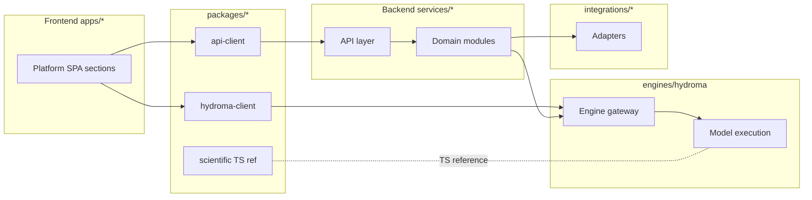
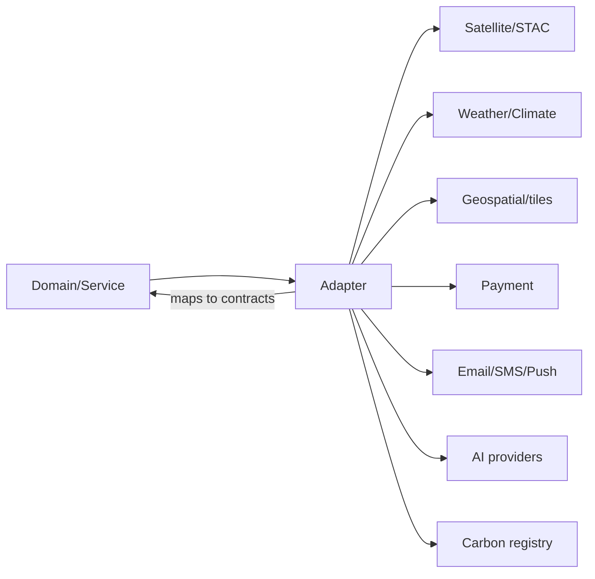

# Integration Map

**Status:** SCAFFOLDED. Shows how components integrate and through which contract. Depth lives in
`architecture/LANDSCAPE-API-CONTRACTS.md`, `architecture/HYDROMA-SCIENTIFIC-ENGINE-PHASE1-IMPL-CONTRACT.md`,
and the registries. This map is the cross-component view.

## 1. Internal integration (contract-mediated)

- Frontend → backend: `contracts/api` via `api-client`.
- Frontend → science: `hydroma-client` → engine gateway (never direct).
- Backend → engine: engine gateway with `contracts/scientific-models`.
- Domain → external: adapter in `integrations/`.

## 2. External integration (adapter-mediated)

Every arrow is outbound-only from the system's perspective; adapters own auth, retry, rate limit,
health and provenance. No provider is a direct dependency of core logic (F7).

## 3. Event integration (future, lightweight)

- Domain modules emit events from `contracts/events`; consumers are idempotent.
- Prefer an outbox + internal dispatcher initially; Kafka/RabbitMQ only on measured need (P6).
- See [events/README.md](./events/README.md).

## 4. Integration status

All external integrations are PLANNED (no credentials, no live calls). Internal frontend↔backend and
frontend↔engine paths exist in demo/local form. See
[registries/integration-registry.md](./registries/integration-registry.md) and
[architecture-status.md](./architecture-status.md).